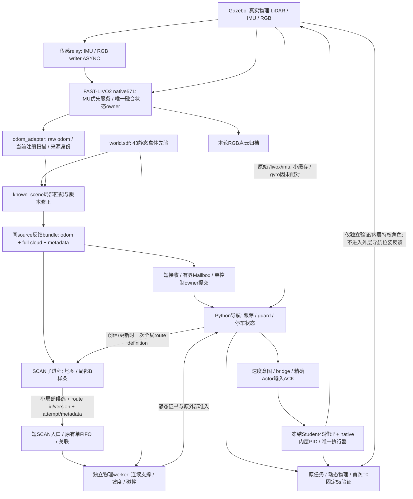

# 当前数据流和进程边界

## 关键接口

|主题或数据|发布/生产→消费|意义|
|---|---|---|
|`/livox/imu`|仿真传感→SLAM relay、控制独立raw IMU订阅/安全缓存、任务审计|200Hz源约5ms；SLAM用过某IMU不等于Python控制器已take/回调/缓存该样本|
|`/demo/teacher/slam/imu`、`/demo/teacher/slam/image`|relay→FAST-LIVO2|与raw输入保留原stamp，异步仅改变writer发布方式|
|`/demo/slam/raw_body_odom`、raw_lidar_odom、raw_registered_full|原生适配→known_scene|未完成场景辅助修正的实际估计/扫描|
|`/demo/slam/body_odom`、`/cloud_registered_full`、`/demo/navigation/localization_bundle`|场景辅助链→控制器|需相同source/generation的业务组包；全云仍用于障碍安全|
|`/demo/navigation/route_definition`|全局路线/SCAN→关联层|RELIABLE/TRANSIENT_LOCAL/KEEP_LAST1的请求；以实际writer/加载回执为准；只在创建/更新定义时传完整全局参考|
|`/demo/navigation/bspline`、reference_attempt、trajectory_metadata|SCAN→短入口→关联/物理worker→单owner提交|局部曲线与ID/version/序号/stamp；必须保留attempt失败、负事件、版本和事务次序|
|`/clock`|仿真→ROS时钟服务→各准入/控制|仿真时间；墙钟/线程CPU/单调驻留另计。未来帧不直接有效，R99 OFF|
|命令原件/compact evidence/Actor ACK|controller/bridge→唯一执行器与独立审计|发零不等于身体已停，停车要实际输入ACK和固定窗测量|

## 排队与CPU的解释边界

数据生成→publish入口/返回→RMW可取/take→Python回调→应用入队→关联/worker→控制提交是不同时间边界。应用接收后等待不能称“网络传输”；publish返回也不是远端消费完成。Python线程共享当前解释器GIL/GC，更多线程不自动保证实时；独立worker有独立地址空间，但仍争用同主机CPU/带宽且IPC有开销。

formal22 controller现成440个采样窗439.390墙钟秒/407.880CPU秒，约92.829%单核。41证书/45patch使用新地形依据，不能据此称全链CPU或尾延迟问题根治。两条实际22曲线在旧策略细分后也通过，较浅细分不等于证明整轮通过唯一因果。
