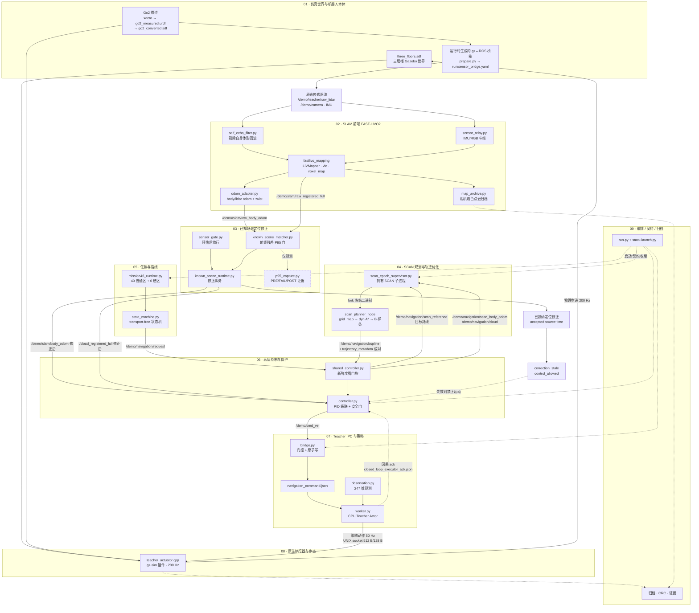
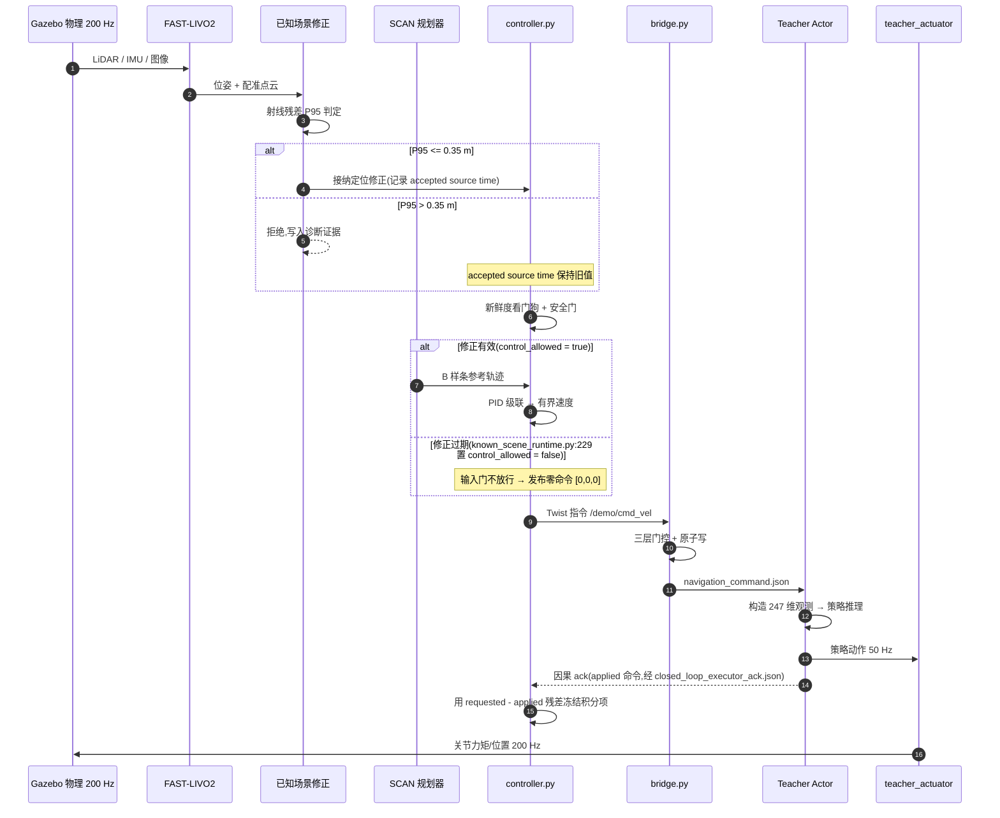
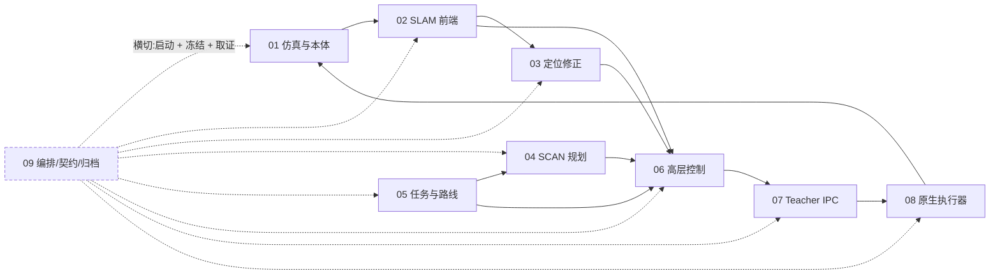

# 00 · 总体数据流与模块划分

> 仓库: `Fast-Livo2-SCAN-Gazebo-dog-sim-control` @ `study/go2-core-20261010` (`2331b93`)
> 快照性质: C44 Go2 核心源码学习快照,独立根提交,不继承主分支实验数据历史
> 本文是**总览**;每个模块的内部讲解见 `01`–`09` 独立文件

---

## 1. 怎么读这套文档

这套文档分两层:

| 层次 | 文件 | 回答的问题 |
|---|---|---|
| **总体** | 本文 `00-overview-dataflow.md` | 系统由哪些模块组成?数据从哪流到哪?代码结构怎么分层? |
| **分模块** | `01`–`09` 各一个文件 | 这个模块内部怎么实现的?关键文件、符号、参数、边界在哪里? |

> **重要前提**:本快照是"学习材料",**不能直接复现原运行**。模型权重、机器人 DAE 资产、安装库、原始运行记录、冻结与运行授权 metadata 均未提供;源码目录内有文件 ≠ 属于源材料。
>
> 具体到执行层:第一次运行会在**缺失的冻结契约与工作区**上直接失败 —— 权重是外部依赖且 `MODEL_SHA=''`(`run.py:50-51`),即使补上权重也会在哈希门上失败;此外还缺 `R33_SHORT_STARTUP_CONTRACT.json`、`STORAGE_SESSION.json`、两个 workspace 的 `build/install`、`policy/worker.py`、`runs/acceptance.json` 等。**"不能一键复现"是设计使然,不是缺陷**。逐条清单见 [09 号文档](09-runtime-orchestration-and-archive.md) 第 9 节。

本文中的所有图都用 Mermaid 书写,在 GitHub 上可直接渲染。若在本地编辑器里看,需要支持 Mermaid 的插件。

---

## 2. 一句话概括这个系统

> **一只 Unitree Go2 四足机器狗,在 Gazebo Harmonic 的三层楼场景里,用 FAST-LIVO2 做传感器 SLAM、用提供的场景地图做定位修正、用 SCAN 规划器生成 B 样条轨迹,由高层控制器输出速度指令,再经过一个 CPU Teacher Actor 转成关节动作,最终由原生 gz-sim 插件以 200 Hz 驱动关节。**

这条链路上有一个关键的**认知边界**必须先讲清楚:

- 高层导航(SLAM + 规划 + 控制)确实**没有使用机器人真值位姿**;
- 但**地图不是本轮传感器独立建立的** —— 它由外部提供的静态场景几何辅助;
- 且低层 Teacher 的 247 维输入中,**232 维是 privileged 仿真状态/高度信息**(来自 Gazebo COM 速度、姿态、关节物理、力矩和静态 SDF 地形查询)。

所以"高层没用 GT pose"**不能**推广为"全链路无真值"。这是本仓库最容易误读的一点。

---

## 3. 模块划分(共 9 个)

| # | 模块 | 分册 | 一句话职责 | 主要代码位置 |
|---|---|---|---|---|
| 01 | 仿真世界、机器人本体与传感器接入 | [01](01-simulation-and-robot.md) | 生成三层楼世界与 Go2 描述,把 Gazebo 传感器数据桥进 ROS 2 | `go2_sim_control/`, `multifloor_demo/simulation/` |
| 02 | SLAM 前端(FAST-LIVO2 + Vikit) | [02](02-slam-frontend.md) | LiDAR/IMU/相机三路融合,输出实时位姿与配准点云 | `multifloor_demo/slam/`, `slam5_navigation/` |
| 03 | 已知场景定位修正与时空关联 | [03](03-known-scene-localization.md) | 用提供的地图做定位修正,以射线残差 P95 决定接纳/拒绝 | `ENG/known_scene_*.py`, `ENG/spatial_reference.py` |
| 04 | SCAN 规划与轨迹优化 | [04](04-scan-planning.md) | 栅格地图 → A\* 前端 → B 样条后端 → 轨迹消息 | `multifloor_demo/navigation/ros2_ws/`, `scan_multifloor/` |
| 05 | 任务状态机、路线分区与 46 区协调 | [05](05-mission-and-route.md) | 40 个普通区 + 6 个硬区的任务编排与通过判定 | `multifloor_demo/mission/`, `ENG/mission46_*.py` |
| 06 | 高层控制、轨迹跟踪与安全保护 | [06](06-high-level-control.md) | 把参考轨迹变成有界速度指令,并在定位失效时禁止运动 | `ENG/controller.py`, `ENG/shared_controller.py` |
| 07 | Teacher IPC 桥接、策略观测与执行 | [07](07-teacher-bridge-and-policy.md) | 速度指令经原子 JSON 文件交给 CPU Teacher Actor | `ENG/bridge.py`, `ENG/worker.py`, `teacher_mode/policy/` |
| 08 | 原生执行器、步态与运动学 | [08](08-native-actuator-and-gait.md) | 50 Hz 策略动作 → 200 Hz 关节物理 | `teacher_mode/simulation/native/current/` |
| 09 | 运行编排、冻结契约与归档证据 | [09](09-runtime-orchestration-and-archive.md) | **横切层**:run 编排、契约冻结、归档与证据 | `ENG/run.py`, `ENG/evidence_runtime_v32/`, `mission/` |

> `ENG/` = `multifloor_demo/teacher_mode/navigation/engineering_v34_r44_active_p95_capture_candidate/`
> 这个目录名保留了原版本名,是本轮实际运行的核心实现所在。

### 代码规模

| 语言 | 文件数 | 说明 |
|---|---:|---|
| Python | 108 | 运行进程、契约、归档、证据 |
| C++ 头文件 | 58 | FAST-LIVO2 core、SCAN 规划、Vikit |
| C++ 源文件 | 43 | 同上 + 原生执行器 |
| YAML / JSON | 34 | 配置与冻结契约 |
| XML / xacro / SDF / URDF | 24 | 机器人描述与仿真世界 |
| Markdown / 日志 | 5 | 仓库自带说明 |
| **合计** | **303** | 工作区约 135 MB(含 `.git`) |

---

## 4. 总体数据流图

这是本文的核心图。数据从 Gazebo 物理世界出发,经过感知、定位、规划、控制、策略、执行,最后回到物理世界闭合。



**读图要点**

1. **主链是实线**,从 `RAW` 一路到 `TW --> ACT` 再回到 `W` 闭合;**虚线是旁路**(仅观测/仅编排),不参与控制决策。
2. `STALE`(修正过期标志)对 `CTL` 的边是**虚线但语义关键** —— 它不是数据,而是"一票否决权"。本轮运行就是卡在这里。
3. 模块 09 **不在主链上**,它是横切的契约与证据层。这是有意的设计判断,理由见 [09 号文档](09-runtime-orchestration-and-archive.md)。

---

## 5. 进程拓扑:一次运行到底启动了哪些东西

本轮的进程拓扑由**三级 launch** 决定。总入口是 `run.py`:它先准备世界与配置,再用 `run.py:281` / `run.py:595` 两处 `ros2 launch stack.launch.py run_dir:=<run>` 拉起导航栈;`stack.launch.py` 再 include `slam.launch.py`。

> **注意**:Gazebo **不在**这两个 launch 文件里。世界文件由 `run.py:162-166` 生成、仿真由 `run.py:606`(`gz sim -s -r`,headless)启动、gz↔ROS 桥由 `run.py:589` 按运行时生成的 `run/sensor_bridge.yaml` 启动。下面这张图只画两个 launch 的内容。

`run.py` 自身分两个阶段(详见 [09 号文档](09-runtime-orchestration-and-archive.md)):

| 阶段 | 位置 | 做什么 | 关键点 |
|---|---|---|---|
| `prepare(run,args)` | `run.py:138-318` | **不启动任何 ROS/Gazebo**。校验 profile、选定冻结 workspace、探针 CPU 解释器、生成并改写场景资产、冻结事件采样契约、把源码快照进 `run/sources/`、写 `runtime_plan.json` | 依赖存在性与**权重哈希**在 `:150-152`;存储预算增量门在 `:309-316` |
| `execute(run,plan)` | `run.py:544-738` | 构造 ROS 环境、启存储看门狗与 guardian、复核 scope 与哈希、**按角色顺序**起 `worker → bridge → capture → navigation_stack →(可选 shadow_sampler)`、再做 SLAM/SCAN/native 的"已加载"见证、主循环看护、`finally` 归档 | 角色启动顺序在 `:583-600`;二进制见证在 `:603-605`;native 见证在 `:606-614` |

> **两个数字上的坑**(模块 09 核查):
> 1. `EXPECTED_CHILDREN=11`(`run.py:53`)只是 `launch_child_receipt` 的**默认参数**,与当前布局已不自洽(本 profile 的 launch 子进程实为 **14** 个 = stack 8 + slam 6)。运行时由 `plan['expected_launch_children']` 显式覆盖(`run.py:697`),并且 `run.py:221` 与 `pid_scope.py:195` 会**两处独立计算再交叉校验**,所以 11 不参与判据 —— 但它作为默认值仍有误导性。
> 2. **存储预算的权威值不是 profile 里那个 50 GB**。`profiles/engineering_nav46.json` 的 `whole_session_budget_bytes: 50000000000` **没有任何代码读取**;真正生效的是 `storage_guard.py` 的 **80 GB hard / 79.5 GB soft**,并且它 fail-closed、**没有任何删除代码**。

```mermaid
flowchart TD
    subgraph STACK["stack.launch.py · 有限 Teacher 导航栈(由 run.py 通过 ros2 launch 启动)"]
        direction TB
        P1["scan_epoch_supervisor.py<br/>拥有冻结的 SCAN 子进程"]
        P2["known_scene_runtime.py<br/>导航侧地图修正事务"]
        P3["sensor_gate.py<br/>传感器预热门"]
        P4["controller.py<br/>高层控制主进程"]
        P5["bridge.py<br/>IPC 门控与命令落盘"]
        P6["mission46_runtime.py<br/>或 request.py"]
        P7["mission46_obstacle_runtime.py<br/>仅 profile 要求时"]
        P8["ros_gz_bridge parameter_bridge<br/>/world/teacher_demo/set_pose"]
    end

    subgraph SLAM["slam.launch.py · 传感器到隔离 FAST-LIVO2"]
        direction TB
        S1["sensor_relay.py"]
        S2["self_echo_filter.py"]
        S3["parameter_blackboard<br/>相机参数"]
        S4["fastlivo_mapping<br/>node: laserMapping"]
        S5["odom_adapter.py"]
        S6["map_archive.py"]
    end

    STACK -->|"IncludeLaunchDescription"| SLAM
    P1 --> SCANBIN["scan_planner_node<br/>冻结 workspace 内的二进制"]
    S4 --> P2
    P4 --> P5
```



**关键设计约束**(来自 `stack.launch.py`):

- 所有子进程都被 `RegisterEventHandler(OnProcessExit(... Shutdown))` 监听 —— **任何一个子进程退出,整栈立即关闭**。这是"有限运行"(finite run)语义:没有自动重启,没有容错恢复。
- `controller.py` 是唯一被注入 `DEMO_RUN_DIR` 环境变量的进程之一。
- `bridge.py` 的启动参数直接写出两个契约文件:`--acceptance run/navigation_scope.json`、`--command-file run/navigation_command.json`。
- 动态避障相关进程(`dynamic/` 下的 mover、observer)只在 `DYNAMIC_EXPERIMENTS` 集合非空时启动 —— **本轮的 `DYNAMIC_EXPERIMENTS` 是空集**,所以动态避障链路本轮完全没有运行。这与 `docs/C44_EXPERIMENT.md` 中"本轮止于 exploring,未进入相应验收步骤"一致。

---

## 6. 关键话题与文件交接点

这是"数据到底怎么流"的最精确答案。

### 6.1 ROS 2 话题

| 话题 | 类型 | 生产者(位置) | 消费者(位置) | 说明 |
|---|---|---|---|---|
| `/demo/teacher/raw_lidar` | `PointCloud2` | **Gazebo 桥接**(运行时生成的 `run/sensor_bridge.yaml`,由 `run.py:589` 启动) | `self_echo_filter.py`、`known_scene_runtime.py:134`、`map_archive.py`、`sensor_gate.py:107` | 原始 LiDAR(**未经体形回波剔除**),雷达 64×480@30 Hz |
| `/demo/slam/lidar_filtered` | `PointCloud2` | **`self_echo_filter.py:62`** | **FAST-LIVO2**(`lid_topic`,`pid_scope.py:112`)、`known_scene_runtime.py:135` | 剔除 Go2 体形回波后的点云,SLAM 实际吃的是这一路 |
| `/demo/camera` | 图像 | 相机桥接 | FAST-LIVO2、`map_archive.py` | 图像流 |
| `/livox/imu` | `Imu` | IMU 桥接 | FAST-LIVO2(源)、`shared_controller.py:138`、`mission46_runtime.py:127` | 原始 IMU |
| `/demo/teacher/slam/imu` | `Imu` | `sensor_relay.py` | FAST-LIVO2(`imu_topic`) | 中继后 IMU |
| `/demo/teacher/slam/image` | 图像 | `sensor_relay.py` | FAST-LIVO2(`img_topic`) | 中继后图像 |
| `/aft_mapped_to_init` | `Odometry` | FAST-LIVO2 | `known_scene_runtime.py:137` | LIO 里程计(**IMU 系状态**,须经 `odom_adapter` 才是 body/lidar) |
| `/cloud_registered` | `PointCloud2` | FAST-LIVO2 | `map_archive.py` | **相机着色**点云(带 RGB) |
| `/demo/slam/raw_registered_full` | `PointCloud2` | `fastlivo_mapping`(FAST-LIVO2 的 `/cloud_registered_full` 被 `slam.launch.py:56` **重映射**到这个名字) | `known_scene_runtime.py:135` | **无 RGB 全扫描**配准点云(**未修正**)。重映射的用意是把 `/cloud_registered_full` 这个名字**腾出来**给修正模块重新发布 |
| `/demo/slam/raw_body_odom` | `Odometry` | `odom_adapter.py` | `known_scene_runtime.py:136` | 机体系位姿(**未修正**) |
| `/demo/slam/raw_lidar_odom` | `Odometry` | `odom_adapter.py` | `known_scene_runtime.py:136` | 雷达系位姿(**未修正**) |
| **`/demo/slam/body_odom`** | `Odometry` | **`known_scene_runtime.py:130`** | `shared_controller.py:135`、`bridge.py:26`、`mission46_runtime.py:123`、`request.py:181` | **修正后位姿 —— 控制用的就是它** |
| **`/cloud_registered_full`** | `PointCloud2` | **`known_scene_runtime.py:131`** | `shared_controller.py:140` | **修正后点云** |
| `/demo/navigation/localization_bundle` | `String` | `known_scene_runtime.py:132` | `known_scene_inputs.py:14`、`scan_epoch_supervisor.py:44` | 定位包 |
| `/demo/navigation/localization_status` | `String` | `known_scene_runtime.py:133` | `known_scene_inputs.py:15`、`scan_epoch_supervisor.py:43` | 定位状态 |
| `/demo/navigation/scan_body_odom` | `Odometry` | `shared_controller.py:131` | `scan_epoch_supervisor.py:45` | 送入规划器的位姿 |
| `/demo/navigation/cloud` | `PointCloud2` | `shared_controller.py:132` | `scan_epoch_supervisor.py:46` | 送入规划器的点云 |
| `/demo/navigation/scan_epoch_ready` | `String` | `scan_epoch_supervisor.py:42` | `known_scene_inputs.py:16` | 规划栅格纪元就绪 |
| **`/demo/navigation/bspline`** | `Bspline` | SCAN 规划器 | `shared_controller.py:141` | **参考轨迹** |
| `/demo/navigation/trajectory_metadata` | `String` | SCAN 规划器 | `shared_controller.py:142` | 轨迹元数据 |
| **`/demo/cmd_vel`** | `Twist` | **`shared_controller.py:125`** | **`bridge.py:27`**(`COMMAND_TOPIC`) | **速度指令黄金交接点** |
| `/demo/teacher/navigation/sensor_health` | `String` | `sensor_gate.py:13` | `bridge.py:359`、`mission46_runtime.py:128` | 传感器健康门 |
| `/demo/control/safety` | `String` | `bridge.py:357` | `shared_controller.py:139`、`mission46_runtime.py:130` | 桥接安全状态回灌 |
| `/demo/teacher/navigation_bridge/status` | `String` | `bridge.py:355` | — | 桥接状态 |
| `/demo/teacher/navigation_bridge/stop` | `Bool` | `bridge.py:356` | — | 桥接停止 |
| `/demo/navigation/request` | `String` | `mission46_runtime.py:112`、`request.py:177` | `shared_controller.py:133` | 路线请求 |
| `/demo/navigation/stop` | `Bool` | `mission46_runtime.py:115`、`request.py:180` | `shared_controller.py:134` | 停止请求 |
| `/demo/navigation/status` | `String` | `shared_controller.py:128` | `mission46_runtime.py:129` | 导航状态 |
| `/demo/navigation/execution_frozen` | `Bool` | `shared_controller.py:126` | — | 执行冻结标志 |
| `/demo/mission/state` | `String` | `mission46_runtime.py:117` | `mission46_obstacle_runtime.py:57` | 任务状态 |
| `/demo/teacher/mission46/state`·`control`·`terrain_request` | `String` | `mission46_runtime.py:118-121` | `known_scene_runtime.py:140`(state);`control` 另有**文件镜像** `mission46_control.json` 供 06 的 `mission46_guard` 从磁盘 fail-closed 读取 | 任务协调 |
| `/demo/obstacle/enable` / `state` | `Bool` / `String` | `mission46_runtime.py:116` / `mission46_obstacle_runtime.py:55` | 互订阅 | 动态障碍开关与状态 |
| `/demo/teacher/corridor/request` / `snapshot` | `Path` / `String` | `controller.py:77` / 走廊运行时 | `controller.py:78` | 走廊几何**shadow 观测**(`control_authority=False`,不影响运动) |
| `/demo/slam/map_status` | `String` | 地图归档 | `mission46_runtime.py:131` | 地图状态 |
| `/world/teacher_demo/set_pose` | `ros_gz_interfaces/srv/SetEntityPose` | `mission46_obstacle_runtime.py` | Gazebo | 动态障碍摆位 |

> **最容易看错的两处**:
>
> 1. 控制、桥接、任务三个模块消费的位姿是 `/demo/slam/body_odom`,它的生产者是**定位修正模块** `known_scene_runtime.py`(节点名 `demo_slam_odom_adapter`),不是 SLAM 也不是 `odom_adapter.py`。`odom_adapter.py` 产的 `/demo/slam/raw_body_odom` 只进定位修正。这个 `raw_` 前缀的区分正是模块 02 与 03 的接口边界。`sensor_gate.py:160-173` 还会**校验发布者图**,要求 canonical 话题的发布者必须是 `demo_slam_odom_adapter` —— 这是"接管"的机器证据。
> 2. **命令走文件,执行走 socket**。`navigation_command.json` 是给 CPU Teacher 的完整状态信封(不是纯速度),由 `worker.py` 以 50 Hz 读取;而**原生执行器从不读这个 JSON**,它只走 `TEACHER_SOCKET` 上的 512 B 请求 / 128 B 响应帧。排查"命令为什么没到关节"时要分清这两段。

### 6.2 `run_dir` 下的关键文件

| 文件 | 作用 |
|---|---|
| `navigation_scope.json` | `bridge.py` 的 `--acceptance` 契约,作用域授权 |
| `navigation_command.json` | **跨进程命令交接点**:`bridge.py:532` 决定路径并原子写入,`worker.py:142` 读取(`command_file_read`),`ipc_request_window.py:221` 旁路观测 |
| `closed_loop_executor_ack.json` | **因果 ack 回路**:Worker 收到下一帧 native 请求后把上一帧的 `applied_command_body` 升级为 ack(`worker.py:122-134`),控制器用 `requested - applied` 残差冻结积分项防抗饱和(`cascade_core.py:322-326`) |
| `cascade_command_source.json` | 控制器写(`controller.py:864`),bridge **读它校验命令来源**,确保 Twist 与级联准备值一致 |
| `run/sources/**` | `run.py` 冻结的本次运行源码副本;`ENG/worker.py:41-43` 用 `importlib` 从 `run/sources/policy/worker.py` 动态加载 Actor |
| `navigation_status.json` | 控制器写、任务侧读的状态投影(`teacher_wrapper.py:67` → `mission46_terrain.py:59`) |
| `navigation_profile.json` | 导航 profile(能力开关) |
| `navigation_slam_contract.json` | SLAM 源码/配置的 sha256 冻结清单 |
| `navigation_scenario.json` | 场景定义(被 SLAM 与仿真共享) |
| `navigation_fastlivo.yaml` / `navigation_camera.yaml` | FAST-LIVO2 与相机参数 |
| `v34_scan_overrides.yaml` | SCAN 规划器参数覆盖 |
| `runtime_plan.json` | 运行时计划(含诊断环境变量期望值) |
| `map_metadata.json` | 地图元数据;若已存在则**禁止启动**(防复用旧地图) |

> `slam.launch.py` 在启动前会校验 `navigation_slam_contract.json` 中每个文件的 sha256,以及 `FASTLIVO_*` 环境变量是否与冻结 profile 一致 —— 任一不符立即 `RuntimeError`。这是本仓库"冻结契约"风格的典型体现。

### 6.3 247 维观测的分段(低层唯一的"真值入口")

CPU Teacher Actor 的输入是 247 维向量:

| 切片 | 维度 | 含义 |
|---|---:|---|
| `0:3` / `3:6` / `6:9` / `9:12` | 各 3 | 命令与上一动作相关量(其中 `9:12` 属 15 维命令组) |
| `12:24` / `24:36` / `36:48` | 各 12 | 关节相关(位置/速度/力矩等) |
| `48:60` | 12 | 命令/上一动作组的其余部分 |
| `60:247` | 187 | privileged 仿真状态/高度信息(含静态 SDF 地形查询) |

**注意 232 + 15 是语义分组,不是物理切分**:15 维命令/上一动作分量位于 `9:12` 与 `48:60` 两段,**在向量里并不连续**。按"前 232 维 = privileged、后 15 维 = 命令"去切会读错。

> 这段 privileged 输入来自 Gazebo COM 速度、姿态、关节物理、力矩和**静态 SDF 地形查询**(含 +20 m 起点、会命中上层楼板)。它正是"高层导航未用 GT pose"**不能**推广为"全链路无真值"的原因。详见 [07 号文档](07-teacher-bridge-and-policy.md)。

---

## 7. 一次控制周期的时序



**这张图里的失败点就是本轮运行的实际结局**:当"接纳的定位修正"过期后,即使前端位姿和点云都是新鲜的(失败时 pose/cloud age 仅 0.011/0.009 s),控制仍然被禁止。设计意图是 —— **新鲜的前端位姿不能替代有效的地图定位修正**。

---

## 8. 代码结构总览(三个平面)

理解这个仓库的结构,最好分三个平面看,不要混在一起。

### 平面 A:ROS 2 包(编译单元)

| 包 | 路径 | 角色 |
|---|---|---|
| `unitree_go2_description` | `go2_sim_control/src/unitree_go2_ros2/` | 机器人 URDF/xacro 与传感器挂载 |
| `unitree_go2_sim` | 同上 | Gazebo 桥接、ros_control、步态配置 |

> ⚠️ **上表中 `ros_control` / `gait` / `joints` / `links` 配置在本轮实际链路中并不生效**。本轮的原生执行器把原资产的 PosePublisher / `gz_ros2_control` / OdometryPublisher 显式删除,改由 `teacher_sim::TeacherActuator` 插件直接写 12 个 `JointForceCmd`(kp=25、kd=0.5)。`ros_control.yaml` 里的 PID(220.98 / 250 Hz)与 `gait.yaml` 在原生链路里**没有任何消费者**。详见 [08 号文档](08-native-actuator-and-gait.md)。

> 另外,`plan_manage` 下的四个节点(`go2_gait_publisher`、`go2_kinematic_sim`、`open_loop_controller`、`closed_loop_controller`)也不在 `stack.launch.py` 中,属旁路/回归用途。
| `fast_livo2_core` | `multifloor_demo/slam/ros2_ws/src/` | SLAM 算法核心(C++) |
| `fast_livo2_ros` | 同上 | SLAM 的 ROS 2 节点封装 |
| `plan_env` | `multifloor_demo/navigation/ros2_ws/src/` | 栅格地图与射线投射 |
| `path_searching` | 同上 | 动态 A\* 前端搜索 |
| `bspline_opt` | 同上 | B 样条后端优化(L-BFGS) |
| `plan_manage` | 同上 | 规划状态机与主节点 |
| `scan_planner_msgs` | `scan_multifloor/ros2_ws/src/planner/` | `Bspline.msg`、`DataDisp.msg` |
| `traj_utils` | 同上 | 多项式轨迹与可视化 |
| `vikit_common` / `vikit_ros` | `slam5_navigation/ros2_ws/src/` | 视觉前端基础库(相机模型、图像对齐、NLLS) |

> 注意:**三个独立的 ROS 2 workspace** 分别位于 `multifloor_demo/slam/ros2_ws`、`multifloor_demo/navigation/ros2_ws`、`scan_multifloor/ros2_ws`,外加 `slam5_navigation/ros2_ws`。这种"多 workspace 隔离"是本仓库刻意的设计,配合 `slam_workspace.py` / `scan_workspace.py` 的冻结校验,防止误加载其它版本。

### 平面 B:运行进程(Python 为主)

核心运行进程集中在一个目录:`multifloor_demo/teacher_mode/navigation/engineering_v34_r44_active_p95_capture_candidate/`,共 **82 个文件**。这些文件按职责大致可分:

- **顶层编排**:`run.py`、`stack.launch.py`、`slam.launch.py`、`pipeline_lifecycle.py`
- **控制**:`controller.py`、`shared_controller.py`、`cascade_core.py`、`pid_core.py`
- **定位修正**:`known_scene_*.py`(8 个文件)
- **任务**:`mission46_*.py`(7 个文件)
- **IPC**:`bridge.py`、`worker.py`、`ipc_*.py`(3 个)
- **归档**:`compact_archives.py`、`storage_guard.py`、`*_archive_shutdown.py`

### 平面 C:契约与证据(JSON)

仓库里有大量 `.json` 契约文件。它们**不是数据流的一部分**,而是"运行前冻结 + 运行后取证"的机制:

| 契约 | 作用 |
|---|---|
| `COMPACT_ARCHIVE_V33_SPEC.json` | 归档格式规范 |
| `KNOWN_SCENE_TEMPORAL_CAPTURE_CONTRACT.json` | 时序捕获契约 |
| `POLICY_SELECTION_CONTRACT.json` | 策略选择契约 |
| `REFERENCE_GEOMETRY.json`(37 KB) | 参考场景几何 |
| `profiles/engineering_nav46.json`(92 KB) | 46 区任务 profile |
| `*_diagnostic_schema.json`(4 个) | 诊断数据 schema |

---

## 9. 模块依赖关系



**闭环**:`08 → 01` 的箭头是物理反馈,让整个系统回到起点。除它之外,系统里只有**一条**真正的向上反馈边 —— 模块 07 的**因果 ack**(`closed_loop_executor_ack.json`),控制器用它比较"请求命令"与"实际施加命令"的残差来冻结 PID 积分项,防止下游限幅导致的积分饱和。除此之外**没有任何回环滤波器或状态估计器**在这个分层之上:定位、规划、任务三层都是严格单向的上游→下游。

> 这也是为什么读这个仓库时要特别小心 `bridge.py` 的**三层门控**:它不是简单的序列化转发,而是一个会**主动把命令改成零**的门(命中任一拒绝条件 → `command=[0,0,0]`、`stop_requested=True`)。命令链路上"零"有多个来源(控制器保护、bridge 门控、Worker fail-closed),定位问题时要分清是哪一层发的零。

---

## 10. 本轮运行的结局(以及它在图上的位置)

`docs/C44_EXPERIMENT.md` 记录的实际结果:

| 项 | 结果 |
|---|---|
| 任务 | 40 个普通区 + 6 个硬区,覆盖探索/返航/跨楼层 |
| 通过 | `exploration:0`–`exploration:4`,共 **5 个普通区,0 个硬区**(`C44_LOG_EXCERPT.log:30`:`original46_passed=5, hard_passed=0, remaining=41`) |
| 最终 | **FAILED**(`navigation_validation="unverified"`) |
| 物理证据 | 32,692 个 200 Hz 步,最后时刻 163.465 s,`step_gaps=0`,`native_faults=0`(`:25`) |
| 频率交叉验证 | 50 Hz telemetry **8,173** 条 × decimation **4** = **32,692** 物理步 —— 两个独立计数互恰,印证 50/200 Hz 的硬编码耦合(`teacher_actuator.cpp:91`) |
| 归档 | 正常退出、`natural_worker_exit=true`、`worker_returncode=0`、`sent_signals=[]`;pipeline `accepted=delivered=committed=91418`,其余计数为 0(`:26`、`:27`) |
| 收尾顺序痕迹 | `telemetry.jsonl` 末条 163.440 s vs 物理末刻 163.465 s,差 0.025 s(5 步)—— 零命令之后物理还积分了几步 |

### 10.1 任务由什么组成

46 个区域的构成有确切代码依据(`mission46_profile.py:25`):

```python
ROUTE_COUNTS = {'exploration': 18, 'return_origin': 14, 'navigation_f1_f3': 14}
```

| 阶段 | 区域数 | 说明 |
|---|---:|---|
| `exploration` | 18 | 探索(本轮通过 0–4,共 5 个) |
| `return_origin` | 14 | 返航(本轮 0 个) |
| `navigation_f1_f3` | 14 | 最终楼层导航(本轮 0 个) |
| **合计** | **46** | |

其中 **6 个是"硬区"**,需要额外停留验收(`profiles/engineering_nav46.json:3685-3692`):

```
exploration:11  exploration:17  return_origin:5
return_origin:13  navigation_f1_f3:7  navigation_f1_f3:13
```

这 6 个硬区不是随意挑的,而是**两类各 3 个**(模块 05 核查):

| 类别 | 区域 | 为什么是硬区 |
|---|---|---|
| 换层 connector | `exploration:11`、`return_origin:5`、`navigation_f1_f3:7` | 三者中心都是 `[16, 7, 1.2]`,即**共享二层平台** —— 换层必经之处,踩错层就整条路线报废 |
| 阶段末区 | `exploration:17`、`return_origin:13`、`navigation_f1_f3:13` | 三个阶段各自的最后一个区,必须**停留验收** |

> 普通区只需"有序通过"(`dwell_ns=0`、`completion_semantics='ordered_pass_without_dwell'`);只有硬区需要 0.4 s 停留。所以本轮通过的 5 个普通区**不能**折算成任何硬区进度。

> 其余 40 个是"普通区",语义是 `pass_original_control_region` —— **顺序通过即可,不等于硬区的停留验收**。`prefix_contract.py:14` 还专门冻结了一个"前 9 区部分测试"契约(`expected_region_count=9`、`duration_s=600`),强制它**不能**被当作 original46 的 PASS。

> **一个容易踩的坑(模块 05 核查发现)**:profile 里声明的 `continuous_route_contract.region_progress_deadline_s: 90.0`(`profiles/engineering_nav46.json:3693`)在本快照中**没有任何读取者**;真正生效的是每个 `Goal` 自带的 `timeout_sim_s = 90.`(`route_regions.py:56`)。两者数值恰好相同,但**没有互校验** —— 改一处不会带动另一处。

### 10.2 直接失败链


三个环节在代码里的确切位置:

| 环节 | 模块 | 机制 | 代码位置 |
|---|---|---|---|
| ① | 03 | 射线残差 P95 超过 0.35 m 门槛 → `original_reason="no_quality_candidate"` | 门:`known_scene_matcher.py:293`;阈值默认 `known_scene_matcher.py:53`(`ray_abs_p95_max_m = .35`) |
| ② | 03 → 06 | TTL 3 s 到期标记 `correction_stale` → `control_allowed = not transition and not stale` → 授权门不成立 → **根本不进入控制主干**,直接发精确零 | TTL:`known_scene_matcher.py:416`;`control_allowed`:`known_scene_runtime.py:229`(**随 `localization_bundle` 发布 `:234`**);授权门:`known_scene_inputs.py:84-90`;零的落地点:`known_scene_inputs.py:113` → `controller.py:830-874`,`cmd_pub.publish` 在 `controller.py:870` |
| ③ | 05 | 区域进度超时判定(逐区 90 s 预算) | 生效值:`Goal.timeout_sim_s = 90.`(`multifloor_demo/mission/route_regions.py:56`),判定 `continuous_route.py:93-95`;判定点在 `known_scene_inputs.py:99-102`(等待定位修正分支)与 `controller.py:748-752` |

**一手证据**(仓库自带的 [`docs/C44_LOG_EXCERPT.log`](../C44_LOG_EXCERPT.log),B 段是脱敏字段投影):

```
:22  {"source_ns":76265000000,"original_ray_abs_p95_m":0.463324076258242,"original_ray_abs_p95_limit_m":0.35,
      "original_reason":"no_quality_candidate","original_top_rejections":["ray_p95"]}
:23  {"source_ns":78280000000,"original_ray_abs_p95_m":0.4253871685796007,"original_ray_abs_p95_limit_m":0.35, ...}
:24  {"state":"failed","ros_clock_ns":162470000000,"message":"定位等待期间原区域超过仿真时间限制，停车",
      "actual_published_command":[0.0,0.0,0.0],"pose_age_s":0.011,"cloud_age_s":0.009,
      "correction_generation":1,"latest_source_ns":162430000000,"accepted_match_source_ns":111740000000,
      "correction_stale":true,"control_allowed":false}
```

> **引用这条日志时的两个坑**:
> 1. 日志 B 段自述为"字段投影,非逐字"。其中的 `accepted_match_source_ns`、`correction_generation`、`latest_source_ns` **在本快照源码里找不到同名标识**;代码里的对应语义是 bundle 的 `match_source_ns`、status 的 `generation`。**不要把日志字段名当成运行时 schema**。
> 2. A 段的 13 行是原始 SCAN 日志,`scan_planner_node` 打印 `frozen=1` 的行表示规划器处于冻结态,与上面的"控制被禁止"是两套不同的机制,不要混为一谈。

**这张表最值得注意的一行是 `:24`**:失败瞬间的 `pose_age_s` 与 `cloud_age_s` 分别只有 **0.011 / 0.009 s**(前端极其新鲜),但 `accepted_match_source_ns` 停在 **111.740 s**,而当时仿真时钟已到 162.470 s —— 也就是上一次**被接纳的**地图修正已经晚了约 50.7 s。**这就是"新鲜的前端位姿不能替代有效的地图定位修正"的量化形态**,也是整条失败链的根。

三个容易误读的点:

- `latest_source_ns=162.430` 说明**前端一直在跑、数据一直在进来**;停的是"修正被接纳"这件事,不是传感器。
- `docs/C44_EXPERIMENT.md` 明确:期间曾有短暂恢复,所以**不能**理解成"从首次拒绝到终态一直停车"。
- 归档成功 ≠ 导航成功:`:26`–`:27` 证明归档与 pipeline 排空是干净的。`:28` 那条 `EOFError: Gazebo actuator disconnected` 是**策略侧 worker_fault**(Gazebo 先停 → `recv_exact` 抛错),不是 native fault(`:25` 的 `native_faults=0`),也不能抹去归档完整性,更不能抹去导航业务失败。读日志时不要把两者混为一谈。

> **归因边界**:射线 P95 是**匹配残差的分位数**,不是同数值的世界位置误差。为什么超限尚未归因(关联?外参?适配器?高度?),`docs/C44_EXPERIMENT.md` 明确把它列为未解决问题。不要用"放宽门槛"代替归因。

---

## 11. 八个容易踩的坑

1. **别把"观测模块"当成控制链路**。本仓库大量模块自述 `observer only` / `no actuator decision` / `never a control input`(例如 `ipc_evidence.py`、`p95_capture.py`、`publication_ledger.py`、`corridor_runtime.py`、`evidence_runtime_v32/`)。它们在数据流图上是**虚线**,读代码时容易误判。各模块文档都标注了这一点。

2. **别把"冻结契约"当成业务逻辑**。`scoped_profile.py`、`*_contract.json`、sha256 校验清单做的是"证明这次运行用的是被授权的那份代码",不是算法本身。它们让运行变得难以启动,但也让每次运行可追溯。

3. **别把 privileged 输入说成"全链路无真值"**。低层 Teacher 的 232 维 privileged 输入来自仿真真值。高层无 GT 与低层有 privileged 输入是**两个独立事实**,不能互相推导。

4. **命令链路上的"零"有多个来源,靠数值分不出来**。`/demo/navigation/execution_frozen` 的定义是 `state!='running' or obstacle_hold or |v|<0.015`(`controller.py:874`)——**受保护零与真实零在这个话题上完全不可区分**。要分清是"定位门禁零"还是"超时/障碍/时钟零",只能查证据文件 `navigation_command_publications.jsonl`:它记录了**调用者函数名**(`publication_ledger.py:37` 用 `sys._getframe(2).f_code.co_name`),所以 `_control_candidate`(定位门)、`control`(超时/障碍)、`control_admission_hold`、`before_control`(时钟)、`on_stop` 各自可辨。这也是本仓库到处写"证据"的原因之一。

5. **仓库里有四套桥接表,只有一套在本轮真正生效**。`gz_main_bridge.yaml`(A,12 条)、`gz_perception_bridge.yaml`(B,5 条)、`simulation/config/bridge.yaml`(C,11 条)这**三套手写配置在本快照里没有任何调用点**;本轮实际加载的是运行时由 `teacher_mode/simulation/prepare.py` 生成、由 `run.py:589` 起 `ros_gz_bridge` 的 **`run/sensor_bridge.yaml`(D,8 条)**。读桥接关系时请看 D,别拿 A/B/C 当事实。同理,`multifloor_demo/simulation/` 只是生成脚本的子集,`artifacts.py` 依赖的部分资源在本快照中缺失。

6. **Gazebo 不在 launch 文件里**。`stack.launch.py` 与 `slam.launch.py` 都**不含** Gazebo;世界与仿真由 `run.py` 负责(`:162-166` 生成 world、`:606` 起 `gz sim -s -r` headless)。想看仿真怎么起,得读 `run.py`,不是读 launch。

7. **规划器的"限速"是名义值,真实放宽了 6 倍**。`run/v34_scan_overrides.yaml` 里写着 `max_vel=0.2` / `max_acc=0.15`,但 `optimization.vel_tolerance` / `acc_tolerance` **没有被任何配置赋值**,于是取默认值 `1.0`,发布前的动态可行性门实际是 **1.2 m/s / 1.15 m/s²**。要判断"轨迹能不能被接受",不能只看 profile 里那个 0.2。

8. **定位修正对规划器是不可见的**。SCAN 规划器只维护**进程内**栅格,与模块 03 没有任何接口 —— 它不知道定位修正是否失效。"能不能动"的否决权完全在模块 06。所以"规划器照常输出轨迹"并不代表系统认为自己定位有效。

---

## 12. 建议的阅读顺序

如果你想**从数据流理解系统**,按这个顺序读:

1. 本文 `00`(你正在读) —— 建立全局图
2. [`docs/C44_EXPERIMENT.md`](../C44_EXPERIMENT.md) 与 [`docs/PROGRESS.md`](../PROGRESS.md) —— 知道本轮实际跑到哪里
3. [02 SLAM 前端](02-slam-frontend.md) —— 数据流的源头
4. [03 定位修正](03-known-scene-localization.md) —— 本轮失败的根源
5. [04 SCAN 规划](04-scan-planning.md) —— 轨迹怎么来的
6. [06 高层控制](06-high-level-control.md) —— 轨迹怎么变成速度,以及为什么变成零
7. [07 Teacher IPC](07-teacher-bridge-and-policy.md) —— 跨进程交接
8. [08 原生执行器](08-native-actuator-and-gait.md) —— 速度怎么变成关节动作
9. [05 任务与路线](05-mission-and-route.md) —— 谁在指挥这一切
10. [01 仿真与本体](01-simulation-and-robot.md) 与 [09 编排/契约/归档](09-runtime-orchestration-and-archive.md) —— 补齐两端与横切层

如果你想**先跑起来看**,请先读 [`README.md`](../../README.md) 的"快照整理与依赖缺口"一节 —— 本快照**不包含**权重、DAE 资产、安装库,启动脚本不能当作已验收的一键演示。

---

## 13. 分册索引

| 文件 | 模块 |
|---|---|
| [01-simulation-and-robot.md](01-simulation-and-robot.md) | 仿真世界、机器人本体与传感器接入 |
| [02-slam-frontend.md](02-slam-frontend.md) | SLAM 前端(FAST-LIVO2 + Vikit) |
| [03-known-scene-localization.md](03-known-scene-localization.md) | 已知场景定位修正与时空关联 |
| [04-scan-planning.md](04-scan-planning.md) | SCAN 规划与轨迹优化 |
| [05-mission-and-route.md](05-mission-and-route.md) | 任务状态机、路线分区与 46 区协调 |
| [06-high-level-control.md](06-high-level-control.md) | 高层控制、轨迹跟踪与安全保护 |
| [07-teacher-bridge-and-policy.md](07-teacher-bridge-and-policy.md) | Teacher IPC 桥接、策略观测与执行 |
| [08-native-actuator-and-gait.md](08-native-actuator-and-gait.md) | 原生执行器、步态与运动学 |
| [09-runtime-orchestration-and-archive.md](09-runtime-orchestration-and-archive.md) | 运行编排、冻结契约与归档证据 |
