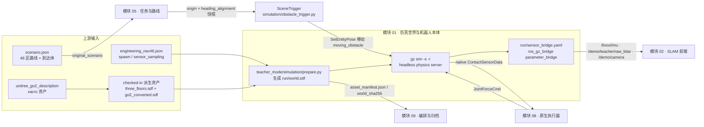
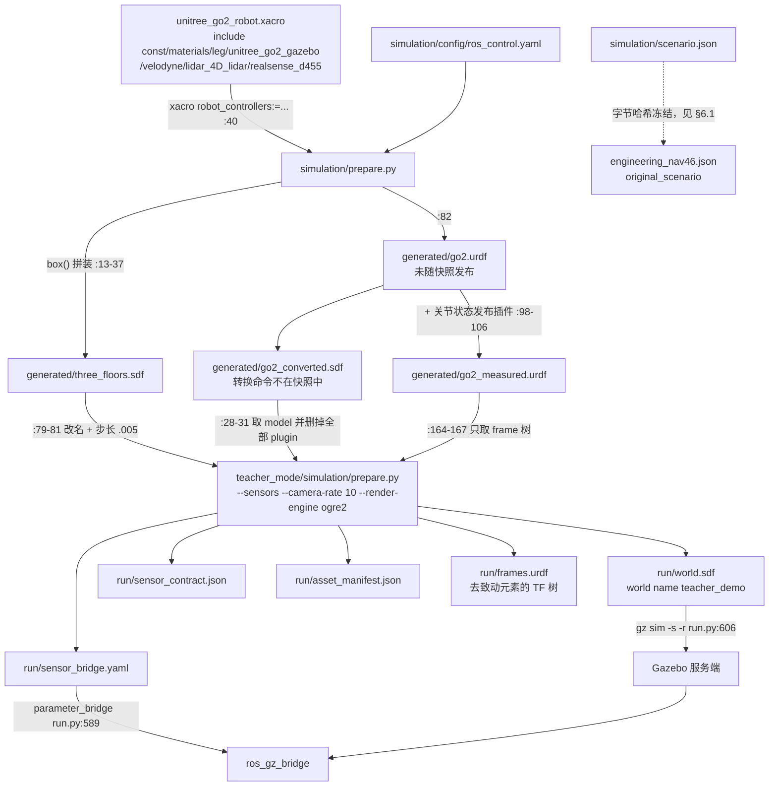
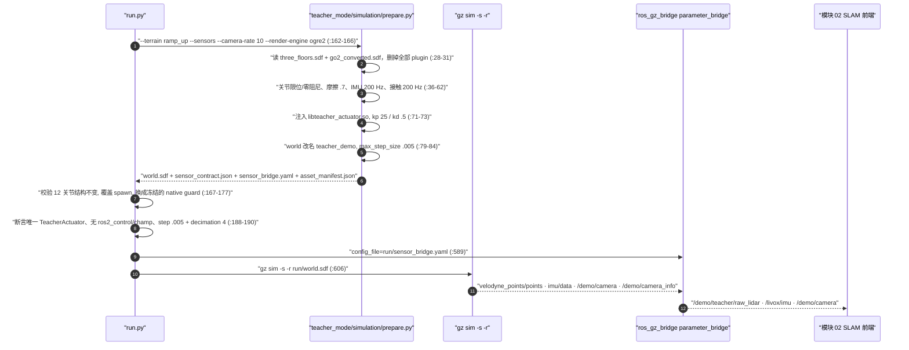
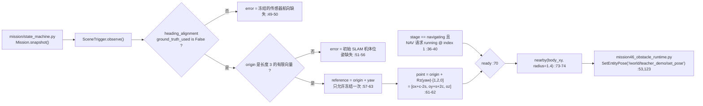

# 01 · 仿真世界、机器人本体与传感器接入

> 所属: Fast-Livo2-SCAN-Gazebo-dog-sim-control @ 2331b93 · 模块 01/09
> 覆盖路径: `go2_sim_control/src/unitree_go2_ros2/`(全量)、`multifloor_demo/simulation/`、`multifloor_demo/teacher_mode/simulation/prepare.py`、`multifloor_demo/teacher_mode/tests/cloud_transport_probe_20261004/`

## 1. 一句话职责

把「三层平台 + 10% 缓坡」的 Gazebo 世界与 Go2 十二关节本体(含 LiDAR / IMU / 相机挂载)组装成一份**运行期冻结的 `run/world.sdf`**,并把 Gazebo 侧的传感器话题用 `ros_gz_bridge` 改名成 SLAM 与策略侧期望的 ROS 2 话题;同时把传感器外参、采样率、关节限位写进 `sensor_contract.json` / `asset_manifest.json` 供下游按契约消费。

## 2. 在总体数据流中的位置

本模块是数据流的**物理起点**,也是唯一的闭环回归点(`08 → 01`)。



三个必须记住的边界事实:

1. **实际运行的 world 不是 `three_floors.sdf` 本身**,而是 `run/world.sdf` —— 由 `teacher_mode/simulation/prepare.py` 把 `three_floors.sdf` 与 `go2_converted.sdf` 合成后写出(`multifloor_demo/teacher_mode/simulation/prepare.py:79-108`)。
2. **实际运行的桥接表也不是仓库里三个手写 yaml**,而是同一脚本生成的 `run/sensor_bridge.yaml`(`multifloor_demo/teacher_mode/simulation/prepare.py:147-162`)。
3. 反向的物理环由 `libteacher_actuator.so` 闭合(`multifloor_demo/teacher_mode/simulation/prepare.py:71-73`),不是在 xacro 里声明的 `gz_ros2_control`。

## 3. 内部子模块划分

| 子模块 | 关键文件 | 职责 | 关键符号 |
|---|---|---|---|
| 世界几何生成 | [simulation/prepare.py](../../multifloor_demo/simulation/prepare.py) | 用 `box()` 拼三层平台、两条缓坡、四面墙、28 块彩色墙板、6 个地标、1 个动态障碍 | `box()`, `floor_1..3`, `ramp_12/23`, `panel_*`, `landmark_*`, `moving_obstacle` |
| 机器人描述组装 | [unitree_go2_robot.xacro](../../go2_sim_control/src/unitree_go2_ros2/unitree_go2_description/urdf/unitree_go2_robot.xacro) | xacro include 拓扑 + trunk/IMU/GPS/camera link + 四条腿实例化 | `xacro:unitree_go2_gazebo`, `xacro:leg`, `floating_base` |
| 传感器挂载 | [velodyne.xacro](../../go2_sim_control/src/unitree_go2_ros2/unitree_go2_description/urdf/velodyne.xacro), [lidar_4D_lidar.xacro](../../go2_sim_control/src/unitree_go2_ros2/unitree_go2_description/urdf/lidar_4D_lidar.xacro), [realsense_d455.xacro](../../go2_sim_control/src/unitree_go2_ros2/unitree_go2_description/urdf/realsense_d455.xacro), [unitree_go2_gazebo.xacro](../../go2_sim_control/src/unitree_go2_ros2/unitree_go2_description/urdf/unitree_go2_gazebo.xacro) | 定义每个 `gpu_lidar` / `imu` / `camera` / `navsat` 的 link、frame、`update_rate`、噪声 | `velodyne-VLP16`, `imu_sensor`, `rgb_camera`, `navsat_sensor`, `d455_rgbd_camera` |
| 场景契约 | [simulation/scenario.json](../../multifloor_demo/simulation/scenario.json) + [mission/route_regions.py](../../multifloor_demo/mission/route_regions.py) | 路线点、到达体几何、传感器外参声明、动态障碍参数 | `route_goals`, `goal_region_profile`, `sensors`, `dynamic_obstacle` |
| 桥接表 | 3 个手写 yaml + `teacher_mode/simulation/prepare.py:147-162` | gz↔ROS 话题映射(4 套,见 §4) | `bridged()`, `qos_profile: SENSOR_DATA` |
| 控制/步态配置 | [ros_control.yaml](../../multifloor_demo/simulation/config/ros_control.yaml), [gait.yaml](../../multifloor_demo/simulation/config/gait.yaml), [joints.yaml](../../go2_sim_control/src/unitree_go2_ros2/unitree_go2_sim/config/joints/joints.yaml), [links.yaml](../../go2_sim_control/src/unitree_go2_ros2/unitree_go2_sim/config/links/links.yaml) | `gz_ros2_control` 参数、步态参数、关节/连杆命名映射 | `joint_group_effort_controller`, `joints_map`, `links_map` |
| 运行期冻结资产 | [teacher_mode/simulation/prepare.py](../../multifloor_demo/teacher_mode/simulation/prepare.py) | 从 checked-in SDF/URDF 派生 `run/world.sdf` 及 4 份契约 | `source_hashes`, `exclusive_writer`, `disabled` |
| 障碍触发冻结 | [simulation/obstacle_trigger.py](../../multifloor_demo/simulation/obstacle_trigger.py) | 把世界轴位移旋转进 `camera_init`,并做就绪门控 | `SceneTrigger.observe/nearby/ready` |
| DDS/shm 传输探针 | [tests/cloud_transport_probe_20261004/](../../multifloor_demo/teacher_mode/tests/cloud_transport_probe_20261004/) | 冻结 Fast DDS loopback+SHM 传输 profile | `audit_shm`, `segment_size`, `audit_udp_loopback` |

---

## 4. 数据流与接口

### 4.1 生成链与运行链



`simulation/prepare.py` 生成世界的方式很直接:把每段模型写成一行 XML 字符串追加进 `world` 列表,最后 `'\n'.join(world)` 写盘(`multifloor_demo/simulation/prepare.py:17-37`)。所有几何体都是同一个 `box()` 模板(静态、质量 50、ODE `mu=mu2=1.0`),因此世界里没有 mesh、没有关节、没有非盒体形状(`multifloor_demo/simulation/prepare.py:13-15`)。缓坡坡度固定为 `atan(0.1)` ≈ 5.71°,长度 `hypot(12,1.2)`,并在平台接缝处重叠 2 cm(`multifloor_demo/simulation/prepare.py:21-24`)。

### 4.2 桥接表 A · `gz_main_bridge.yaml`(通用主桥,12 条)

文件:[unitree_go2_sim/config/gz_main_bridge.yaml](../../go2_sim_control/src/unitree_go2_ros2/unitree_go2_sim/config/gz_main_bridge.yaml)

| 话题(GZ) | 话题(ROS) | 类型(gz → ros) | 方向 | 用途 | 行号 |
|---|---|---|---|---|---|
| `/clock` | `/clock` | `gz.msgs.Clock` → `rosgraph_msgs/msg/Clock` | GZ→ROS | 仿真时钟 | :6-10 |
| `/imu/data` | `/imu/data` | `gz.msgs.IMU` → `sensor_msgs/msg/Imu` | GZ→ROS | IMU | :12-16 |
| `/velodyne_points/points` | 同名 | `PointCloudPacked` → `PointCloud2` | GZ→ROS | Velodyne 点云 | :18-22 |
| `/unitree_lidar/points` | 同名 | `PointCloudPacked` → `PointCloud2` | GZ→ROS | L1 4D LiDAR 点云 | :24-28 |
| `/gps/fix` | 同名 | `gz.msgs.NavSat` → `sensor_msgs/msg/NavSatFix` | GZ→ROS | GPS | :30-34 |
| `/rgb_image` | 同名 | `gz.msgs.Image` → `sensor_msgs/msg/Image` | GZ→ROS | trunk 前置相机 | :36-40 |
| `/d455/image` | 同名 | `Image` → `Image` | GZ→ROS | D455 RGB | :42-46 |
| `/d455/depth_image` | 同名 | `Image` → `Image` | GZ→ROS | D455 深度 | :48-52 |
| `/d455/points` | 同名 | `PointCloudPacked` → `PointCloud2` | GZ→ROS | D455 点云 | :54-58 |
| `/d455/camera_info` | 同名 | `CameraInfo` → `CameraInfo` | GZ→ROS | D455 内参 | :60-64 |
| `/cmd_vel` | 同名 | `geometry_msgs/msg/Twist` → `gz.msgs.Twist` | **ROS→GZ** | 速度直通 | :67-71 |
| `/joint_group_effort_controller/joint_trajectory` | 同名 | `trajectory_msgs/msg/JointTrajectory` → `gz.msgs.JointTrajectory` | **ROS→GZ** | 轨迹直通 | :73-77 |

文件头注释明确说 `/joint_states` 由 `joint_state_broadcaster` 发布、**不经桥接**(`gz_main_bridge.yaml:3`)。

### 4.3 桥接表 B · `gz_perception_bridge.yaml`(感知桥,5 条)

文件:[unitree_go2_sim/config/gz_perception_bridge.yaml](../../go2_sim_control/src/unitree_go2_ros2/unitree_go2_sim/config/gz_perception_bridge.yaml)。作用是**把 Gazebo 原生话题改名成 FAST-LIVO2 期望的名字**。

| 话题(GZ) | 话题(ROS) | 类型(gz → ros) | 方向 | 用途 | 行号 |
|---|---|---|---|---|---|
| `/velodyne_points/points` | `/livox/lidar` | `PointCloudPacked` → `PointCloud2` | GZ→ROS | 伪装成 Livox 雷达话题给 SLAM | :6-10 |
| `/imu/data` | `/livox/imu` | `gz.msgs.IMU` → `sensor_msgs/msg/Imu` | GZ→ROS | 伪装成 Livox IMU 话题给 SLAM | :13-17 |
| `/d455/image` | `/camera/image_color` | `Image` → `Image` | GZ→ROS | 彩色图给 SLAM | :20-24 |
| `/d455/camera_info` | `/camera/image_color_frame_info` | `CameraInfo` → `CameraInfo` | GZ→ROS | 相机内参 | :27-31 |
| `/odom` | `/ground_truth/odometry` | `gz.msgs.Odometry` → `nav_msgs/msg/Odometry` | GZ→ROS | Gazebo 里程计**显式命名为真值** | :34-38 |

### 4.4 桥接表 C · `multifloor_demo/simulation/config/bridge.yaml`(多层 demo 桥,11 条)

文件:[simulation/config/bridge.yaml](../../multifloor_demo/simulation/config/bridge.yaml)

| 话题(GZ) | 话题(ROS) | 类型(gz → ros) | 方向 | 用途 | 行号 |
|---|---|---|---|---|---|
| `/clock` | `/clock` | `Clock` → `Clock` | GZ→ROS | 仿真时钟 | :1-5 |
| `/velodyne_points/points` | `/livox/lidar` | `PointCloudPacked` → `PointCloud2` | GZ→ROS | 雷达点云 | :6-10 |
| `/imu/data` | `/livox/imu` | `IMU` → `Imu` | GZ→ROS | IMU | :11-15 |
| `/demo/camera` | `/camera/image_color` | `Image` → `Image` | GZ→ROS | 车体相机 | :16-20 |
| `/demo/camera_info` | `/camera/camera_info` | `CameraInfo` → `CameraInfo` | GZ→ROS | 相机内参 | :21-25 |
| `/demo/ground_truth` | `/demo/ground_truth` | `Odometry` → `Odometry` | GZ→ROS | 真值里程计 | :26-30 |
| `/world/multifloor_demo/model/go2/link/base_link/sensor/demo_body_contacts/contact` | `/demo/body_contacts` | `gz.msgs.Contacts` → `ros_gz_interfaces/msg/Contacts` | GZ→ROS | 躯干接触(用于判定"躯干触地 = 非法") | :32-36 |
| `.../link/lf_lower_leg_link/sensor/demo_lf_foot_contacts/contact` | `/demo/contacts/lf_foot` | 同上 | GZ→ROS | 左前足接触 | :38-42 |
| `.../link/rf_lower_leg_link/sensor/demo_rf_foot_contacts/contact` | `/demo/contacts/rf_foot` | 同上 | GZ→ROS | 右前足接触 | :44-48 |
| `.../link/lh_lower_leg_link/sensor/demo_lh_foot_contacts/contact` | `/demo/contacts/lh_foot` | 同上 | GZ→ROS | 左后足接触 | :50-54 |
| `.../link/rh_lower_leg_link/sensor/demo_rh_foot_contacts/contact` | `/demo/contacts/rh_foot` | 同上 | GZ→ROS | 右后足接触 | :56-60 |

⚠️ 5 条接触话题的 GZ 名里**硬编码了 world 名 `multifloor_demo`**(`:32,38,44,50,56`)。这只对 `three_floors.sdf` 的原始 world 名成立;实际运行把 world 改名为 `teacher_demo`(`teacher_mode/simulation/prepare.py:80`),接触量改由插件原生读取,因此这 5 条在本轮不可能命中。

### 4.5 桥接表 D · 实际运行生成的 `run/sensor_bridge.yaml`

由 `bridged()` 逐条追加,全部 `direction: GZ_TO_ROS`、`qos_profile: SENSOR_DATA`、`publisher_queue/subscriber_queue: 5`、`lazy: false`(`teacher_mode/simulation/prepare.py:148-150`)。

| 话题(GZ) | 话题(ROS) | 类型(gz → ros) | 生效条件 | 用途 | 行号 |
|---|---|---|---|---|---|
| `/demo/camera` | `/demo/camera` | `Image` → `Image` | `--sensors` 或 `--camera-only` | 车体 RGB(→ SLAM 与 map_archive) | :152 |
| `/demo/teacher/overview` | `/demo/teacher/overview` | `Image` → `Image` | 同上 | 静态观察相机,只做诊断 | :153 |
| `/demo/camera_info` | `/demo/camera_info` | `CameraInfo` → `CameraInfo` | 同上 | 车体相机内参 | :154 |
| `/demo/teacher/overview_info` | `/demo/teacher/overview_info` | `CameraInfo` → `CameraInfo` | 同上 | 观察相机内参 | :155 |
| `/clock` | `/clock` | `Clock` → `Clock` | 同上 | 仿真时钟 | :156 |
| `/imu/data` | `/livox/imu` | `IMU` → `Imu` | 仅 `--sensors` | IMU → SLAM | :158 |
| `/demo/teacher/physical_joint_states` | `/demo/control/measured_joint_states` | `gz.msgs.Model` → `sensor_msgs/msg/JointState` | 仅 `--sensors` | 物理关节实测(只读证据) | :159 |
| `/velodyne_points/points` | `/demo/teacher/raw_lidar` | `PointCloudPacked` → `PointCloud2` | 仅 `--sensors` | 雷达点云 → `self_echo_filter` | :160 |

**对照结论**:本轮 `run.py:162-166` 传 `--sensors`,所以 D 表 8 条全部生效;A/B/C 三表在本快照内**没有任何调用点**(全仓只在 `unitree_go2_sim/CMakeLists.txt:14-26` 里被声明为要安装 `config/` 目录)。这一点的含义见 §9。

---

## 5. 关键流程与时序

### 5.1 从 prepare 到 200 Hz 物理



逐步要点:

1. **世界先行**:`three_floors.sdf` 先被解析,world 改名 `teacher_demo`,物理步长从 `0.001` 改成 `.005`(`teacher_mode/simulation/prepare.py:79-84`)。也就是说世界文件里写的 1000 Hz 只是普通 demo 的值,本轮实际是 200 Hz。
2. **模型后置**:`go2_converted.sdf` 里的 `<model name='go2'>` 被深拷贝,`<plugin>` 全删(`:28-31`),随后被挂到 world 末尾(`:108`)。删插件是**语义决定**而不是清理:`OdometryPublisher`(真值里程计)与 `gz_ros2_control` 都在这一步消失。
3. **致动唯一性**:只注入一个 `libteacher_actuator.so`(`:71`),`asset_manifest.json` 声明 `exclusive_writer: teacher_sim::TeacherActuator`、`disabled: [CHAMP, body_stabilizer, ros2_control, JointTrajectoryController]`(`:169-170`)。
4. **启动顺序**:`bridge` 先于 `gazebo` 启动(`run.py:589` vs `run.py:606`),`gz sim` 带 `-s -r`(仅服务端、立即运行),即本轮**没有 GUI、没有渲染窗口**。
5. **环境隔离**:`GZ_PARTITION` 每次运行唯一、`GZ_IP=127.0.0.1`、`GZ_SIM_SYSTEM_PLUGIN_PATH` 指向 `simulation/build`(`run.py:551-552`)。

### 5.2 动态障碍如何冻结到 SLAM 坐标系

`SceneTrigger` 的设计目标写在文件头:它**没有仿真位姿、没有真值输入**,只用任务侧冻结的一次性传感器航向对齐(`obstacle_trigger.py:1-7`)。



关键点:

- 触发点用 `[1, 2, 0]` 这个**世界轴位移**经 `Rz(yaw_camera_init_from_world)` 旋转得到 `camera_init` 下的坐标(`obstacle_trigger.py:61-62`),不再使用仿真真值;`heading_alignment['ground_truth_used']` 必须是 `False`,否则直接报错(`:49-50`)。
- 同一 run 内参考系被**冻结一次**;若任务改口(`reference != self.reference`)即抛 `mission changed its frozen scene calibration`(`:58-59`)。
- 就绪条件三重:阶段必须是 `navigating`、当前 NAV 请求正在跑且 `waypoint_index == 1`、场景标定合法(`:36-40,68-71`)。注释解释了为什么必须等到"北向接近已到达第一个航点":若在接近途中就触发,东向转弯结束时障碍循环已经走完(`:33-35`)。
- 障碍模型本身是 `<static>true</static>`(`simulation/prepare.py:36`),只能被 `SetEntityPose` 服务移动;机器人从不被瞬移(`simulation/prepare.py:35` 注释、`mission46_obstacle_runtime.py:4`)。插件同样禁止 `body_pose_resets`(`teacher_actuator.cpp:157` 记录 `body_pose_resets: 0`)。
- 事后审计会离线重放同一个 `SceneTrigger`,要求与实测触发点一致,不一致即判失败(`mission46_runtime_evidence.py:308-316`)。

---

## 6. 关键数据结构与配置

### 6.1 `scenario.json`(66 KB / 3240 行)定义了什么

顶层键与行号(全部为 `multifloor_demo/simulation/scenario.json`):

| 键 | 行号 | 内容 |
|---|---|---|
| `world` / `geometry` / `floor_elevations` | :2-8 | world 名 `multifloor_demo`、"三层平台 + 10% 缓坡 (非楼梯)"、层高 `[0, 1.2, 2.4]` |
| `spawn` / `nominal_standing_body_height` | :9-15 | 出生点 `(0, 0, 0.30, yaw 0)`、标称站立高度 0.30 |
| `frame` / `coordinates` | :16-17 | `camera_init`;"世界轴位移,由任务用冻结航向旋转进 camera_init" |
| `exploration` / `return_origin` / `navigation_f1_f3` | :18-253 | 三组**权威规划中心点**(点数组) |
| `dynamic_obstacle` | :254-271 | 实体名 `moving_obstacle`、初始 `[1,4,0.6]`、穿越平面 `crossing_plane_x=1`、路线 `route_y=2`、尺寸、激活航点索引 1 |
| `sensors` | :272-344 | imu / lidar / camera 的 frame、`body_xyz`、`body_rpy`、`rate`、`topic`、内参 |
| `slam_origin_in_world` / `body_clearance` / `origin` | :345-362 | `[0,0,0.30]`、0.30、原点定义与航点语义 |
| `ground_waypoints` | :363-434 | 与 `navigation_f1_f3` 同值的档位化拷贝 |
| `goal_region_profile` | :441-465 | 到达体契约 `three_platform_body_arrival_v2`:dwell 0.4 s、max gap 0.2 s、平面半径 0.35、坡道半宽 `[0.35,0.30,0.10]`、原点球半径 0.22,外加更小的 `control_band` |
| `route_goals` | :466-3239 | **由 `add_route_regions()` 生成**,46 个带几何的到达区 |

`route_goals` 三组数量与 `mission46_profile.py:25` 的 `ROUTE_COUNTS` 完全一致:**exploration 18 + return_origin 14 + navigation_f1_f3 14 = 46**,并由 `mission46_profile.py:74` 断言"必须正好 46 个原始区域"。

**消费者**(按链接方式分类):

| 消费者 | 读什么 | 证据 |
|---|---|---|
| `mission46_profile.load_original_scenario()` | 全量,且**先校验 sha256** | `mission46_profile.py:49-56` |
| `mission/route_regions.add_route_regions()` | 三组点数组 + profile | `route_regions.py:29-58` |
| `slam/odom_adapter.py` | `--scenario`(默认指向该文件) | `odom_adapter.py:121` |
| `slam/self_echo_filter.py` | `--scenario`(默认指向该文件) | `self_echo_filter.py:90` |
| `teacher_mode/.../shared_controller.py` | `scenario_path` 参数,**默认路径已失效** | `shared_controller.py:52`(见 §9) |
| 运行期实际消费者 | `run/navigation_scenario.json` = profile 内嵌副本 | `pid_scope.py:135-137`;`slam.launch.py:49,57` |
| 运行期任务侧 | `run/navigation_scenario.json` 的 `frame_id` 参与观测校验 | `mission46.py:167` |

### 6.2 `ros_control.yaml` / `gait.yaml` / `joints.yaml` / `links.yaml`

| 文件 | 定义什么 | 关键内容 | 是否参与本轮 |
|---|---|---|---|
| [simulation/config/ros_control.yaml](../../multifloor_demo/simulation/config/ros_control.yaml) | `gz_ros2_control` 插件节点 `gz_ros_control` 与 `controller_manager` 参数 | `hold_joints: true`(:7)、`position_proportional_gain: 100.0`(:8)、`update_rate: 250`(:14)、`joint_states_controller` + `joint_group_effort_controller`(:19-23)、12 个关节名(:33-45)、`command_interfaces: [effort]` / `state_interfaces: [position, velocity]`(:47-51)、统一增益 `p 220.982919, i 0.2, d 1.0, i_clamp 2.5`(:67-79) | ❌ 只通过 xacro 参数写进 URDF/SDF 文本;插件在 `teacher_mode/simulation/prepare.py:31` 被删除 |
| [go2_sim_control/.../config/ros_control/ros_control.yaml](../../go2_sim_control/src/unitree_go2_ros2/unitree_go2_sim/config/ros_control/ros_control.yaml) | 同名文件的包默认版本 | `hold_joints: false`(:7)、`position_proportional_gain: 0.0`(:8)、增益 `p 100.0`(:66-77);注释说明 `hold_joints=false` 时关节完全自由、让狗被动倒地以便 SLAM 干净初始化(:2-3) | ❌ 未使用(被 `simulation/prepare.py:40` 的显式参数覆盖) |
| [simulation/config/gait.yaml](../../multifloor_demo/simulation/config/gait.yaml) | 步态/速度上限参数 | `swing_height 0.07`、`stance_depth 0.005`、`stance_duration 0.35`、`nominal_height 0.30`、`max_linear_velocity_x 0.3` / `y 0.25` / `angular_z 0.5`、`odom_scaler 0.9`(:1-14) | ❌ 快照内无任何读取点 |
| [config/gait/gait.yaml](../../go2_sim_control/src/unitree_go2_ros2/unitree_go2_sim/config/gait/gait.yaml) | 同一份步态配置的包默认版本 | `swing_height 0.02`、`nominal_height 0.225`(:11,14);其余同上 | ❌ 未使用 |
| [config/joints/joints.yaml](../../go2_sim_control/src/unitree_go2_ros2/unitree_go2_sim/config/joints/joints.yaml) | 腿 → 关节名映射(每腿 4 个,**含 fixed 的 `*_foot_joint`) | `joints_map.{left_front|right_front|left_hind|right_hind}`(:3-26) | ❌ 未使用 |
| [config/links/links.yaml](../../go2_sim_control/src/unitree_go2_ros2/unitree_go2_sim/config/links/links.yaml) | 机体系 → 连杆名映射 | `links_map.base: base_link` + 四腿各 4 个 link(:3-27) | ❌ 未使用 |

**"命令如何变成物理关节运动"在本轮的真实答案**:

1. 上游给出的是关节**目标位置**序列(action),`gz_ros2_control` + `JointTrajectoryController` 这条历史路径在本轮被**显式禁用**(`mission46.py:4` 自述"never starts the historical CHAMP/JTC stack";`run.py:188` 断言插件名中不含 `ros2_control`/`champ`)。
2. 实际执行者是 `teacher_sim::TeacherActuator`:它在 `PreUpdate` 读 12 个关节的 position/velocity、base 世界位姿与 COM 速度、以及 physics 直接填写的 `ContactSensorData`(`teacher_actuator.cpp:127-142,185-199`),通过 UNIX socket 把观测交给 CPU Actor,再收 16 个 float 的动作,换算成 `JointForceCmd` 写回 physics。
3. 内部是 PD:`raw = kp*(target-q) - kd*qd`,默认 `kp=25, kd=.5, effort_limit=23.5, velocity_limit=30`,输出前再按训练用的 DCMotor 速度/力矩包络做非对称钳位(`teacher_actuator.cpp:83-90,232-240`),并断言物理步长必须等于 `expected_dt=0.005`(`:174-175`)。
4. 每 `decimation=4` 个物理步交换一次观测/动作(`teacher_actuator.cpp:91,229`),即 **200 Hz 物理 → 50 Hz 策略与 telemetry**;`mission46_runtime_evidence.py` / `pid_scope.py:97` 都在契约层再断言一次 `physics_step_s == .005 and decimation == 4`。
5. `ros_control.yaml` 唯一残留作用是把 `joint_group_effort_controller` 的字节写进 URDF 的插件参数文本(`simulation/prepare.py:40`;`go2_measured.urdf:295` 可见 `${GO2_STUDY_PROJECT_ROOT}/multifloor_demo/simulation/config/ros_control.yaml`),连同关节初值一起作为**被冻结的历史配置**保存。

### 6.3 数据率总表(全部给出文件:行号)

| 量 | 名义值 | 证据位置 |
|---|---|---|
| 物理步长(世界文件默认) | `0.001 s` = **1000 Hz** | `multifloor_demo/simulation/prepare.py:17`;`generated/three_floors.sdf:1` |
| 物理步长(本轮实际) | `0.005 s` = **200 Hz** | `teacher_mode/simulation/prepare.py:81`;断言见 `run.py:190`、`pid_scope.py:97` |
| 策略 / telemetry 周期 | **50 Hz**(200 Hz 的 `decimation=4`) | `teacher_actuator.cpp:89,91,229`;`asset_manifest.decimation` 见 `teacher_mode/simulation/prepare.py:169` |
| IMU —— xacro 原始声明 | 100 Hz | `unitree_go2_gazebo.xacro:50` |
| IMU —— `simulation/prepare.py` 意图 | 1000 Hz(与 1 ms 物理步对齐) | `simulation/prepare.py:11,47`;`scenario.json:285` |
| IMU —— checked-in SDF 冻结值 | 100 Hz(**落后于上面两行**) | `generated/go2_converted.sdf:229` |
| IMU —— 本轮运行期 | **200 Hz** | `teacher_mode/simulation/prepare.py:50` |
| IMU 方向参考 | `CUSTOM` + `custom_rpy parent_frame='world'` = `0 0 0` | `simulation/prepare.py:48-56`;`go2_converted.sdf:273-276` |
| Velodyne 线数/水平/频率 —— xacro | 720 × 64 @ 10 Hz,±180° / −30°~+15°,range 0.3-130 | `velodyne.xacro:56,61,67,69,70,74-75` |
| Velodyne —— `simulation/prepare.py` 改写 | 480 × 32,`range.max = 35` | `simulation/prepare.py:58-60` |
| Velodyne —— 本轮运行期 | **64 线 × 480 采样**,频率取自 profile | `sampling.py:22-23,33-35` 用 `engineering_nav46.json:210-214` 的 `vertical_lines 64 / horizontal_samples 480 / lidar_hz 30` |
| L1 4D LiDAR(未接入) | 600 × 30 @ 10 Hz,range 0.8-30 | `lidar_4D_lidar.xacro:42,46,52,59-60`;被 `simulation/prepare.py:42-44` 删除 |
| 车体相机 `demo_rgb` —— 创建 | 640×480,HFOV 80°,10 Hz | `simulation/prepare.py:74` |
| 车体相机 —— 本轮运行期 | `--camera-rate 10` 后被采样契约改成 **30 Hz** | `run.py:163`;`teacher_mode/simulation/prepare.py:56`;`sampling.py:35`;`engineering_nav46.json:214` |
| D455 RGBD(未接入) | 640×480 @ 30 Hz | `realsense_d455.xacro:20-21,29`;被 `simulation/prepare.py:42-44` 删除 |
| trunk `rgb_camera`(未接入) | 640×480 @ 10 Hz | `unitree_go2_gazebo.xacro:149-150,159`;同上被删除 |
| 观察相机 `teacher_overview_camera` | 640×480,2 Hz(连续地形测试为 10 Hz) | `teacher_mode/simulation/prepare.py:97,100` |
| 接触传感器 —— 生成 | 50 Hz | `simulation/prepare.py:81`;`go2_converted.sdf:201,543,778,1013,1248` |
| 接触传感器 —— 本轮运行期 | **200 Hz** | `teacher_mode/simulation/prepare.py:57-58` |
| GPS/NavSat(未接入) | 10 Hz | `unitree_go2_gazebo.xacro:106`;被删除 |
| `OdometryPublisher` 发布频率 | 50 Hz(普通 demo;本轮插件被删) | `unitree_go2_gazebo.xacro:42`;删除见 `teacher_mode/simulation/prepare.py:31` |
| 采样契约允许的改写范围 | **只有 4 个叶子**:vertical lines、horizontal samples、lidar rate、camera rate | `sampling.py:33-35,43-44`;契约自述 `nominal_30_is_not_measured_30` (`sampling.py:67`) |
| 采样契约锁定的不变量 | `unchanged_physics_step_s .005`、`unchanged_native_PD_hz 200`、`unchanged_Actor_hz 50` | `sampling.py:64` |

### 6.4 DDS/shm 传输探针解决什么问题

- 目的:为 **点云这类大消息**排除"传输层缓冲不足"这一混淆变量。`config_shm64MiB.xml` 定义两条显式传输 —— `audit_udp_loopback`(仅 `127.0.0.1`,监听白名单、`sendBufferSize/receiveBufferSize=0`、`maxMessageSize=65500`)与 `audit_shm`(`segment_size=67108864`、`port_queue_capacity=512`、`healthy_check_timeout_ms=1000`),默认 profile 关掉内置传输并显式声明两条 user transport(`config_shm64MiB.xml:6-15,17-26`)。
- `prepare_transport.py` 做的事:严格校验上述 XML 的每一个字段(必须恰好 1 条 UDP + 1 条 SHM、必须 loopback、必须禁用 builtin transport、禁止组播 locator、禁止覆盖端点 QoS),校验 XML 与已安装 DDS/RMW 二进制的 sha256,然后**把 XML 拷进 run 目录**并写 `cloud_transport_manifest.json`;它自己不启动 ROS、不创建 participant(`prepare_transport.py:13-32,34-56`,`:55` 明写 `ROS_started: False / participant_created: False`)。
- **是否属于实际运行链路**:是。`run.py:194-195` 在准备阶段就调用 `prepare_transport.py --profile shm_64m`,`run.py:545-547` 再把 manifest 里的环境变量注入所有子进程(并先 `pop` 掉要移除的键)。
- **但它在本快照不可重放**:它依赖同目录的 `config_env_manifest.json`(`prepare_transport.py:38`),该文件不在快照中;目录里只有 `config_shm64MiB.xml` 与 `prepare_transport.py`。`shm_512k` 对照分支的 XML 也不在快照中。

---

## 7. 代码结构讲解

```text
go2_sim_control/src/unitree_go2_ros2/
├── unitree_go2_description/                     # 机器人描述包(纯 xacro/CMake)
│   ├── CMakeLists.txt
│   ├── package.xml                              # exec_depend: realsense2_description, gz_ros2_control
│   └── urdf/
│       ├── unitree_go2_robot.xacro              # 顶层:include 拓扑 + link/joint 主体
│       ├── const.xacro                          # 尺寸/惯量/关节限位常量(121 行)
│       ├── materials.xacro                      # 材质
│       ├── leg.xacro                            # xacro:leg 宏:4 关节链路 + ros2_control 块
│       ├── unitree_go2_gazebo.xacro             # xacro:unitree_go2_gazebo 宏:插件 + IMU/GPS/相机 + 摩擦
│       ├── velodyne.xacro                       # 16 线雷达 + gpu_lidar 传感器
│       ├── lidar_4D_lidar.xacro                 # L1 4D 雷达 + gpu_lidar 传感器
│       ├── realsense_d455.xacro                 # D455(RGBD)+ rgbd_camera 传感器
│       └── perception_sensors.xacro             # Livox 风格 LiDAR+相机 —— 未被 include(见 §9)
└── unitree_go2_sim/                             # 仿真配置包
    ├── CMakeLists.txt                           # 安装 launch/ config/ rviz/ + 5 个脚本(均不在快照中)
    ├── package.xml                              # champ_base, robot_localization, ros_gz_bridge ...
    └── config/
        ├── gz_main_bridge.yaml                  # 表 A
        ├── gz_perception_bridge.yaml            # 表 B
        ├── ros_control/ros_control.yaml         # gz_ros2_control + JTC 参数
        ├── gait/gait.yaml                       # 步态参数
        ├── joints/joints.yaml                   # 腿→关节映射
        └── links/links.yaml                     # 机体系→连杆映射

multifloor_demo/
├── simulation/                                  # 原 simulation 包的裁剪子集
│   ├── prepare.py                               # 世界 + go2.urdf + scenario.json 生成器
│   ├── obstacle_trigger.py                      # SceneTrigger
│   ├── scenario.json                            # 46 区场景契约
│   ├── config/{bridge.yaml, ros_control.yaml, gait.yaml}
│   └── generated/{three_floors.sdf, go2_converted.sdf, go2_measured.urdf}
└── teacher_mode/
    ├── simulation/
    │   ├── prepare.py                           # 本轮真正生成 run/world.sdf 的脚本
    │   └── native/current/teacher_actuator.cpp  # 唯一力矩写入者(模块 08)
    └── tests/cloud_transport_probe_20261004/{config_shm64MiB.xml, prepare_transport.py}
```

逐个文件的作用(只列本模块新增信息):

- [materials.xacro](../../go2_sim_control/src/unitree_go2_ros2/unitree_go2_description/urdf/materials.xacro):仅材质,无几何。
- [const.xacro](../../go2_sim_control/src/unitree_go2_ros2/unitree_go2_description/urdf/const.xacro):trunk 长宽高 `0.3762/0.0935/0.114`(:11-12)、`thigh_length = calf_length = 0.213`(:27-28)、腿偏移 `leg_offset_x 0.1934 / y 0.0465`(:31-32)、关节限位与力矩上限(:52-66)、各部惯量(:68-119)。**`go2_converted.sdf` 与 `scenario.json` 里的外参数值都能在这里找到源头。**
- [leg.xacro](../../go2_sim_control/src/unitree_go2_ros2/unitree_go2_description/urdf/leg.xacro):`xacro:leg` 宏接收 `name/mirror/mirror_dae/front_hind/front_hind_dae` 五个参数(:7),按 4 种组合切换 hip 关节原点正负(:10-21);hip 轴 `1 0 0`、大小腿轴 `0 1 0`(:24,74,114);`*_foot_joint` 是 fixed、偏移 `-calf_length`(:145-149);`<ros2_control name="${name}" type="system">` 声明 `gz_ros2_control/GazeboSimSystem` + effort 命令 / position+velocity 状态(:174-193)。
- [unitree_go2_robot.xacro](../../go2_sim_control/src/unitree_go2_ros2/unitree_go2_description/urdf/unitree_go2_robot.xacro):顶层。xacro 参数 `robot_controllers` 默认指向包的 `config/ros_control/ros_control.yaml`(:7);include 顺序为 const → materials → leg → unitree_go2_gazebo → velodyne → lidar_4D_lidar → realsense_d455(:9-17);`base_link` 是个 1 mm 的占位立方体(:36-43),`trunk` 才是实体(:51-71);`imu_joint` 把 `imu_link` 固定在 trunk 原点(:73-77);`gps_joint` 在 `z=0.065`(:80-84);`camera_joint` 在 `(0.326, 0, 0.043)`(:152-156);四条腿实例化在 :191-194;`lidar_l1_joint` 的旧定义被注释掉(:159-189),实际定义搬到了 `lidar_4D_lidar.xacro`。
- [velodyne.xacro](../../go2_sim_control/src/unitree_go2_ros2/unitree_go2_description/urdf/velodyne.xacro):两级固定关节 `base_link → velodyne_base_link (0.2, 0, 0.08)`(:4-8)、`velodyne_base_link → velodyne (0, 0, 0.0377)`(:32-36);传感器 `velodyne-VLP16` 挂在链接 `velodyne` 上,topic 写 `velodyne_points`,gz 侧实际话题为 `/velodyne_points/points`(:53-57)。
- [lidar_4D_lidar.xacro](../../go2_sim_control/src/unitree_go2_ros2/unitree_go2_description/urdf/lidar_4D_lidar.xacro):`lidar_l1_link` 直挂 `base_link`,rpy `(2.879, 0, 1.5705)`、xyz `(0.25, -0.038, -0.03)`(:32-37);传感器 topic `unitree_lidar`(:41) → gz 话题 `/unitree_lidar/points`,与表 A 第 4 条对应。
- [realsense_d455.xacro](../../go2_sim_control/src/unitree_go2_ros2/unitree_go2_description/urdf/realsense_d455.xacro):include 第三方 `realsense2_description`(:6),用 `xacro:sensor_d455` 把相机挂在 `trunk` 上、原点 `(0.28, 0, 0.062)`(:9-11);传感器 `d455_rgbd_camera` topic `d455`(:15,31) → gz 话题 `/d455/*`,对应表 A 第 7-9 条。
- [unitree_go2_gazebo.xacro](../../go2_sim_control/src/unitree_go2_ros2/unitree_go2_description/urdf/unitree_go2_gazebo.xacro):宏 `unitree_go2_gazebo(robot_controllers)`(:3)。含 4 个插件/传感器组:`PosePublisher`(:6-15)、`gz_ros2_control`(:29-32)、`OdometryPublisher(odom → base_link, topic /odom, 50 Hz)`(:37-43)、`imu_sensor`(:48-99,`imu_link`,100 Hz,角速度 σ=2e-4 / 线加速度 σ=1.7e-2)、`navsat_sensor`(:104-139,`gps_link`,10 Hz,水平 σ=0.5 m)、`rgb_camera`(:144-162,`camera_link`,10 Hz);末尾是逐 link 的 `mu1/mu2/self_collide/kp/kd`(:166-271),足端摩擦 0.6、其余 0.2。
- [simulation/prepare.py](../../multifloor_demo/simulation/prepare.py):三段式 —— 世界(:13-37)、机器人模型(:39-82)、场景(:83-107)。
- [teacher_mode/simulation/prepare.py](../../multifloor_demo/teacher_mode/simulation/prepare.py):把 checked-in 资产变成**运行期世界**并产出 5 份契约。
- [obstacle_trigger.py](../../multifloor_demo/simulation/obstacle_trigger.py):74 行的纯函数式触发器,无 ROS 依赖。
- [three_floors.sdf](../../multifloor_demo/simulation/generated/three_floors.sdf):46 行,1 行世界头 + 44 行模型 + 1 行收尾;**世界自带 6 个插件**:Physics / UserCommands / SceneBroadcaster / Sensors(Ogre2) / Imu / Contact(:1)。

---

## 8. 与其他模块的边界

| 下游 | 交接物 | 交接方式 | 证据 |
|---|---|---|---|
| 02 SLAM 前端 | `/livox/imu`(200 Hz)、`/demo/teacher/raw_lidar`、`/demo/camera`、`/demo/camera_info` | ROS 2 话题;`sensor_relay.py` 再转成 `/demo/teacher/slam/{imu,image}` | `sensor_bridge.yaml` 生成于 `teacher_mode/simulation/prepare.py:152-160`;`sensor_relay.py:26-27` |
| 02 SLAM 前端 | **外参** | `sensor_contract.json` 的 `body_xyz/body_rpy` 被换算成 `extrinsic_T/R`、`Rcl/Pcl`;`scan_line` 直接取垂直线数 | `pid_scope.py:111-116` |
| 03 已知场景定位 | 世界几何 | `known_scene_reference.json` 由 `run/world.sdf` 构建 | `run.py:197` |
| 04 SCAN 规划 | 地形目标清单 | profile 指定 `tests/terrain_targets/lower12.json` | `engineering_nav46.json:109` |
| 05 任务与路线 | `scenario.json` / `original_scenario` 的 46 个到达区与 `dynamic_obstacle` | 文件哈希冻结 + `add_route_regions()` 几何生成 | `mission46_profile.py:25,49-75`;`route_regions.py:29-58` |
| 05 任务与路线 | 触发点坐标 | `SceneTrigger.point` 由任务的 `origin`/`heading_alignment` 单向输入 | `obstacle_trigger.py:46-63`;`mission46.py:343-346` |
| 07/08 策略与执行 | 12 关节名与顺序、默认角、硬限位、接触 collision 集 | 关节序 `rf/lf/rh/lh` × `hip/upper_leg/lower_leg`;`qdefault`;`lower/upper`;接触集 `base_link` + 4 个 `*_foot` | `teacher_mode/simulation/prepare.py:32-40,172`;`teacher_actuator.cpp:127-135` |
| 07/08 策略与执行 | 物理步长与 decimation | `expected_dt=0.005`,`decimation=4` 两侧互相断言 | `teacher_actuator.cpp:89,91,174-175`;`run.py:190` |
| 09 编排与归档 | `world_sha256`、`sensor_bridge_sha256`、`sensor_contract_sha256`、`source_hashes`、`exclusive_writer`、`disabled` | `run/asset_manifest.json` | `teacher_mode/simulation/prepare.py:168-182` |
| 09 编排与归档 | 冻结清单 | `pid_scope.py:55` 把 `simulation/prepare.py`、`teacher_actuator.cpp`、`libteacher_actuator.so` 纳入必检 sha256 | `pid_scope.py:44-58,83-84` |

**本模块不做的事**:不算里程计(由 Gazebo 插件在普通 demo 出、本轮被删)、不做 TF 广播(只产出只读 `frames.urdf`)、不做接触判定的业务结论(只提供传感器与原生 collision 集)。

---

## 9. 已知限制与失败点

1. **三个手写桥接表在本快照内没有消费者**。`gz_main_bridge.yaml` / `gz_perception_bridge.yaml` / `simulation/config/bridge.yaml` 全仓仅有的引用是 `unitree_go2_sim/CMakeLists.txt:14-26` 的"安装 `config/` 目录"声明;`unitree_go2_sim` 还声明安装 `launch/`、`rviz/` 与 5 个脚本(`CMakeLists.txt:14-36`),但**这些目录在快照里都不存在**。本轮启动 Gazebo 的唯一入口是 `run.py:606` + 生成的 `run/world.sdf`。把 A/B 表当作"实际桥接"会读错链路。
2. **表 A 中多条条目在实际世界里没有对端**。`/d455/*`、`/rgb_image`、`/gps/fix`、`/unitree_lidar/points` 对应的传感器都被 `simulation/prepare.py:42-44` 的过滤器删掉了(该过滤器只保留 `imu` 类型与名为 `velodyne-VLP16` 的 `gpu_lidar`);`/cmd_vel` 与 `/joint_group_effort_controller/joint_trajectory` 依赖的 `gz_ros2_control` 插件也在 `teacher_mode/simulation/prepare.py:31` 被删除。
3. **`perception_sensors.xacro` 完全未接入**。它定义了 `livox_link` / `fvl_cam_link` 与 20 Hz 的 `livox_lidar_sensor` / `fvl_camera_sensor`,但 `unitree_go2_robot.xacro:9-17` 的 include 列表里没有它,全仓也没有第二处 `include`。
4. **IMU 频率存在四个互不一致的数字**:xacro 100 Hz(`unitree_go2_gazebo.xacro:50`)、`simulation/prepare.py:11` 的 1000 Hz、checked-in `go2_converted.sdf:229` 的 100 Hz、运行期 `teacher_mode/simulation/prepare.py:50` 的 200 Hz。实际生效的只有最后一条 —— 因为运行期世界是从 checked-in SDF 派生的,派生脚本强制改写。
5. **`go2.urdf` 与 `scenario_smoke.json` 不在快照中**。`simulation/prepare.py:82,90` 会写这两个文件,`generated/` 里只有 `three_floors.sdf`、`go2_measured.urdf`、`go2_converted.sdf`;`measured_joint_bridge.yaml` 同样只在脚本里出现(:107)。因此 `go2_converted.sdf` 的 URDF→SDF 转换命令在快照中**找不到**(全仓无 `gz sdf -p` 之类调用),只能确认它是从 `go2.urdf` 派生的;`go2_measured.urdf` 的尾插件(`:1109-1113`,`/demo/physical_joint_states` + 12 个 `joint_name`)在 `go2_converted.sdf` 中不存在 —— 证明 SDF 并非由 measured 版本转换而来。
6. **`/demo/camera_info` 的生产者靠运行期注入**。checked-in `go2_converted.sdf:208-226` 的 `demo_rgb` 传感器**没有** `camera_info_topic`;`teacher_mode/simulation/prepare.py:52-54` 才把它补成 `/demo/camera_info`。因此表 C 的 `/demo/camera_info` 与表 D 的同名条目只有在运行期才成立。
7. **表 C 的接触话题绑定的是另一个 world 名**(`multifloor_demo`),与实际 `teacher_demo` 不匹配,见 §4.4。本轮接触量改由插件原生 `ContactSensorData` 读取(`teacher_actuator.cpp:138`),契约自述为 `actual_ContactSensorData_200Hz_v1`(`teacher_actuator.cpp:143`)。
8. **动态障碍本轮从未触发**。`SceneTrigger.ready` 要求 `stage == 'navigating'`(`obstacle_trigger.py:70`),而本轮在 `exploring` 阶段即失败、止于 `exploration:5`([C44_EXPERIMENT.md](../C44_EXPERIMENT.md) 第 13-19 行);因此 `SetEntityPose` 与 §5.2 的整条链路只被审阅、未被本轮执行。
9. **本快照的场景哈希门是空的**。`mission46_profile.py:24` 的 `ORIGINAL_SCENARIO_SHA = ''`,而 `:52-53` 要求 `scenario.json` 的 sha256 等于该常量 —— 快照整理时该字段被清空,所以 `load_original_scenario()` 在快照里必然抛 `Original scenario bytes changed`。这是**发布口子**,不是算法缺陷。
10. **`multifloor_demo/simulation/` 是原 `simulation` 包的子集**。`mission/artifacts.py:46,60,66-68` 依赖 `simulation.gait_selection`、`controller_runtime`、`execution_safety`、`control_timing_trace` 与 `simulation/gait_control_ws/src`,这些在本快照中都不存在(全仓只有 `evidence_runtime_v32/__init__.py` 一个包初始化文件)。原来的"普通 demo"链路因此不可复现。
11. **`shared_controller.py:52` 的默认场景路径已失效**:它指向 `<teacher_mode>/simulation/scenario.json`,而 `teacher_mode/simulation/` 下只有 `prepare.py` 与 `native/`。实际运行时被 `teacher_wrapper.py:94` 覆盖为 `run/navigation_scenario.json`。
12. **DAE 资产缺口**:`unitree_go2_robot.xacro:55`、`velodyne.xacro:17,22,46`、`lidar_4D_lidar.xacro:15` 引用 `unitree_go2_description/meshes/*.dae`,但快照中 `unitree_go2_description/` 下没有 `meshes/`;这与 [README.md](../../README.md) 第 33 行的"机器人 DAE 资产未提供"一致。另外 `realsense_d455.xacro:6` 依赖外部包 `realsense2_description`,需要自行 `xacro` 展开。
13. **`prepare_transport.py` 在本快照不可重放** —— 见 §6.4;`config_env_manifest.json` 缺失,`shm_512k` 对照也缺失。
14. **渲染/依频选择的隐含约束**:`--render-engine` 只接受 `ogre|ogre2`(`teacher_mode/simulation/prepare.py:23`),且传感器开启时必须是 `ogre2`(`run.py:164`);无传感器时才允许移除 `Sensors`/`Imu` 系统插件(`:89-91`)。这意味着**任何不带 GPU/渲染能力的复现都会与运行期不一致**。
15. **`--terrain` 在本轮的语义被稀释**:profile 的 `expected_asset.terrain` 是 `ramp_up`(`engineering_nav46.json:85`),但 `run.py:169-170` 随后用 profile 的 `spawn` 覆盖了模型位姿,`--terrain ramp_up` 只影响被覆盖的默认出生点、被 `--overview-pose/--overview-fov` 覆盖的观察相机、以及 `asset_manifest.terrain` 字段;只有 `step*` 分支才会真正往世界里加台阶(`teacher_mode/simulation/prepare.py:102-107`)。

---

## 10. 建议阅读路线

1. 先看 [three_floors.sdf](../../multifloor_demo/simulation/generated/three_floors.sdf)(46 行,一次读完),建立"世界就是一排盒子"的直觉。
2. 读 [simulation/prepare.py](../../multifloor_demo/simulation/prepare.py):`17-37` 世界、`39-82` 机器人、`83-107` 场景三段的边界。
3. 读 [unitree_go2_robot.xacro](../../go2_sim_control/src/unitree_go2_ros2/unitree_go2_description/urdf/unitree_go2_robot.xacro) 建立 link/joint 骨架,再按需展开 [leg.xacro](../../go2_sim_control/src/unitree_go2_ros2/unitree_go2_description/urdf/leg.xacro) 与 [const.xacro](../../go2_sim_control/src/unitree_go2_ros2/unitree_go2_description/urdf/const.xacro)。
4. 对照 §4 四张桥接表,把"哪些条目真的在跑"在纸上勾出来 —— 这是本模块最容易读错的地方。
5. 读 [teacher_mode/simulation/prepare.py](../../multifloor_demo/teacher_mode/simulation/prepare.py) 的 `28-108` 与 `147-182`:什么被删、什么被改写、什么被哈希冻结。
6. 再读 [obstacle_trigger.py](../../multifloor_demo/simulation/obstacle_trigger.py)(74 行)与 [mission46_obstacle_runtime.py](../../multifloor_demo/teacher_mode/navigation/engineering_v34_r44_active_p95_capture_candidate/mission46_obstacle_runtime.py) 的 `100-130`,理解"触发点如何被冻结进 SLAM 坐标系"。
7. 最后读 [config_shm64MiB.xml](../../multifloor_demo/teacher_mode/tests/cloud_transport_probe_20261004/config_shm64MiB.xml) 与 [prepare_transport.py](../../multifloor_demo/teacher_mode/tests/cloud_transport_probe_20261004/prepare_transport.py),它是"把传输层从混淆变量里剔除"的做法范例。
