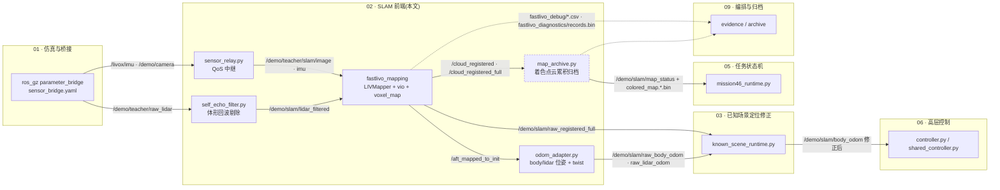
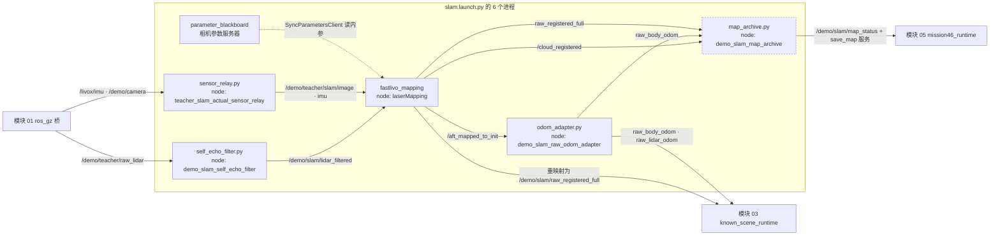
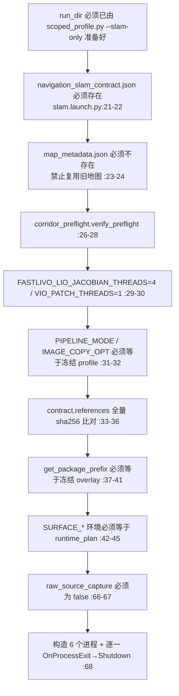
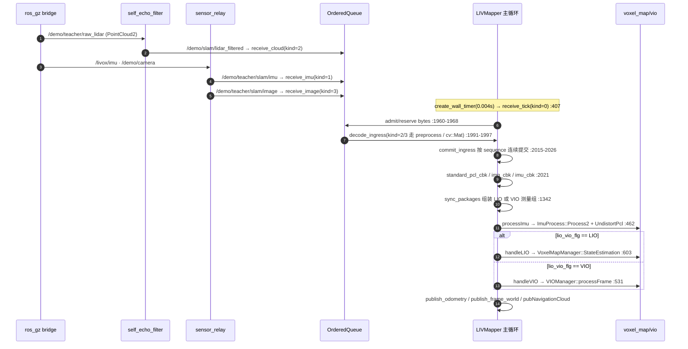
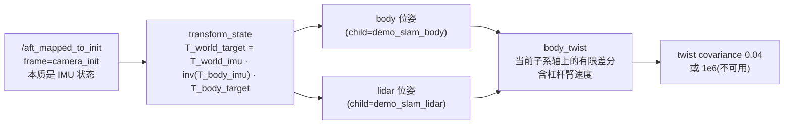

# 02 · SLAM 前端(FAST-LIVO2 + Vikit)

> 所属: Fast-Livo2-SCAN-Gazebo-dog-sim-control @ 2331b93 · 模块 02/09
> 覆盖路径:
> - `multifloor_demo/slam/ros2_ws/src/fast_livo2_core/`(C++ 算法核心)
> - `multifloor_demo/slam/ros2_ws/src/fast_livo2_ros/`(ROS 2 节点封装)
> - `multifloor_demo/slam/*.py`(Python 适配层)
> - `slam5_navigation/ros2_ws/src/vikit_common/`、`vikit_ros/`(视觉基础库)
> - `multifloor_demo/camera_mode/slam/*.yaml`(生成运行配置的模板)
> - `ENG/slam.launch.py`、`ENG/sensor_relay.py`(实际启动链)

---

## 1. 一句话职责

**把 Gazebo 桥出来的 LiDAR / IMU / RGB 三路原始流,在独立的 ROS 2 workspace 里用 FAST-LIVO2 融成一条连续的 `camera_init` 位姿链和配准点云,再由三个 Python 旁路节点把它整理成"显式 body/lidar 位姿 + 有效 twist + 相机着色点云 + 可归档地图"四种下游能直接吃的接口。**

关键限定:本模块**只输出前端观测**,不做定位修正、不做规划、不做控制(见第 8 节)。

---

## 2. 在总体数据流中的位置



**读图要点**

1. 唯一进入控制决策的 SLAM 产物是 `/demo/slam/raw_body_odom`、`/demo/slam/raw_lidar_odom`、`/demo/slam/raw_registered_full` 三条 —— 它们**都带 `raw_` 前缀**,表示"未经地图修正"。修正由模块 03 完成后改名重发(`known_scene_runtime.py:130-137`)。
2. `map_archive.py` 与 `/demo/slam/map_status` 是**任务侧接口**,不是控制接口(`mission46_runtime.py:122,131,293`)。
3. SLAM 节点自身的话题(`/rgb_img`、`/path`、`/mavros/vision_pose/pose` 等)在本轮运行中**没有任何运行期消费者**,只被包的 RViz 配置引用(见第 4、9 节)。

---

## 3. 内部子模块划分

| 子模块 | 关键文件 | 职责 | 关键符号 |
|---|---|---|---|
| ROS 节点外壳 | [main.cpp](../../multifloor_demo/slam/ros2_ws/src/fast_livo2_ros/src/main.cpp)、[runner.cpp](../../multifloor_demo/slam/ros2_ws/src/fast_livo2_core/src/runner.cpp)、[runner.hpp](../../multifloor_demo/slam/ros2_ws/src/fast_livo2_core/include/fast_livo2_core/runner.hpp) | 建 `laserMapping` 节点、注册 SIGUSR1 正常停车、构造 `LIVMapper`(把带 Eigen/PCL 成员的类封在 so 内,避免 ABI 风险) | `run_mapping`、`request_mapping_stop` |
| V19 输入管线 | [ordered_ingress.h](../../multifloor_demo/slam/ros2_ws/src/fast_livo2_core/include/fast_livo2_core/core/ordered_ingress.h)、`LIVMapper.cpp:1960-2042` | 有界、保序、按阶段记账的收发/解码/提交队列 | `OrderedQueue`、`IngressPacket`、`Stage` |
| LiDAR 预处理 | [preprocess.h](../../multifloor_demo/slam/ros2_ws/src/fast_livo2_core/include/fast_livo2_core/core/preprocess.h)、[preprocess.cpp](../../multifloor_demo/slam/ros2_ws/src/fast_livo2_core/src/preprocess.cpp) | `PointCloud2`/`CustomMsg` → `PointCloudXYZI`,blind 半径与抽点 | `Preprocess::process`、`pl_surf`、`blind_sqr` |
| IMU 处理与去畸变 | [IMU_Processing.h](../../multifloor_demo/slam/ros2_ws/src/fast_livo2_core/include/fast_livo2_core/core/IMU_Processing.h)、[IMU_Processing.cpp](../../multifloor_demo/slam/ros2_ws/src/fast_livo2_core/src/IMU_Processing.cpp) | 重力初始化、ESIKF 预测、逐点去畸变 | `ImuProcess::Process2`、`UndistortPcl`、`IMU_init` |
| 静止初始化门 | [stationary_imu_initialization.h](../../multifloor_demo/slam/ros2_ws/src/fast_livo2_core/include/fast_livo2_core/core/stationary_imu_initialization.h) | 只用一段连续静止 IMU 估计重力,任何扰动整段作废 | `StationaryImuInitialization::add/ready` |
| LIO 体素地图 + ESIKF | [voxel_map.h](../../multifloor_demo/slam/ros2_ws/src/fast_livo2_core/include/fast_livo2_core/core/voxel_map.h)、[voxel_map.cpp](../../multifloor_demo/slam/ros2_ws/src/fast_livo2_core/src/voxel_map.cpp) | 八叉树体素平面拟合、点面残差、迭代卡尔曼更新 | `VoxelMapManager::StateEstimation`、`VoxelOctoTree::init_plane`、`BuildJacobianRows` |
| VIO 直接法 | [vio.h](../../multifloor_demo/slam/ros2_ws/src/fast_livo2_core/include/fast_livo2_core/core/vio.h)、[vio.cpp](../../multifloor_demo/slam/ros2_ws/src/fast_livo2_core/src/vio.cpp) | 从同一体素地图取点、仿射 warp、patch 光度残差、EKF 更新 | `VIOManager::processFrame`、`retrieveFromVisualSparseMap`、`computeJacobianAndUpdateEKF` |
| 视觉点/特征/帧 | [visual_point.h](../../multifloor_demo/slam/ros2_ws/src/fast_livo2_core/include/fast_livo2_core/core/visual_point.h)、[feature.h](../../multifloor_demo/slam/ros2_ws/src/fast_livo2_core/include/fast_livo2_core/core/feature.h)、[frame.h](../../multifloor_demo/slam/ros2_ws/src/fast_livo2_core/include/fast_livo2_core/core/frame.h) | 地图点-参考 patch-帧位姿三者关系与金字塔 | `VisualPoint`、`Feature`、`Frame`、`frame_utils::createImgPyramid` |
| 诊断(旁路) | [diagnostics.h](../../multifloor_demo/slam/ros2_ws/src/fast_livo2_core/include/fast_livo2_core/core/diagnostics.h)、[boundary_timing.h](../../multifloor_demo/slam/ros2_ws/src/fast_livo2_core/include/fast_livo2_core/core/boundary_timing.h)、[surface_validity.h](../../multifloor_demo/slam/ros2_ws/src/fast_livo2_core/include/fast_livo2_core/core/surface_validity.h)、[surface_support_diagnostics.h](../../multifloor_demo/slam/ros2_ws/src/fast_livo2_core/include/fast_livo2_core/core/surface_support_diagnostics.h)、[run_log_directory.h](../../multifloor_demo/slam/ros2_ws/src/fast_livo2_core/include/fast_livo2_core/core/run_log_directory.h) | 有界异步日志、17 个边界计时、平面拟合有效性门、支撑点快照 | `fastlivo_diag::Logger`、`fastlivo_timing::Scope`、`fastlivo_surface::assess` |
| Python 适配层 | [self_echo_filter.py](../../multifloor_demo/slam/self_echo_filter.py)、[odom_adapter.py](../../multifloor_demo/slam/odom_adapter.py)、[geometry.py](../../multifloor_demo/slam/geometry.py)、[map_archive.py](../../multifloor_demo/slam/map_archive.py)、[heading_alignment.py](../../multifloor_demo/slam/heading_alignment.py) | 体形剔除、位姿/速度坐标系转换、地图归档、静态朝向标定 | `self_mask`、`transform_state`、`body_twist`、`VoxelArchive` |
| 视觉基础库 | `slam5_navigation/ros2_ws/src/vikit_common/`、`vikit_ros/` | 相机模型、插值、Shi-Tomasi 评分、参数加载 | `vk::PinholeCamera`、`vk::interpolateMat_8u`、`camera_loader::loadFromRosNs` |

---

## 4. 数据流与接口

### 4.0 进程级接线图(含重映射)



### 4.1 实际启动的 6 个进程与话题重映射

`ENG/slam.launch.py` 在 `OpaqueFunction.start()` 里一次性构造 6 个进程(`slam.launch.py:47-65`),并给**每一个**挂 `OnProcessExit → Shutdown`(`slam.launch.py:68`),即"有限运行":任一子进程退出,整栈立即关闭。

| 进程(slam.launch.py 行号) | 输入话题 | 输出话题 | 作用 |
|---|---|---|---|
| `sensor_relay.py`(`:48`) | `/livox/imu`、`/demo/camera`(best-effort sensor QoS) | `/demo/teacher/slam/imu`、`/demo/teacher/slam/image`、`/demo/teacher/slam/relay_status` | 把 best-effort 传感器流原样转成可靠投递,**只丢时间戳不前进的样本**;payload/字段/stamp 不变(`sensor_relay.py:26-36`) |
| `self_echo_filter.py`(`:49-50`,重映射 `/livox/lidar:=/demo/teacher/raw_lidar`) | `/demo/teacher/raw_lidar`(best-effort) | `/demo/slam/lidar_filtered`(reliable, depth 10)、`/demo/slam/lidar_filter_status` | 按固定 URDF 外参把 Go2 自身"躯干 + 摆动腿"包围盒内的点整条删除,其余字节原样保留(`self_echo_filter.py:26-30,62-64`) |
| `parameter_blackboard`(`:51-52`) | 参数文件 `navigation_camera.yaml` | —(全局参数服务器) | 供 `camera_loader` 跨节点读相机内参;节点名 `parameter_blackboard` 是硬编码的查询命名空间(`LIVMapper.cpp:260`) |
| `fastlivo_mapping`(节点名 `laserMapping`,`:53-56`,重映射 `/cloud_registered_full:=/demo/slam/raw_registered_full`) | `common.lid_topic=/demo/slam/lidar_filtered`、`common.imu_topic=/demo/teacher/slam/imu`、`common.img_topic=/demo/teacher/slam/image`(运行期由 `navigation_fastlivo.yaml` 决定,见 `scoped_profile.py:176-179`、`pid_scope.py:112`) | `/aft_mapped_to_init`、`/cloud_registered`、`/demo/slam/raw_registered_full`、`/rgb_img`、`/path`、`/mavros/vision_pose/pose` | 三路融合主节点;`additional_env={'DEMO_RUN_DIR':run}`,只有它拿到 run 目录 |
| `odom_adapter.py`(`:57-60`,重映射 `__node:=demo_slam_raw_odom_adapter`、`/demo/slam/body_odom:=/demo/slam/raw_body_odom`、`/demo/slam/lidar_odom:=/demo/slam/raw_lidar_odom`) | `/aft_mapped_to_init` | `/demo/slam/raw_body_odom`、`/demo/slam/raw_lidar_odom`、`/demo/slam/status`、TF `camera_init→demo_slam_body`/`demo_slam_lidar` | 把 IMU 系 ESIKF 状态转成显式 body/lidar 位姿与有限差分 twist |
| `map_archive.py`(`:61-64`,重映射 `/livox/lidar:=/demo/teacher/raw_lidar`、`/camera/image_color:=/demo/camera`、`/demo/slam/body_odom:=/demo/slam/raw_body_odom`、`/cloud_registered_full:=/demo/slam/raw_registered_full`) | `/cloud_registered`(累积)、`/demo/teacher/raw_lidar`、`/livox/imu`、`/demo/camera`、`/demo/slam/raw_body_odom`、`/demo/slam/raw_registered_full`(后五个只做新鲜度记账) | `/demo/slam/map_status`、服务 `/demo/slam/save_map`、文件 `colored_map.NNNNNN.bin`/`colored_map.pcd`/`map_metadata.json` | 本轮观测到的相机着色点云去重累积与归档 |

> 注意两处容易读错的地方:
> ① `/demo/teacher/raw_lidar` 的**生产者是模块 01 的 ros_gz 桥**(`teacher_mode/simulation/prepare.py:160`),`self_echo_filter` 与 `map_archive` 都是它的消费者 —— launch 里的 `-r /livox/lidar:=...` 改的是这两个节点的**订阅**名。
> ② 本模块**没有任何节点发布 `/demo/slam/body_odom`**;该名字在本次 launch 中由模块 03 的 `known_scene_runtime.py:130` 发布(修正后)。

### 4.2 话题级接口表

| 话题 | 类型 | 生产者(文件:行) | 消费者(文件:行) |
|---|---|---|---|
| `/demo/slam/lidar_filtered` | `PointCloud2` | `self_echo_filter.py:62,77` | `fastlivo_mapping`(经 `common.lid_topic`,`scoped_profile.py:178`)、`known_scene_runtime.py:135`、`bounded_shadow_capture.py:11` |
| `/demo/teacher/slam/{imu,image}` | `Imu`/`Image` | `sensor_relay.py:26-29,35` | `fastlivo_mapping`、`known_scene_runtime.py:144-147`(旁路观测) |
| `/aft_mapped_to_init` | `Odometry` | `LIVMapper.cpp:396,643,1928` | `odom_adapter.py:38`、`known_scene_runtime.py:137`、`bounded_shadow_capture.py:13` |
| `/cloud_registered` | `PointCloud2`(带 RGB) | `LIVMapper.cpp:391`、发布于 `:1736` | `map_archive.py:105` |
| `/cloud_registered_full`→`/demo/slam/raw_registered_full` | `PointCloud2`(仅 XYZI,全扫描) | `LIVMapper.cpp:390`、发布于 `:695` | `known_scene_runtime.py:135`、`map_archive.py:111`、`sensor_gate.py:168`、`bounded_shadow_capture.py:12` |
| `/demo/slam/raw_body_odom` | `Odometry` | `odom_adapter.py:28,85` | `known_scene_runtime.py:136`、`map_archive.py:110`、`sensor_gate.py:167` |
| `/demo/slam/raw_lidar_odom` | `Odometry` | `odom_adapter.py:28,85` | `known_scene_runtime.py:136` |
| `/demo/slam/map_status` | `String`(JSON) | `map_archive.py:104,191` | `mission46_runtime.py:131,168` |
| `/demo/slam/save_map` | `std_srvs/Trigger` | 服务端 `map_archive.py:113` | 客户端 `mission46_runtime.py:122` |
| `/rgb_img` | `Image` | `LIVMapper.cpp:404`、发布于 `:558` | **本快照未找到运行期消费者**(仅 `rviz/fast_livo2.rviz:704`) |
| `/path` | `Path` | `LIVMapper.cpp:397`、发布于 `:703` | 同上(仅 RViz) |
| `/mavros/vision_pose/pose` | `PoseStamped` | `LIVMapper.cpp:403`、发布于 `:704` | 同上(仅 RViz) |

### 4.3 只声明不发布的"僵尸"发布者

`initializeSubscribersAndPublishers` 一次性创建 17 个发布者(`LIVMapper.cpp:390-408`),其中下列在本快照里**找不到任何 publish 调用**:`/visualization_marker`(:392)、`/Laser_map`(:395)、`/planner_normal`(:398)、`/voxels`(:399)、`/dyn_obj`(:400)、`/dyn_obj_removed`(:401)、`/dyn_obj_dbg_hist`(:402);`/cloud_visual_sub_map_before`(:393)有 `publish_visual_sub_map`(`:1847,1859`)但**没有调用点**。`/cloud_effected`、`/planes`、`/LIVO2/imu_propagate` 由参数关闭:`pub_effect_point_en=false`、`pub_plane_en=false`、`uav.imu_rate_odom=false`(`camera_mode/slam/fastlivo.yaml:107-108,103`;读取处 `LIVMapper.cpp:199,235`、`voxel_map.cpp:115`)。

---

## 5. 关键流程与时序

### 5.1 启动门与一次性校验



任何一条不满足都是**启动期 `RuntimeError`**,不是运行期降级。

### 5.2 一路数据进到状态估计



**逐步讲解**

1. **入口分流**:三个回调不是直接被 ROS executor 调用的。`initializeSubscribersAndPublishers` 把 `sub_pcl` 绑到 `receive_cloud`(:380)、`sub_imu`→`receive_imu`(:382)、`sub_img`→`receive_image`(:383)。三个 `receive_*` 只负责**打收据、算容量预留、入队**(`IngressPacket` 字段见 `LIVMapper.h:38-50`);解码在 `decode_ingress`(:1991)里做 —— LiDAR 走 `p_pre->process`(:1993),图像走 `getImageFromMsg`(:1993);IMU/定时 tick 无需解码。
2. **顺序与背压**:`OrderedQueue` 用 `std::map<sequence,Slot>` 保证"按序提交",槽位在 Raw/Decoding/Ready/Owner 四阶段间流转,只有 owner `acknowledge` 后才释放字节额度(`ordered_ingress.h:16-42`)。容量上限 512 项 / 64 MiB(`LIVMapper.h:54`);超限即置 `failure` 并让整条管线**失败退出**,而不是静默丢包(`ordered_ingress.h:26`)。
3. **主循环**:`run()`(:800)先 `start_ingress()`(:803),然后循环:检查 SIGUSR1 停车标志(:810)→ `serial` 模式走 `rclcpp::spin_some`,其余模式走 `commit_ingress()`(:811-812)→ 每 5000 次打印缓冲水位(:820-828)→ `sync_packages`(:830)不成组就睡 200 µs 继续 → `handleFirstFrame` → `processImu` → `stateEstimationAndMapping`(:838-844)。
4. **LIO/VIO 交替**:LIVO 模式下 `sync_packages` 是状态机 —— 上一拍为 `WAIT/VIO` 时产出一个 **LIO** 测量组(`:1548`),上一拍为 `LIO` 时产出一个 **VIO** 测量组(`:1560`)。也就是"每帧 LiDAR 一次 LIO、每帧图像一次 VIO"交替推进,`LidarMeasures.lio_vio_flg` 决定 `stateEstimationAndMapping` 走 `handleLIO` 还是 `handleVIO`(:485-494)。
5. **收尾**:正常停车会先 `commit_ingress` 排空再 `ingress_queue.close()`,后者在未排空时抛异常(`ordered_ingress.h:45`);异常路径走 `abandon()` 并在 `pipeline_v19_summary.json` 里列出未提交包(:2033-2039)。本轮运行记录的 accepted/delivered/committed 三者相等(见 [C44_EXPERIMENT.md](../C44_EXPERIMENT.md)),即走的正常排空路径。

### 5.3 `odom_adapter` 的坐标转换



- `transform_state`(`geometry.py:12-22`)先校验位姿有限、四元数非零,再用 `sensor_transform`(:6-9)从 `scenario.json` 的 `sensors.{imu,lidar}.body_{xyz,rpy}` 取外参。它**只用固定外参,不读真值、不读仿真位姿**。
- `body_twist`(`geometry.py:25-38`)在**当前子系轴**上做差分,先做 SE(3) 目标点变换再微分,因此保留杠杆臂速度 —— 这正是不直接把 IMU 原始速度搬进 body 消息的原因(注释 `:28-31`)。
- 有效性条件很窄:`dt ∈ (0,1]` 且存在上一帧(`odom_adapter.py:63`);不满足时 twist 保持 0 且协方差置 `1e6`(:83-84)。时间戳不递增直接整帧拒绝(:47-50)。
- TF 用 `demo_slam_body`/`demo_slam_lidar` 这种**适配器专属 frame 名**(:86-95),避免与 CHAMP/URDF 的 `odom→base` 树冲突。

---

## 6. 关键数据结构与配置

### 6.1 核心结构

| 结构 | 位置 | 要点 |
|---|---|---|
| `StatesGroup` | `common_lib.h:133-230` | 19 维 ESIKF 状态:`rot_end/pos_end/vel_end/inv_expo_time/bias_g/bias_a/gravity` + 19×19 `cov`;`operator+/-` 用 `Exp/Log` 做流形加减 |
| `MeasureGroup` / `LidarMeasureGroup` | `common_lib.h:66-104` | 一次更新的输入组;`lio_vio_flg` 为 `WAIT/VIO/LIO/LO` |
| `pointWithVar` | `common_lib.h:106-130` | 点 + 三类协方差(含去掉状态项的 `var_nostate`)+ 只读诊断 sidecar |
| `IngressPacket` | `LIVMapper.h:38-50` | `kind`(0 tick / 1 imu / 2 cloud / 3 image)+ 8 个墙钟打点 + `reserved_bytes` |
| `OrderedQueue<T>` | `ordered_ingress.h:14-56` | 512/64 MiB 双上限,按序提交与确认 |
| `VoxelOctoTree` / `VoxelPlane` | `voxel_map.h:80-196` | 每体素一个平面(中心/法向/特征值/平面方差)+ 8 叉子树 |
| `Frame` / `Feature` / `VisualPoint` | `frame.h:26-71`、`feature.h:19-54`、`visual_point.h:23-46` | 帧存图像金字塔与特征表;特征存 patch 指针与 `T_f_w_`;地图点存观测列表与参考 patch |
| `fastlivo_surface::Quality` | `surface_validity.h:26-35` | `reason` 0 接受 / 1 支撑不足 / 2 非有限 / 3 一维支撑 / 4 归一化残差超限 |

### 6.2 配置来源(三层)

1. **模板**:[fastlivo.yaml](../../multifloor_demo/camera_mode/slam/fastlivo.yaml)(`lidar_type: 0` 即通用 `PointCloud2` 分支、`blind: 0.3`、`voxel_size: 0.5`、`img_point_cov: 100000000`、`imu_int_frame: 300`、`stationary_initialization_en: true`)与 [camera.yaml](../../multifloor_demo/camera_mode/slam/camera.yaml)(640×480、fx=fy=381.361、D=0)。包的默认配置是 [avia.yaml](../../multifloor_demo/slam/ros2_ws/src/fast_livo2_ros/config/avia.yaml)(Livox Avia、`lidar_type: 1`)与 [camera_pinhole.yaml](../../multifloor_demo/slam/ros2_ws/src/fast_livo2_ros/config/camera_pinhole.yaml)(1280×1024),**它们不是本轮运行的配置**。
2. **生成**:`scoped_profile.py:174-196` / `pid_scope.py:110-133` 覆写话题名、外参(`extrinsic_T/R` 由 `R_imu^T` 折算,`Rcl/Pcl` 走相机光学系 `[[0,-1,0],[0,0,-1],[1,0,0]]`)、`imu_int_frame = round(rate_hz·3)`、`init_min_span = 2.9`,写成 `run/navigation_fastlivo.yaml`。
3. **冻结**:`slam.launch.py:33-36` 对这份生成文件与二进制做 sha256 校验后启动,运行时不可改。
4. **环境变量**:见第 7 节。

### 6.3 诊断产物落点

| 产物 | 路径 | 触发条件 |
|---|---|---|
| `pipeline_v19_events.csv`(23 列)、`pipeline_v19_lifecycle.csv`、`pipeline_v19_summary.json` | `<DEMO_RUN_DIR>/fastlivo_debug/`(`run_log_directory.h:15-16`;写入 `LIVMapper.cpp:2002-2004,2038`) | 只要 `ingress_enabled`(默认 true,`LIVMapper.h:51`) |
| `mat_pre.txt` / `mat_out.txt` / `imu.txt` | 同上(`LIVMapper.cpp:370-371`、`IMU_Processing.cpp:680-683`) | 始终 / IMU 初始化完成时 |
| `records.bin` + `index.csv` + `writer_stats.json` | `$FASTLIVO_DIAGNOSTIC_DIR`(`<run>/fastlivo_diagnostics`,`run.py:228`) | 仅当该环境变量存在;已存在则**直接抛异常**拒绝覆盖(`diagnostics.h:79`) |
| `colored_map.NNNNNN.bin` / `colored_map.pcd` / `map_metadata.json` | `<run>/`(`map_archive.py:88,182-189,218`) | 有脏数据即每 2 s 落一个不可变版本,保留最近 3 个(`:192-195`) |

---

## 7. 代码结构讲解

```
multifloor_demo/
├─ camera_mode/slam/                 # 生成运行配置的模板(真正被运行使用)
│  ├─ fastlivo.yaml                  # 传感器话题/外参/VIO/LIO/IMU 初始化门
│  └─ camera.yaml                    # 640×480 Pinhole, D=0
├─ slam/
│  ├─ ros2_ws/src/
│  │  ├─ fast_livo2_core/            # 共享库:算法核心(CMakeLists.txt:81-91)
│  │  │  ├─ include/fast_livo2_core/core/*.h
│  │  │  ├─ include/fast_livo2_core/utils/{so3_math,types,utils,color}.h
│  │  │  └─ src/{LIVMapper,vio,voxel_map,preprocess,IMU_Processing,
│  │  │           frame,visual_point,runner,utils}.cpp
│  │  └─ fast_livo2_ros/             # 可执行 fastlivo_mapping + 配置 + RViz
│  ├─ self_echo_filter.py            # 体形回波剔除
│  ├─ odom_adapter.py                # IMU 状态 → body/lidar 位姿 + twist
│  ├─ geometry.py                    # 坐标代数的唯一实现(被测试复用)
│  ├─ map_archive.py                 # 着色点云累积/归档
│  └─ heading_alignment.py           # 静态朝向标定(工具,无 ROS)
slam5_navigation/ros2_ws/src/
├─ vikit_common/                     # 相机模型 + 图像工具 + NLLS/img_align(未接入)
└─ vikit_ros/                        # camera_loader(在用) + output_helper(未接入)
```

逐个文件:

| 文件 | 作用 | 关键证据 |
|---|---|---|
| [main.cpp](../../multifloor_demo/slam/ros2_ws/src/fast_livo2_ros/src/main.cpp) | 17 行的入口:建 `laserMapping` 节点、`SIGUSR1` → 正常停车标志、异常返回 2 | `:5,10,12-16` |
| [runner.cpp](../../multifloor_demo/slam/ros2_ws/src/fast_livo2_core/src/runner.cpp) / [runner.hpp](../../multifloor_demo/slam/ros2_ws/src/fast_livo2_core/include/fast_livo2_core/runner.hpp) | 把 `LIVMapper` 的构造与运行封在 so 内;注释说明原因是 Eigen/PCL 成员布局与编译架构标志耦合 | `runner.cpp:15-22`;`runner.hpp:10-13` |
| [LIVMapper.cpp](../../multifloor_demo/slam/ros2_ws/src/fast_livo2_core/src/LIVMapper.cpp) | 主控:参数、订阅/发布、`run()` 主循环、同步、两条处理分支、19 个发布者、V19 管线 | 见第 4、5 节行号 |
| [LIVMapper.h](../../multifloor_demo/slam/ros2_ws/src/fast_livo2_core/include/fast_livo2_core/core/LIVMapper.h) | 类定义;`IngressPacket` 与管线成员在此 | `:38-70` |
| [ordered_ingress.h](../../multifloor_demo/slam/ros2_ws/src/fast_livo2_core/include/fast_livo2_core/core/ordered_ingress.h) | 保序有界队列;`close()` 要求完全排空 | `:41-45` |
| [preprocess.cpp](../../multifloor_demo/slam/ros2_ws/src/fast_livo2_core/src/preprocess.cpp) | 按 `lidar_type` 分派;`lidar_type=0` 走通用分支:`fromROSMsg` → 抽点 → 有限性与 `blind_sqr` 过滤 → `curvature=0` | `:62-124` |
| [IMU_Processing.cpp](../../multifloor_demo/slam/ros2_ws/src/fast_livo2_core/src/IMU_Processing.cpp) | `Process2`(:624)在未初始化时只喂静止门,初始化完成才去畸变;`UndistortPcl`(:287)逐点反传播 | `:640-692` |
| [stationary_imu_initialization.h](../../multifloor_demo/slam/ros2_ws/src/fast_livo2_core/include/fast_livo2_core/core/stationary_imu_initialization.h) | 静止窗校验器;`ready()` 要求样本数够且跨度 ≥ 2.9 s | `:33-88` |
| [voxel_map.cpp](../../multifloor_demo/slam/ros2_ws/src/fast_livo2_core/src/voxel_map.cpp) | 体素平面拟合 + 残差查询 + ESIKF 迭代;`init_plane` 里插入可选有效性门 | `:130-239`、`:509-698` |
| [vio.cpp](../../multifloor_demo/slam/ros2_ws/src/fast_livo2_core/src/vio.cpp) | VIO 全流程:`processFrame`(:2095)串起 `retrieveFromVisualSparseMap`/`computeJacobianAndUpdateEKF`/`generateVisualMapPoints`/`updateVisualMapPoints` | `:2095-2133` |
| [visual_point.cpp](../../multifloor_demo/slam/ros2_ws/src/fast_livo2_core/src/visual_point.cpp) / [feature.h](../../multifloor_demo/slam/ros2_ws/src/fast_livo2_core/include/fast_livo2_core/core/feature.h) / [frame.cpp](../../multifloor_demo/slam/ros2_ws/src/fast_livo2_core/src/frame.cpp) | 地图点的观测管理、参考 patch 选择、帧校验(尺寸/灰度必须匹配相机模型) | `visual_point.cpp:57-111`;`frame.cpp:36-48` |
| [common_lib.h](../../multifloor_demo/slam/ros2_ws/src/fast_livo2_core/include/fast_livo2_core/core/common_lib.h) / [so3_math.h](../../multifloor_demo/slam/ros2_ws/src/fast_livo2_core/include/fast_livo2_core/utils/so3_math.h) / [utils.h](../../multifloor_demo/slam/ros2_ws/src/fast_livo2_core/include/fast_livo2_core/utils/utils.h) | 状态/测量结构、`Exp/Log/RotMtoEuler`、时间戳编解码(`sec2Stamp` 用 `llround` 避免丢 1 ns) | `common_lib.h:34-57`;`so3_math.h:9-87`;`utils.h:18-33` |
| [diagnostics.h](../../multifloor_demo/slam/ros2_ws/src/fast_livo2_core/include/fast_livo2_core/core/diagnostics.h) | 单例异步日志:队列上限 256 条 / 32 MiB,超限计数丢弃;后台线程每 2 s flush 并写 `writer_stats.json` | `:92-104,120-150` |
| [boundary_timing.h](../../multifloor_demo/slam/ros2_ws/src/fast_livo2_core/include/fast_livo2_core/core/boundary_timing.h) | 17 个边界的 wall/thread-CPU/process-CPU 计时,每秒聚合成一条 kind=300 记录 | `:8,15-47` |
| [surface_validity.h](../../multifloor_demo/slam/ros2_ws/src/fast_livo2_core/include/fast_livo2_core/core/surface_validity.h) | 平面拟合的工程有效性门(不是标定过的 χ²) | `:22-25,36-65` |
| [surface_support_diagnostics.h](../../multifloor_demo/slam/ros2_ws/src/fast_livo2_core/include/fast_livo2_core/core/surface_support_diagnostics.h) | ROI + 时间窗 + 字节预算三重约束下的支撑点快照(kind 104/105) | `:31-54,74-113` |
| [run_log_directory.h](../../multifloor_demo/slam/ros2_ws/src/fast_livo2_core/include/fast_livo2_core/core/run_log_directory.h) | 日志目录解析:优先 `DEMO_RUN_DIR/fastlivo_debug`,否则 `mkdtemp` 独立临时目录 | `:13-26` |
| [geometry.py](../../multifloor_demo/slam/geometry.py) | `transform_state`/`body_twist`/`shifted_pose_covariance`/`cloud_records` | `:12-83` |
| [map_archive.py](../../multifloor_demo/slam/map_archive.py) | 16 B/点的浏览器格式、原子写、版本化快照、保守的 `save()` 门 | `:29-39,42-70,178-228` |
| [heading_alignment.py](../../multifloor_demo/slam/heading_alignment.py) | 用时间配对的 IMU/SLAM 姿态求 `R_camera_init_world` 偏航并冻结;显式声明"不做位姿修正" | `:28-90` |
| [mapping_aviz.launch.py](../../multifloor_demo/slam/ros2_ws/src/fast_livo2_ros/launch/mapping_aviz.launch.py) | **包的示例 launch**(parameter_blackboard + 图像解压 republish + fastlivo + 可选 RViz);`use_rviz` 默认 `False`。本轮运行**不使用**它 | `:23-27,64-108` |
| [decompress_images.py](../../multifloor_demo/slam/ros2_ws/src/fast_livo2_ros/scripts/decompress_images.py) | 回放压缩 bag 时的解压节点;本快照的运行链**未启动**它 | `:9-25` |

---

## 8. 与其他模块的边界

| 边界 | 本模块负责 | 对方负责 |
|---|---|---|
| ↔ 01 仿真与桥接 | 只消费桥出来的 `/demo/teacher/raw_lidar`、`/livox/imu`、`/demo/camera`;不读仿真真值、不调 Gazebo API | 生成世界/SDF、传感器外参、ros_gz 桥配置(`teacher_mode/simulation/prepare.py:147-160`) |
| ↔ 03 定位修正 | 输出**未修正**的 `raw_*` 三件套与配准点云;`camera_init` 是 SLAM 自己的世界原点 | 用提供的场景地图做匹配、P95 门槛、修正后改名发 `/demo/slam/body_odom`、`/cloud_registered_full`(`known_scene_runtime.py:130-137`) |
| ↔ 05 任务 | 通过 `/demo/slam/map_status` + `/demo/slam/save_map` 提供地图落盘能力 | 决定何时触发保存、如何判定区域通过(`mission46_runtime.py:122,131,293`) |
| ↔ 06 控制 | 只提供位姿/速度/点云;`odom_adapter` 的 twist 有效性语义由控制侧解释 | 新鲜度看门狗、`correction_stale`/`control_allowed` 决策 |
| ↔ 09 编排 | 提供 `fastlivo_debug/*.csv` 与 `pipeline_v19_summary.json` 的 schema 与状态 | 在 run 收尾时读取并校验(`pipeline_lifecycle.py:18-40,74-76`),冻结源码 sha256 清单 |

一条硬边界:**本模块不含任何"是否允许运动"的判断**。SLAM 健康与否只体现为话题新鲜度与状态 JSON,是否停车由模块 06 决定。

---

## 9. 已知限制与失败点

1. **本轮失败不在本模块,但边界正好卡在这里**。任务在第 6 个区域超时失败,直接原因是"可接纳的已知场景修正过期 → 控制禁止运动 → 区域超时"。失败时 pose/cloud age 仅 0.011/0.009 s —— **前端是新鲜的,但新鲜的前端位姿不能替代有效的地图修正**([C44_EXPERIMENT.md](../C44_EXPERIMENT.md))。
2. **`/cloud_registered` 与 `/cloud_registered_full` 内容不同**,不可互换:`/cloud_registered` 只在 VIO 更新时发相机着色点(`LIVMapper.cpp:1668-1736`,要求投影非空),`/cloud_registered_full` 在每次 LIO 更新发全量去畸变扫描且**没有 RGB 字段**(`:691-695`)。`map_archive` 的累积用的是前者,后者只做新鲜度记账。
3. **图像时的偏移**:模板 `img_time_offset: 0.0`(`camera_mode/slam/fastlivo.yaml:46`),但包的示例配置是 `0.1`(`avia.yaml:23`)。改动它等于改动 VIO 与 LIO 的时间关联,属于冻结契约范围内的量。
4. **IMU 初始化是"全有或全无"**:静止门一旦因振动、样本间隔 > 30 ms、角速度 > 0.03 rad/s 或加速度轴标准差 > 0.40 而拒绝,**整段统计清零重来**(`stationary_imu_initialization.h:71-75,105-110`),并且 `ready()` 还要求跨度 ≥ 2.9 s(`:85-88`)。任务启动阶段的任何移动都会推迟重力对齐。
5. **`FASTLIVO_VIO_PATCH_THREADS` 不控制任何 C++ 行为**。它在全仓库只出现在 `slam.launch.py:29-30` 与 `run.py:233`,即"冻结环境校验";真正的线程数是编译期宏 `V16_VIO_PATCH_THREADS`(`fast_livo2_core/CMakeLists.txt:37-43`,`vio.cpp:1616-1617`)。两者不一致时启动脚本**不会**发现,只有重新编译才会改变行为。
6. **`-march=native` 的 ABI 反差**:`fast_livo2_core` 明确回避 `-march=native`(注释说明会破坏与发行版 PCL 的 Eigen 对齐 ABI,`fast_livo2_core/CMakeLists.txt:13-16`),而 `vikit_common` 直接启用它(`vikit_common/CMakeLists.txt:11`)。两者最终链接进同一个进程,是这套构建里最需要注意的不一致点。
7. **相机模型加载有三重回退**:`camera_loader` 先读 `parameter_blackboard` 远端参数,失败再读本节点参数,都失败就**硬编码一个 1280×1024/scale 0.5 的 PinholeCamera 并继续**(`camera_loader.cpp:94-100`)。它只在 `stderr` 打一行提示,不会让节点失败 —— 参数配错时表现为"位姿看着能跑但投影错位"。
8. **`params_helper` 的 `popen` 回退**:跨节点取参数失败时会 fork `ros2 param get`(`params_helper.h:34-35,125`),这是 SLAM 进程内的一次外部进程调用。
9. **诊断窗口默认值有误导性**:`diagnostics.h:152` 的默认 detail 窗口是 `[115,165]` s,而实际运行由 `run.py:227-230` 用 profile 的 `detail_window_sim_s` 覆盖。窗口外只保留标量摘要,不是"零值"(`engineering_nav46.json:207`)。
10. **`map_archive` 的存在性门是硬门**:`map_metadata.json` 已存在即拒绝启动(`map_archive.py:91-92`),`slam.launch.py:23-24` 也做同样检查;`save()` 在容量超限或任一传感器陈旧时**拒绝标记保存成功**(`:204-216`)。

---

## 10. 建议阅读路线

**想搞清"数据怎么流"**(约 40 分钟):
1. `ENG/slam.launch.py` 全文(71 行)—— 先建立"6 个进程 + 话题重映射 + 启动门"的全貌。
2. `self_echo_filter.py`(:26-30, :33-53, :62-86)—— 输入侧到底改了什么、没改什么。
3. `LIVMapper.cpp:375-409`(订阅/发布清单)→ `:800-850`(主循环)→ `:1960-2042`(管线三态)。
4. `odom_adapter.py` + `geometry.py` —— 输出侧坐标系语义。
5. `map_archive.py:85-135`(订阅与累积)+ `:178-228`(归档与保存门)。

**想搞清"位姿怎么算出来的"**(约 2 小时):
1. `common_lib.h:133-230`(`StatesGroup`)与 `so3_math.h`。
2. `IMU_Processing.cpp:119-199`(初始化)→ `:624-694`(`Process2`)→ `:287-620`(去畸变)。
3. `voxel_map.cpp:130-239`(平面拟合)→ `:447-508`(雅可比行)→ `:509-700`(ESIKF)。
4. `vio.cpp:48-176`(相机/网格初始化)→ `:377-905`(取点与 warp)→ `:905-950`(EKF 更新)→ `:2095-2160`(`processFrame`)。
5. `visual_point.cpp` + `feature.h` + `frame.h` —— 视觉地图点与 patch 的生命周期。

**想复核本轮结果**:先读 [C44_EXPERIMENT.md](../C44_EXPERIMENT.md),再回到 [00-overview-dataflow.md](00-overview-dataflow.md) 第 10 节,把失败链的三个环节分别落到模块 03 / 06 / 05;本模块只需确认"前端当时是新鲜的"(失败时 pose/cloud age 0.011/0.009 s)。

**想改代码**:动手前先读 `slam.launch.py:29-45` —— 任何源码、配置二进制改动都会让 sha256 冻结校验失败,必须重新走 `scoped_profile.py` 制备 run 目录。
