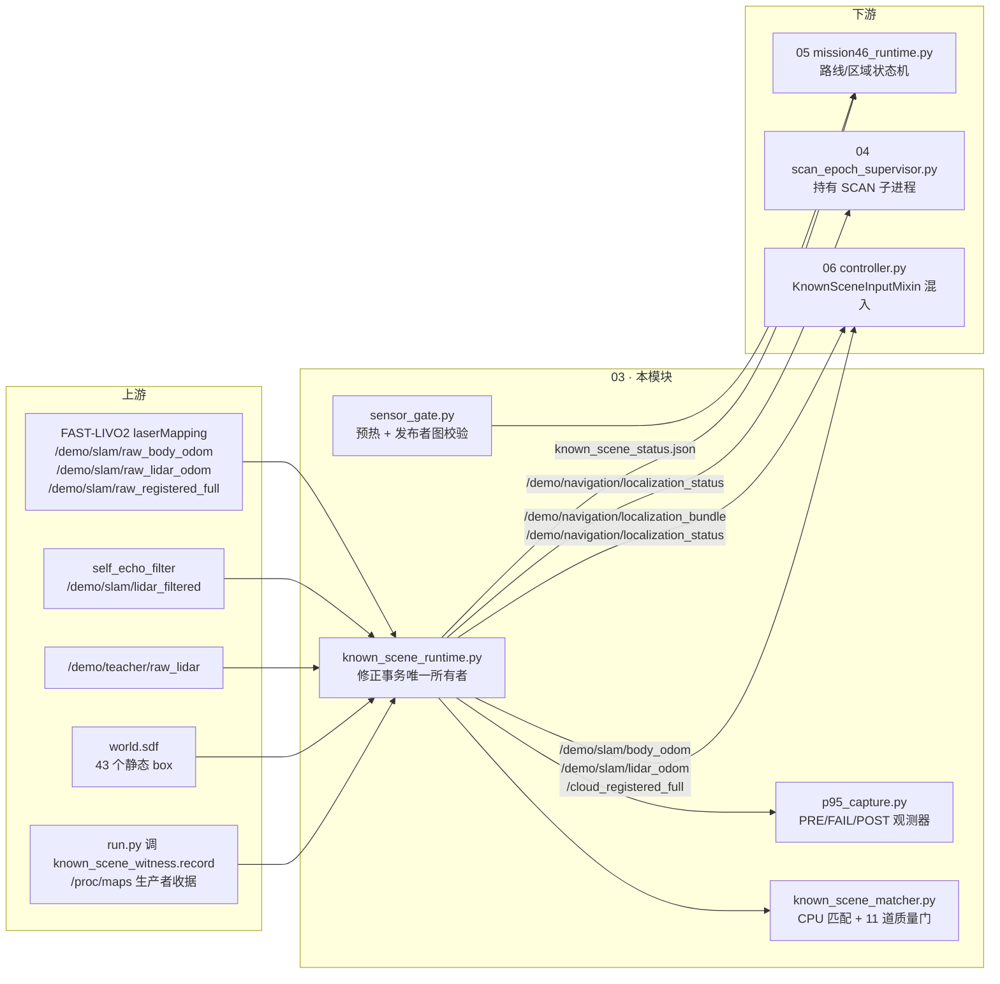
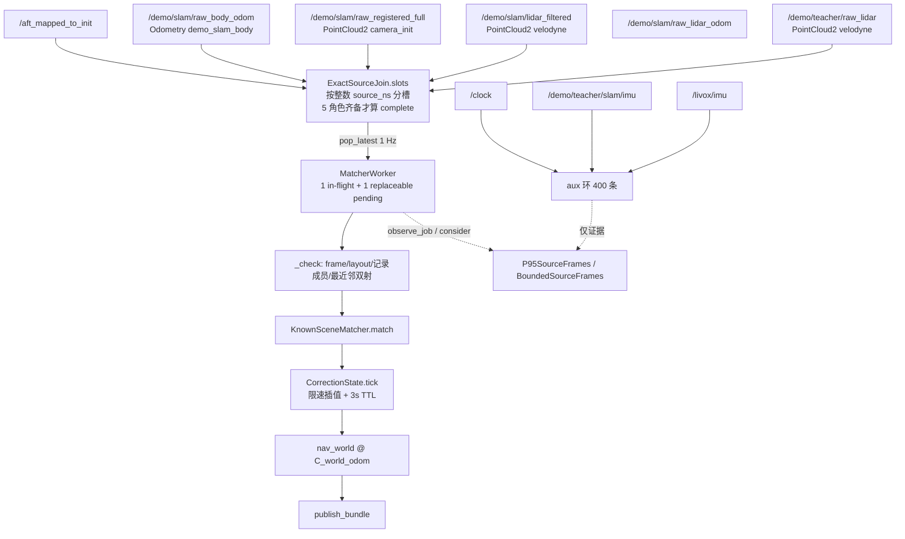
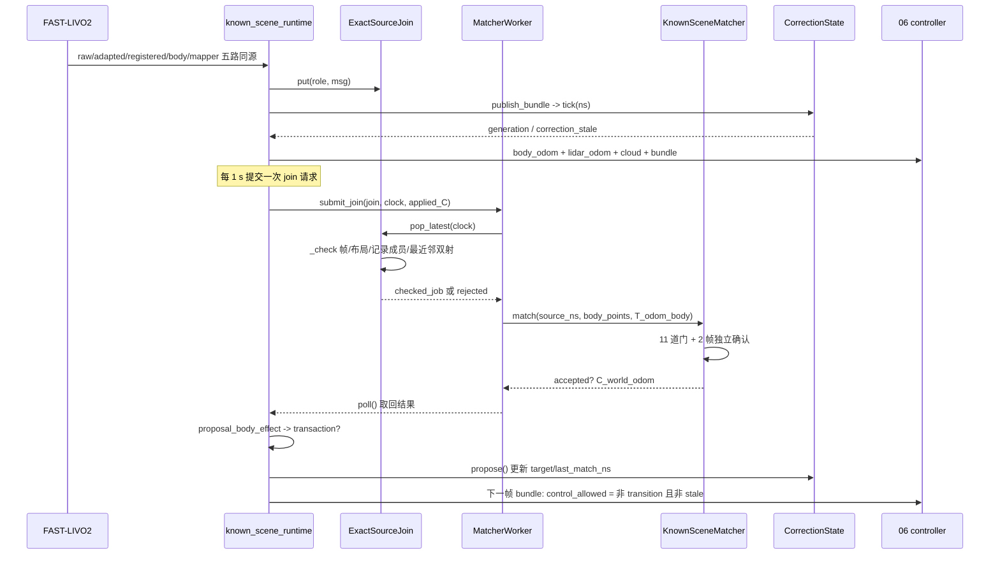
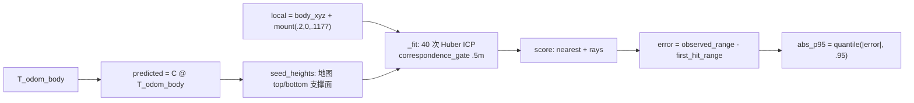
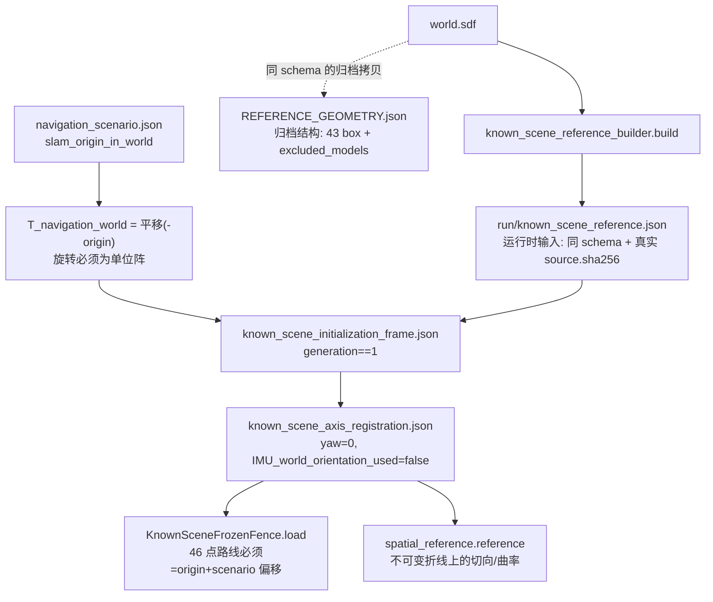

# 03 · 已知场景定位修正与时空关联

> 所属: Fast-Livo2-SCAN-Gazebo-dog-sim-control @ 2331b93 · 模块 03/09
> 覆盖路径: [ENG 目录](../../multifloor_demo/teacher_mode/navigation/engineering_v34_r44_active_p95_capture_candidate)(下文简称 **ENG**,即 `multifloor_demo/teacher_mode/navigation/engineering_v34_r44_active_p95_capture_candidate/`)
> 核心: `ENG/known_scene_inputs.py`、`known_scene_adapter.py`、`known_scene_matcher.py`、`known_scene_runtime.py`、`known_scene_route_registration.py`、`known_scene_reference_builder.py`、`known_scene_witness.py`、`known_scene_stale_recovery.py`、`ENG/spatial_reference.py`、`ENG/sensor_gate.py`、`ENG/p95_capture.py`、`ENG/bounded_shadow_capture.py`、`ENG/event_aware_source_capture.py`、`ENG/*_schema.json`、`ENG/REFERENCE_GEOMETRY.json`、`ENG/KNOWN_SCENE_TEMPORAL_CAPTURE_CONTRACT.json`、`multifloor_demo/teacher_mode/navigation/sensor_relay.py`

---

## 1. 一句话职责

**在不改动 FAST-LIVO2 本体的前提下,用一份显式提供的静态场景几何地图,对 SLAM 输出的位姿与配准点云做"有界、可审计、可拒绝"的地图修正事务,并把"修正是否仍然有效"这一唯一布尔事实(`correction_stale` / `control_allowed`)交给下游控制与规划模块决定是否允许运动。**

它**不是**独立建图,也**不做**全局唯一定位:匹配目标函数不使用 ROS、仿真位姿、IMU 世界姿态、前端协方差或路线答案(`ENG/known_scene_matcher.py:1-7`),返回结果里硬编码 `independent_sensor_map=False`、`global_search_complete=False`、`calibrated_covariance=False`(`known_scene_matcher.py:313-321`)。

---

## 2. 在总体数据流中的位置



**必须记住的定位**:本模块是**旁挂式上游**(inline upstream gate),不是控制器的一部分。它读**原始**(raw)话题、读**自己的**修正事务状态、写**规范化**(canonical)话题。下游看到的所有位姿/点云都是被 `C_world_odom` 变换之后的版本(`known_scene_runtime.py:224-235`)。

---

## 3. 内部子模块划分

> `ENG` = `.../engineering_v34_r44_active_p95_capture_candidate/`。文件链接指向仓库内实际路径。

| 子模块 | 关键文件 | 职责 | 关键符号 |
|---|---|---|---|
| 摄取与代际门 | [known_scene_inputs.py](../../multifloor_demo/teacher_mode/navigation/engineering_v34_r44_active_p95_capture_candidate/known_scene_inputs.py) | 原子 pose/cloud/metadata 归并;`_known_generation_ready` 是控制器侧唯一放行条件 | `KnownSceneInputMixin`、`_known_receive`、`_known_generation_ready`、`_control_candidate` |
| 精确源关联 | [known_scene_adapter.py](../../multifloor_demo/teacher_mode/navigation/engineering_v34_r44_active_p95_capture_candidate/known_scene_adapter.py) | 五角色整数时间戳 join + 源级几何否决 + 有界后台 worker | `ExactSourceJoin`、`MatcherWorker`、`SourceGeometryMismatch`、`validate_runtime_witness` |
| 匹配器 | [known_scene_matcher.py](../../multifloor_demo/teacher_mode/navigation/engineering_v34_r44_active_p95_capture_candidate/known_scene_matcher.py) | 静态 box 地图上的小规模 CPU ICP + 射线残差门 + 收敛/歧义/跳变门 + 双重确认 | `SceneReference`、`KnownSceneMatcher`、`MatchPolicy`、`CorrectionState` |
| 运行时事务 | [known_scene_runtime.py](../../multifloor_demo/teacher_mode/navigation/engineering_v34_r44_active_p95_capture_candidate/known_scene_runtime.py) | **唯一进程**:订阅 raw、发布 canonical、维护 `CorrectionState`、写全部 bundle/status/evidence | `Runtime`、`publish_bundle`、`tick`、`proposal_body_effect`、`transaction_convergence` |
| 冻结地图坐标轴 | [known_scene_route_registration.py](../../multifloor_demo/teacher_mode/navigation/engineering_v34_r44_active_p95_capture_candidate/known_scene_route_registration.py) | 匹配成功后冻结"提供地图坐标系"证据,产出路线 fence 依据 | `KnownSceneAxisRegistration`、`validate_initial_frame`、`KnownSceneFrozenFence` |
| 参考几何构建 | [known_scene_reference_builder.py](../../multifloor_demo/teacher_mode/navigation/engineering_v34_r44_active_p95_capture_candidate/known_scene_reference_builder.py) | 从 `world.sdf` 只抽静态 box | `build`、`pose` |
| 生产者见证 | [known_scene_witness.py](../../multifloor_demo/teacher_mode/navigation/engineering_v34_r44_active_p95_capture_candidate/known_scene_witness.py) | 记录真实加载的库与冻结的 post-LIO 源阶段 | `record`、`group` |
| 过期事务恢复 | [known_scene_stale_recovery.py](../../multifloor_demo/teacher_mode/navigation/engineering_v34_r44_active_p95_capture_candidate/known_scene_stale_recovery.py) | fail-closed 的 ABORT+替换**提案**,自身不改状态 | `recovery_proposal`、`CONTRACT` |
| 空间方向参考 | [spatial_reference.py](../../multifloor_demo/teacher_mode/navigation/engineering_v34_r44_active_p95_capture_candidate/spatial_reference.py) | 不可变折线上的可审计切向/曲率/速度预算 | `configuration`、`reference`、`speed_budget`、`point_at` |
| 传感器预热门 | [sensor_gate.py](../../multifloor_demo/teacher_mode/navigation/engineering_v34_r44_active_p95_capture_candidate/sensor_gate.py) | 实际传感器 SLAM 预热完成才放行有界路线请求 | `WarmupRecovery`、`ImageInfoPairs`、`TOPIC` |
| P95 观测器 | [p95_capture.py](../../multifloor_demo/teacher_mode/navigation/engineering_v34_r44_active_p95_capture_candidate/p95_capture.py) | 首次"持续"活跃请求 ray_p95 拒绝的 PRE/FAIL/POST 采样 | `P95SourceFrames`、`TRIGGER`、`_p95_failed`、`receipt` |
| 关联组观测器 | [event_aware_source_capture.py](../../multifloor_demo/teacher_mode/navigation/engineering_v34_r44_active_p95_capture_candidate/event_aware_source_capture.py) | 首次 NN 唯一索引碰撞的三组完整源消息采样(**基类**) | `BoundedSourceFrames`、`GATES`、`CAPS`、`TOPICS`、`PHASES`、`diagnostic_stop_hint` |
| 两组位置触发采样 | [bounded_shadow_capture.py](../../multifloor_demo/teacher_mode/navigation/engineering_v34_r44_active_p95_capture_candidate/bounded_shadow_capture.py) | 按 XY 目标位置触发的 2 组整包采样 | `TARGETS`、`commit` |
| 传感器中继 | [sensor_relay.py](../../multifloor_demo/teacher_mode/navigation/sensor_relay.py) | IMU/RGB 原样中继到 FAST-LIVO2 输入话题 | `Relay` |

---

## 4. 数据流与接口



### 话题接口表(全部有源码证据)

| 方向 | 话题 | 类型 | 谁用 | 证据 |
|---|---|---|---|---|
| 订阅 | `/demo/teacher/raw_lidar` | `PointCloud2` | join 角色 `raw` | `known_scene_runtime.py:134` |
| 订阅 | `/demo/slam/lidar_filtered` | `PointCloud2` | join 角色 `adapted` | `:135` |
| 订阅 | `/demo/slam/raw_registered_full` | `PointCloud2` | join 角色 `registered` | `:135` |
| 订阅 | `/demo/slam/raw_body_odom` | `Odometry` | join 角色 `body` | `:136` |
| 订阅 | `/demo/slam/raw_lidar_odom` | `Odometry` | join 角色 `lidar` **且**是发布 bundle 的位姿来源 | `:136`、`:232` |
| 订阅 | `/aft_mapped_to_init` | `Odometry` | join 角色 `mapper` | `:137` |
| 订阅 | `/clock`、`/livox/imu`、`/demo/teacher/slam/imu` | — | 仅辅助证据采样 | `:144-147` |
| 订阅 | `/demo/teacher/mission46/state`、`/demo/obstacle/state` | `String` | 仅观测(scope/terminal) | `:140-143` |
| 发布 | `/demo/slam/body_odom` | `Odometry` | 修正后 body 位姿 → **06** | `:130` |
| 发布 | `/demo/slam/lidar_odom` | `Odometry` | 修正后 lidar 位姿 → **04**(SCAN `sensor_pose`) | `:130`、`scan_epoch_supervisor.py:12-15` |
| 发布 | `/cloud_registered_full` | `PointCloud2` | 修正后整帧点云 → **06/04** | `:131` |
| 发布 | `/demo/navigation/localization_bundle` | `String` JSON | 版本/事务元数据 → **06**、**04** | `:132` |
| 发布 | `/demo/navigation/localization_status` | `String` JSON | 1 Hz 状态 → **06**、**04**、**05** | `:133` |
| 发布 | `/demo/teacher/navigation/sensor_health` | `String` JSON | → **05**(`sensor_gate.TOPIC`) | `sensor_gate.py:13` |

### 本模块写出的文件

| 文件 | 写者:行号 | 消费者 |
|---|---|---|
| `known_scene_reference.json` | 由 `run.py:196-197` 生成(非本模块运行时) | `known_scene_runtime.py:113-114` 加载 |
| `known_scene_runtime_witness.json` | `known_scene_witness.py:71-73` | `known_scene_runtime.py:150-155` |
| `known_scene_witness_validation.json` | `known_scene_runtime.py:153` | 审计 |
| `known_scene_status.json` | `known_scene_runtime.py:319` | `known_scene_route_registration.py:134-139`、**05** |
| `known_scene_initialization_frame.json` | `known_scene_runtime.py:281-289` | `known_scene_route_registration.py:128-133` |
| `known_scene_matches.jsonl` / `known_scene_bundles.jsonl` | `:126-127`、`:239`、`:248` | 证据归档 |
| `known_scene_correction_decisions.jsonl` | `:128`、`:301-304` | 证据归档 |
| `known_scene_transaction_releases.jsonl` | `:129`、`:218-223` | 证据归档 |
| `known_scene_exit.json` | `:325-326` | 证据归档 |
| `known_scene_controller_inputs.jsonl` / `known_scene_path_transactions.jsonl` | `known_scene_inputs.py:43-48`、`:67-75` | 证据归档(控制器侧) |
| `known_scene_event_frames/{PRE,FAIL,POST}_<ns>/` | `event_aware_source_capture.py:363-372` | P95 诊断 |
| `known_scene_event_frames/RECEIPT.json` | `event_aware_source_capture.py:251-257` | `diagnostic_stop_hint` |
| `nav_registration_pairs.jsonl`、`navigation_scene_axis_registration.json` | `known_scene_route_registration.py:119`、**05** | `KnownSceneFrozenFence` |
| `navigation_sensor_gate.json` / `_history.jsonl` | `sensor_gate.py:213-214` | **05** |
| `producer_*_proc_maps_*.txt` | `known_scene_witness.py:36-41` | `validate_runtime_witness` |

### 4.1 `sensor_gate.py` 的预热条件与放行形式

**预热条件(全部满足才 `ready=true`)**:

1. 六路实际传感器都新鲜:`imu`/`raw_lidar`/`body_odom`/`cloud` 要求 wall <0.3 s 且 `-0.05 ≤ sim_age < 0.3`;`image`/`camera_info` 在相机实际速率 <10 Hz 时放宽到 wall <2.0 s、sim <0.75 s(`sensor_gate.py:185-188`)。
2. `image` 与 `camera_info` 必须配对:同 frame、同尺寸、时间戳差 ≤50 ms、二者都新鲜(`:24-38`、`:189-192`)。
3. 发布者图必须唯一且正确:`/aft_mapped_to_init=laserMapping`、`/demo/slam/body_odom=demo_slam_odom_adapter`、`/cloud_registered_full=demo_slam_odom_adapter`(enabled 时)、`/demo/slam/lidar_filtered=demo_slam_self_echo_filter`、两个 relay 话题为 `teacher_slam_actual_sensor_relay`;enabled 时还要求 `/demo/slam/raw_body_odom=demo_slam_raw_odom_adapter`、`/demo/slam/raw_registered_full=laserMapping`(`:160-173`)。**这一条正是"本模块接管 canonical 话题"的机器可验证证据。**
4. **累积初始化历史** `warmup_history` 对每个字段有独立样本数与时间跨度要求(`profiles/engineering_nav46.json:11-36`:`imu` 600 样本/2.9 s,其余 10 样本/2.0 s),一旦满足即**永久 complete**(`:54-63`)。
5. 当前释放仍然严格:要求 `sensor_warmup_sim_s=2.0` 之后**新的** body 位姿样本 ≥`recovery_fresh_pose_samples=2`、跨度 ≥`recovery_min_pose_span_sim_s=0.1`(`profiles/engineering_nav46.json:9`、`:50-51`;`sensor_gate.py:64-73`,这三个值在 `:103-104` 传入)。孤立点云空档不会抹掉已积累的初始化历史,但会立刻停车并清零恢复样本(`:41-49`)。**注意 `self.warmup_ns`(`:48`)在本文件内只被赋值、从不被读取;跨度约束实际来自 `warmup_history` 的 `min_span_sim_s`,按 `last_stamp_ns - first_stamp_ns` 判定(`:54-63`)。**

**放行/拦截的信号形式**:话题 `String` `/demo/teacher/navigation/sensor_health`(`TOPIC`,`:13`、`:106`、`:215`),载荷为 JSON,字段 `state` 取 `ready`/`hold`/`failed`、`ready` 为布尔、`reason` 为人类可读原因串(`:201-215`);同时原子写 `run/navigation_sensor_gate.json` 并追加 `navigation_sensor_gate_history.jsonl`(`:213-214`)。下游用 `ready is True` + `monotonic_wall` 新鲜度作为路线初始化前置(`mission46_runtime.py:128`、`:136-139`、`:156`;`request.py:81`、`:183`、`:258-262`)。

### 4.2 PRE / FAIL / POST 诊断组的触发与写入

- **两个观测器的分工**:`event_aware_source_capture.py` 的 `BoundedSourceFrames` 由触发器 `first_original_unique_source_collision` 武装,条件是精确关联的**最近邻唯一索引双射失败**(`TRIGGER`,`:24-25`;`consider_rejection` 里的 `detail.get('nearest_index_bijection_failed') is not True → return False`,`:165-167`)。
- **`p95_capture.py` 的 `P95SourceFrames` 继承基类并覆盖触发条件**:同一个活跃请求 + 同一 parent generation 下,**连续两个不同的** checked job 都以"仅 `ray_p95` 一条拒绝项"失败(`TRIGGER`,`:14-19`;`_p95_failed` 严格校验 `reason=='no_quality_candidate'`、`rejections==['ray_p95']`、`accepted is False`、`control_allowed is False`、`value > GATES['allray_abs_p95_m']`,`:117-127`)。首次失败只是"等待独立确认"(`:171-174`),**第二次**才武装,同时选 PRE 与 FAIL(`:175-197`)。
- **活跃请求 scope** 由 `/demo/teacher/mission46/state` 投影:阶段必须映射到 `exploring`/`returning`/`navigating` 之一,且 `current_request` 前缀为 `<run>:<phase>:`、后缀是**不以 0 开头的纯数字**(`:58-67`;`PHASES` 见 `event_aware_source_capture.py:23`)。scope 或 generation 一变就重置连续计数(`:77-80`)。
- **`observe_source` 在本观测器里是空操作**,直接 `return False`(`event_aware_source_capture.py:120-123`);真正提供源引用的是 worker 的 checked job。
- **写入位置**:`run/known_scene_event_frames/<ROLE>_<source_ns>/`(`PRE_…`、`FAIL_…`、`POST_…`),组内含 `raw.cdr`/`adapted.cdr`/`registered.cdr`、`association.npz`(原始评估过的最近邻 index/distance 数组,`schema=original_evaluated_source_association/v1`)、辅助角色 CDR 与 `GROUP.json`(`:363-372`、`:206-231`、`:320-350`);总进度写 `run/known_scene_event_frames/RECEIPT.json`(`:251-257`)。**15 s 事件窗口过期只停止采样,不请求停车**(`p95_capture.py:84-89`)。
- **与 `docs/C44_EXPERIMENT.md:25` 的 73.195 / 78.280 / 80.260 s 对应关系**:`C44_EXPERIMENT.md` 与 `C44_LOG_EXCERPT.log:22-23` 给出两次持续拒绝的源时刻为 **76.265 / 78.280 s**,后者正是 P95 阈值 0.35 m 被判超限的第二帧,即本代码中的 **FAIL**;`POST` 是其后第一个同 scope 的 checked job;而**源时刻 73.195 / 78.280 / 80.260 s 这三个具体数值本身未在本快照的源码或日志中出现**,只能确认它们是 PRE/FAIL/POST 三组的源时刻,分别落在"首次拒绝前最后一次检查"、"第二次连续拒绝"、"持续拒绝后第一个被检查的作业"三个位置。`docs/C44_EXPERIMENT.md:27` 已给出必要警示:**PRE 本轮恰好是接纳帧,一般情况下不保证如此**(代码侧 `_select('PRE', …)` 只要求它是"更早的同 scope checked job",并在 `clean_or_accepted_PRE_claimed=False` 里显式拒绝把 PRE 声称为"干净或已接纳",`p95_capture.py:188-191`)。

---

## 5. 关键流程与时序



### 逐步讲解

1. **顶沿(每帧)**:`receive` 把五个角色按整数时间戳分槽,只有 `body/lidar/registered` 齐备才调用 `publish_bundle`(`known_scene_runtime.py:186-190`);`publish_bundle` 再要求 `initialized`、`-50ms ≤ clock-ns < 300ms`、且三路 wall age < 0.3 s,否则只写 trace 并返回(`:200-206`)。发布内容 = `nav_world @ C_world_odom` 后重写的 body/lidar odom、重写 XYZ 的整帧点云、以及 JSON metadata(`:224-235`)。twist 保持物理量、协方差只做旋转合同变换(`:67-74`)。**它不删地图、不重置前端状态、不发 TF**(`:2-4`)。
2. **底沿(每 1 s)**:`tick()` 若距上次提交 ≥1 s,就把 join 交给 worker(`:310-311`)。worker 里 `pop_latest` 取最大的"五角色齐备"时间戳,并要求距上次完成 ≥1 s(`known_scene_adapter.py:154-168`)。
3. **源级几何否决**在 worker 内做(`known_scene_adapter.py:194-267`):frame、`child_frame_id`、body/mapper 位姿逐元素 ≤1e-10、raw/adapted 字段布局完全一致、**任何逐点时间字段都直接拒绝**、adapted 的原始记录必须是 raw 记录的子集、最近邻索引必须构成双射且 RMS ≤0.006 m、max ≤0.030 m。失败抛 `SourceGeometryMismatch`,结果里带 `nearest_index_bijection_failed` 等谓词明细(`:236-248`)。
4. **匹配**在 worker 线程做,节点/控制回调只入队/轮询(`known_scene_adapter.py:270-276`)。
5. **事务**由 `tick()` 单线程串行决定:`proposal_body_effect` 用**结果自带的那一帧 body 位姿**比较修正前后效果,位移 >0.04 m 或转角 >0.025 rad 才需要事务(`known_scene_runtime.py:24-49`);`proposal_epoch_valid` 保证结果属于当前 parent generation 或与当前 target 一致(≤0.08 m / 0.05 rad),否则记为 `stale_parent_proposal_not_adopted` 并**丢弃**(`:18-22`、`:272-274`)。
6. **释放**:只有 `transaction_convergence` 同时满足"冻结 body 残差 <0.005 m、原点残差 <0.005 m、角残差 <0.003 rad"**且** `idle_or_stopped` 声称已实测零速(`navigation_command.json` 请求全 0、近 0.3 s、实测体速 <0.08、|wz|<0.1,并保持 ≥100 ms),才 `transition=False`(`:51-65`、`:157-180`、`:212-223`)。

---

## 6. 关键数据结构与配置

### 6.1 P95 门槛的确切位置

| 常量 | 值 | 位置 |
|---|---|---|
| `MatchPolicy.ray_abs_p95_max_m` | **0.35** | `known_scene_matcher.py:53` |
| `GATES['allray_abs_p95_m']` | **0.35** | `event_aware_source_capture.py:19` |
| 契约镜像 `unchanged_gates.allray_abs_p95_m` | 0.35 | `EVENT_CAPTURE_CONTRACT_TEMPLATE.json:21` |
| 契约加载时逐字校验 | `p95_capture.py:36-38` | 与 `GATES` 全等才算合法契约 |

同一 `MatchPolicy` 里还有:`rms_max_m=.060`、`surface_p95_max_m=.12`、`ray_abs_median_max_m=.045`、`ray_hit_fraction_min=.90`、`ray_behind_max_fraction=.12`、`inlier_fraction_min=.90`、`foreground_max_fraction=.05`、`max_initial_correction_m=.65`、`max_initial_rotation_rad=.20`、`independent_confirmations=2`、`compute_budget_s=1.6`(`known_scene_matcher.py:35-65`)。

### 6.2 P95 到底算的是什么(以及它不是世界位置误差)



- 射线只对 `SceneReference.rays` 有效命中的点计算;未命中点不进入误差集合(`known_scene_matcher.py:141-150`)。
- `observed` 是点相对**激光原点**(`pose[:3,3] + pose[:3,:3] @ mount`)的距离;`first` 是该方向与 box 集合的**最近前向交点**;残差为二者之差(`:125-142`、`:217-218`)。
- 主门用全部有效光线的 `abs_p95_m`(`:293`),诊断额外给出 `nonforeground` / `foreground` 两个子集的分位(`:247-262`)。
- **代码里没有任何地方把 0.35 m 换算成世界位置误差**:它既不投影到 XY,也不与任何位置真值比较。因此 `docs/C44_EXPERIMENT.md:27` 的结论"P95 是射线匹配残差的分位数,不是同数值的世界位置误差"在代码层面成立。

### 6.3 契约 JSON 关键字段

`ENG/KNOWN_SCENE_TEMPORAL_CAPTURE_CONTRACT.json`(见 [KNOWN_SCENE_TEMPORAL_CAPTURE_CONTRACT.json](../../multifloor_demo/teacher_mode/navigation/engineering_v34_r44_active_p95_capture_candidate/KNOWN_SCENE_TEMPORAL_CAPTURE_CONTRACT.json))是**可选**诊断停止预算(schema `known_scene_baseline_temporal_capture/v1`):`enable_environment=GO2_BASELINE_TEMPORAL_CAPTURE`、`enable_value=R29_bounded_baseline`、`stop_request_sim_cap_s=120`、`stop_request_wall_cap_s=238`、`maximum_groups=4`。`run.py:64-80` 校验后才缩短 wall 预算。**本快照中它属于可选路径**:只有设置该环境变量才生效。

`ENG/EVENT_CAPTURE_CONTRACT_TEMPLATE.json`(schema `go2_P95_quality_source_capture_contract/v2`,见 [EVENT_CAPTURE_CONTRACT_TEMPLATE.json](../../multifloor_demo/teacher_mode/navigation/engineering_v34_r44_active_p95_capture_candidate/EVENT_CAPTURE_CONTRACT_TEMPLATE.json))的 `caps` 为 16 MiB 总量、3 组、`event_window_ns=15e9`、`maximum_query_points=30720`;`topics` 记录 IMU 源/中继/时钟。`run.py:201-210` 在冻结前把 `run_id` 绑定并追加 `diagnostic_stop_owner`、`sensor_contract` 两个 `source_bindings`。

`ENG/REFERENCE_GEOMETRY.json`(见 [REFERENCE_GEOMETRY.json](../../multifloor_demo/teacher_mode/navigation/engineering_v34_r44_active_p95_capture_candidate/REFERENCE_GEOMETRY.json))结构:43 个 box,每个含 `id`/`model`/`T_world_box`/`size_m`/`world_min`/`world_max`/`surface_ids`;`excluded_models=[moving_obstacle, teacher_overview_camera, go2]`;尾部 `online_truth_pose_used:false`。**它与运行时实际加载的 `run/known_scene_reference.json` 不是同一份字节**:运行时的那份由 `known_scene_reference_builder.build` 生成,`source.sha256` 为真实哈希,并追加 `reference_kind`/`independent_sensor_map`/`robot_truth_pose_used` 三个字段(`known_scene_reference_builder.py:35-37`);归档里这份的 `source.sha256` 为 `""`。**注意 schema 相同,不要把它当成运行时输入。**

四份诊断 schema —— [lio_diagnostic_schema.json](../../multifloor_demo/teacher_mode/navigation/engineering_v34_r44_active_p95_capture_candidate/lio_diagnostic_schema.json)、[vio_diagnostic_schema.json](../../multifloor_demo/teacher_mode/navigation/engineering_v34_r44_active_p95_capture_candidate/vio_diagnostic_schema.json)、[boundary_timing_diagnostic_schema.json](../../multifloor_demo/teacher_mode/navigation/engineering_v34_r44_active_p95_capture_candidate/boundary_timing_diagnostic_schema.json)、[caller_diagnostic_schema.json](../../multifloor_demo/teacher_mode/navigation/engineering_v34_r44_active_p95_capture_candidate/caller_diagnostic_schema.json) —— 是**只读估计器副本**的记录格式(`caller_diagnostic_schema.json:16-158` 的 kind 1/2/3/4/10-14/20;`boundary_timing_diagnostic_schema.json:22-40` 的 17 个 boundary),明确声明不改估计代数与分支,且与导航真值分离(`:160`)。它们**不参与本模块的接纳决策**。

---

## 7. 代码结构讲解

```
ENG/
├── known_scene_inputs.py            # 控制器侧混入:代际门 + 事务回调
├── known_scene_adapter.py           # ExactSourceJoin + MatcherWorker + witness 校验
├── known_scene_matcher.py           # SceneReference / MatchPolicy / KnownSceneMatcher / CorrectionState
├── known_scene_runtime.py           # 唯一 ROS 进程:事务所有者
├── known_scene_route_registration.py# 坐标轴冻结 + KnownSceneFrozenFence
├── known_scene_reference_builder.py # world.sdf → 43 box
├── known_scene_witness.py           # /proc/maps 级生产者见证
├── known_scene_stale_recovery.py    # 过期事务 ABORT 提案
├── spatial_reference.py             # 折线切向/曲率/速度预算(被 06 实际使用)
├── sensor_gate.py                   # 预热门(独立进程)
├── p95_capture.py                   # active-request 持续 P95 观测器
├── event_aware_source_capture.py    # 组采样基类(写文件、封顶、receipt)
└── bounded_shadow_capture.py        # 位置触发的两组采样(本轮未启用)
```

逐文件要点:

- **`known_scene_inputs.py`** 通过重写 `create_subscription` 拦截 `/demo/slam/body_odom` 与 `/cloud_registered_full`(`:18-23`),把回调延后到 body/cloud/metadata 三者在**同一整数时间戳**上齐备后,在**同一个 executor 回调内**依次调用(`:38-42`)。`_known_generation_ready` 要求三路 wall age <0.3 s、generation 三方一致、`control_allowed=true`、非 `correction_transition`、且 `pose_stamp==cloud_stamp==source_ns`(`:84-90`)。
- **`known_scene_matcher.py`** 的 `CorrectionState` 是**限速**状态机:每帧最多平移 0.04 m/s、旋转 0.02 rad/s 向 target 收敛,`generation` 仅在真的动了之后自增(`:439-459`);TTL 由 `max_match_age_ns=3 s` 决定,过期只是**标记** `correction_stale`,不会突然跳到 target(`:416`)。
- **`known_scene_stale_recovery.py`** 有 `maximum_replacements_per_unreleased_transaction=2` 的上界,且明确 `control_enabled_during_replacement=False`、`deadline_reset=False`、`frontend_reset=False`(`:12-23`);它返回的是事件字典,调用方记 `ABORT` 并保持 `transition=true`(`known_scene_runtime.py:291-294`)。
- **`spatial_reference.py`** 的弦方向在折线尾段/弦长塌缩/拐角偏差超限时会**回退到原始切线**并给出 `fallback_reason`(`:75-87`),曲线前馈与速度上限由配置开关控制,速度预算不可行时返回 `cap=0` 的显式停车请求(`:137-166`)。

---

## 8. 与其他模块的边界

| 对方 | 边界形式 | 具体契约 |
|---|---|---|
| **02 SLAM 前端** | 话题(本模块**只读** raw) | 读 `/demo/slam/raw_body_odom`、`/demo/slam/raw_lidar_odom`、`/demo/slam/raw_registered_full`、`/demo/slam/lidar_filtered`、`/aft_mapped_to_init`;`slam.launch.py:56-64` 把这些从上游重映射出来。**本模块从不发布到 raw 话题**,因此不构成回环;`sensor_relay.py:26-27` 的 IMU/RGB 中继属于 02 |
| **02 前端状态** | 硬边界 | 不重置前端状态、不修速度/零偏(`known_scene_matcher.py:459` 的 `frontend_velocity_or_bias_repaired=False`) |
| **04 SCAN 规划** | 话题 + 文件 | 发布修正后 `/demo/slam/lidar_odom` 与 `/cloud_registered_full`;`/demo/navigation/localization_status` 的 `generation`/`correction_transition`/`correction_stale` 决定 `scan_epoch_ready`(`scan_epoch_supervisor.py:87`、`:95-96`);`scan_epoch_ready.json` 被本模块读回用于过期事务恢复前置条件(`known_scene_runtime.py:261-267`) |
| **05 任务/路线** | 文件 + 话题 | `navigation_scene_axis_registration.json`、`navigation_anchor.json`、`nav_registration_pairs.jsonl`;`sensor_gate.TOPIC` 的健康 JSON;`known_scene_status.json` |
| **05 → 本模块(唯一被调用方)** | Python API | `KnownSceneAxisRegistration` 由 **05** 实例化(`mission46_runtime.py:94`)并喂入 `observe_imu`/`observe_pose`(`:184`、`:210`),冻结结果随后写入 05 的 anchor(`:240`、`:256-271`)。坐标轴冻结的**所有权在 05**,本模块只提供校验与证据 |
| **06 高层控制** | 混入 + 话题 | `controller.py:880-881` 用 `KnownSceneInputMixin` 混入 `PIDNavigation`;`control_allowed` 是唯一放行位;位姿/点云的接受条件是同源整数时间戳一致 |

### 8.1 坐标轴冻结三方关系(`spatial_reference.py` / `known_scene_route_registration.py` / `REFERENCE_GEOMETRY.json`)



- **`REFERENCE_GEOMETRY.json` 只描述几何**,不含坐标系约定;`known_scene_reference_builder.py:7-12` 明确拒绝 `relative_to` 相对位姿,`pose()` 只接受 6 元素绝对 `xyz rpy`(`Rotation.from_euler('xyz')`)。
- **坐标系定义在 `known_scene_runtime.py:108-112`**:`nav_world = I`,平移 `-slam_origin_in_world`;`CorrectionState` 初值 `baseline` 平移到 `+origin`。发布时 `c = nav_world @ C_world_odom`(`:224`)。工程 profile 里 `slam_origin_in_world=[0,0,0.3]`(`profiles/engineering_nav46.json:647-651`,与 `simulation/prepare.py:84` 的生成逻辑一致),即**纯 Z 平移**;若 `C_world_odom` 初值等于 `baseline = +origin`,则 `nav_world @ C = I`,发布位姿落在 `camera_init` 原点附近,与 SLAM 起点的物理语义一致。
- **坐标系校验在 `known_scene_route_registration.py`**:`validate_initial_frame` 要求 `T_navigation_world` 与 scenario 推出的 `nav` 逐元素相等(`:38-41`);`KnownSceneFrozenFence.load` 进一步要求 `nav[:3,:3]` 为单位阵、`yaw==0`、并重建 46 个路线点比较哈希(`:183`、`:190-193`)。**如果旋转不是单位阵,yaw 不是 0,或路线点不匹配,fence 直接抛错**(`:174`、`:183`、`:193`)。
- **`spatial_reference.py` 与坐标轴冻结无关**:它工作在**已经冻结并校验过的路由折线**上,输出切向/法向/曲率与速度预算,由 06 消费(`cascade_core.py:437-452`、`:530-545`)。**它不做任何世界↔导航坐标系变换,也不校验 REFERENCE_GEOMETRY**。

---

## 9. 已知限制与失败点

### 9.1 失败链归因边界(**本模块是上游,但不是唯一原因**)

实际失败链是:可接纳修正过期 → 控制保护发零命令 → 区域 90 s 超时(`docs/C44_EXPERIMENT.md:15-21`)。逐步拆到代码:

1. `CorrectionState.tick` 的 `stale` 只有**一个**判据:`source_ns - last_match_ns > 3e9`(或 `last_match_ns is None`)(`known_scene_matcher.py:446-447`)。`last_match_ns` **只**在 `proposal` 成功时写入(`:429-437`),而 `proposal` 成功要求 `accepted is True` **且** `evidence_verified is True`;运行时另有一条路径直接写 `self.correction.last_match_ns=result['source_ns']`(`known_scene_runtime.py:295`),但它位于 `if result.get('accepted') and result.get('evidence_verified'):` 分支之内(`:250`),因此**同样不会**被 P95 拒绝的结果刷新。
2. `control_allowed = not transition and not correction_stale`(`known_scene_runtime.py:229`)。
3. 控制器侧 `_known_generation_ready()` 返回假 → `_control_candidate` 走 hold 分支:先 `publish_command()` 再判区域超时,命中即 `state='failed'` 并再次发零命令(`known_scene_inputs.py:92-117`)。

**因此:只要连续两次 ray_p95 拒绝(P95 > 0.35 m)使匹配结果不 accepted,3 s 后必然进入 hold;而 P95 超限的几何根因在本模块之外**(可能在外参、mount、关联、地图几何或高度假设),`docs/C44_EXPERIMENT.md:27-29` 已明确"门槛没有放宽""采样成功不代表定位修正可接纳"。

### 9.2 具体限制清单

- **`match_source_ns` 是"最近一次被 proposal 采纳"的时刻**,`known_scene_runtime.py:227` 写入 bundle;但下游是否消费该字段**未在本快照中找到**——`known_scene_inputs.py` 只读 `control_allowed`/`generation`/`correction_transition`。逐帧读取它的是 `known_scene_status.json` 的 `last_match_source_ns`(`:315`),由 `known_scene_route_registration.py:138-139` 做 ≤3 s 的新鲜度校验。
- **`docs/C44_LOG_EXCERPT.log:24` 里的 `accepted_match_source_ns` / `correction_generation` / `latest_source_ns` 字段名未在本快照源码中出现**(日志自述为"字段投影,非逐字");代码里的对应语义是 bundle 的 `match_source_ns`、status 的 `generation`、`match_source_ns`。字段名差异本身就是"日志投影 ≠ 运行时 schema"的证据,引用时勿把两者当同一字段。
- **逐点时间未验证**:join 一旦在源字段里发现 `time/t/timestamp/offset_time` 就拒绝(`known_scene_adapter.py:211-212`);捕获侧把点时间模型标为 `version_bound_instantaneous_header` 或 `UNVERIFIED`(`event_aware_source_capture.py:336`),并显式 `fabricated_point_time=False`。
- **生产者身份依赖外部见证**:`validate_runtime_witness` 要求四个实际加载库角色 + 四个冻结源阶段(`LIVMapper`/`preprocess`/`odom_adapter`/`self_echo_filter`)、PID 与 `/proc/maps` 观测(`known_scene_adapter.py:75-103`)。见证不合法 → 运行时 `raise RuntimeError`(`known_scene_runtime.py:154`)。该文件由**集成方**在启动前调用 `known_scene_witness.record` 生成(`run.py:607-613`);它依赖 Linux `/proc`、真实 SLAM workspace 与已构建的溯源源文件,故**本学习快照内不存在,本模块在快照中无法启动**。
- **`known_scene_witness.py` 用 `/proc/*/maps`**,仅 Linux 可用(`:20-43`);其时间模型结论明确自述为"版本绑定的上游实现推断",`binary_source_equivalence_formally_certified=False`(`:63-69`),即**不是**逐点物理时序测量。
- **`CorrectionState.tick` 的时钟必须严格递增**,否则抛错(`known_scene_matcher.py:442-443`);join 的 `pop_latest` 也会把"源太旧/墙钟太旧"返回为 `rejected` 而非抛错(`known_scene_adapter.py:169-172`)。
- **匹配本身的边界**:局部种子域是"当前位姿 XY/朝向 + 全部地图上下面高度假设"(`known_scene_matcher.py:356`),因此不是全局搜索;`completed != len(initial)` 会以 `finite_hypotheses_budget_exceeded` 直接放弃(`:359-360`)。

### 9.3 旁路 vs 控制流(逐文件核实)

| 文件 | 是否进入控制器决策 | 证据 |
|---|---|---|
| [known_scene_runtime.py](../../multifloor_demo/teacher_mode/navigation/engineering_v34_r44_active_p95_capture_candidate/known_scene_runtime.py) | **是**:产出控制/规划实际消费的 canonical 位姿、点云与 `control_allowed` | `:229-235` |
| [known_scene_matcher.py](../../multifloor_demo/teacher_mode/navigation/engineering_v34_r44_active_p95_capture_candidate/known_scene_matcher.py) | **是**:门结果决定 `accepted` | `:282-300`、`:406-407` |
| [known_scene_adapter.py](../../multifloor_demo/teacher_mode/navigation/engineering_v34_r44_active_p95_capture_candidate/known_scene_adapter.py) | **是**:`_check` 是硬否决;worker 异常变成 `accepted=False` | `:194-248`、`:357-360` |
| [known_scene_inputs.py](../../multifloor_demo/teacher_mode/navigation/engineering_v34_r44_active_p95_capture_candidate/known_scene_inputs.py) | **是**:hold 与零命令 | `:92-117` |
| [known_scene_route_registration.py](../../multifloor_demo/teacher_mode/navigation/engineering_v34_r44_active_p95_capture_candidate/known_scene_route_registration.py) | **是**(间接):fence 校验失败会让 05 无法冻结锚点 | `:156-197`、`controller.py:13` |
| [spatial_reference.py](../../multifloor_demo/teacher_mode/navigation/engineering_v34_r44_active_p95_capture_candidate/spatial_reference.py) | **是**:`heading_rad`/`tangent_xy`/速度预算进入指令 | `cascade_core.py:437-452`、`:530-545`;异常走 `_protect(fatal=True)`(`:440-442`) |
| [sensor_gate.py](../../multifloor_demo/teacher_mode/navigation/engineering_v34_r44_active_p95_capture_candidate/sensor_gate.py) | **是**(门控):`ready` 被 05 用作初始化前置,不 ready 时 `registration.reset('sensor_gate_not_ready')` | `mission46_runtime.py:128`、`:156`;`request.py:81` |
| [p95_capture.py](../../multifloor_demo/teacher_mode/navigation/engineering_v34_r44_active_p95_capture_candidate/p95_capture.py) | **否**:`task_stop_requested=False`、`ready_for_diagnostic_stop=False`、`quality_rejection_is_control_admission=False` | `:75`、`:89`、`:159`、`:250-252` |
| [event_aware_source_capture.py](../../multifloor_demo/teacher_mode/navigation/engineering_v34_r44_active_p95_capture_candidate/event_aware_source_capture.py) | **否**:`diagnostic_only=True`、`localization_admission=False`;`diagnostic_stop_hint` 只返回一个提示字典,不写控制 | `:325`、`:348`、`:484-490` |
| [bounded_shadow_capture.py](../../multifloor_demo/teacher_mode/navigation/engineering_v34_r44_active_p95_capture_candidate/bounded_shadow_capture.py) | **否**:`control_allowed=False`、`matching_or_pose_admission=False` | `:123`、`:142` |
| [known_scene_stale_recovery.py](../../multifloor_demo/teacher_mode/navigation/engineering_v34_r44_active_p95_capture_candidate/known_scene_stale_recovery.py) | **间接**:只返回提案,由运行时决定是否 ABORT | `:1-6`、`:87-88` |
| [known_scene_witness.py](../../multifloor_demo/teacher_mode/navigation/engineering_v34_r44_active_p95_capture_candidate/known_scene_witness.py) / [known_scene_reference_builder.py](../../multifloor_demo/teacher_mode/navigation/engineering_v34_r44_active_p95_capture_candidate/known_scene_reference_builder.py) | **是**(启动期硬门),但运行时无周期性影响 | `known_scene_runtime.py:154` |
| `*_schema.json` / [REFERENCE_GEOMETRY.json](../../multifloor_demo/teacher_mode/navigation/engineering_v34_r44_active_p95_capture_candidate/REFERENCE_GEOMETRY.json) | **否**:纯记录/归档格式 | `caller_diagnostic_schema.json:160` |

> **核实结论**:"observer only" 的自述**成立**——`p95_capture.py`、`event_aware_source_capture.py`、`bounded_shadow_capture.py` 三者确实不进决策;但 `sensor_gate.py`、`spatial_reference.py`、`known_scene_route_registration.py` 尽管带诊断色彩,其输出**确实**进入下游门控与指令,不能一概归为观测。

---

## 10. 建议阅读路线

1. [known_scene_matcher.py](../../multifloor_demo/teacher_mode/navigation/engineering_v34_r44_active_p95_capture_candidate/known_scene_matcher.py) `:35-170`(策略常量、`SceneReference.nearest/rays`)→ 先建立"残差是什么"的直觉。
2. 同文件 `:185-300`(`_fit` 与 11 道门)→ 看拒绝是怎么产生的。
3. 同文件 `:410-470`(`CorrectionState`)→ **失败链的关键**:TTL 与限速语义。
4. [known_scene_runtime.py](../../multifloor_demo/teacher_mode/navigation/engineering_v34_r44_active_p95_capture_candidate/known_scene_runtime.py) `:199-243`(`publish_bundle`)→ 看订阅什么、发布什么、写哪些文件。
5. 同文件 `:243-319`(`tick`)→ 事务从提案到释放的全过程。
6. [known_scene_adapter.py](../../multifloor_demo/teacher_mode/navigation/engineering_v34_r44_active_p95_capture_candidate/known_scene_adapter.py) `:117-267`(`ExactSourceJoin`)→ 精确源关联与源级否决。
7. [known_scene_inputs.py](../../multifloor_demo/teacher_mode/navigation/engineering_v34_r44_active_p95_capture_candidate/known_scene_inputs.py) `:84-117`(`_known_generation_ready` / `_control_candidate`)→ 下游怎么用它。
8. [p95_capture.py](../../multifloor_demo/teacher_mode/navigation/engineering_v34_r44_active_p95_capture_candidate/p95_capture.py) `:117-200`,对照 [event_aware_source_capture.py](../../multifloor_demo/teacher_mode/navigation/engineering_v34_r44_active_p95_capture_candidate/event_aware_source_capture.py) `:14-25` 的 `GATES/CAPS/PHASES/TRIGGER`,理解 PRE/FAIL/POST。
9. [known_scene_route_registration.py](../../multifloor_demo/teacher_mode/navigation/engineering_v34_r44_active_p95_capture_candidate/known_scene_route_registration.py) `:23-73`、`:120-197` → 坐标轴冻结与 fence。
10. 最后读 [spatial_reference.py](../../multifloor_demo/teacher_mode/navigation/engineering_v34_r44_active_p95_capture_candidate/spatial_reference.py) 与 [cascade_core.py](../../multifloor_demo/teacher_mode/navigation/engineering_v34_r44_active_p95_capture_candidate/cascade_core.py) `:425-545`,确认本模块的"空间方向"确实进了控制流。
