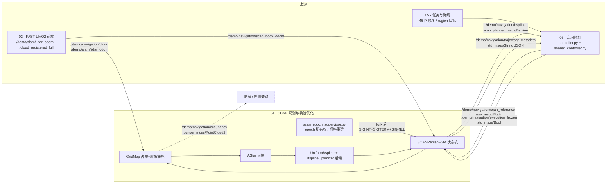
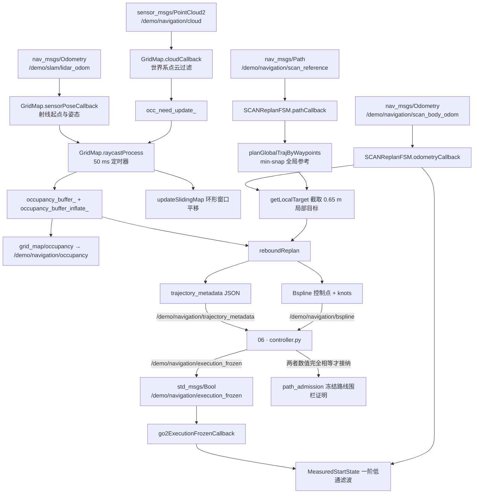
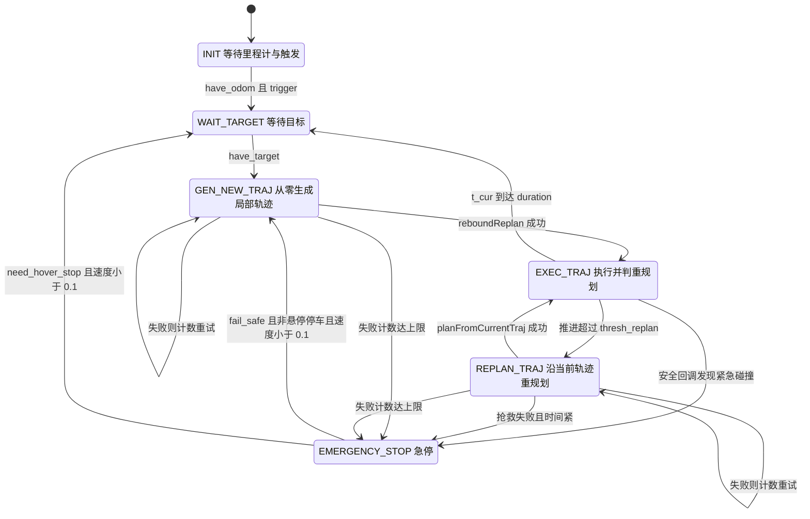
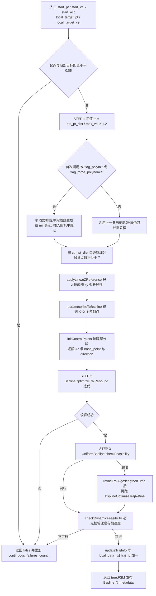

# 04 · SCAN 规划与轨迹优化

> 所属: Fast-Livo2-SCAN-Gazebo-dog-sim-control @ `2331b93` · 模块 04/09
> 覆盖路径: `multifloor_demo/navigation/ros2_ws/src/{plan_env,path_searching,bspline_opt,plan_manage}/`、`scan_multifloor/ros2_ws/src/planner/{scan_planner_msgs,traj_utils}/`、`ENG/{scan_epoch_supervisor,scan_workspace,scan_runtime_parameters,global_route_reference,path_admission}.py`
>
> `ENG/` = `multifloor_demo/teacher_mode/navigation/engineering_v34_r44_active_p95_capture_candidate/`
> 本文只描述源码结构与运行边界,不复制 `docs/C44_EXPERIMENT.md` 的结论。

## 1. 一句话职责

SCAN 规划器(可执行文件 `scan_planner_node`)订阅机体里程计、雷达系位姿与世界系点云,维护一张 **0.08 m 体素的对数几率占据栅格 + 无 ESDF 的圆形膨胀层**,在模块 06 下发的 `nav_msgs/Path` 参考路线上截取局部目标,依次执行 **多项式初值 → 动态 A\* 绕障 → 三次均匀 B 样条 L-BFGS 后端 → 时间重分配**,把「控制点 + 节点向量」打包成 `scan_planner_msgs/Bspline`,并配一份 JSON 溯源元数据发给模块 06。

先纠正一个名称:**本快照中没有 `searchAndOptimize`**。主函数叫 [`SCANPlannerManager::reboundReplan`](../../multifloor_demo/navigation/ros2_ws/src/plan_manage/src/planner_manager.cpp),由 FSM 的 `callReboundReplan` 调用(`multifloor_demo/navigation/ros2_ws/src/plan_manage/src/scan_replan_fsm.cpp:840`)。

## 2. 在总体数据流中的位置



三条必须记住的事实:

1. **目标不是从任务层直接进来的**,而是模块 06 把「46 区当前子目标 + 规划引导点」拼成 `nav_msgs/Path` 发到 `/demo/navigation/scan_reference`(`ENG/shared_controller.py:530-548`);本轮 `fsm.navi_mode=3`,规划器只吃这一条路。
2. **规划器只有一个进程内栅格**,不订阅外部地图、不做重定位;`/demo/navigation/occupancy` 是纯输出。模块 03 的定位修正与本模块**没有任何接口**(否决权在模块 06)。
3. 轨迹必须 `Bspline` + `trajectory_metadata` **成对**才被模块 06 接纳(`multifloor_demo/navigation/trajectory_contract.py:83-99`)。

## 3. 内部子模块划分

| 子模块 | 关键文件 | 职责 | 关键符号 |
|---|---|---|---|
| 栅格环境 | [grid_map.h](../../multifloor_demo/navigation/ros2_ws/src/plan_env/include/plan_env/grid_map.h) / [grid_map.cpp](../../multifloor_demo/navigation/ros2_ws/src/plan_env/src/grid_map.cpp) | 对数几率占据、圆形膨胀层(计数式)、滑动窗口哈希环、射线融合 | `GridMap`、`MappingParameters`、`updateInflation`、`updateSlidingMap`、`raycastProcess` |
| 体素遍历 | [raycast.h](../../multifloor_demo/navigation/ros2_ws/src/plan_env/include/plan_env/raycast.h) / [raycast.cpp](../../multifloor_demo/navigation/ros2_ws/src/plan_env/src/raycast.cpp) | Amanatides-Woo 遍历;两个自由函数 + 可中断步进器 | `Raycast()`、`RayCaster::setInput/step`、`intbound` |
| 前端搜索 | [dyn_a_star.h](../../multifloor_demo/navigation/ros2_ws/src/path_searching/include/path_searching/dyn_a_star.h) / [dyn_a_star.cpp](../../multifloor_demo/navigation/ros2_ws/src/path_searching/src/dyn_a_star.cpp) | 8 连通 2.5D 动态 A\*;池化节点 + round 复用 | `AStar::AstarSearch`、`getDiagHeu`、`interpolateZIndexOnSearchPlane` |
| B 样条表示 | [uniform_bspline.h](../../multifloor_demo/navigation/ros2_ws/src/bspline_opt/include/bspline_opt/uniform_bspline.h) / [uniform_bspline.cpp](../../multifloor_demo/navigation/ros2_ws/src/bspline_opt/src/uniform_bspline.cpp) | 三次均匀 B 样条、de Boor 求值、导数样条、可行性检查、时间拉长 | `UniformBspline`、`parameterizeToBspline`、`checkFeasibility`、`lengthenTime` |
| 后端优化 | [bspline_optimizer.h](../../multifloor_demo/navigation/ros2_ws/src/bspline_opt/include/bspline_opt/bspline_optimizer.h) / [bspline_optimizer.cpp](../../multifloor_demo/navigation/ros2_ws/src/bspline_opt/src/bspline_optimizer.cpp) | 平滑/碰撞/可行性/拟合四项代价 + A\* 引导方向与再分段 | `BsplineOptimizer`、`BsplineOptimizeTrajRebound/Refine`、`combineCost*` |
| 求解器 | [lbfgs.hpp](../../multifloor_demo/navigation/ros2_ws/src/bspline_opt/include/bspline_opt/lbfgs.hpp)(第三方) / [gradient_descent_optimizer.cpp](../../multifloor_demo/navigation/ros2_ws/src/bspline_opt/src/gradient_descent_optimizer.cpp) | L-BFGS 为唯一实际求解器;梯度下降**仅编译未调用** | `lbfgs::lbfgs_optimize`、`GradientDescentOptimizer` |
| 状态机与节点 | [scan_replan_fsm.h](../../multifloor_demo/navigation/ros2_ws/src/plan_manage/include/plan_manage/scan_replan_fsm.h) / [scan_replan_fsm.cpp](../../multifloor_demo/navigation/ros2_ws/src/plan_manage/src/scan_replan_fsm.cpp) / [scan_planner_node.cpp](../../multifloor_demo/navigation/ros2_ws/src/plan_manage/src/scan_planner_node.cpp) | 6 态 FSM、目标接纳、局部目标、发布、安全回调 | `SCANReplanFSM`、`callReboundReplan`、`getLocalTarget`、`pathCallback` |
| 规划管理器 | [planner_manager.h](../../multifloor_demo/navigation/ros2_ws/src/plan_manage/include/plan_manage/planner_manager.h) / [planner_manager.cpp](../../multifloor_demo/navigation/ros2_ws/src/plan_manage/src/planner_manager.cpp) | 全局 min-snap、局部 rebound、时间重分配、动态可行性复核 | `SCANPlannerManager::reboundReplan`、`refineTrajAlgo`、`checkDynamicFeasibility` |
| 数据结构 | [plan_container.hpp](../../multifloor_demo/navigation/ros2_ws/src/plan_manage/include/plan_manage/plan_container.hpp) / [measured_start_state.h](../../multifloor_demo/navigation/ros2_ws/src/plan_manage/include/plan_manage/measured_start_state.h) | 全局/局部轨迹容器、起点速度测量滤波 | `GlobalTrajData`、`LocalTrajData`、`PlanParameters`、`MeasuredStartState` |
| 消息 | [Bspline.msg](../../scan_multifloor/ros2_ws/src/planner/scan_planner_msgs/msg/Bspline.msg) / [DataDisp.msg](../../scan_multifloor/ros2_ws/src/planner/scan_planner_msgs/msg/DataDisp.msg) | 轨迹载荷与显示占位 | `Bspline`、`DataDisp` |
| 可视化/多项式 | [planning_visualization.cpp](../../scan_multifloor/ros2_ws/src/planner/traj_utils/src/planning_visualization.cpp) / [polynomial_traj.cpp](../../scan_multifloor/ros2_ws/src/planner/traj_utils/src/polynomial_traj.cpp) | RViz Marker;min-snap 与单段多项式生成 | `PlanningVisualization`、`PolynomialTraj::minSnapTraj`、`one_segment_traj_gen` |
| 进程监督 | [scan_epoch_supervisor.py](../../multifloor_demo/teacher_mode/navigation/engineering_v34_r44_active_p95_capture_candidate/scan_epoch_supervisor.py) 等 | epoch 所有权、参数冻结、轨迹接纳 | `Supervisor`、`scan_contract`、`parameters`、`certify_curve` |

## 4. 数据流与接口



### 4.1 输入话题

| 话题名 | 类型 | 方向 | 用途 | 声明位置 |
|---|---|---|---|---|
| `body_pose` | `nav_msgs/Odometry` | 订阅 | FSM 的机体位置/速度/姿态;滑动地图参考帧 | `scan_replan_fsm.cpp:81-83`;`grid_map.cpp:185-187` |
| `sensor_pose` | `nav_msgs/Odometry` | 订阅 | 雷达系位姿,提供射线原点与姿态(仅 `sensor_type=lidar`) | `grid_map.cpp:177-179` |
| `cloud` | `sensor_msgs/PointCloud2` | 订阅 | 世界系点云(`cloud_is_world=true`),填充 `proj_points_` | `grid_map.cpp:180-182`、`905-971` |
| `depth` | `sensor_msgs/Image` | 订阅 | 仅 `sensor_type=depth`,与 `sensor_pose` 近似时间同步 | `grid_map.cpp:165-173` |
| `move_base_simple/goal` | `geometry_msgs/PoseStamped` | 订阅 | 仅 `navi_mode=1` 手动单点目标 | `scan_replan_fsm.cpp:94-97` |
| `initial_path` | `nav_msgs/Path` | 订阅 | 仅 `navi_mode=3` 参考路线(**本轮使用**) | `scan_replan_fsm.cpp:98-100`、`347-396` |
| `planning/go2_execution_frozen` | `std_msgs/Bool` | 订阅 | 执行冻结:置零测量速度并冻结局部轨迹时钟 | `scan_replan_fsm.cpp:84-86`、`432-436`、`438-450` |

### 4.2 输出话题

| 话题名 | 类型 | 方向 | 用途 | 声明位置 |
|---|---|---|---|---|
| `planning/bspline` | `scan_planner_msgs/Bspline` | 发布 | **主产物**:控制点 + 节点向量 + `traj_id` | `scan_replan_fsm.cpp:88`;填充 `851-874`;急停 `891-914` |
| `planning/trajectory_metadata` | `std_msgs/String`(JSON) | 发布 | 溯源:reference_stamp / body_goal / 起点状态 / 完整轨迹载荷 | `scan_replan_fsm.cpp:89`、`920-954` |
| `planning/data_display` | `scan_planner_msgs/DataDisp` | 发布 | 只设 header,`a..e` 从未赋值(见 §6.2) | `scan_replan_fsm.cpp:90`、`725-726` |
| `self_inflation` | `visualization_msgs/Marker` | 发布 | 双圆柱自身体积包络(reliable + transient_local) | `scan_replan_fsm.cpp:91-92`、`468-509` |
| `grid_map/occupancy` | `sensor_msgs/PointCloud2` | 发布 | 占据点云;本轮 remap 为 `/demo/navigation/occupancy` | `grid_map.cpp:194`、`973` |
| `grid_map/occupancy_inflate` | `sensor_msgs/PointCloud2` | 发布 | 膨胀层点云(**本轮未 remap**) | `grid_map.cpp:195`、`1013` |
| `grid_map/sliding_map_bbox` | `visualization_msgs/Marker` | 发布 | 滑动窗口包围盒 | `grid_map.cpp:196`、`1073` |
| `grid_map/unknown` / `grid_map/depth_cloud` / `grid_map/sensor_pose_extrinsic` | `PointCloud2` / `PointCloud2` / `Odometry` | 发布 | 诊断输出 | `grid_map.cpp:198-200`、`1128`、`1186` |
| TF `world → sliding_map` | `tf2` | 发布 | 滑动地图局部参考帧 | `grid_map.cpp:1057-1071` |
| `goal_point` / `global_list` / `init_list` / `optimal_list` / `a_star_list` | `visualization_msgs/Marker` | 发布 | RViz 目标点、全局参考、初值路径、优化结果、A\* 路径 | `planning_visualization.cpp:14-18` |

### 4.3 本轮的真实 remap(由 supervisor 注入,不是 launch 文件)

`scan_epoch_supervisor.py:12-15` 把节点内相对名映射为:`body_pose → /demo/navigation/scan_body_odom`、`sensor_pose → /demo/slam/lidar_odom`、`cloud → /demo/navigation/cloud`、`initial_path → /demo/navigation/scan_reference`、`planning/bspline → /demo/navigation/bspline`、`planning/trajectory_metadata → /demo/navigation/trajectory_metadata`、`planning/go2_execution_frozen → /demo/navigation/execution_frozen`、`grid_map/occupancy → /demo/navigation/occupancy`。

> `planning/data_display`、`self_inflation`、`grid_map/occupancy_inflate` 不在 remap 表内,留在全局命名空间;本快照中**未找到**这三个话题的任何订阅者。

## 5. 关键流程与时序

### 5.1 规划状态机

状态集合定义在 `scan_replan_fsm.h:34-42`;导航模式 `scan_replan_fsm.h:43-48`(`MANUAL_TARGET=1` / `PRESET_TARGET=2` / `REFERENCE_PATH=3`)。



逐步讲解(全部位于 `execFSMCallback`,`scan_replan_fsm.cpp:537-727`;10 ms 定时器 `:77-78`):

| 状态 | 职责 | 迁移条件 | 证据 |
|---|---|---|---|
| `INIT` | 只检查 `have_odom_` 与 `trigger_`,不规划 | 两者为真 → `WAIT_TARGET` | `:555-567` |
| `WAIT_TARGET` | 空转等待目标 | `have_target_` → `GEN_NEW_TRAJ` | `:569-578` |
| `GEN_NEW_TRAJ` | `setStartStateFromOdomOrCurrentTraj()` 后 `callReboundReplan(true, flag_random_poly_init)`;首次用多项式初值,连续调用后改用随机中继点初值 | 成功 → `EXEC_TRAJ` 且清失败计数;失败 → 计数并**自环** | `:580-608`;随机初值判据 `:589-592` |
| `REPLAN_TRAJ` | `planFromCurrentTraj()`:先按当前测量状态重算全局 min-snap,再 `callReboundReplan(true,false)`;失败改用随机初值再试一次 | 成功 → `EXEC_TRAJ`;否则计数并自环 | `:610-625`、`:742-771` |
| `EXEC_TRAJ` | 由 `(now - local_data_.start_time_)` 求 `t_cur`,用 `position_traj_.evaluateDeBoorT(t_cur)` 取名义指令点 | `t_cur > duration - 1e-2` → `WAIT_TARGET` 且 `have_target_=false`;距终点 `< no_replan_thresh_` 或距局部起点 `< replan_thresh_` → **留在本状态**;否则 → `REPLAN_TRAJ` | `:627-694` |
| `EMERGENCY_STOP` | 首次进入调 `callEmergencyStop(odom_pos_)`(6 个重合控制点 + `ts=1.0`,`planner_manager.cpp:317-328`);之后由 `flag_escape_emergency_` 防重复 | `enable_fail_safe_ && vel<0.1`:非 `need_hover_stop_` → `GEN_NEW_TRAJ`;`need_hover_stop_` → 清 `have_target_`/`trigger_` 回 `WAIT_TARGET` | `:696-720` |

两条进入急停的独立路径:

- **失败计数**:每次 `execFSMCallback` 末尾调用 `finishProcess()`(`:723`、`:729-740`),`replan_fail_count_ >= max_replan_fail_count_` 时置 `need_hover_stop_=true` 并切换。本轮上限为 50。
- **安全回调**:`checkCollisionCallback`(`:787-832`,50 ms 定时器 `:79-80`)以 0.01 s 步长检查**轨迹前 2/3**(`:798-804`);命中膨胀层先调 `planFromCurrentTraj()` 抢救,失败则按「碰撞点距当前时刻 < `emergency_time_`」决定急停,否则退回 `REPLAN_TRAJ`(`:808-830`)。

### 5.2 规划主流程:`reboundReplan`



关键代码位置(`planner_manager.cpp`):

1. **合流拒绝**:`(start_pt - local_target_pt).norm() < 0.05` 直接失败(`:94-99`)。
2. **时间步长**:`ts = ctrl_pt_dist / max_vel × 1.2`(距离 > 0.1 m)或 `× 5`(极近)(`:105`)。
3. **初值二选一**:多项式初值(`:115-171`)或复用上一条轨迹(`:172-248`);后者用「伪弧长」重采样并在尾部接一段多项式补齐到新目标。
4. **z 参考线性化**:`applyLinearZReference` 按 xy 累积弧长线性插值 z(`:10-39`、`:251`)——多层场景中避免样条在楼层间乱跳的硬约束。
5. **参数化**:`UniformBspline::parameterizeToBspline`(`uniform_bspline.cpp:209-279`)解带首末速度/加速度约束的线性系统,得 `K+2` 个控制点。
6. **A\* 引导 + 后端**:`initControlPoints` 返回逐段 A\* 路径并写好 `base_point`/`direction`(`:256-257`);`BsplineOptimizeTrajRebound` 失败即整体失败(`:268-275`)。
7. **时间重分配**:`checkFeasibility` 返回 `ratio`,超限则 `refineTrajAlgo` → `reparamBspline`(拉长时间并重新参数化)→ `BsplineOptimizeTrajRefine`(`:282-295`、`:476-495`、`:542-561`)。
8. **独立复核门**:`checkDynamicFeasibility`(`:508-540`)以 `max(0.01, min(0.05, duration/50))` 采样,逐点比较 `max_vel_+vel_tolerance_` 与 `max_acc_+acc_tolerance_`;不合格**不发布**。
9. **落库与发布**:`updateTrajInfo`(`:497-506`)写三条样条、`start_time_`、`duration_` 并 `traj_id_ += 1`;FSM 组消息发布。

### 5.3 前端搜索(动态 A\*)

- **搜索空间**:池式三维节点数组 `POOL_SIZE_ = (100,100,100)`,在 `planner_manager.cpp:73` 初始化,`step_size` 取栅格分辨率(本轮 0.08 m),池半径约 4 m;越界报 `Ran out of pool` 并失败(`dyn_a_star.cpp:17-37`;`dyn_a_star.h:112-117`)。
- **实际是 2.5D 搜索**:邻域只遍历 `dx,dy ∈ {-1,0,1}`(8 连通),层号由 `interpolateZIndexOnSearchPlane` 沿「起点→终点」直线插值(`dyn_a_star.cpp:227-236`、`169-180`),前端不会主动翻层。
- **代价函数**:`static_cost = sqrt(dx²+dy²+dz²)`(`:262`),`gScore` 累加;启发式 `getHeu = 1.0001 × getDiagHeu`(三维对角距离,`dyn_a_star.h:98-101`、`dyn_a_star.cpp:39-64`)。
- **与 `plan_env` 的接口**:唯一环境查询是 `AStar::checkOccupancy(pos, yaw) → grid_map_->getInflateOccupancy(pos, yaw)`(`dyn_a_star.h:69`),即带航向的双圆柱膨胀查询,不是原始占据。
- **起终点校正**:落在膨胀体内时沿「起→终」方向以 `step_size_` 逐步外推直到自由;出图返回 `false`(`:94-144`)。
- **超时**:每轮迭代检查 0.2 s 墙钟上限,超时返回 `SEARCH_ERR`(`:281-287`)。
- **调用点**:搜索不在 FSM 里,而是埋在 `BsplineOptimizer::initControlPoints`(`bspline_optimizer.cpp:132-154`)与 `check_collision_and_rebound`(`:794-827`),只对被障碍打断的段搜索。

### 5.4 后端优化

`UniformBspline` 的表示(`uniform_bspline.cpp:14-41`):`p_` 阶、`n_+1` 个控制点、`m_ = n_+p_+1`,节点向量 `u_` 长度 `m_+1`,首末各 `p_+1` 个节点按 `interval_` 外推;求值用 de Boor(`:60-93`);导数样条控制点为 `p(P_{i+1}-P_i)/(u_{i+p+1}-u_{i+1})`(`:99-110`)。

| 代价项 | 函数 | 数学含义 | 权重 |
|---|---|---|---|
| 平滑 | `calcSmoothnessCost` | 默认 jerk 差分 `q_{i+3}-3q_{i+2}+3q_{i+1}-q_i` 的平方和;可选 acc 版本 | `lambda1_` = `optimization.lambda_smooth`(`bspline_optimizer.cpp:473-512`、`:17`) |
| 碰撞(距离) | `calcDistanceCostRebound` | 沿 A\* 引导方向到 `base_point` 的有符号投影距离 `dist`,超过 `clearance` 才计费,分 `d³` 与三次多项式两段;`iter_num_>3` 且平滑代价足够小(每点 < 0.1)时触发 `check_collision_and_rebound` 再分段 | `new_lambda2_`,初值 `optimization.lambda_collision`,重启时 ×2(`:402-441`、`:1164`) |
| 可行性 | `calcFeasibilityCost` | 对速度 `(q_{i+1}-q_i)/ts` 与加速度 `(q_{i+2}-2q_{i+1}+q_i)/ts²` 的**逐轴二次罚**(`SECOND_DERIVATIVE_CONTINOUS` 未定义,走 `#else` 分支) | `lambda3_` = `optimization.lambda_feasibility`(`:514-716`、`:19`) |
| 拟合(refine) | `calcFitnessCost` | `f = (x·v)²/25 + ‖x×v‖²/1`(a2=25、b2=1),把控制点拉回 `ref_pts_` 参考曲线 | `lambda4_` = `optimization.lambda_fitness`,不安全时 ×2(`:443-471`、`:20`、`:1136`) |

组合式:rebound `f = λ₁·smooth + λ₂'·distance + λ₃·feasibility`(`:1164`);refine `f = λ₁·smooth + λ₄·fitness + λ₃·feasibility`(`:1192`)。两者都清零 z 行梯度(`grad_3D.row(2).setZero()`,`:1169`、`:1197`)——**可行性惩罚只作用在水平面**。

| 求解器 | 使用位置 | 配置 | 说明 |
|---|---|---|---|
| `lbfgs.hpp` | `rebound_optimize`(`:1000`)与 `refine_optimize`(`:1098`),**唯一实际使用** | rebound `mem_size=16`/`max_iterations=200`/`g_epsilon=0.01`;refine `g_epsilon=0.001` | 参数结构体未手工初始化 `m` 等字段,直接由 `lbfgs_load_default_parameters` 覆盖 |
| `GradientDescentOptimizer` | **无任何调用点**;仅 `bspline_optimizer.cpp:2` `#include`,并由 `CMakeLists.txt:18` 编入库 | Armijo 线搜索 + `objfunDef` | 属历史遗留;另 `bspline_optimizer.h:57/69/70/73/75` 的 `BsplineOptimizeTraj`/`setGuidePath`/`setWaypoints`/`optimize`/`getControlPoints` **只有声明没有定义** |

**rebound 的重启机制**(`:964-1073`):求解"成功"后重新对轨迹前 2/3 做膨胀占据检查;仍碰撞则 `new_lambda2_ *= 2` 并 `initControlPoints(cps_.points, false)` 重新分段,最多 `MAX_RESART_NUMS_SET = 3` 次(`:979`、`:1047-1054`);若首 3 个控制点就在障碍里则直接失败(`:1027-1036`)。

### 5.5 一次局部规划的真机时序(本轮日志)

`docs/C44_LOG_EXCERPT.log:3-14` 记录了与本模块直接对应的两类日志:`Reference path accepted`(`scan_replan_fsm.cpp:390`)与 `Measured replan state: frozen=… pos=… measured_vel=… used_vel=… acc=[0,0,0] body_goal=…`(`scan_replan_fsm.cpp:780-784`)。日志中 `frozen=1` 时 `used_vel=[0,0,0]`,即 `MeasuredStartState::velocity(true)` 的零化(`measured_start_state.h:25-27`);`frozen=0` 时 `used_vel` 是 `tau=0.4` 一阶低通后的值,明显滞后于瞬时测量。

## 6. 关键数据结构与配置

### 6.1 `Bspline.msg` 字段逐个解释

| 字段 | 类型 | 含义 | 本仓库是否填充 |
|---|---|---|---|
| `order` | `int32` | B 样条阶数 | 恒为 `3`(`scan_replan_fsm.cpp:852`、`:892`) |
| `traj_id` | `int64` | 局部轨迹自增编号,**不是时间序** | `local_data_.traj_id_`,`updateTrajInfo` 每次 +1(`planner_manager.cpp:505`) |
| `start_time` | `builtin_interfaces/Time` | 名义起始时刻;执行冻结时会被 supervisor 侧时钟前移改写 | `info->start_time_`(`scan_replan_fsm.cpp:853`);冻结补偿 `:438-450` |
| `knots` | `float64[]` | 节点向量,长度应为 `控制点数 + order + 1` | `position_traj_.getKnot()`(`:867-872`) |
| `pos_pts` | `geometry_msgs/Point[]` | 控制点(3×N 矩阵按列展开) | `position_traj_.getControlPoint()`(`:856-865`) |
| `yaw_pts` | `float64[]` | 预留偏航控制点 | **从不填充**,下游也从不解引用 |
| `yaw_dt` | `float64` | 预留偏航时间步 | **从不填充** |

下游校验(模块 06):`order == 3`、`len(knots) == len(pos_pts)+order+1`、`knots[order] < knots[-order-1]`(`ENG/shared_controller.py:444-451`);曲线起点必须距测量位姿 ≤ 1.2 m(`:455`)。

### 6.2 `DataDisp.msg` 字段逐个解释

`header`(`std_msgs/Header`)在每个 FSM 循环被写成 `node_->now()` 并发布(`scan_replan_fsm.cpp:725-726`);`a b c d e` 五个 `float64` 是通用显示槽位,**本快照中从未赋值**(`data_disp_` 只在 `scan_replan_fsm.h:53` 声明为成员),线上恒为 `0.0`,并且**未找到订阅者**。结论:这是纯占位契约;`PlanParameters::time_search_/time_optimize_/time_adjust_`(`plan_container.hpp:201-203`)同样只声明未写入。

### 6.3 `planning/trajectory_metadata` JSON(schema 1)

由 `publishTrajectoryMetadata`(`scan_replan_fsm.cpp:920-954`)生成,仅在 `navi_mode==3 && reference_ready_` 时发布:

```json
{"schema":1,"reference_stamp":[sec,nanosec],"body_goal":[x,y,z],"adjusted_body_goal":[x,y,z],
 "start_state":{"position":[…],"measured_velocity":[…],"used_velocity":[…],
                "used_acceleration":[…],"frozen_reference_boundary":true},
 "trajectory":{"order":3,"traj_id":…,"start_time":[sec,nanosec],"pos_pts":[[x,y,z],…],"knots":[…]}}
```

- `reference_stamp`:原样回显 `initial_path.header.stamp`,作为**不可变的请求身份**。
- `body_goal`:参考路线末点(已含 `+body_height` 约定);`adjusted_body_goal`:原目标被膨胀占据时沿线回退后的实际终点。

下游 `TrajectoryAssociation`(`multifloor_demo/navigation/trajectory_contract.py:64-99`)要求 `schema==1`、`reference_stamp` 与本次请求一致、`body_goal` 与控制器目标一致、`trajectory` 与收到的 `Bspline` 数值**完全相等**,且 `traj_id` 大于已接纳高水位;任一不符即拒绝执行。

### 6.4 `planner.yaml`(演示默认值)关键参数

| 键 | 值 | 作用 | 证据 |
|---|---|---|---|
| `fsm.navi_mode` | `1` | 手动目标模式(本轮被覆盖为 3) | `planner.yaml:5`;`scan_replan_fsm.cpp:94-104` |
| `fsm.thresh_replan` / `thresh_no_replan` | `1.0` / `0.1` m | 重规划触发线 / 终点死区 | `scan_replan_fsm.cpp:684`、`:679` |
| `fsm.planning_horizon` | `7.5` m | **局部规划时域**:局部目标前视距离 | `scan_replan_fsm.cpp:960`、`983` |
| `fsm.emergency_time` | `1.0` s | 碰撞点距当前时刻多近才急停 | `scan_replan_fsm.cpp:817` |
| `fsm.fail_safe` / `max_replan_fail_count` | `true` / `1000` | 急停后允许恢复 / 触发急停的失败上限 | `scan_replan_fsm.cpp:705-714`、`:731` |
| `grid_map.resolution` | `0.05` m | 体素边长 | `grid_map.cpp:50` |
| `grid_map.sliding_map_size_*` | `10/10/5` m | 滑动窗口尺寸 | `grid_map.cpp:51-53` |
| `grid_map.local_update_range_*` | `5/5/2.5` m | 单帧有效融合范围 | `grid_map.cpp:54-56`、`952-956` |
| `grid_map.map_sliding_en` / `thresh` | `true` / `0.2` m | 环形窗口平移开关与阈值 | `grid_map.cpp:62-63`、`123` |
| `grid_map.double_cylinder_radius` | `0.25` m | **安全包络 XY 半径**:膨胀偏移表按此生成 | `grid_map.cpp:236-251`;`grid_map.h:372-381` |
| `grid_map.double_cylinder_offset` | `0.18` m | 前/后两圆心沿航向偏移 | 同上 |
| `grid_map.obstacles_inflation_z_up/down` | `0.1` / `0.4` m | **安全包络垂直上下界** | `grid_map.cpp:58-59`、`238-239` |
| `grid_map.body_height` | `0.4` m | `navi_mode=3` 时对路点 z 的固定抬升 | `scan_replan_fsm.cpp:49`、`369` |
| `grid_map.p_hit/miss/min/max/occ` | `0.85/0.30/0.12/0.98/0.80` | 对数几率融合参数 | `grid_map.cpp:117-121` |
| `grid_map.max_ray_length` | `5.0` m | 射线截断长度 | `grid_map.cpp:611`、`621` |
| `manager.max_vel` / `max_acc` | `0.75` / `0.5` | **速度/加速度上限** | `planner_manager.cpp:56-57` |
| `manager.max_jerk` | `4.0` | **读取后未在本快照中找到使用点** | `planner_manager.cpp:58` |
| `manager.control_points_distance` | `0.2` m | 控制点间距,决定 `ts` | `planner_manager.cpp:62`、`105` |
| `manager.feasibility_tolerance` | `0.5` | 时间重分配门限的放宽比例 | `planner_manager.cpp:61` → `uniform_bspline.cpp:143` |
| `manager.planning_horizon` | `7.5` m | 初值路径过长判据 | `planner_manager.cpp:63`、`243` |
| `optimization.lambda_smooth/collision/feasibility/fitness` | `1.0/1.0/0.1/1.0` | 四项代价权重 | `bspline_optimizer.cpp:17-20` |
| `optimization.dist0` | `0.2` m | 期望离障净距 `clearance` | `bspline_optimizer.cpp:21`、`66` |
| `optimization.max_vel/max_acc/order` | `0.75/0.5/3` | 后端可行性罚的限值与阶数 | `bspline_optimizer.cpp:22-25` |
| `optimization.vel_tolerance` / `acc_tolerance` | **文件里没有** → 代码默认 `1.0` | 动态可行性门的加性松弛 | `planner_manager.cpp:59-60`、`514-515` |

### 6.5 `controllers.yaml` 与 `simulator.yaml`

`controllers.yaml`(独立演示栈参数,本轮**不生效**):`closed_loop_controller` 的 `time_forward=0.8`、`heading_error_threshold=0.8`、`kp_pos=0.8`、`kp_yaw=1.5`、`max_vx=0.75`、`max_vy=0.35`、`max_vyaw=1.0`(代码内再夹到 1.0,`closed_loop_controller.cpp:31`)、`finish_dist=0.15`;`open_loop_controller` 的 `publish_rate=100`、`yaw_min_speed=0.05`、`hold_final_position=true`;`go2_kinematic_sim` 的 `cmd_timeout=0.3`、`sim_rate=100`;`go2_gait_publisher` 的 `rate=60`、`gait_frequency=2.2`、`max_walk_speed=1.0`。

`simulator.yaml`(确定性回归的合成环境):`mockamap_node` 固定 `seed=127`、`resolution=0.1`、`40×40×5`、`type=2`、`obstacle_number=500`;`pcl_render_node` 用 `quad_0` 命名空间、`sensor_type=lidar`、`sensing_horizon=40`、`yaw_fov=360`、`vertical_fov=90`、`lidar_pitch=45`、`is_360lidar=1`、`use_minicf_pattern=1`,`dynamic.enable=0`、`collision_check.enable=0`。

### 6.6 本轮真实参数:`v34_scan_overrides.yaml`

本轮**不是**直接用 `planner.yaml`。`run.py:198-199` 从 profile 生成 `run/v34_scan_overrides.yaml`,supervisor 把它作为**第二个** `--params-file` 追加(`scan_epoch_supervisor.py:53-54`),因此它覆盖前者。

| 键 | 本轮值 | 相对 `planner.yaml` |
|---|---|---|
| `fsm.navi_mode` | `3` | 1 → 3(参考路线模式) |
| `fsm.planning_horizon` = `manager.planning_horizon` | `0.65` m | 7.5 → **0.65**;取自 `continuous_route_contract.local_planning_horizon_m`,profile 备注为 "native Euclidean horizon must not span initial 1m loop" |
| `fsm.thresh_replan` / `max_replan_fail_count` | `0.35` / `50` | 1.0/1000 → 0.35/50 |
| `fsm.measured_max_speed` / `measured_velocity_filter_tau` | `0.2` / `0.4` | 新增,供 `MeasuredStartState` |
| `manager.max_vel` = `optimization.max_vel` | `0.2` m/s | 0.75 → 0.2 |
| `manager.max_acc` = `optimization.max_acc` | `0.15` m/s² | 0.5 → 0.15 |
| `grid_map.resolution` | `0.08` m | 0.05 → 0.08 |
| `grid_map.obstacles_inflation_z_up/down` | `0.12/0.12` | `0.1/0.4` → 对称 0.12 |
| `grid_map.double_cylinder_radius/offset` | `0.25/0.18` | 不变 |
| `grid_map.frame_id` / `sliding_map_frame_id` | `camera_init` / `teacher_scan_sliding_map` | `world` / `sliding_map` |
| **未覆盖** | `optimization.lambda_*`、`dist0`、`order`、`vel_tolerance`、`acc_tolerance`、`thresh_no_replan` | 沿用 `planner.yaml` 或代码默认值 |

由此本轮实际生效的门限为:时间重分配触发线 `0.2×1.5 = 0.3 m/s`、`0.15×1.5 = 0.225 m/s²`;而**发布前**的动态可行性门是 `0.2+1.0 = 1.2 m/s`、`0.15+1.0 = 1.15 m/s²`(名义上限的 6~8 倍,见 §9)。

## 7. 代码结构讲解

```
multifloor_demo/navigation/ros2_ws/src/
├── plan_env/    include/plan_env/{grid_map.h,raycast.h};src/{grid_map.cpp,raycast.cpp}
│                test/{original_grid_map.cpp,original_raycast.cpp,raycast_regression.cpp}
├── path_searching/  include/path_searching/dyn_a_star.h;src/dyn_a_star.cpp
├── bspline_opt/ include/bspline_opt/{bspline_optimizer.h,uniform_bspline.h,
│                gradient_descent_optimizer.h,lbfgs.hpp}
│                src/{bspline_optimizer.cpp,uniform_bspline.cpp,gradient_descent_optimizer.cpp}
└── plan_manage/ include/plan_manage/{scan_replan_fsm.h,planner_manager.h,
                 plan_container.hpp,measured_start_state.h}
                 src/{scan_planner_node.cpp,scan_replan_fsm.cpp,planner_manager.cpp,
                      open_loop_controller.cpp,closed_loop_controller.cpp,
                      go2_kinematic_sim.cpp,go2_gait_publisher.cpp}
                 config/{planner.yaml,controllers.yaml,simulator.yaml,keypoints.example.yaml}
                 launch/{run.launch.py,simulator.launch.py,rviz.launch.py,default.rviz}
                 scripts/keypoint_recorder.py
scan_multifloor/ros2_ws/src/planner/
├── scan_planner_msgs/msg/{Bspline.msg,DataDisp.msg}
└── traj_utils/ include/traj_utils/{polynomial_traj.h,planning_visualization.h}
               src/{polynomial_traj.cpp,planning_visualization.cpp}
```

- **`grid_map.cpp`**:`initMap`(`:44-222`)读参、把概率转 logit(`:117-122`)、算体素数(`:131-132`)、分配 `occupancy_buffer_`(double,初值 `clamp_min_log_ - unknown_flag_` 即"未知")与 `occupancy_buffer_inflate_`/`_cnt_`(`:143-155`),再按 `sensor_type` 挂订阅(`:163-183`)、起 50 ms 占据/可视化定时器(`:189-192`)。**没有 ESDF**:`grid_map.h:102` 的注释写着 "occupancy of each voxel and Euclidean distance",但全仓库检索 `esdf`/`distance_buffer`/`signed_distance`/`getDistance` 均无命中,后端的"距离"是沿 A\* 引导方向的投影距离。**膨胀层是计数式增量维护**:`rebuildInflationOffsets` 生成 XY 圆盘 × `[−z_down, +z_up]` 偏移表,半径判定用严格小于(`:234-252`);`applyOccupancyUpdate` 只在占据态翻转时调 `updateInflation(±1)`(`:314-326`);`updateInflationLayer` 用 `cnt_buffer` 计数,避免多障碍重叠膨胀互相抵消(`:285-306`)。**滑动窗口是哈希环**:`toAddress` 对体素数取模(`grid_map.h:278-292`),`updateSlidingMap` 在传感器索引相对上次平移超过 `map_sliding_thresh_vox_` 时清零移出侧的整层格子(`:350-447`),索引跳变超过整张图则 `resetAllMapData`(`:361-369`)。`cloudCallback`(`:905-971`)把点云变换到世界系(`cloud_is_world_` 为真时直传)并按 `local_update_range_` 与 `max_ray_length_` 过滤;`raycastProcess`(`:568-738`)是融合主体。
- **`raycastProcess` 的三条不变量**(注释即契约):① 只有**真实测量的表面**才计一次 hit,因越界或超距被截断的端点只算"观测到的自由空间",绝不制造假表面(`:601-640`);② 只有**正长度穿越**该半开体素的射线才能计 miss,由 `observedSegmentCrossesVoxel` 做 slab 判定(`:9-33`、`:631-673`);③ 一帧内**真实命中优先于**粗体素的自由穿越,重复射线不重复加权(`:710-737`)。scratch 标记每帧重置为 0 而非沿用 `char` epoch,避免 256 帧后与陈旧标记碰撞(`:576-580`)。
- **`raycast.cpp`**:两个自由函数 `Raycast()`(指针数组版与 `std::vector` 版,`:20-221`)实现经典 **Amanatides & Woo 体素遍历**(注释引用 1987 年论文与 grid.pdf);`RayCaster` 类(`:223-310`)是同算法的**可中断步进器**,`grid_map.cpp:594`、`654-674` 用的就是它。
- **`plan_env/test/` 与"回归比对原始实现"的关系**:不是同一二进制内的新旧双实现比对,而是**同一份测试源码编出两个可执行文件**——`raycast_regression` 链接生产库 `plan_env`(`CMakeLists.txt:37-38`),`raycast_regression_baseline` 则把该测试源码与 `test/original_grid_map.cpp`、`test/original_raycast.cpp`(硬化前实现快照)**一起编译**(`:39-43`)。两个 exe 跑同一组断言、输出同一个 JSON(`raycast_regression.cpp:96-99`),用退出码表达结论,因此 baseline 展示了原始实现会挂在哪几条。可对照的差异例如 `original_raycast.cpp` 的 `RayCaster::step` 只推进最小 `tMax` 轴,**没有** `next >= 1.0` 的段末终止,也没有并列轴同时推进的 `<= next+1e-12` 处理(`raycast.cpp:297-307`)。该测试共 13 条无条件断言(另有 1 条需夹具文件才执行),覆盖:共享端点射线的不同路径必须各自被清除、重复射线一帧只计一次证据、真实命中优先于粗体素穿越、被遮挡/未观测的旧表面必须保留、距离截断碰到下一体素不得清除它、超过 300 帧不得复用陈旧 scratch 标记、滑动环复用必须同时清占据与膨胀。可选 `argv[1]` 是"实测快照夹具"(`:84-95`),用于验证一次真实运行残留的阻塞格能否被反复射线清除——**该夹具未包含在本快照中**。
- **`dyn_a_star.cpp`**:见 §5.3;`retrievePath` 回溯 `cameFrom`(`:80-92`),`getPath` 反序输出并以 `Index2Coord` 转世界坐标(`:300-308`)。
- **`bspline_optimizer.cpp`**:见 §5.4。`check_collision_and_rebound`(`:718-938`)是**运行时**再分段:从 `order_-1` 扫到 `end_idx-(end_idx-order_)/3`,对"新进入膨胀体"的控制点向前/向后找自由点并段,各跑一次 A\*,把 `base_point`/`direction` 写回后置 `force_stop_type_ = STOP_FOR_REBOUND` 让 L-BFGS 提前退出并带新方向重启(`:933-934`;`earlyExit` `:372-378`);终点在障碍里则置 `STOP_FOR_ERROR` 放弃(`:777-784`)。
- **`uniform_bspline.cpp`**:`checkFeasibility` 用控制点差分判别并返回 `ratio = max(max_vel/limit_vel, sqrt(|max_acc|/limit_acc))`(`:189`);`lengthenTime` 只拉伸 `u_(5)` 到 `u_(m-5)` 之间的节点,首末各 5 个节点不动(`:194-205`)——即**固定首末速度/加速度边界**。
- **`scan_replan_fsm.cpp`** 另有三个要点:`getLocalTarget`(`:956-1059`)以 `t_step = planning_horizon_/20/max_vel_` 采样全局轨迹,取第一个距起点 ≥ `planning_horizon_` 的点;若局部目标被占据则先向前再向后找最近自由点(`:1001-1046`);局部目标距终点小于 `max_vel²/(2·max_acc)` 时把末端速度置零(`:1048-1053`)。`adjustGlobalTargetIfOccupied`(`:306-345`)从全局轨迹末端回退找自由点并同步收缩 `global_duration_`。`pathCallback`(`:347-396`)对每个路点 z 加 `body_height_`,失败**绝不**标记 `reference_ready_`(`:349-351` 注释即此意),成功后记录 `reference_stamp_`/`reference_body_goal_` 供元数据回显。
- **`planner_manager.cpp`**:`planGlobalTraj`(`:412-474`)与 `planGlobalTrajWaypoints`(`:330-410`)都用 `PolynomialTraj::minSnapTraj` 生成全局参考,并按 4 m 间距插入中间点。**`scan_planner_node.cpp`** 是唯一 `main`:`SingleThreadedExecutor` + `spin()`(`:16-18`),构造异常打 `FATAL` 并返回 1(`:20-25`)。**`keypoint_recorder.py`** 交互式记录里程计路点为 `fsm.waypoints` YAML(`:76-86`),供 `navi_mode=2`。**`traj_utils`** 只承担可视化与多项式生成:构造时建 5 个 Marker 话题(`planning_visualization.cpp:14-18`),`PolynomialTraj` 提供 `minSnapTraj` 与 `one_segment_traj_gen`(`polynomial_traj.h:327`、`331`)。

## 8. 与其他模块的边界

### 8.1 上游(02 / 03)

规划器不接触 FAST-LIVO2 内部,只需要 `/demo/navigation/cloud` 与 `/demo/slam/lidar_odom`,外加 `/demo/navigation/scan_body_odom`;这三个话题都由模块 06 的 `shared_controller.py` 转发(发布 `:131-132`,订阅 `:135`、`:140`)。已知场景定位修正(模块 03)在本模块内**没有任何接口**;修正失效不会让规划器停车,规划器只发轨迹,否决权在模块 06。

### 8.2 下游(06)——真正的"轨迹控制数据流"分界

- 出边两条:`/demo/navigation/bspline`(`Bspline`)与 `/demo/navigation/trajectory_metadata`(`String`),被 `shared_controller.py:141-142` 订阅,必须**成对匹配**才被接受(`trajectory_contract.py:83-99`)。
- 入边两条:`/demo/navigation/scan_reference`(`nav_msgs/Path`,发布于 `shared_controller.py:130`、`545`)与 `/demo/navigation/execution_frozen`(`std_msgs/Bool`,发布于 `:126`、`:562`)。
- **坐标约定边界**:`make_path(..., height_offset=0.4)` 把每个路点 z **减** 0.4(`shared_controller.py:509-520`),规划器在 `pathCallback` 里**加**回 `body_height_=0.4`(`scan_replan_fsm.cpp:369`);两侧必须同时改,否则元数据 `body_goal` 的 1e-8 精确比对会拒绝轨迹。
- `navi_mode=3` 下 `reference_stamp` 是**不可变请求身份**:控制器用 `max(last+1, now)` 保证唯一(`shared_controller.py:541-543`),规划器原样回显(`scan_replan_fsm.cpp:377-379`、`930-931`)。

### 8.3 与模块 09:进程所有权与"重建栅格"

`scan_epoch_supervisor.py` 是**唯一**有权持有 SCAN 子进程的组件:

1. **启动什么**:冻结 workspace 安装目录里的 `scan_planner_node`,命令行为 `scan_planner_node --ros-args -r __node:=scan_planner_node --params-file <share>/config/planner.yaml --params-file <run>/v34_scan_overrides.yaml -r body_pose:=… -r cloud:=… …`(`scan_epoch_supervisor.py:51-56`;调用方 `stack.launch.py:29-32`)。可执行文件路径与 SHA-256 被登记进证据(`:33`、`:100`)。
2. **如何"拥有"**:禁止第二个写者(`:52`);启动后读 `/proc/<pid>/stat` 与 `readlink /proc/<pid>/exe`,以 `start_ticks`/`ppid`/`exe` 作为身份指纹(`:16-20`、`:57-63`);停机三重信号 `SIGINT(3 s) → SIGTERM(2 s) → SIGKILL(2 s)`,每次发信号前重校指纹,不符即抛 `Refuse signalling an unowned planner PID`(`:66-78`)。
3. **"重建栅格"的真实做法是换进程,不是调用栅格 API**:当 `/demo/navigation/localization_status` 报告 `generation` 变化(导航坐标系事务)时,`tick()` 先置 `ready=False` 并发布,再 `stop_child('completed_navigation_frame_transaction')`,递增 `epoch` 后 `start_child()`(`:111-113`)。新进程的 `GridMap::initMap` 重新分配整张缓冲并把所有体素置为"未知"(`grid_map.cpp:143-155`),因此事件记录直接写 `new_planner_with_empty_grid` 与 `clean_empty_grid_at_generation_start=True`(`:65`、`:101`)。`GridMap` 自身的 `resetBuffer`/`resetAllMapData`(`:254-265`、`449-473`)**不参与** epoch 级重建。
4. **何时放行**:`ready` 需三个条件同时成立——图连接(两个输入话题的订阅者里出现 `scan_planner_node`,`:114-116`)、至少 2 个经校验的源时间戳、最新确认戳落在 ROS 时钟 300 ms 窗口内(`:117-118`);每个时间戳还需 `metadata/odom/cloud` 三角色在同一 `source_ns` 上凑齐且 `generation` 匹配、非 `correction_transition`、非 `correction_stale`(`:82-97`)。结果以 `known_scene_SCAN_epoch_ready/v1` 发布到 `/demo/navigation/scan_epoch_ready` 并落盘 `scan_epoch_ready.json`(`:98-105`)。

### 8.4 冻结 workspace、`path_admission`、`global_route_reference` 的归属

- **`scan_workspace.py`**:白名单只有两个槽位——`protected_baseline`(= `multifloor_demo/navigation/ros2_ws`)与 `bounded_snapshot_exporter_v20`(`navigation/corridor_tracking_v20/scan_ws`)(`scan_workspace.py:7-10`)。选择器不在表内即抛 `An arbitrary or unreviewed SCAN workspace is prohibited`(`:19-20`);随后校验契约 JSON 的 schema、`candidate` 名、`workspace` 绝对路径、`algorithm_math_changed is False`、`runtime_acceptance_inherited is False`、`actual_loaded_binary_witness_required is True`(`:26-30`),再逐个 sha256 校验 `bindings_sha256` 登记的 install 产物(必须含 `setup.bash`、`scan_planner_node`、`planner.yaml`,`:31-39`)。目的就是**保证被加载的二进制与契约登记的那一份逐字节相同**,防止误加载另一个 workspace 的 SCAN。本快照限制:两个 `SCAN_*_WORKSPACE_CONTRACT.json` 与 `corridor_tracking_v20/scan_ws` **均未包含**,这套校验在此快照中无法实际执行。
- **`path_admission.py`**:位于**模块 06 的控制数据流下游**,不是规划器内部环节。输入是规划器刚发布的 `Bspline` 载荷 + 元数据 + 冻结的 46 点 SLAM 路线,输出是 `allowed` 布尔与拒绝理由(`certify_curve`,`path_admission.py:120-219`)。算法把每个 B 样条跨度精确转成 Bezier 段,用「Bezier 凸包球 + 所有可能最近三维线段距离上界 `D_i ≤ D_min + 2r` + 一阶导 1-Lipschitz 分量残差」在 de Casteljau 细分下**证明整条曲线的水平误差 < `horizontal_radius_m` 且高度误差 < `height_error_m`**;预算 `MAX_PATCHES=2048`/`MAX_DEPTH=24`/`MAX_WALL_S=0.020` s,证据不足即拒绝(`:16-20`、`:194-217`)。调用点 `ENG/controller.py:375-384`(`certify_curve`)与 `:389-393`(起点距实测位姿 ≤ 1.2 m 且必须有水平推进);本轮围栏为 `horizontal_radius_m=0.45`、`height_error_m=0.3`(`profiles/engineering_nav46.json:183-185`)。文件 docstring 明确它**只证明路线围栏包含性**,返回结构带 `occupancy_or_terrain_support_certified: False`(`:1-5`),占据、源新鲜度、航向、到达判定各自独立。
- **`global_route_reference.py`**:提供**规划引导**(planning-only guides),不是执行权威。`SegmentGuides.remaining()` 为每个 `(request_id, waypoint_index)` 冻结一条「实测激活点 → 原始目标」直线,按 `guide_spacing_m=1.0` 采样、起点前视 `guide_start_ahead_m=0.35`、最多 64 点,并剔除距终点不足半间距的尾部辅助点(`:40-82`);回执字段写明 `guide_only_not_arrival=True`、`collision_or_support_certified=False`(`:81`)。本轮 profile 为 `enabled=true, guide_spacing_m=1.0, guide_start_ahead_m=0.35, direction_audit_arc_m=0.8, max_guide_points=64`(`profiles/engineering_nav46.json:3648-3654`)。**本轮的实际分支**:`controller.py:563-572` 先判 `self.continuous_route is not None`,而 V34 `continuous_route_contract.enabled=true`(`profiles/engineering_nav46.json:3680-3682`),因此引导点实际来自 `continuous_route.reference_points()`;`SegmentGuides` 是 `continuous_route` 缺席时的回退路径(`controller.py:573-580`),`direction_check`/`admission_direction_check` 则在邀请曲线上做航向一致性审计(`global_route_reference.py:118-144`)。

### 8.5 与模块 05

任务层不直接给规划器发目标,而是通过模块 06 的 `planner_goal()`(取 46 区顺序账本的 `next_index`,`controller.py:552-555`)间接决定路点。

## 9. 已知限制与失败点

1. **动态可行性门几乎是空的**。`planner_manager.cpp:59-60` 把 `optimization.vel_tolerance`/`acc_tolerance` 默认值写成 `1.0`,而 `planner.yaml` 与本轮覆盖 YAML **都没有定义这两个键**,于是发布前检查线是 `1.2 m/s`/`1.15 m/s²`,名义上限只有 `0.2 m/s`/`0.15 m/s²`(`planner_manager.cpp:514-515`)。真正约束轨迹的是 L-BFGS 里 `lambda3_=0.1` 的软罚与 `checkFeasibility` 的时间拉长,不是这道门。
2. **`DataDisp` 是空契约**,`a..e` 从未赋值,规划耗时字段从未写入(`plan_container.hpp:201-203`)。任何"从 DataDisp 读规划质量"的假设都不成立。
3. **死代码/死声明**:`max_jerk_` 读取后无用;`GradientDescentOptimizer` 编入库但无调用点;`BsplineOptimizeTraj`/`setGuidePath`/`setWaypoints`/`optimize`/`getControlPoints` 只有声明无定义,一旦被引用即链接失败。
4. **没有 ESDF**。`grid_map.h:102` 的注释与常被描述的"占据/膨胀/ESDF"三件套不一致:本快照只有占据 + 二值膨胀 + 计数。
5. **膨胀层是二值、单分辨率的**,不提供距离梯度;所有净距信息来自 A\* 引导方向。这也意味着膨胀一旦形成就是硬障碍,且有效包络不是简单的 0.25 m 圆:`double_cylinder_radius=0.25` 的膨胀叠加查询点沿航向 ±0.18 的双圆柱。
6. **滑动窗口哈希环会周期性清空整层体素**。0.08 m 分辨率下阈值 3 格 ≈ 0.24 m 位移即触发一次平移(`grid_map.cpp:123`、`350-447`);`raycast_regression.cpp:77-81` 专门为此写了两条断言,说明这是被反复踩过的位置。
7. **A\* 池只有 100³ 格**,0.08 m 步长下约 8 m 跨度(`planner_manager.cpp:73`)。本轮把局部时域压到 0.65 m 才安全;若把 `fsm.planning_horizon` 调回演示默认的 7.5 m,起终点跨度就可能超池并报 `Ran out of pool`(`dyn_a_star.h:112-117`)。
8. **前端只做 2.5D 搜索**:z 层号沿起终点直线插值(`dyn_a_star.cpp:169-180`),多层场景的翻层能力实际来自初值路径与 `applyLinearZReference`,不是搜索本身。
9. **`checkCollisionCallback` 只看前 2/3 轨迹**(`scan_replan_fsm.cpp:800-804`),后 1/3 在下一轮重规划前不被安全回调覆盖。
10. **急停无时长限制**:`EMERGENCY_STOP` 的退出条件是速度 < 0.1(`:705-714`),若控制端没真正把速度压下来,状态机会一直停在急停并持续重发同一个 6 点重合样条(`:883-918`)。
11. **`planFromCurrentTraj` 每次都重算全局 min-snap**(`:746-757`),并因 `setGlobalTraj` 把 `last_progress_time_` 归零(`plan_container.hpp:48`),局部目标进度不跨重规划累积。
12. **本轮真实结局与本模块的关系**:`docs/C44_EXPERIMENT.md` 记录 46 区只通过 5 个普通区后 FAILED,直接链是「定位修正过期 → 控制保护发零命令 → 区域 90 s 超时」。否决点在模块 06,规划器是**被动响应方**:`/demo/navigation/execution_frozen` 为真时它把测量速度置零并冻结局部轨迹时钟(`scan_replan_fsm.cpp:432-436`、`438-450`),日志 `frozen=1 … used_vel=[0,0,0]` 即此行为(`docs/C44_LOG_EXCERPT.log:4`、`:14`)。规划器内部没有"定位修正失效"这个概念,不应把任务失败归因于规划算法。
13. **`plan_manage/CMakeLists.txt:59-63` 在 `BUILD_TESTING` 下引用的 `test/test_planner_startup.py`、`test/test_waypoint_parameters.py` 未包含在本快照中**;`bspline_opt/CMakeLists.txt:33` 引用的 `test/test_uniform_bspline.cpp` 同样缺失。开启测试构建会失败。

## 10. 建议阅读路线

1. `scan_replan_fsm.h:34-48` → 认识 6 个状态与 3 种导航模式,确认要读的是 `navi_mode=3` 分支。
2. `scan_replan_fsm.cpp:21-105` → 参数与全部订阅/发布,建立话题表。
3. `scan_replan_fsm.cpp:537-727` → 状态机主循环,对照 §5.1 的图逐状态读。
4. `planner_manager.cpp:82-315` → `reboundReplan` 一次读完整。
5. `bspline_optimizer.cpp:1148-1199` → 先看两个 `combineCost*` 知道有哪几项代价,再回到 `:402-716` 逐项读。
6. `uniform_bspline.cpp:209-279` → 参数化线性系统;再读 `:134-205` 的可行性与时间拉长。
7. `grid_map.cpp:568-738` → `raycastProcess`;配合 `raycast.cpp:273-310` 的步进器。
8. `dyn_a_star.cpp:146-298` → A\*,特别注意 `:169-180` 的 z 插值。
9. `plan_manage/config/planner.yaml` 与 `ENG/scan_runtime_parameters.py` → 对照 §6.4/§6.6,理解"演示默认值"与"本轮实际值"差多远。
10. 最后读 `ENG/scan_epoch_supervisor.py` 与 `multifloor_demo/navigation/trajectory_contract.py`,补齐"谁拥有规划器进程"和"轨迹如何被接纳",再进入 [06 高层控制](06-high-level-control.md)。
