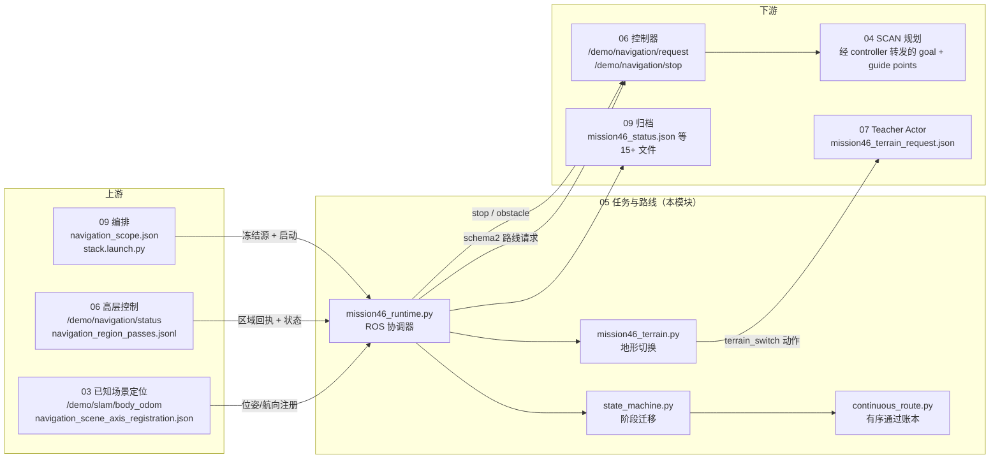
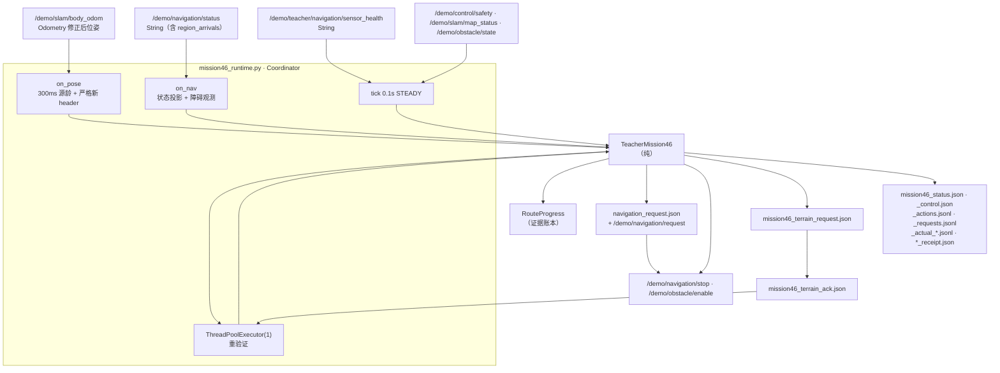
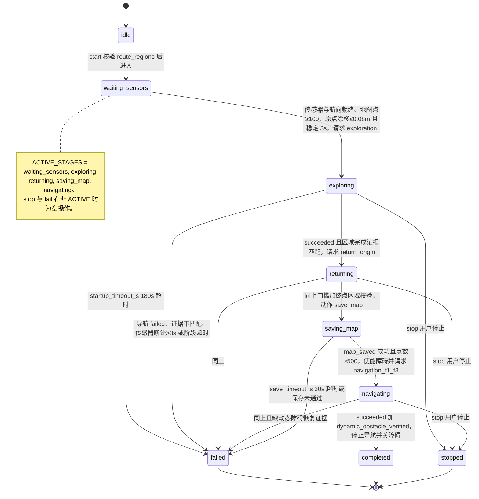
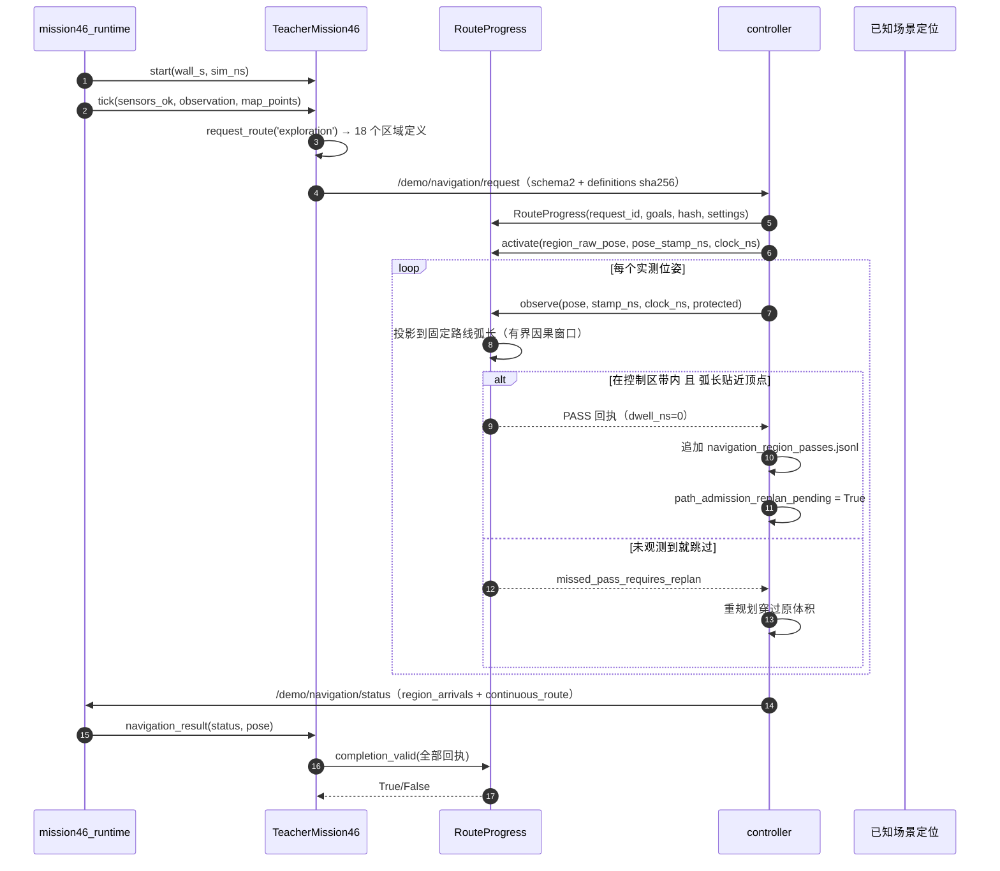
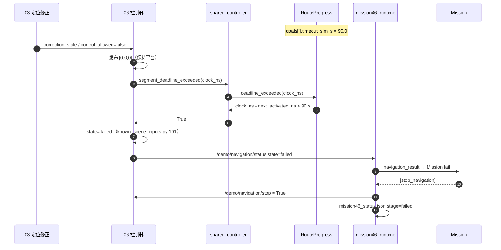
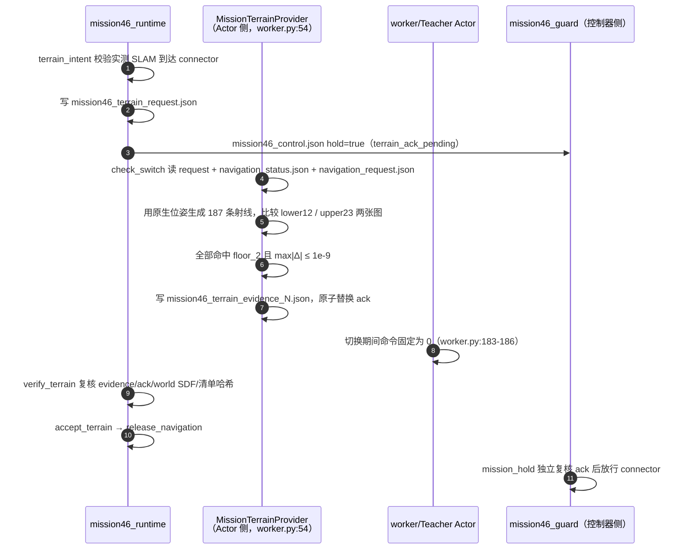

# 05 · 任务状态机、路线分区与 46 区协调

> 所属: `Fast-Livo2-SCAN-Gazebo-dog-sim-control` @ `2331b93` · 模块 05/09
> 覆盖路径: `multifloor_demo/mission/`、`multifloor_demo/navigation/goal_regions.py`、`ENG/mission46*.py`、`ENG/continuous_route.py`、`ENG/continuous_scene_trigger.py`、`ENG/route.py`、`ENG/request.py`、`ENG/full46_*.py`、`ENG/prefix_contract.py`、`ENG/profiles/engineering_nav46.json`、`ENG/stack.launch.py`
> 约定: 下文 `ENG/` = `multifloor_demo/teacher_mode/navigation/engineering_v34_r44_active_p95_capture_candidate/`（[00 号总览](00-overview-dataflow.md)同此约定）

---

## 1. 一句话职责

本模块是**任务权威**：把"46 个预注册区域"翻译成逐段路线请求，把实测 SLAM 到达/控制器回执判定成"通过"，把"通过/超时/证据不匹配"翻译成阶段迁移与停止动作；它自己**不发任何速度或关节指令**，只产出路线、保持、停止、障碍使能、存档、地形切换这六类动作。

`mission46.py:4-7` 明确写了这一边界："This file never starts the historical CHAMP/JTC stack and never reads simulator pose for navigation."；`continuous_route.py:6` 同："This module has no ROS, simulator pose or control authority."

---

## 2. 在总体数据流中的位置



**读图要点**

1. 本模块是**单向的下游决策者**：上游只给"实测到达"和"健康状态"，它不回写位姿、不改地图、不干预滤波器。
2. 它对 04（规划）**没有直接接口**：区域几何先变成 `/demo/navigation/request`，再由控制器转成 SCAN 的 goal 与 guide points（`controller.py:563-572`）。总览图里 `05 → 04` 的边实际经过 06。
3. 它同时是 09 的**证据生产者**（15 个以上 run 目录文件），但 `worker.py:197` 只读其中 `mission46_status.json` 来决定"整任务是否结束"——这是本模块对关闭时序唯一的关键影响。

---

## 3. 内部子模块划分

| 子模块 | 关键文件 | 职责 | 关键符号 |
|---|---|---|---|
| 任务状态机（纯） | [state_machine.py](../../multifloor_demo/mission/state_machine.py) | 阶段迁移、路线请求生成、完成证据校验 | `Mission`、`ACTIVE_STAGES`、`ObstacleEvidence`、`region_completion_valid` |
| 区域几何内核（纯） | [goal_regions.py](../../multifloor_demo/navigation/goal_regions.py) | 不可变目标几何、坐标系变换、按标称时间戳停留判定 | `Goal`、`parse_goal`、`parse_request`、`contains`、`contains_control`、`ArrivalWindow`、`definitions_sha256` |
| 三层平台到达区预注册 | [route_regions.py](../../multifloor_demo/mission/route_regions.py) | 为三条路线生成 46 个到达体，并在启动前校验 | `ROUTES`、`add_route_regions`、`validate_route_regions`、`transformed_route_goals` |
| 有序通过账本 | [continuous_route.py](../../multifloor_demo/teacher_mode/navigation/engineering_v34_r44_active_p95_capture_candidate/continuous_route.py) | 固定路线弧长投影 + 普通区"经过即通过"+ 硬区停留 + 完成门 | `RouteProgress`、`hard_indices`、`completion_valid`、`ContinuousMission` |
| Teacher 适配器（纯） | [mission46.py](../../multifloor_demo/teacher_mode/navigation/engineering_v34_r44_active_p95_capture_candidate/mission46.py) | 把 Mission 动作接到 5 个显式运行时接口与 5 类回执 | `TeacherMission46`、`INTERFACES`、`TRANSITIONS`、`_bound`、`terrain_intent` |
| ROS 协调器 | [mission46_runtime.py](../../multifloor_demo/teacher_mode/navigation/engineering_v34_r44_active_p95_capture_candidate/mission46_runtime.py) | 订阅实测源、驱动适配器、发布/落盘动作、异步重验证 | `Coordinator`、`tick`、`apply`、`complete_jobs`、`periodic_control` |
| profile 纯适配 | [mission46_profile.py](../../multifloor_demo/teacher_mode/navigation/engineering_v34_r44_active_p95_capture_candidate/mission46_profile.py) | 冻结原 scenario 身份与 46 数 | `ROUTE_COUNTS`、`validate_original_scenario`、`validate_profile` |
| 地形切换（Actor 侧） | [mission46_terrain.py](../../multifloor_demo/teacher_mode/navigation/engineering_v34_r44_active_p95_capture_candidate/mission46_terrain.py) | 单向 privileged 地形切换 + 187 射线等值证明 | `MissionTerrainProvider`、`check_switch`、`LAYERS` |
| 控制器门（独立） | [mission46_guard.py](../../multifloor_demo/teacher_mode/navigation/engineering_v34_r44_active_p95_capture_candidate/mission46_guard.py) | 保时间戳地读文件决定"是否可以继续动" | `mission_hold`、`TRANSITIONS` |
| 契约四件套 | [mission46_contract.py](../../multifloor_demo/teacher_mode/navigation/engineering_v34_r44_active_p95_capture_candidate/mission46_contract.py) · [full46_launch_contract.py](../../multifloor_demo/teacher_mode/navigation/engineering_v34_r44_active_p95_capture_candidate/full46_launch_contract.py) · [full46_v34_contract.py](../../multifloor_demo/teacher_mode/navigation/engineering_v34_r44_active_p95_capture_candidate/full46_v34_contract.py) · [prefix_contract.py](../../multifloor_demo/teacher_mode/navigation/engineering_v34_r44_active_p95_capture_candidate/prefix_contract.py) | 冻结接口、profile 身份、前缀语义 | `contract()`、`validate_full46`、`validate_prefix` |
| 单请求路线（旁路） | [route.py](../../multifloor_demo/teacher_mode/navigation/engineering_v34_r44_active_p95_capture_candidate/route.py) · [request.py](../../multifloor_demo/teacher_mode/navigation/engineering_v34_r44_active_p95_capture_candidate/request.py) | 非 46 区路径的锚点/路线冻结；`SceneAxisRegistration` 被 46 区复用 | `registered_points`、`build_request`、`SceneAxisRegistration` |
| 进程/存档（历史 demo） | [processes.py](../../multifloor_demo/mission/processes.py) · [artifacts.py](../../multifloor_demo/mission/artifacts.py) · [runtime_evidence.py](../../multifloor_demo/mission/runtime_evidence.py) | 自有进程组有界关闭、源码/运行产物快照、停止前后证据 | `finish_owned_process`、`snapshot_sources`、`capture_before_stop` |

---

## 4. 数据流与接口



### 4.1 接口表

| 方向 | 话题 / 文件 / 调用 | 类型 | 生产者 | 消费者 |
|---|---|---|---|---|
| 入 ← 03 | `/demo/slam/body_odom` | `nav_msgs/Odometry` | `known_scene_runtime.py:130` | `mission46_runtime.py:123` |
| 入 ← 03 | `navigation_scene_axis_registration.json` | JSON 文件 | `mission46_runtime.py:240`（`KnownSceneAxisRegistration.try_freeze`） | `mission46.py:243` 经 `set_heading_alignment` |
| 出 → 03 | `/demo/teacher/mission46/state` | `String` | `mission46_runtime.py:118` | `known_scene_runtime.py:140`（修正提交需导航空闲） |
| 出 → 04 | 无直接接口；经 06 转发 goal 与 guide points | — | — | `controller.py:563-572` |
| 入 ← 04 | 无直接接口；规划结果经 06 汇总 | — | — | — |
| 出 → 06 | `/demo/navigation/request` | `String`（schema2 goals） | `mission46_runtime.py:112`、`request.py:177` | `shared_controller.py:133` |
| 出 → 06 | `/demo/navigation/stop` | `Bool` | `mission46_runtime.py:115` | `shared_controller.py:134` |
| 出 → 06 | `mission46_control.json` / `_history.jsonl` | JSON | `mission46_runtime.py:340-341` | `controller.py:706-707` → `mission46_guard.mission_hold` |
| 出 → 06 | `mission46_terrain_request.json` | JSON | `mission46_runtime.py:299` | `mission46_terrain.py:45` |
| 入 ← 06 | `/demo/navigation/status` | `String`（`region_arrivals`、`continuous_route`、`state`） | `shared_controller.py:128` | `mission46_runtime.py:129` → `on_nav` |
| 入 ← 06 | `navigation_status.json` | JSON | `teacher_wrapper.py:67` | `mission46_terrain.py:59`、`mission46_guard.py:14` |
| 入 ← 06 | `navigation_region_passes.jsonl` | JSONL | `controller.py:516` | `first_goal_stop.py:78`（交叉核对归档） |
| 出 → 06 | `mission46_terrain_ack` 校验结果 | 调用 | `mission46_runtime.py:317` | `mission46.accept_terrain` → `release_navigation` |
| 出 → 07 | `mission46_terrain_request.json` | JSON | `mission46_runtime.py:299` | `worker.py:54` 构造的 `MissionTerrainProvider` |
| 入 ← 07 | `mission46_terrain_ack.json` + `mission46_terrain_evidence_N.json` | JSON | `mission46_terrain.py:113-128` | `mission46_runtime_evidence.verify_terrain:197` |
| 入 ← 07 | `/demo/teacher/navigation/anchor`（要求唯一发布者，回执须等于冻结锚点） | `String`（TRANSIENT_LOCAL） | `mission46_runtime.py:114` | `bridge.py:361`、校验 `bridge.py:423-437` |
| 入 ← 09 | `navigation_scope.json` | JSON | 09 的 `run.py`/`pid_scope` | `mission46_runtime.py:459`、`mission46_runtime.py:56-65` |
| 出 → 09 | `mission46_status.json` | JSON | `mission46_runtime.py:357` | `worker.py:197`（整任务结束判定）、`ipc_request_window.py:226` |
| 出 → 09 | 其余 run 目录文件 | JSON/JSONL | 见 §6.5 | 归档与独立评估器 |
| 出/入 ↔ 自身 | `/demo/obstacle/enable`（出，`Bool`）与 `/demo/obstacle/state`、`/demo/mission/state`（入，`String`） | `Bool` / `String` | `mission46_runtime.py:116,117` / `mission46_obstacle_runtime.py:55` | `mission46_obstacle_runtime.py:56` / `mission46_runtime.py:132` |
| 调用 | `/demo/slam/save_map` | `std_srvs/Trigger` | `mission46_runtime.py:122,297` | 地图归档节点 |
| 调用 | `/world/teacher_demo/set_pose` | `ros_gz_interfaces/SetEntityPose` | `mission46_obstacle_runtime.py:53` | Gazebo（经 `ros_gz_bridge`，`stack.launch.py:42-43`） |

> `/demo/teacher/navigation/request_status`（`mission46_runtime.py:120`）在本快照中**未找到订阅者**，只有 `request.py:176` 的同名发布者；它是历史接口的保留发布。

---

## 5. 关键流程与时序

### 5.1 任务状态机（`state_machine.py`）



**逐条讲解**（`文件:行号` 全部指向 [state_machine.py](../../multifloor_demo/mission/state_machine.py)）

1. `idle → waiting_sensors`：`start()` 先拒绝重入（`:58-59` 抛 `已有任务正在运行`），再 `validate_route_regions(scenario)`（`:60`）——**几何不合法就根本不允许开始**；随后清空 origin/request/goal/事件并进入等待（`:61-68`）。
2. `waiting_sensors → exploring`：需要四个条件同时成立（`:156`）：`sensors_ok`、航向就绪（`relative_world_axes` 模式下必须已有冻结航向，`:155`）、位姿非空、`map_points ≥ minimum_start_points`（默认 100）。原点用"首次就绪位姿"冻结，若之后漂移超过 0.08 m 就重新计时（`:160-161`），连续稳定 `initial_stable_s`（默认 3 s）才放行（`:162-163`）。放行动作是 `request_route('exploration')`（`:164`）。
3. `exploring → returning`：由 `navigation_result()` 驱动。先做 `request_id` 过滤（`:182-183`），`failed` 直接失败（`:185-186`），`succeeded` 时**必须通过 `region_completion_valid`**（`:189-190`），否则报"导航区域完成证据不匹配，或实际 SLAM 位姿未进入终点区域"。通过后记录 `completed_stages`，进入 `returning` 并请求返航路线（`:197-199`）。
4. `returning → saving_map`：若本阶段没有区域几何（legacy 点位模式），额外要求实际位姿回到初始化原点、误差 ≤ `goal_tolerance_m`（默认 0.30 m）（`:201-202`）。动作是 `{'kind': 'save_map'}`（`:204`）。
5. `saving_map → navigating`：`map_saved()` 要求 `success` 且 `point_count ≥ minimum_saved_points`（默认 500）（`:212-213`），然后**先开障碍再请求路线**（`:216`）。
6. `navigating → completed`：额外要求 `dynamic_obstacle_verified`（`:194-195`），终态动作是 `stop_navigation` + 关障碍（`:207`）。
7. 横切保护一：传感器断流超过 `sensor_failure_grace_s`（默认 3 s）→ 失败（`:168-171`）。
8. 横切保护二：阶段超时。`saving_map` 用 `save_timeout_s`（默认 30 s），其余都用 `stage_timeout_s`（默认 1500 s）（`:174-176`）。
9. `stop()` 只在 ACTIVE 时迁移到 `stopped` 并清 request（`:70-73`）；`fail()` 无论当前状态都进入 `failed` 并返回停止动作（`:75-78`）。

**为什么刻意不依赖 ROS 与仿真时钟**：模块首行即为契约（`:1`）。`tick()` 把时间当作**参数**传入（`:149`），类内部只 import `dataclasses`/`math` 与两个纯几何模块（`:2-5`），不建节点、不读 `/clock`。好处有三：一是同一份迁移逻辑可被纯测试穷举；二是 Teacher 适配器能显式把 `wall_s`（单调墙钟，用于原版启动/阶段超时）与 `sim_ns`（整数仿真纳秒，用于停留/源龄/全局上限）**分开**传入（`mission46.py:106-118`）；三是重回执校验可以挪到 ROS executor 之外的线程池执行（`mission46_runtime.py:91`），不阻塞 0.1 s 控制 tick。`mission46.py:53-55` 的 docstring 把这条时间契约写成了硬约束。

### 5.2 一个普通区的"通过"时序



### 5.3 90 s 区域进度超时（本轮实际失败点）



---

## 6. 关键数据结构与配置

### 6.1 区域体系：40 普通区 + 6 硬区怎么来的

| 项 | 值 | 定义位置 |
|---|---|---|
| 三条路线（也是三个阶段的路由名） | `exploration` / `return_origin` / `navigation_f1_f3` | [route_regions.py:11](../../multifloor_demo/mission/route_regions.py) |
| 各区数量 | 18 / 14 / 14 = **46** | [mission46_profile.py:25](../../multifloor_demo/teacher_mode/navigation/engineering_v34_r44_active_p95_capture_candidate/mission46_profile.py)、[engineering_nav46.json:282-286](../../multifloor_demo/teacher_mode/navigation/engineering_v34_r44_active_p95_capture_candidate/profiles/engineering_nav46.json) |
| 区 ID 编号 | `f'{name}:{index}'`，从 0 连续 | [route_regions.py:55](../../multifloor_demo/mission/route_regions.py) |
| 顺序/身份强校验 | 必须恰好 `name:0..name:N-1` | [continuous_route.py:52-53](../../multifloor_demo/teacher_mode/navigation/engineering_v34_r44_active_p95_capture_candidate/continuous_route.py) |
| 6 个硬区 | connector `exploration:11` / `return_origin:5` / `navigation_f1_f3:7`，加各阶段末区 `exploration:17` / `return_origin:13` / `navigation_f1_f3:13` | [continuous_route.py:20,54](../../multifloor_demo/teacher_mode/navigation/engineering_v34_r44_active_p95_capture_candidate/continuous_route.py) |
| profile 声明的硬区表 | 同上 6 个 | [engineering_nav46.json:3685-3692](../../multifloor_demo/teacher_mode/navigation/engineering_v34_r44_active_p95_capture_candidate/profiles/engineering_nav46.json) |
| 40 个普通区 | 46 − 6 | 由上两行推出 |
| 46 数硬断言 | `sum(map(len, scenario['route_goals'].values())) != 46` 即抛错 | [mission46_profile.py:74](../../multifloor_demo/teacher_mode/navigation/engineering_v34_r44_active_p95_capture_candidate/mission46_profile.py) |
| 阶段顺序 | `waiting_sensors → exploring:18 → returning:14 → saving_map → navigating:14 → final_active_hold:5sim_s → completed` | [mission46_contract.py:60-61](../../multifloor_demo/teacher_mode/navigation/engineering_v34_r44_active_p95_capture_candidate/mission46_contract.py) |

**阶段如何划分**：阶段是 `Mission.stage`（[state_machine.py:36](../../multifloor_demo/mission/state_machine.py)），**不是**区域的属性。三条路线与三个阶段一一对应：`exploring` 请求 `exploration`（`:164`），`returning` 请求 `return_origin`（`:199`），`saving_map` 之后 `navigating` 请求 `navigation_f1_f3`（`:216`）。因此"阶段"由状态机产生，"区域"由 `route_goals` 提供，两者靠 `request_route(name)` 的 `name` 绑定。

**三层平台与硬区的关系**：`route_regions.py:38-45` 按 z 值给每个区打 `route_surface_id`（`floor_1`/`ramp_12`/`floor_2`/`ramp_23`/`floor_3`），并给两段坡道上的区换成 `oriented_box`（轴含 ±10% 斜率）。三个 connector 的中心都是 `[16, 7, 1.2]`、`route_surface_id = floor_2`（`multifloor_demo/simulation/scenario.json:1126`、`:1872`、`:2810`），即**共享二层平台**——这正是地形切换允许发生且必须在 187 条射线上完全一致的位置（`mission46_terrain.py:101-105`）。六类硬区的实际含义：3 个 connector（换层必经的共享平台）+ 3 个阶段终点（`scenario.json:1498`、`:2358`、`:3182`，必须停留验收）。

### 6.2 `Goal` 与到达语义

[goal_regions.py:41-95](../../multifloor_demo/navigation/goal_regions.py) 的 `Goal` 是 frozen dataclass，字段：`goal_id`、`center`、`kind`、`axes`、`radius`、`height_half_span`、`half_extents`、`dwell_sim_s`、`timeout_sim_s`、`route_surface_id`、`legacy`、`control_extents`。三种到达体：`sphere`、`disc_prism`、`oriented_box`（`:58`）。

**双层几何**是本模块最容易忽略的设计：

- **外层到达区**（`.definition()['arrival']`）：报告"进入了该区"，平地为半径 0.35 m / 半高 0.10 m 的 `disc_prism`。
- **内层控制区带**（`control_band`）：控制器真正用来判停的**更严格**子体积，平地半径 0.25 m（[route_regions.py:26-28](../../multifloor_demo/mission/route_regions.py)）。

`__post_init__` 强制控制区带必须正且包含在外层内（`goal_regions.py:73`），且不允许 legacy 点位被追加控制带（`:70`）。判定函数是两个：`contains()` 用外层（`:195-204`），`contains_control()` 先 `control_goal()` 降级到内层再调用同一个 `contains()`（`:76-80`、`:207-208`）。

| 常量 | 值 | 位置 |
|---|---|---|
| 外层到达区 | 平地 0.35 m / 0.10 m；坡道 [0.35, 0.30, 0.10]，轴含 ±10% 斜率 | [route_regions.py:35-45](../../multifloor_demo/mission/route_regions.py) |
| 原点球 | 半径 0.22 m，**必须**是路线终点 | [route_regions.py:46-50](../../multifloor_demo/mission/route_regions.py)、校验 [`:85-87`](../../multifloor_demo/mission/route_regions.py) |
| 控制区带 | 平地 0.25 m / 坡道 [0.25,0.20,0.07] / 原点 0.17 m | [route_regions.py:26-28](../../multifloor_demo/mission/route_regions.py)、[`:52-54`](../../multifloor_demo/mission/route_regions.py) |
| 停留 | `dwell_sim_s = 0.4` | [route_regions.py:37](../../multifloor_demo/mission/route_regions.py) |
| 观测最大间隔 | `max_gap_sim_s = 0.2` → `max_observation_gap_ns = 200_000_000` | [route_regions.py:22](../../multifloor_demo/mission/route_regions.py)、[goal_regions.py:219](../../multifloor_demo/navigation/goal_regions.py) |
| 默认超时 | `timeout_sim_s = 90.` | [route_regions.py:56](../../multifloor_demo/mission/route_regions.py)、[goal_regions.py:51](../../multifloor_demo/navigation/goal_regions.py) |

### 6.3 两类区域定义的分工，以及 `ENG/route.py` 的位置

三者不是替代关系，而是"几何内核 / 场景预注册 / 单请求装配"三层：

- [goal_regions.py](../../multifloor_demo/navigation/goal_regions.py) 是**纯几何内核**，服务全体：它定义 `Goal`、`contains`、`ArrivalWindow`、`definitions_sha256`、`RigidTransform`，但不认识任何一条具体路线（`ROUTES` 都不在这里）。使用者包括 `route_regions.py:9`、`state_machine.py:5`、`controller.py:28`、`continuous_route.py:13`、`continuous_scene_trigger.py:12`、`first_goal_stop.py:29`。
- [route_regions.py](../../multifloor_demo/mission/route_regions.py) 是**本任务的场景预注册**，服务"三层平台 + 46 区"这一具体任务：它把三条路线的点位数组变成 46 个区的到达体（`add_route_regions:14-59`），并提供启动前反向校验（`validate_route_regions:62-87`）与坐标系变换（`transformed_route_goals:90-101`）。它被 `state_machine.py:97` 与 `mission46_profile.py:21,65` 使用，也是 `mission46_profile.py:74` 那个"恰好 46 个区"断言的来源。
- [route.py](../../multifloor_demo/teacher_mode/navigation/engineering_v34_r44_active_p95_capture_candidate/route.py) 是**旧的单请求装配器**，服务非 46 区的历史路径（前缀 9 区、`route_world_points` 注册路线、单目标 PID 路线）。它冻结"实测 SLAM 锚点 + 声明先验"如何映射成 `camera_init` 坐标（`registered_points:9-35`、`bind_registered_route:38-49`），并按 `arrival` 阈值拼出 schema2 请求（`build_request:52-83`）。

**关键判断**：原版 46 区任务**不走** `route.py`。`mission46_runtime.freeze_anchor()`（`:256-271`）直接用 `profile['original_scenario'][name]` 与 `ROUTE_COUNTS` 自己算注册路线，`route()`（`:273-285`）直接用 `Mission.request_route` 产出的 action 落盘请求。`route.py` 只在 `mission46_runtime.py:29` 被 import 了 `ROUTE_REFERENCE` 常量（`:269` 用于声明注册口径），以及 `request.py:244-251` 在**非** mission46 分支里被调用。把 `route.py` 当成 46 区的请求构造者是最常见的误读。

### 6.4 90 s 超时的确切位置（与 C44 对照）

- **值**：每个区在生成时就带 `'timeout_sim_s': 90.`，见 [route_regions.py:56](../../multifloor_demo/mission/route_regions.py)；缺省值同为 90.，见 [goal_regions.py:51](../../multifloor_demo/navigation/goal_regions.py) 与解析缺省 [`:108`](../../multifloor_demo/navigation/goal_regions.py)。
- **profile 另有一份声明**：`goal_timeout_sim_s: 90.0`（[engineering_nav46.json:7](../../multifloor_demo/teacher_mode/navigation/engineering_v34_r44_active_p95_capture_candidate/profiles/engineering_nav46.json)，供旧 `route.py` 路径使用，[route.py:80-82](../../multifloor_demo/teacher_mode/navigation/engineering_v34_r44_active_p95_capture_candidate/route.py)）与 `continuous_route_contract.region_progress_deadline_s: 90.0`（[engineering_nav46.json:3693](../../multifloor_demo/teacher_mode/navigation/engineering_v34_r44_active_p95_capture_candidate/profiles/engineering_nav46.json)，同样出现在 [full46_launch_contract.py:53](../../multifloor_demo/teacher_mode/navigation/engineering_v34_r44_active_p95_capture_candidate/full46_launch_contract.py) 与 [full46_v34_contract.py:38](../../multifloor_demo/teacher_mode/navigation/engineering_v34_r44_active_p95_capture_candidate/full46_v34_contract.py)）。
- **实际执行的是哪一个**：`RouteProgress.deadline_exceeded()` 只读 `self.goals[next_index].timeout_sim_s`，见 [continuous_route.py:93-95](../../multifloor_demo/teacher_mode/navigation/engineering_v34_r44_active_p95_capture_candidate/continuous_route.py)。本快照内**没有**任何代码读 `region_progress_deadline_s`（全仓 grep 只命中三处声明与 JSON 本身），`continuous_route.configuration()` 只校验 `guide_spacing_m`/`max_guide_points`/`max_projection_advance_m` 三个常量（[continuous_route.py:32-38](../../multifloor_demo/teacher_mode/navigation/engineering_v34_r44_active_p95_capture_candidate/continuous_route.py)）。也就是说：**声明值与执行值是两条独立的 90，恰好相等，但没有互校验**。
- **计时起点**：`activate()` 把 `activated_ns` 与 `next_activated_ns` 都设为激活时刻（[continuous_route.py:89](../../multifloor_demo/teacher_mode/navigation/engineering_v34_r44_active_p95_capture_candidate/continuous_route.py)）；之后每通过一个区，`next_activated_ns` 重置（普通区 [`:162`](../../multifloor_demo/teacher_mode/navigation/engineering_v34_r44_active_p95_capture_candidate/continuous_route.py)、硬区 [`:172`](../../multifloor_demo/teacher_mode/navigation/engineering_v34_r44_active_p95_capture_candidate/continuous_route.py)）。所以 90 s 是**逐区**预算，不是全阶段预算。
- **调用链**：`shared_controller.segment_deadline_exceeded`（[shared_controller.py:576-579](../../multifloor_demo/teacher_mode/navigation/engineering_v34_r44_active_p95_capture_candidate/shared_controller.py)）→ 控制器两条路径判定：普通控制循环 [controller.py:748-752](../../multifloor_demo/teacher_mode/navigation/engineering_v34_r44_active_p95_capture_candidate/controller.py)、已知场景等待循环 [known_scene_inputs.py:99-102](../../multifloor_demo/teacher_mode/navigation/engineering_v34_r44_active_p95_capture_candidate/known_scene_inputs.py)（`shared_controller.py:590-595` 是基类版本）→ `state='failed'` → `/demo/navigation/status` → [mission46_runtime.py:416-417](../../multifloor_demo/teacher_mode/navigation/engineering_v34_r44_active_p95_capture_candidate/mission46_runtime.py) → `Mission.navigation_result`（[state_machine.py:185-186](../../multifloor_demo/mission/state_machine.py)）→ 动作 `stop_navigation` → `/demo/navigation/stop`（[mission46_runtime.py:291](../../multifloor_demo/teacher_mode/navigation/engineering_v34_r44_active_p95_capture_candidate/mission46_runtime.py)）。
- **与 C44 数值对照**：`exploration:5` 于仿真 72.370 s 激活（[C44_EXPERIMENT.md:15](../C44_EXPERIMENT.md)）；首次归档 FAILED 于 162.470 s。162.470 − 72.370 = **90.100 s**，正好越过 90 s 阈值。日志里那条失败记录（[C44_LOG_EXCERPT.log:24](../C44_LOG_EXCERPT.log)，`ros_clock_ns: 162470000000`）的文案"定位等待期间原区域超过仿真时间限制，停车"精确对应 [known_scene_inputs.py:101](../../multifloor_demo/teacher_mode/navigation/engineering_v34_r44_active_p95_capture_candidate/known_scene_inputs.py)，说明本轮超时是在**等待有效定位修正**的分支里被触发的，而不是普通控制分支。
- **另有两层上限不要混淆**：全局仿真上限 `SIMULATION_MAX_S = 1500.`（[mission46_profile.py:27](../../multifloor_demo/teacher_mode/navigation/engineering_v34_r44_active_p95_capture_candidate/mission46_profile.py)）在 [mission46.py:115-118](../../multifloor_demo/teacher_mode/navigation/engineering_v34_r44_active_p95_capture_candidate/mission46.py) 强制，越界抛 `MissionDeadlineExceeded` 并保持 Teacher；`stage_timeout_s` 也是 1500 s（[engineering_nav46.json:3532](../../multifloor_demo/teacher_mode/navigation/engineering_v34_r44_active_p95_capture_candidate/profiles/engineering_nav46.json)、`state_machine.py:174`）。启动另有 `StartupDeadline`（[request.py:137-149](../../multifloor_demo/teacher_mode/navigation/engineering_v34_r44_active_p95_capture_candidate/request.py)，由 [mission46_runtime.py:93](../../multifloor_demo/teacher_mode/navigation/engineering_v34_r44_active_p95_capture_candidate/mission46_runtime.py) 持有并在 `:377` 观察）。

### 6.5 run 目录下的本模块文件

| 文件 | 写入者 | 语义 |
|---|---|---|
| `navigation_anchor.json` / `navigation_request.json` / `mission46_requests.jsonl` | `:271` / `:281` / `:282` | 冻结的实测 SLAM 原点/航向/注册路线；当前阶段路线（含 46 个 goal 的完整 definition） |
| `mission46_actions.jsonl` | `:288` | 每个动作的追加记录（route/hold/stop/obstacle/save_map/terrain_switch） |
| `mission46_control.json` / `_history.jsonl` | `:340-341` | 供控制器读的保持/释放裁决 |
| `mission46_status.json` / `_history.jsonl` | `:357-358` | 任务快照（阶段、计数、层、待办地形） |
| `mission46_actual_slam_poses.jsonl` | `:211` | 被接受的实测位姿原始行 |
| `mission46_actual_navigation_statuses.jsonl` | `:220` | 状态投影 + 全量 sha256 + 当时的位姿 |
| `mission46_initialization_receipt.json` / `_rgb_save_receipt.json` / `_dynamic_receipt.json` / `_final_parking_receipt.json` / `_failures.jsonl` / `_terrain_clock_wait.jsonl` | `:312` / `:314` / `:319` / `:321` / `:325` / `:396` | 四类阶段回执，加失败记录与"ACK 时钟尚未到达"等待 |
| `mission46_terrain_request.json` / `_ack.json` / `_evidence_N.json` | `:299` / `mission46_terrain.py:128` / `:113-114` | 地形切换的请求、确认、原生射线证明 |

---

## 7. 代码结构讲解

```
multifloor_demo/mission/          # 任务层（与 ROS 无关）
├── state_machine.py              # 9 状态迁移 + 路线请求 + 完成门（219 行）
├── route_regions.py              # 三层平台到达区预注册 + 启动前校验
└── processes.py · artifacts.py · runtime_evidence.py
                                  # 进程组有界关闭 / 源码与运行产物快照 / 停止前后取证
multifloor_demo/navigation/goal_regions.py    # 不可变几何、坐标变换、ArrivalWindow

ENG/ = multifloor_demo/teacher_mode/navigation/engineering_v34_r44_active_p95_capture_candidate/
├── mission46.py                  # 纯 Teacher 适配器（418 行）
├── mission46_runtime.py          # ROS 协调器（472 行）
├── continuous_route.py           # 有序通过账本（316 行）
├── mission46_profile.py · mission46_contract.py · mission46_guard.py
├── mission46_terrain.py · mission46_obstacle_runtime.py · mission46_runtime_evidence.py
├── continuous_scene_trigger.py · route.py · request.py
├── full46_launch_contract.py · full46_v34_contract.py · prefix_contract.py
├── stack.launch.py               # 启动哪些进程
└── profiles/engineering_nav46.json   # 92 KB 冻结 profile
```

逐文件要点：

- **`state_machine.py`**：唯一的状态所有权。`ObstacleEvidence`（`:11-30`）用"进入过 holding 相位 + 恢复后速度 > 0.025 m/s"证明动态障碍响应，`verified` 是 `navigating` 完成的硬门槛（`:194`）。`region_completion_valid()`（`:108-147`）是**回执校验器**：逐条比对 `goal_id`、`request_id`、定义哈希、`stamp/start/dwell` 整数性与 `dwell == stamp-start`、`dwell ≥ dwell_sim_s`、`reason == 'arrived'`、`max_observation_gap_ns == 200_000_000`、`protected is False`、`region_inside is True`，并逐个时间戳严格递增（`start <= previous` 即失败）。最后还要实际位姿落在终点控制区内（`:145`）。
- **`goal_regions.py`**：文件头（`:4-7`）声明它"never creates a ROS node, accepts a GT control input or generates robot commands"。`ArrivalWindow`（`:211-247`）是**按标称时间戳**的停留积分器：重复观测不推进（`:232-235`）、乱序重置（`:233`）、超 `max_gap` 重置（`:243`）、`protected` 直接重置（`:231`），只有 `stamp - since >= dwell_sim_s` 才算 `arrived`（`:245-247`）。
- **`route_regions.py`**：`add_route_regions()` 生成 profile 并逐点造区；`validate_route_regions()`（`:62-87`）会**重新计算一遍**期望几何再逐条比对（`:83`），并要求 `return_origin` 末区必须是 0.22 m 球（`:85-87`）——任何"手改一格几何"的尝试都会在任务启动时炸掉。
- **`continuous_route.py`**：`configuration()`（`:28-41`）在启用时强制三个被 review 过的常量，并要求 `mission46_required is True`；`hard_indices()`（`:44-54`）强制路线身份/顺序/数量；`RouteProgress.observe()`（`:128-163`）是普通区通过的唯一出口；`completion_valid()`（`:235-299`）是新的完成门，`ContinuousMission` 只是把 `Mission.region_completion_valid` 换成它（`:302-305`）。`CausalHandoffProjectionController`（`:308-316`）把本地 SCAN 路径的坐标交接恢复成无条件调用，避免 V33 的强制重置——本地弧长会随重规划换坐标系，**独立账本不会**。
- **`mission46.py`**：五个接口必须显式绑定且带实现哈希（`:81-89`、`INTERFACES` `:24-26`）；`_bound()`（`:125-139`）要求回执带 `binding_verified is True`、`source_evidence_sha256` 为 64 位十六进制、每个 check 都 `passed/status=passed`；`_pose()`（`:165-180`）要求 `source='actual_slam_body'`、`ground_truth_used is False`、墙钟龄与仿真龄双双 ≤ 0.3 s。
- **`mission46_runtime.py`**：见 §5.1 与 §4；关键是"动作先落盘、再发布"（`:286-304`），以及重验证全部走单线程池（`:91`、`:305-327`），失败只记 `mission46_failures.jsonl`，其中 `RGB/terrain/parking` 三类失败会立刻 `fail()`（`:327`）。
- **`mission46_terrain.py`** 与 **`mission46_guard.py`**：见 §7.1。

### 7.1 地形切换与 Actor 的交接



**授权事件是什么**：不是计时、不是配置，而是**实测 SLAM 到达**。`terrain_intent()`（[mission46.py:236-267](../../multifloor_demo/teacher_mode/navigation/engineering_v34_r44_active_p95_capture_candidate/mission46.py)）要求 `status['state']=='running'`、`waypoint_index == connector_index + 1`、`goals_definitions` 与本地完全一致、**当前层等于 from_layer**、前缀回执全部有效（`_valid_prefix` `:222-234`），并且 `contains_control(connector_goal, pose)` 成立（`:258`）。任何一条不满足就 `_fail`，错误文案统一为"terrain connector receipt/order is invalid or controller ran ahead"（`:259`）。

**与模块 07 Actor 的交接面**：两个方向各一个文件。

- 任务 → Actor：`mission46_terrain_request.json`（[mission46_runtime.py:299](../../multifloor_demo/teacher_mode/navigation/engineering_v34_r44_active_p95_capture_candidate/mission46_runtime.py) 原子写，再由 `/demo/teacher/mission46/terrain_request` 发布）。Actor 侧 `MissionTerrainProvider.check_switch()`（[mission46_terrain.py:40-135](../../multifloor_demo/teacher_mode/navigation/engineering_v34_r44_active_p95_capture_candidate/mission46_terrain.py)）读它，并**独立重新验证** `navigation_request.json` 与 `navigation_status.json`（`:59-88`），包括 `arrival_receipt` 与 intent 中的 `arrival_receipt` 完全相等（`:80`）。
- Actor → 任务：`mission46_terrain_evidence_N.json` + 原子替换的 `mission46_terrain_ack.json`（`:113-128`）。ack 里带 `privileged_actor_source_declared`、`shared_landing_187_rays_equal`、`frozen_sdf_geometry` 等 5 个 check（`:119-122`），以及 `ray_count: 187`、`maximum_ray_difference_m`。运行时用 `verify_terrain()`（[mission46_runtime_evidence.py:197-241](../../multifloor_demo/teacher_mode/navigation/engineering_v34_r44_active_p95_capture_candidate/mission46_runtime_evidence.py)）复核：证据必须在 run 内、哈希相符、187 条射线全在 `floor_2`、`effective_sim_ns == native_clock` 且落在 `arrival.stamp_ns ≤ clock ≤ now`、`world.sdf` 与地形清单哈希与 scope 相符（`:218-226`）。

**"单向 privileged"的含义**：原生位姿**只**用于"两张 Actor 地形图在共享二层平台上给出相同射线"这一个等式（`:1-5`、`:105`、`:108`），不会被回传成导航位姿，也不参与选层。选层权属于实测 SLAM 到达（`mission46_contract.py:76`："navigation_selector: actual SLAM arrival geometry and original goal ID only"）。切换期间 Actor 侧强制零命令（[worker.py:183-186](../../multifloor_demo/teacher_mode/navigation/engineering_v34_r44_active_p95_capture_candidate/worker.py)），控制器侧还有一道独立门 `mission46_guard.mission_hold`（[mission46_guard.py:11-43](../../multifloor_demo/teacher_mode/navigation/engineering_v34_r44_active_p95_capture_candidate/mission46_guard.py)）：它从**磁盘**读 `mission46_control.json` 与 `mission46_terrain_ack.json`，要求时间戳新鲜（sim ≤ 0.3 s、wall ≤ 0.3 s）、ack 的证据文件在 run 内且哈希相符、`arrival['stamp_ns'] <= ack.effective_sim_ns <= now_ns`，否则一律返回"保持"（fail-closed，`:42-43`）。

---

## 8. 与其他模块的边界

| 模块 | 边界在哪 | 不在哪 |
|---|---|---|
| 03 已知场景定位 | 本模块只**消费**修正后的 `/demo/slam/body_odom` 与冻结的坐标系注册，并把任务状态发给 `known_scene_runtime.py` 用于"导航空闲才提交修正" | 不读原始 `raw_` 话题、不做匹配、不改外参、不写 `correction_stale` |
| 04 SCAN 规划 | 本模块只产出 goal 定义与 guide points 语义（`reference_points`：1 m 间隔、≤128 点，见 `continuous_route.py:185-201`；投影前向窗口 `.8 m`，见 `:106`），经控制器转交 | 不直接发 B 样条、不设栅格、不参与路径接纳判定 |
| 06 高层控制 | 本模块决定"去哪/停不停/何时算通过"，通过 `request`/`stop`/`control.json` 三条通道下发 | 不产生速度或指令（`mission46.py:4-7`）；控制器可以用 `mission_hold` 反过来否决本模块的释放 |
| 07 Teacher IPC/Actor | 只通过 `mission46_terrain_request/ack` + `navigation_anchor` 一致性检查接触 | 不接触 `navigation_command.json`、不接触策略观测 |
| 09 编排/归档 | 本模块所有产物都是 run 目录文件；`worker.py:197` 用 `mission46_status.json` 判整任务结束 | 不负责进程启停、不做 CRC、不做归档 drain |
| 01/02/08 | 无接口 | — |

**内部边界**：`continuous_route.py` 与 `mission46_guard.py` 都声明"无 ROS / 无控制权"；`mission46_terrain.py` 是唯一消费原生 privileged 数据的一侧，但它的输出被两处独立复核（运行时 `verify_terrain` + 控制器 `mission_hold`）。

### 8.1 哪些输出真的改变控制决策，哪些只是证据

| 类别 | 具体输出 | 谁据此改变运动 |
|---|---|---|
| **控制流（会改变运动）** | `/demo/navigation/request`（路线）、`/demo/navigation/stop`（停止）、`mission46_control.json` 的 `hold`（控制器直接读）、`mission46_terrain_request.json`（Actor 选层 + 切换期间零命令）、`/demo/obstacle/enable`（动态障碍使能） | 06 控制器（`shared_controller.py:133-134`、`controller.py:706-707`）、07 Actor（`worker.py:54,183-186`） |
| **旁路（仅证据/观测，不参与决策）** | `mission46_actions.jsonl`、`mission46_status.json`/`_history.jsonl`、`mission46_actual_slam_poses.jsonl`、`mission46_actual_navigation_statuses.jsonl`、四类 `*_receipt.json`、`mission46_failures.jsonl`、`mission46_requests*.jsonl`、`mission46_terrain_evidence_N.json`、`continuous_scene_trigger` 视图 | 归档、`worker.py:197`（仅用于整任务结束判定）、独立评估器 |
| **易误判** | `/demo/teacher/mission46/state` 被 `known_scene_runtime.py:140` 订阅，但只用于"导航空闲才提交修正"——它是**门**不是数据；`/demo/teacher/navigation/request_status` 无订阅者 | — |

**一句话区分**：本模块真正"能停车、能换路线、能换地形"的只有 5 个接口（上表第一行）；其余 20 多个文件都是为了让这 5 个决定**事后可被独立复核**。

---

## 9. 已知限制与失败点

1. **声明与执行两套 90 s**：`region_progress_deadline_s`（[engineering_nav46.json:3693](../../multifloor_demo/teacher_mode/navigation/engineering_v34_r44_active_p95_capture_candidate/profiles/engineering_nav46.json)）在本快照中**没有读取者**；真正生效的是每个 `Goal` 的 `timeout_sim_s`（[route_regions.py:56](../../multifloor_demo/mission/route_regions.py)）。目前两者数值一致，但没有任何代码阻止它们分歧。
2. **"通过"不等于"验收"**：普通区回执固定写 `completion_semantics='ordered_pass_without_dwell'`、`dwell_ns=0`、`original_dwell_satisfied=False`（[continuous_route.py:148-159](../../multifloor_demo/teacher_mode/navigation/engineering_v34_r44_active_p95_capture_candidate/continuous_route.py)），`completion_valid` 也明确拒绝把普通区当 dwell（`:278-280`）。C44 的 5 个通过区因此**不能**当作硬区停留验收，也不能当作新的 GT 精度验收。
3. **硬区只有 6 个**：3 个 connector + 3 个阶段终点（[continuous_route.py:20,54](../../multifloor_demo/teacher_mode/navigation/engineering_v34_r44_active_p95_capture_candidate/continuous_route.py)）。反过来说，其余 40 个区在连续路线模式下不再有停留证据。
4. **普通区漏测不会自动放行**：`missed_pass_requires_replan()`（[continuous_route.py:203-214](../../multifloor_demo/teacher_mode/navigation/engineering_v34_r44_active_p95_capture_candidate/continuous_route.py)）只请求"穿过该体积的受检重规划"，不合成路径穷尽回执；控制器据此丢弃本地路径但保留路线进度（[controller.py:519-529](../../multifloor_demo/teacher_mode/navigation/engineering_v34_r44_active_p95_capture_candidate/controller.py)）。
5. **CONNECTOR 之后不自行前进**：`accept_hard_receipt()` 接受硬区回执后**故意不移动** `target_index`，注释写明要等独立 `mission_hold` 确认 Actor 地形 ACK（[continuous_route.py:165-179](../../multifloor_demo/teacher_mode/navigation/engineering_v34_r44_active_p95_capture_candidate/continuous_route.py)）。这条设计在本轮没有被走到（terrain ACK 为 0）。
6. **本轮实测边界**：任务止于 `exploring`，5/40 普通区、0/6 硬区；`exploration:5` 在 72.370 s 激活、162.470 s 首次归档 FAILED，已耗时 90.100 s 越过 90 s 限制，直接链是"修正过期 → 零命令 → 区域进度超时"（[C44_EXPERIMENT.md:13-21](../C44_EXPERIMENT.md)、[PROGRESS.md:15-24](../PROGRESS.md)）。本模块只负责其中第三环。
7. **形态限制**：`mission46_runtime.main()` 拒绝复用已有 `navigation_anchor.json`/`navigation_request.json`/`mission46_status.json` 的 run（`:461-462`）；`mission46_obstacle_runtime.main()` 拒绝复用 `mission46_obstacle_calls.jsonl`（`:150`）。任务不可续跑。
8. **前缀语义**：`prefix_contract.validate_prefix()`（[prefix_contract.py:5-23](../../multifloor_demo/teacher_mode/navigation/engineering_v34_r44_active_p95_capture_candidate/prefix_contract.py)）用**硬等式**强制"前九个区只是部分测试"——`original46_prefix_regions` 必须是整数 9、`route_world_points` 必须逐字等于 `route_goals['exploration'][:9]` 的 `{goal_id, xyz}`、`spawn` 必须是 `[0,0,.3,0]`、`mission46_required is False`、`return_to_origin is False`、`expected_region_count == 9`、`duration_s == 600.`、`pose_cloud_timeout_s == .3`（`:11-15`），并且 `bounded_prefix_contract` 必须声明 `clock_cutoff_is_success is False`、`full46_verified is False`、`region_geometry_or_timeout_changed is False`（`:17-22`）。它是**唯一入口**：`route.py:23-24` 与 `:57-58` 在前缀分支先调用它，任何不走它的前缀请求会在 `build_request` 里立刻炸掉。所以"前缀完成"在代码层面**不可能**被写成 original46 PASS。
9. **历史 demo 组件在本快照内无调用方**：`mission/processes.py`、`mission/artifacts.py`、`mission/runtime_evidence.py` 的功能函数（`finish_owned_process`、`snapshot_sources`、`snapshot_runtime`、`capture_before_stop`、`verify_after_stop`）在本快照中**未找到调用点**；`artifacts.py:14` 扫描的 `scripts`/`web` 目录也不存在于 `multifloor_demo/`。它们属于未随快照提供的演示服务器入口。
10. **`Mission` 的实例化者只有 ENG，且 `request_status` 无订阅者**：全仓 grep 只有 `mission46.py:62` 构造 `Mission()`/`ContinuousMission()`，也就是说 `state_machine.py` 是"被 Teacher 复用的任务内核"，不是独立运行的主循环；`/demo/teacher/navigation/request_status`（`mission46_runtime.py:120`）在本快照中也未找到订阅者。

---

## 10. 建议阅读路线

1. [docs/C44_EXPERIMENT.md](../C44_EXPERIMENT.md) 与 [docs/PROGRESS.md](../PROGRESS.md) —— 先知道本轮跑到哪、失败在哪一环。
2. [state_machine.py](../../multifloor_demo/mission/state_machine.py)（219 行）—— 最短路径看到 9 个状态与全部门槛常量。
3. [goal_regions.py](../../multifloor_demo/navigation/goal_regions.py) —— 几何 + `ArrivalWindow`，理解"双层区带"与"标称时间戳停留"。
4. [route_regions.py](../../multifloor_demo/mission/route_regions.py) —— 46 个区怎么生成、怎么被反向校验。
5. [mission46_profile.py](../../multifloor_demo/teacher_mode/navigation/engineering_v34_r44_active_p95_capture_candidate/mission46_profile.py) 与 [profiles/engineering_nav46.json](../../multifloor_demo/teacher_mode/navigation/engineering_v34_r44_active_p95_capture_candidate/profiles/engineering_nav46.json) 的 `270-300`、`3670-3700` 两段 —— 数字与硬区声明的出处。
6. [continuous_route.py](../../multifloor_demo/teacher_mode/navigation/engineering_v34_r44_active_p95_capture_candidate/continuous_route.py) —— **本文档的核心**：有序通过语义、账本状态、新完成门。
7. [mission46.py](../../multifloor_demo/teacher_mode/navigation/engineering_v34_r44_active_p95_capture_candidate/mission46.py) —— 纯适配器如何把动作与 5 类回执接起来。
8. [mission46_runtime.py](../../multifloor_demo/teacher_mode/navigation/engineering_v34_r44_active_p95_capture_candidate/mission46_runtime.py) 配合 [stack.launch.py:39-44](../../multifloor_demo/teacher_mode/navigation/engineering_v34_r44_active_p95_capture_candidate/stack.launch.py) —— 谁启动它、它订阅/发布/写什么。
9. [mission46_terrain.py](../../multifloor_demo/teacher_mode/navigation/engineering_v34_r44_active_p95_capture_candidate/mission46_terrain.py) + [mission46_guard.py](../../multifloor_demo/teacher_mode/navigation/engineering_v34_r44_active_p95_capture_candidate/mission46_guard.py) —— 地形切换的双向交接与独立门；最后读契约四件套 [mission46_contract.py](../../multifloor_demo/teacher_mode/navigation/engineering_v34_r44_active_p95_capture_candidate/mission46_contract.py)、[full46_launch_contract.py](../../multifloor_demo/teacher_mode/navigation/engineering_v34_r44_active_p95_capture_candidate/full46_launch_contract.py)、[full46_v34_contract.py](../../multifloor_demo/teacher_mode/navigation/engineering_v34_r44_active_p95_capture_candidate/full46_v34_contract.py)、[prefix_contract.py](../../multifloor_demo/teacher_mode/navigation/engineering_v34_r44_active_p95_capture_candidate/prefix_contract.py)，理解"为什么这个仓库这么难启动"。
