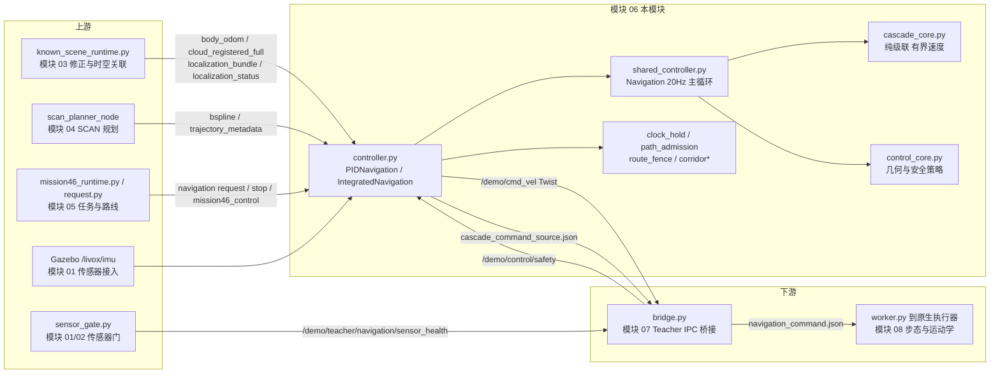
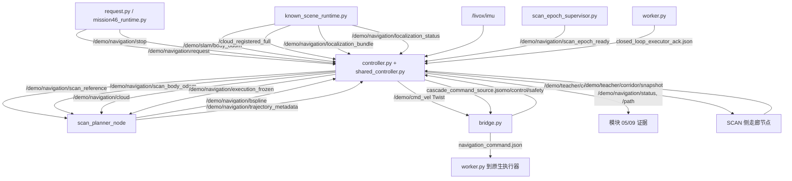
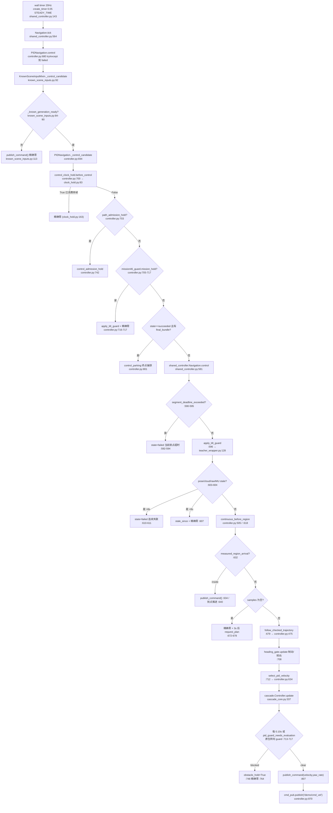
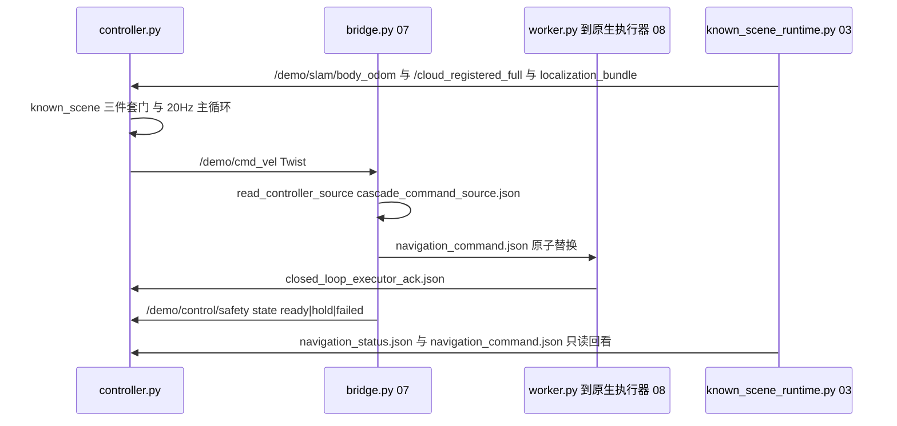
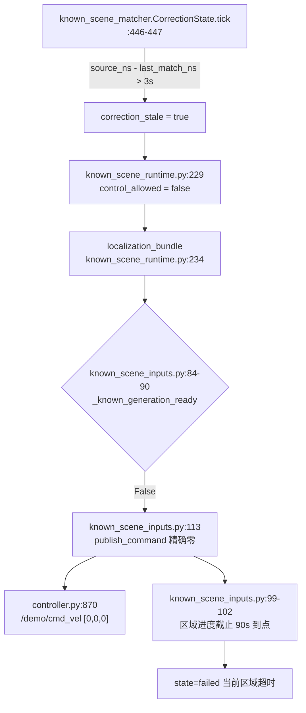

# 06 · 高层控制、轨迹跟踪与安全保护

> 所属: Fast-Livo2-SCAN-Gazebo-dog-sim-control @ 2331b93 · 模块 06/09
> 覆盖路径: `multifloor_demo/teacher_mode/navigation/engineering_v34_r44_active_p95_capture_candidate/`(下称 `ENG/`)、`multifloor_demo/navigation/control_core.py`、`multifloor_demo/teacher_mode/navigation/guard_audit.py`、`multifloor_demo/teacher_mode/navigation/teacher_transition.py`

## 1. 一句话职责

把**实测(经已知场景修正的)SLAM 位姿 + 原始 IMU + SCAN 已检查轨迹**变成一条有界、带完整来源收据的机体速度指令,并在任何一路输入、几何证明或时钟不成立时**发布精确零速度**;它是全栈唯一的速度指令发布者(`/demo/cmd_vel`),但**不产生 action、不驱动关节**。

## 2. 在总体数据流中的位置



三条要点:**①** 控制器看到的位姿/点云**不是** FAST-LIVO2 原始输出,而是 `known_scene_runtime.py` 修正后重新发布的同名话题(`slam.launch.py:56-60` 把前端输出改名为 `/demo/slam/raw_body_odom`、`/demo/slam/raw_registered_full`)。**②** 控制器与 bridge 之间**话题 + 文件双通道**:话题是命令本体,文件是来源收据。**③** bridge 与下游执行器之间**只有文件**(`navigation_command.json`)。

## 3. 内部子模块划分

| 子模块 | 关键文件 | 职责 | 关键符号 |
|---|---|---|---|
| 主控进程 / 决策编排 | [controller.py](../../multifloor_demo/teacher_mode/navigation/engineering_v34_r44_active_p95_capture_candidate/controller.py) | 子类化共享控制器;路径接纳事务、SCAN 参考一致性、级联选择、任务门、走廊 shadow、唯一的 `publish_command` | `PIDNavigation`、`IntegratedNavigation`、`select_pid_velocity`、`publish_command` |
| 共享执行循环 / 新鲜度看门狗 | [shared_controller.py](../../multifloor_demo/teacher_mode/navigation/engineering_v34_r44_active_p95_capture_candidate/shared_controller.py) | 订阅、20 Hz wall tick、取位姿/点云、到达判定、LiDAR 停止/恢复、超时失败 | `Navigation.control`、`tick`、`publish_command`、`apply_tilt_guard` |
| Teacher 有限包装 | [teacher_wrapper.py](../../multifloor_demo/teacher_mode/navigation/engineering_v34_r44_active_p95_capture_candidate/teacher_wrapper.py) | 收紧 QoS/参数/范围;实测停止与航向转换门;原生 guard 证据;状态发布包装 | `TeacherNavigation`、`RecordedPublisher`、`record_native_guard` |
| 纯级联核心 | [cascade_core.py](../../multifloor_demo/teacher_mode/navigation/engineering_v34_r44_active_p95_capture_candidate/cascade_core.py) | 只用整数时间戳的 SLAM/IMU/SCAN 级联;返回有界速度**与诊断行**,不返回 action、无 ROS | `Controller.update`、`_protect`、`path_end_hold` |
| header 事件 PID / 限幅 | [pid_core.py](../../multifloor_demo/teacher_mode/navigation/engineering_v34_r44_active_p95_capture_candidate/pid_core.py) | `slew` 变化率限制(实际使用);`HeaderPID` 类**在本快照中无实例化点** | `slew`、`HeaderPID`(未接线) |
| 作用域授权 | [pid_scope.py](../../multifloor_demo/teacher_mode/navigation/engineering_v34_r44_active_p95_capture_candidate/pid_scope.py) | 冻结运行输入、校验 `navigation_scope.json`;**不是** PID 数学 | `verify_scope`、`runtime_files` |
| 几何与安全策略 | [control_core.py](../../multifloor_demo/navigation/control_core.py) | 四元数/倾角/自过滤/轨迹跟随/航向门/加速度限制/障碍走廊 | `follow_trajectory`、`HeadingGate`、`steering_obstacle_ahead`、`limit_acceleration` |
| 时钟边界 | [clock_hold.py](../../multifloor_demo/teacher_mode/navigation/engineering_v34_r44_active_p95_capture_candidate/clock_hold.py) | wall tick / ROS clock 边界,重复时钟只能输出精确零 | `ControlClockHold.before_control`、`classify` |
| 路径接纳 | [path_admission.py](../../multifloor_demo/teacher_mode/navigation/engineering_v34_r44_active_p95_capture_candidate/path_admission.py)(内部算法见模块 04) | 连续三次曲线与冻结路线管的包含证明;旧路径保留证明 | `certify_curve`、`remaining_certificate`、`FrozenFence` |
| 保护零语义 | [replan_policy.py](../../multifloor_demo/teacher_mode/navigation/engineering_v34_r44_active_p95_capture_candidate/replan_policy.py) | 区分"受保护的命令零"与"SCAN 几何耗尽" | `low_command_is_exhausted_path` |
| **控制授权门**(失败链第 ② 环) | [known_scene_inputs.py](../../multifloor_demo/teacher_mode/navigation/engineering_v34_r44_active_p95_capture_candidate/known_scene_inputs.py) | 三件套原子摄入;`control_allowed`/generation/纪元/新鲜度全通过才放行控制主干,否则精确零 | `KnownSceneInputMixin`、`_known_generation_ready` |
| 冻结场景先验管 | [route_fence.py](../../multifloor_demo/teacher_mode/navigation/engineering_v34_r44_active_p95_capture_candidate/route_fence.py) | 围绕冻结配准场景折线的有限 3D 管道 | `tube_evidence` |
| 走廊(证据) | [corridor.py](../../multifloor_demo/teacher_mode/navigation/engineering_v34_r44_active_p95_capture_candidate/corridor.py) / [corridor_runtime.py](../../multifloor_demo/teacher_mode/navigation/engineering_v34_r44_active_p95_capture_candidate/corridor_runtime.py) / [corridor_preflight.py](../../multifloor_demo/teacher_mode/navigation/engineering_v34_r44_active_p95_capture_candidate/corridor_preflight.py) | shadow 体素/支撑面证书、离线线程、源码预检 | `CorridorObserver`、`decode_snapshot` |
| 转换门 | [transition_gate.py](../../multifloor_demo/teacher_mode/navigation/engineering_v34_r44_active_p95_capture_candidate/transition_gate.py) | 由新鲜 SLAM + 原始机体陀螺证明停车/航向转换 | `TeacherHeadingGate` |
| 轨迹关联 | [trajectory_contract.py](../../multifloor_demo/navigation/trajectory_contract.py) | 把 B-spline 载荷与已提交参考**成对**关联 | `TrajectoryAssociation` |
| 原生 guard 审计 | [guard_audit.py](../../multifloor_demo/teacher_mode/navigation/guard_audit.py) | 只截获原生转向 guard 的**两次** `obstacle_ahead` 结果 | `NativeGuardAudit` |
| 首目标停机观察 | [first_goal_stop.py](../../multifloor_demo/teacher_mode/navigation/engineering_v34_r44_active_p95_capture_candidate/first_goal_stop.py) | 只读原始证据、对一次首目标实验给出停止判定 | `verified_first_goal` |
| 证据归档 | [event_archive.py](../../multifloor_demo/navigation/event_archive.py) / [publication_ledger.py](../../multifloor_demo/teacher_mode/navigation/engineering_v34_r44_active_p95_capture_candidate/publication_ledger.py) | 异步有界事件归档、命令发布账本 | `EventArchive`、`PublicationLedger` |

## 4. 数据流与接口



接口表(方向 | 话题/文件 | 类型 | 生产者 | 消费者):

| 方向 | 话题/文件 | 类型 | 生产者(证据) | 消费者(证据) |
|---|---|---|---|---|
| ← | `/demo/navigation/request` | `String`(JSON 航点) | `request.py:177` / `mission46_runtime.py:112`(05) | `shared_controller.py:133` |
| ← | `/demo/navigation/stop` | `Bool` | `request.py:180` / `mission46_runtime.py:115`(05) | `shared_controller.py:134` |
| ← | `/demo/slam/body_odom` | `Odometry`(修正后实测位姿) | `known_scene_runtime.py:130,235`(03) | `known_scene_inputs.py:19` → `shared_controller.py:135` |
| ← | `/cloud_registered_full` | `PointCloud2`(修正后配准点云) | `known_scene_runtime.py:131,235`(03) | `known_scene_inputs.py:19` → `shared_controller.py:140` |
| ← | `/livox/imu` | `Imu` | Gazebo/传感器接入(01) | `shared_controller.py:138` |
| ← | `/demo/navigation/bspline` | `scan_planner_msgs/Bspline` | `scan_planner_node`(04) | `shared_controller.py:141` |
| ← | `/demo/navigation/trajectory_metadata` | `String` | `scan_planner_node`(04) | `shared_controller.py:142` → `trajectory_contract.py` |
| ← | `/demo/control/safety` | `String`(执行桥 hold/ready/failed) | `bridge.py:357,466`(07) | `shared_controller.py:139`、`teacher_wrapper.py:98` |
| ← | `/demo/navigation/localization_bundle` | `String`(含 `correction_stale`/`control_allowed`) | `known_scene_runtime.py:132,234`(03) | `known_scene_inputs.py:14` **控制权门** |
| ← | `/demo/navigation/localization_status` | `String`(修正事务状态) | `known_scene_runtime.py:133,318`(03) | `known_scene_inputs.py:15` |
| ← | `/demo/navigation/scan_epoch_ready` | `String` | `scan_epoch_supervisor.py:42`(09/04) | `known_scene_inputs.py:16` |
| ← | `/demo/teacher/corridor/snapshot` | `String`(shadow 快照) | **未在本快照 Python 源码中找到**(SCAN 侧) | `controller.py:78` |
| ← | `closed_loop_executor_ack.json` | 文件 | `worker.py:133`(07) | `controller.py:631` |
| ← | `navigation_anchor.json` + `navigation_scene_axis_registration.json` | 文件 | `request.py:252`(05) | `controller.py:375` → `path_admission.FrozenFence.load` |
| ← | `mission46_control.json` / `mission46_terrain_ack.json` | 文件 | `mission46_runtime.py`(05) | `mission46_guard.py:14,28`(经 `controller.py:706`) |
| ← | `navigation_status.json` | 文件 | 本模块 `teacher_wrapper.py:67` | `known_scene_runtime.py:158`(03,判定"已停") |
| ← | `navigation_command.json` | 文件 | `bridge.py`(`CommandFile.write` 316-328) | `known_scene_runtime.py:163`(03) |
| → | `/demo/cmd_vel` | `geometry_msgs/Twist` | **`controller.py:870`(唯一发布者)** | `bridge.py:365`(07) |
| → | `cascade_command_source.json` | 文件(来源收据) | `controller.py:864-865` | `bridge.py:392-394`(07) |
| → | `/demo/navigation/execution_frozen` | `Bool` | `controller.py:874` / `shared_controller.py:562` | `scan_planner_node`(`scan_epoch_supervisor.py:15` 重映射) |
| → | `/demo/navigation/status` | `String`(0.25 s 心跳) | `shared_controller.py:866` + `teacher_wrapper.py:64` | 模块 05/09、`known_scene_runtime` |
| → | `/demo/navigation/path` | `nav_msgs/Path` | `shared_controller.py:468,477` | 记录/SCAN |
| → | `/demo/navigation/scan_reference` | `nav_msgs/Path`(规划参考) | `shared_controller.py:545` | `scan_planner_node`(04) |
| → | `/demo/navigation/scan_body_odom` | `Odometry`(**world 速度语义**) | `shared_controller.py:259` | `scan_epoch_supervisor.py:45` → SCAN(04) |
| → | `/demo/navigation/cloud` | `PointCloud2`(自过滤后) | `shared_controller.py:308` | `scan_planner_node`、`scan_epoch_supervisor.py:46` |
| → | `/demo/teacher/corridor/request` | `nav_msgs/Path` | `controller.py:164` | SCAN 侧走廊节点 |
| → | `navigation_pid_history.jsonl` 等 | 证据 | `controller.py:866`、`publication_ledger.py:64` | 模块 09 |

## 5. 关键流程与时序

### 5.1 20 Hz 控制主循环(MRO 三层包装 + 共享循环)

进程入口是 `python3 controller.py --run <run>`,由 [stack.launch.py](../../multifloor_demo/teacher_mode/navigation/engineering_v34_r44_active_p95_capture_candidate/stack.launch.py) `:36` 启动(`use_sim_time:=true` 见 `:28`,`DEMO_RUN_DIR` 环境见 `:36`)。节点类在 `main()` 里动态组装:`class IntegratedNavigation(KnownSceneInputMixin,PIDNavigation)`(`controller.py:880-882`),因此调用链是 **`KnownSceneInputMixin` → `PIDNavigation`(controller.py) → `TeacherNavigation`(teacher_wrapper.py) → `Navigation`(shared_controller.py)**。



逐步讲解(每周期顺序):

1. **取输入(回调侧,不在 tick 内)**:`KnownSceneInputMixin.create_subscription`(`known_scene_inputs.py:18-23`)把 `/demo/slam/body_odom` 与 `/cloud_registered_full` 的原始回调截获,只有**同一 `source_ns` 的 body+cloud+metadata 三件套齐全**时,才在**一个** executor 回调里同步依次调用 `on_odom`、`on_cloud`(`:38-42`)。位姿回调链 `PIDNavigation.on_odom`(`controller.py:178`)→ `TeacherNavigation.on_odom`(`teacher_wrapper.py:159`,拒绝非 `camera_init`/`demo_slam_body`、时间倒退、四元数不归一、非有限值)→ `shared_controller.on_odom`(`:230`,写 `pose_stamp/pose_updated`,更新 `TrackingPositionFilter`,并把 twist 转成 world 速度后发 `/demo/navigation/scan_body_odom`)。`controller.py:181-195` 再把 20 ms 内的原始 IMU 与位姿配对成 `self.paired_imu`。
2. **时钟边界**:`control_clock_hold.before_control`(`controller.py:700`)。重复时钟直接精确零并结束本帧(见 §9.8)。
3. **接纳门**:`path_admission_hold` 为真时走 `control_admission_hold`(`controller.py:742`),它保留继承的超时/倾角/失联保护,但**不推进级联、航向与到达积分器**,最后统一 `publish_command()`(`:800`)。
4. **任务门**:`mission46_guard.mission_hold`(`controller.py:705-712`)读 `mission46_control.json` 与地形 ACK;hold 时只发零速度请求(不是零 action)。
5. **继承控制**:`shared_controller.control`(`:581`)按"超时失败 → 倾角保护 → 新鲜度 → 连续路线 → 到达 → 参考 → 跟随 → guard"的顺序执行;任何保护分支都是 `publish_command()`(零参)或 `publish_command(velocity,yaw_rate)`。
6. **跟踪**:`follow_checked_trajectory`(`controller.py:475-504`)调用 `control_core.follow_trajectory`(取 lookahead 0.80 m 的投影与航向),即使 `tracking_pose` 用滤波位姿,其空间参考仍换成级联的 `preview_reference`(同一条有限弧);障碍/到达/倾角判定始终用原始位姿(`control_core.py:93-100`)。
7. **速度生成**:`select_pid_velocity`(`controller.py:634-669`)把位姿+配对 IMU+执行器 ACK 交给 `cascade_core.Controller.update`,再把输出按 `pid_core.slew` 限变化率(`:650-651`),并校验发布值与 `pid_prepared_output` 完全一致(`:841-842`)。
8. **限幅**:指令包络由 profile `cascade.command_limits`(`profiles/engineering_nav46.json:117-121` = `[0.6,0.2,0.6]`,`bridge.py:78-86` 再校验其不超过 `(1.0,0.4,1.0)`)给出,由 `cascade_core.bounded`(`cascade_core.py:74`)逐轴裁剪;`control_core.limit_acceleration` 另行限制加速度并**强制机体侧向速度为 0**(`control_core.py:282`)。注意 `pid_core.HeaderPID` 里的 `≤[0.3,0.2,0.3]` 检查在本栈**未生效**(该类无实例化点)。
9. **发布**:`controller.py:830-874` 是唯一出口;同时写 `cascade_command_source.json` 并发布 `/demo/navigation/execution_frozen`。

### 5.2 一次 SCAN 轨迹接入事务

`accept_spline` 被 `PIDNavigation.accept_spline`(`controller.py:359-474`)整体接管,顺序为:载荷/元数据配对(`path_admission.candidate`)→ 有序覆盖纪元检查(`:369-374`)→ 冻结管包含证明(`certify_curve`,`:375-393`)→ 方向一致性(`:394-402`)→ 旧路径保留证明(`retain_admitted_path`,`:411-413`)→ 只有全部通过才 `super().accept_spline`(`:443`),失败则 `path_admission_hold=True` 并**立即精确零**(`:425,432`)。`KnownSceneInputMixin.accept_spline`(`known_scene_inputs.py:127-132`)更早一层:定位纪元未就绪或参考代次不匹配时直接拒绝关联,不进入几何证明。

### 5.3 命令下发时序(话题 + 文件)



## 6. 关键数据结构与配置

| 参数 | 值 | 位置 |
|---|---|---|
| `max_speed` / `arrival_radius` | 0.12 / 0.22(被 profile 覆盖为 `max_speed_mps=0.2`) | `shared_controller.py:48-49`、`teacher_wrapper.py:93-97`、`engineering_nav46.json:5` |
| `pose_timeout` / `cloud_timeout` | 默认 0.8/1.0 s,**本实验统一 0.3 s**(`pose_cloud_timeout_s`) | `shared_controller.py:50-51`、`teacher_wrapper.py:96`、`engineering_nav46.json:8` |
| 原始 IMU 超时 | 0.25 s(wall)且 `-0.10 ≤ ros_now-stamp ≤ 0.25` | `control_core.py:28,56-58` |
| 级联源 TTL | sim 与 wall 各 300 ms;位姿-陀螺配对 ≤20 ms | `cascade_core.py:307-311,374`、`engineering_nav46.json:128` |
| 控制时钟 TTL | `TTL_NS=300_000_000`(≥300 ms 无推进判 stalled) | `clock_hold.py:15,61` |
| 连续失联失败 | 8 s | `shared_controller.py:610`、`known_scene_inputs.py:108`、`clock_hold.py:150` |
| 倾角门 | ≥0.50 rad → `failed`;≥0.30 rad → hold;恢复需 <0.18 rad 且持续 0.8 s | `teacher_wrapper.py:135-154`、`shared_controller.py:186-226` |
| 障碍停止/恢复 | 走廊 `stop_distance=0.95 m`、`half_width=0.42 m`、`min_points=3`;clear 需连续 1.0 s | `control_core.py:286-287`、`shared_controller.py:754` |
| guard 评估周期 | ≥0.10 s 或级联更新后强制 | `shared_controller.py:713`、`controller.py:645-646` |
| 航向门 | `turn_complete_rad=0.1`、`drive_heading_max_rad=0.2`、停机窗 0.3 s/3 样本 | `engineering_nav46.json:39-49`、`transition_gate.py:37-42` |
| 角速度上限 | 物理侧 0.12 rad/s,行走 0.08 rad/s;转换门允许 ≤0.6 | `control_core.py:11-12`、`transition_gate.py:16` |
| 区域进度截止 | 90 s(`goal_timeout_sim_s` 默认 90,`region_progress_deadline_s=90.0`) | `multifloor_demo/navigation/goal_regions.py:51`、`engineering_nav46.json:7,3693`、`continuous_route.py:93-95` |
| 级联指令包络 | `[0.6,0.2,0.6]`,slew `[0.6,0.6,0.8]/s` | `engineering_nav46.json:117-121,142-146` |
| 修正新鲜度 | 源龄 ≤0.3 s、`maximum_match_age_s=3.0`(实测默认 `max_match_age_ns=3e9`) | `engineering_nav46.json:3705-3706`、`known_scene_matcher.py:418-419,446-447` |
| 走廊模式 | `corridor.mode` 只允许 `off`/`shadow`,`retain_valid_plan` 必须 false | `controller.py:62-64`、`engineering_nav46.json:3570-3573` |

## 7. 代码结构讲解

```
ENG/                                  # 主控进程所在目录(被 stack.launch.py 逐个拉起)
├── controller.py                     # 入口 1:唯一速度指令发布者;接纳/级联/任务门/走廊 shadow
├── shared_controller.py              # 入口(被 import):20Hz 主循环、看门狗、LiDAR 停止恢复
├── teacher_wrapper.py                # 入口(被 import):Teacher 范围收紧、转换门、原生 guard 证据
├── cascade_core.py                   # 纯数学:级联输出有界速度 + 诊断行
├── pid_core.py / pid_scope.py        # slew(使用)/ HeaderPID(未接线);作用域授权
├── control_core.py(在 multifloor_demo/navigation/)  # 几何与安全策略
├── clock_hold.py / replan_policy.py  # 时钟边界;零语义判别
├── path_admission.py / route_fence.py / known_scene_route_registration.py
├── corridor.py / corridor_runtime.py / corridor_preflight.py
├── transition_gate.py / guard_audit.py / first_goal_stop.py
├── trajectory_contract.py(在 multifloor_demo/navigation/)、event_archive.py、publication_ledger.py
└── stack.launch.py                   # 编排:planner/sensor_gate/controller/bridge/mission46
```

- **`controller.py`**:决策编排层。`PIDNavigation.__init__`(`:34-82`)建冻结管(`:54`)、时钟保持(`:57`)、走廊 shadow(`:62-79`);`on_*` 回调采集并落证据;`select_pid_velocity`(`:634`)是控制数学与 ROS 的接缝;`_control_candidate`(`:694`)是决策主干;`publish_command`(`:830`)覆盖基类版本,增加发布账本与"发布值必须等于级联准备值"的断言。
- **`shared_controller.py`**:通用执行循环。订阅8路+定时器(`:133-143`);`control`(`:581-807`)含全部超时/到达/障碍分支;`publish_command`(`:550-562`);`publish_status`(`:809`)。
- **`teacher_wrapper.py`**:用 `importlib` 把 `shared_controller.py` 作为 `base` 动态加载(`:24-25`),`TeacherNavigation(base.Navigation)`(`:70`)重写 QoS/参数/回调并**收紧**语义(冻结请求校验 `:221-227`、清障连续性与实测停止 `:242-265`、`guard_continuity` `:330-353`)。
- **`cascade_core.py`**:纯函数式核心,`update` 返回 `(bounded_velocity, diagnostic)`(`:305,337`);`_protect`(`:271-287`)清积分/滤波/dwell 并置零;`_output`(`:289-305`)带 `navigation_ground_truth_used=False` 等溯源字段。
- **`control_core.py`**:与测试共享的几何与安全策略;`RawImuTilt`、`TrackingPositionFilter`、`follow_trajectory`、`HeadingGate`、`limit_acceleration`、`obstacle_ahead`、`steering_obstacle_ahead`。
- **`clock_hold.py` / `replan_policy.py`**:两个小而关键的语义裁判(见 §9.8、§9.3)。
- **`known_scene_inputs.py`**:模块 06 与 03 的接缝,也是**控制授权门**;`create_subscription` 钩子(`:18-23`)与同步三件套回调(`:38-42`)保证"位姿/点云/元数据同一帧",`_control_candidate`(`:92-117`)是失败链第 ② 环的落点。
- **走廊三件套 + `route_fence.py`**:见 §9.7。
- **`guard_audit.py`(在 `teacher_mode/navigation/`,不在 `ENG/`)**:`NativeGuardAudit.__call__` 要求原生 guard 恰好执行**两次**走廊检查(`:25-30`),否则抛错 → 保护。

## 8. 与其他模块的边界

- **模块 03(已知场景定位)**:提供修正后的位姿与点云,并用 `localization_bundle` 的 `control_allowed` 给本模块**控制授权**;本模块只读,不参与匹配、不改写修正变换。反向只提供 `navigation_status.json`(状态回看,`known_scene_runtime.py:158` 判定"已停")。
- **模块 04(SCAN 规划)**:本模块发 `/demo/navigation/scan_reference` + `scan_body_odom` + `cloud` + `execution_frozen`,收回 `bspline`/`trajectory_metadata`;轨迹必须先过 `trajectory_contract` 配对再过 `path_admission` 证明。`corridor` 内部算法归 04,本模块只讲接口(`CorridorObserver`、`control_authority=False`)。
- **模块 05(任务与路线)**:`request`/`stop`/`mission46_control`/地形 ACK 进;`status`/`region_arrivals` 出。区域进度截止的超时判定在**本模块**触发 `state='failed'`,任务级清理在 05。
- **模块 07(Teacher IPC 桥)**:见 §5.3;`/demo/control/safety` 反向进入本模块,构成"零-hold-零"回环,**代码显式避免再回灌**(`teacher_wrapper.py:109-111`)。
- **模块 08(执行器/步态)**:无直接耦合;本模块只到 `/demo/cmd_vel` 与文件,原生命令包络在 `cascade_core.bounded` 与 `bridge.CommandGate` 双侧限制。
- **模块 09(运行编排)**:`pid_scope.verify_scope` 在每个进程 `main()` 校验冻结作用域(`teacher_wrapper.py:72`、`stack.launch.py:22`);证据文件名/schema 是归档契约的一部分。

## 9. 已知限制与失败点(失败链第 ② 环)

### 9.1 `correction_stale` / `control_allowed` 的确切位置

| 量 | 计算位置 | 语义 |
|---|---|---|
| `correction_stale` | [known_scene_matcher.py:446-447](../../multifloor_demo/teacher_mode/navigation/engineering_v34_r44_active_p95_capture_candidate/known_scene_matcher.py)(`CorrectionState.tick`,默认 `max_match_age_ns=3_000_000_000`,`:418-419`) | `last_match_ns is None` 或 `source_ns - last_match_ns > 3 s` |
| `correction_stale` 发布 | [known_scene_runtime.py:207-212,228](../../multifloor_demo/teacher_mode/navigation/engineering_v34_r44_active_p95_capture_candidate/known_scene_runtime.py) | 修正事务期间冻结 C,再取快照 |
| `control_allowed` | [known_scene_runtime.py:229](../../multifloor_demo/teacher_mode/navigation/engineering_v34_r44_active_p95_capture_candidate/known_scene_runtime.py) | `not self.transition and not correction_stale`,随 `localization_bundle` 发布(`:234`) |
| 控制授权判定 | [known_scene_inputs.py:84-90](../../multifloor_demo/teacher_mode/navigation/engineering_v34_r44_active_p95_capture_candidate/known_scene_inputs.py) | `d['control_allowed'] is True` **且** 三条消息 wall 龄 <0.3 s **且** `initialized` **且** SCAN 纪元 ready **且** 三代 generation 相同 **且** `pose_stamp==cloud_stamp==d['source_ns']` |
| **禁止运动并发布零** | [known_scene_inputs.py:92-116](../../multifloor_demo/teacher_mode/navigation/engineering_v34_r44_active_p95_capture_candidate/known_scene_inputs.py),零在 `:113` | 门不成立即 `publish_command()`(零参)+ `reset_region_arrival('known_scene_fresh_transaction_hold')`,**根本不进入** `PIDNavigation._control_candidate`/`shared_controller.control` |
| 零命令落地点 | [controller.py:830-874](../../multifloor_demo/teacher_mode/navigation/engineering_v34_r44_active_p95_capture_candidate/controller.py),`cmd_pub.publish` 在 `:870` | `velocity is None` → `msg` 三个字段保持 0 |



- **本仓库实测失败链的对应**:失败时 pose/cloud age 仅 0.011/0.009 s(前端完全新鲜),但最近**被接纳**的匹配源时刻停在 111.740 s,超过 3 s 上限 → `correction_stale=true` → `control_allowed=false` → 上面这条路径持续发布 `[0,0,0]`;期间 `exploration:5` 于 72.370 s 激活,90 s 后在 `known_scene_inputs.py:99-102` 判定"定位等待期间原区域超过仿真时间限制"置 `failed`,任务级清理由模块 05 完成。
- **为何"新鲜前端位姿不能替代有效地图修正"在代码中成立**:授权门查的不是"位姿/点云有没有新帧",而是①元数据里的 `control_allowed`,它由**地图匹配**的 `last_match_ns` 决定;②三件套必须共享同一个 `source_ns`;③`pose_stamp==cloud_stamp==source_ns`。前端继续输出新 header 只会让①以外的条件更满足,无法更新 `last_match_ns`。

### 9.2 保护零与真实零的区别

- **零的产生方式只有一种**:`publish_command()` 不带 `velocity` 参数(`controller.py:830`、`shared_controller.py:550`),`msg` 字段全 0;`self.command` 归零。带速度时必须与 `pid_prepared_output` 位级一致,否则抛错(`controller.py:841-842`)。
- **语义区分靠证据,不靠数值**:`PublicationLedger.begin` 用 `sys._getframe(2).f_code.co_name` 记录**调用者函数名**(`publication_ledger.py:37`),因此 `_control_candidate`(定位门零)、`control`(超时/障碍零)、`control_admission_hold`、`before_control`(时钟零)、`on_stop` 在 `navigation_command_publications.jsonl` 中可区分;`before_control` 另有专用 `navigation_control_clock_hold.jsonl`(`clock_hold.py:165-184`)。
- **`self.pid.reset('exact_zero_stop_or_protection')`**(`controller.py:844`)只递增**遗留归档计数**(`:18-25` 自述"Legacy archive reset counter only"),不是控制数学。
- **对外标志**:`/demo/navigation/execution_frozen = state!='running' or obstacle_hold or |v|<0.015`(`controller.py:874`),SCAN 侧据此冻结规划——受保护零与真实零在该话题上不可区分,这正是必须依赖证据文件的原因。

### 9.3 `replan_policy.py` 的作用

`low_command_is_exhausted_path`(`replan_policy.py:9-26`)只接受 `cascade_mode ∈ ('drive','path_end_hold')`;`protect`/`hold`/`recovering`/`pre_turn`/`settle`/`reference_constraint_hold`/`capture` 一律返回 `False`。调用点只有一处:`shared_controller.py:794-805`,满足"未对齐位移 + |v|<0.015 + |ω|<0.05 + 距上次参考 >3 s + 该谓词为真"时,才 `mark_execution_path_exhausted('low_command_exhausted_path')` 并请求新 SCAN 路径。**结论**:受保护的命令零永远不会被误判成"SCAN 几何耗尽",因此不会用零速来自动替换活动路线;反过来,真正耗尽时需要 `path_admission` 证明的新曲线才可能授权运动(`controller.py:416-425`)。

### 9.4 其它受保护零的来源(按优先级)

`clock_hold.before_control`(重复/倒退/停滞时钟,`controller.py:700`)、`_known_generation_ready` 不成立(`known_scene_inputs.py:113`)、区域截止(`shared_controller.py:592`、`known_scene_inputs.py:101`、`controller.py:750`)、倾角/原始 IMU 缺失(`teacher_wrapper.py:139,146`)、桥 hold/failed(`bridge.py:291` → `/demo/control/safety` → `teacher_wrapper.py:155-157`)、源超时与 8 s 失败(`shared_controller.py:603-611`)、到达/航向 pre_turn-settle(`shared_controller.py:634,788-791`)、障碍 hold(`shared_controller.py:763-764`)、路径耗尽与参考不一致(`shared_controller.py:691-698,784-787`)、接纳 hold(`controller.py:472,800`)、`reference_constraint_hold`(`cascade_core.py:562-564`)。

### 9.5 新鲜度看门狗(问题 5)

三路独立阈值(单位:**单调墙钟秒**,另有仿真时间龄作为上限):位姿 `pose_timeout`、点云 `cloud_timeout`(本实验同为 0.3 s,`teacher_wrapper.py:96` → `engineering_nav46.json:8`),原始 IMU 0.25 s(`control_core.py:28,56-58`)。`pose_updated`/`cloud_updated` 在**被接受的**消息里用 `time.monotonic()` 打点(`shared_controller.py:246,292`),所以"新鲜"是回调到达时刻,不是 header 时刻;`apply_tilt_guard` 的 `if not fresh: return True`(`shared_controller.py:206-210`)使 IMU 缺失本身就是停车原因。级联内部另有一套 **sim+wall 双 300 ms** 源检查(`cascade_core.py:307-311`),`bridge`/`worker` 又各做一次 300 ms 检查(`bridge.py:102-106`、`worker.py:152`)。

### 9.6 LiDAR 停止/恢复(问题 6)

触发:每 ≥0.10 s 或级联刚更新时(`shared_controller.py:713`),用**计算时刻冻结**的点云与位姿调 `evaluate_motion_guard`(`controller.py:670-679`)→ `TeacherNavigation.record_native_guard`(`teacher_wrapper.py:284-328`)先校验"本次 guard 用的正是被接受的那帧点云/位姿"(`:293-295`,否则抛错),再经 `NativeGuardAudit` 调**未修改的** `control_core.steering_obstacle_ahead`(`control_core.py:329-343`,已检查点走廊 ∪ 0.8 m 转向走廊)。阻塞即 `obstacle_hold=True` 并精确零(`shared_controller.py:743-764`)。恢复需:连续 1.0 s 无阻塞(`:752-758`)**且**实测停车成立(`teacher_wrapper.py:264-265` 要求 `heading_gate.stopped`,V44 还要求 guard 连续性 `:242-263,330-353`),随后 `samples=None` 必须重新拿 SCAN 路径。与 `route_fence.py` 无关(那是 bridge 侧的冻结先验管),与 `corridor.py` 无关(见 9.7)。

### 9.7 走廊与管道保护(问题 7)

| 文件 | 分工 | 会阻止运动吗 |
|---|---|---|
| `route_fence.py` | 冻结配准场景折线的有限 3D 管道判定(`horizontal_radius=0.45 m`、`height_error=0.3 m`,取 profile `registered_route_fence`) | **会**:`bridge.CommandGate.snapshot` 判 `outside` 时置 `failed`(`bridge.py:256-270`)→ 经 `/demo/control/safety` 使控制器 `failed`;同时作为 `path_admission` 的管半径来源(`path_admission.py:109`) |
| `path_admission.py` | 连续三次曲线包含证明、旧剩余路径证明 | **会**:证不出即 `path_admission_hold`(`controller.py:425,472`) |
| `corridor.py` | shadow 体素/支撑面证书数学(无 ROS) | **不会**:`controller.py:63-64` 只允许 `off`/`shadow`,且证书标 `control_authority=False`(`:131`) |
| `corridor_runtime.py` | 有界只读快照解码 + 单作业线程池 | **不会**:只 `submit/poll`,离线于 ROS 控制回调(`corridor_runtime.py:1-6`) |
| `corridor_preflight.py` | 冻结源码/构建预检与哈希清单 | **不会**:运行时只被 `pid_scope.runtime_files` 取哈希(`pid_scope.py:36`),不影响命令 |

### 9.8 时钟边界(问题 8)

"重复时钟只能输出精确零"指:`classify` 发现本次 tick 的 ROS clock 与上次相同(同仿真步内的第二次 wall tick,或 `/clock` 暂停)时返回 `duplicate`(≥300 ms 无推进返回 `stalled`,`clock_hold.py:59-62`),`before_control` 随即置 `guard_required=True`、执行原有倾角/超时保护、调用 `node.publish_command()` 发零并 `return True`(`:112-163`),于是**任何** PI、航向、到达或原生几何数学本帧都不执行(`controller.py:700-701` 提前返回)。必要性有三:级联与原生 guard 的时钟契约要求严格递增否则抛错(`teacher_wrapper.py:288-290`、`cascade_core.py:351-352`);同一采样点重复积分会重复累积 PI 与 dwell(`clock_hold.py:69-81,183` 冻结快照);bridge/worker 要求命令来源时间戳因果一致(`bridge.py:102-104`)。恢复必须等真实时钟推进**并**重新做一次原生几何检查(`guard_required`,`controller.py:645-646`)。

### 9.9 旁路 vs 控制流(问题 10)

| 文件 | 输出是否进入控制决策 | 依据 |
|---|---|---|
| `controller.py`、`shared_controller.py`、`teacher_wrapper.py`、`cascade_core.py`、`pid_core.slew`、`control_core.py`、`clock_hold.py`、`path_admission.py`、`replan_policy.py`、`transition_gate.py`、`trajectory_contract.py`、`route_fence.py`(经 bridge) | **是** | 见 §5、§9 |
| `known_scene_inputs.py` | **是(最强的门)** | `:92-117` 决定是否进入控制主干 |
| `corridor.py`、`corridor_runtime.py` | 否(仅影子证据) | `:1-6`、`controller.py:131` `control_authority=False` |
| `corridor_preflight.py` | 否(源码预检) | `pid_scope.py:36` |
| `event_archive.py` | 否("never a control input"),归档失败也**不能取消**保护停车 | `event_archive.py:1,33-34`、`shared_controller.py:775-777` |
| `publication_ledger.py` | 否(发布后只读记账) | `:1-4` |
| `guard_audit.py` | 否,但它的**返回值**就是原生 guard 结果 | `:1-5`、`teacher_wrapper.py:296` |
| `first_goal_stop.py` | 否(只观测原始证据并给出一次判定,由 `run.py`/`startup_trace.py` 使用) | `:1-5`、`run.py:628`、`startup_trace.py:194` |
| `pid_core.HeaderPID` | **未接线**,本快照无实例化点 | `controller.py:8` 只导入 `slew` |

## 10. 建议阅读路线

1. `stack.launch.py:29-44` → 认清进程边界与控制器的启动参数。
2. `shared_controller.py:44-143`(订阅/发布/参数/20 Hz 定时器)→ `:564-612`(tick 与超时)→ `:679-807`(跟随、guard、零发布)。
3. `teacher_wrapper.py:70-158`(范围收紧与倾角)、`:237-282`(control 包装)、`:284-353`(原生 guard 与连续性)。
4. `controller.py:830-874`(唯一发布点)→ `:634-669`(级联调用)→ `:694-800`(决策主干与接纳 hold)→ `:359-474`(接纳事务)。
5. `cascade_core.py:271-311`(保护与输出行)、`:337-457`(输入校验与 capture)。
6. **失败链**:`known_scene_matcher.py:410-459` → `known_scene_runtime.py:199-241` → `known_scene_inputs.py:84-117`;再读 `replan_policy.py`、`clock_hold.py:46-64,83-185`。
7. 保护旁路:`route_fence.py`(20 行)、`corridor_runtime.py:1-50`、`guard_audit.py`(35 行)。
