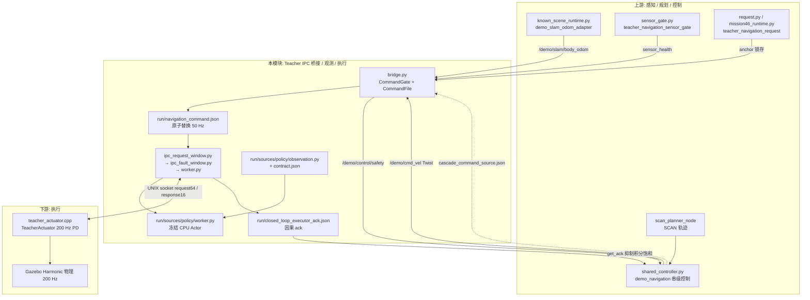
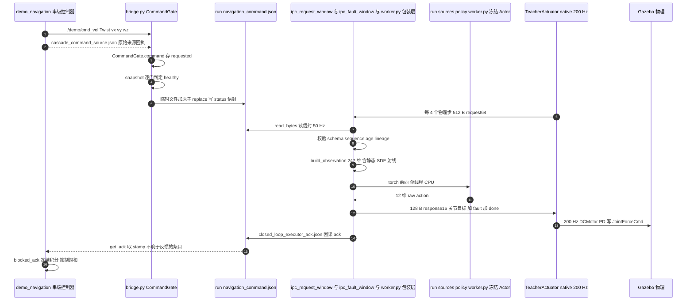
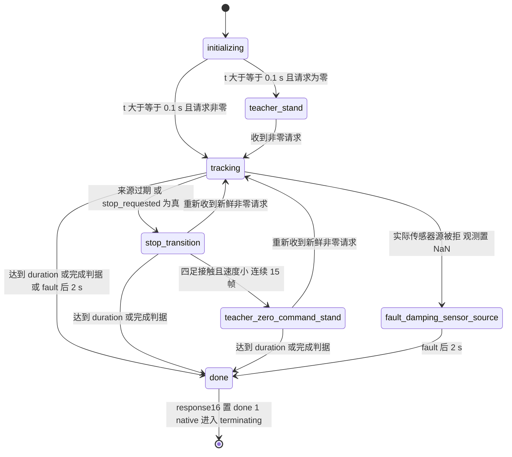

# 07 · Teacher IPC 桥接、策略观测与执行

> 所属: Fast-Livo2-SCAN-Gazebo-dog-sim-control @ 2331b93 · 模块 07/09
> 覆盖路径:
> - `multifloor_demo/teacher_mode/navigation/engineering_v34_r44_active_p95_capture_candidate/`(`ENG/`)
>   `bridge.py`、`worker.py`、`policy_candidate/worker.py`、`policy_selection.py`、`POLICY_SELECTION_CONTRACT.json`、`ipc_evidence.py`、`ipc_fault_window.py`、`ipc_request_window.py`、`owned_guardian.py`、`stack.launch.py`
> - `multifloor_demo/teacher_mode/policy/observation.py`、`multifloor_demo/teacher_mode/policy/contract.json`
> - `multifloor_demo/teacher_mode/navigation/runtime_io.py`
> - `multifloor_demo/teacher_mode/scripts/capture.py`
> - 只读引用(归属其它模块): `ENG/run.py`(模块 09)、`ENG/controller.py`+`cascade_core.py`(模块 06)、`multifloor_demo/teacher_mode/simulation/native/current/teacher_actuator.cpp`(模块 08)

## 1. 一句话职责

把模块 06 产出的**经门控的 SLAM/SCAN 速度命令**通过一个原子 JSON 文件交给 CPU Teacher，由 Teacher 用 privileged 仿真状态构造 247 维观测、单线程 CPU 前向出 12 个关节目标，经 UNIX socket 交回 native 执行器，并把「命令确实被下一帧 native 请求消费」的因果 ack 回写给高层控制器。

这一层是整条链路中唯一**同时**持有 ROS 话题、本地文件、UNIX socket 三种传输的接缝层；`bridge.py` 自述「这是一个准备好的集成边界，不是导航成功的证据」，且「从不订阅 Gazebo 真值、从不自己驱动关节」(`ENG/bridge.py:3-7`)。

## 2. 在总体数据流中的位置



关键事实:命令**不**走 ROS 话题进 Teacher，而是走 `run/navigation_command.json`;native 执行器**不**读该 JSON,只读 UNIX socket。两条路径在 `worker.py` 汇合。

## 3. 内部子模块划分

| 子模块 | 关键文件 | 职责 | 关键符号 |
|---|---|---|---|
| 门控桥 | [bridge.py](../../multifloor_demo/teacher_mode/navigation/engineering_v34_r44_active_p95_capture_candidate/bridge.py) | 订阅 Twist+SLAM 位姿,做健康/来源/围栏门控,写原子 JSON,发状态与安全话题 | `CommandGate`、`CommandFile`、`check_acceptance`、`validate_controller_source` |
| 命令文件传输 | [runtime_io.py](../../multifloor_demo/teacher_mode/navigation/runtime_io.py)、[compact_archives.py](../../multifloor_demo/teacher_mode/navigation/engineering_v34_r44_active_p95_capture_candidate/compact_archives.py) | 单飞+可替换 pending 的后台写线程,历史归档 | `LatestCommandWriter`、`make_command_writer`、`ArchiveHistory` |
| IPC 包装 worker | [worker.py](../../multifloor_demo/teacher_mode/navigation/engineering_v34_r44_active_p95_capture_candidate/worker.py) | monkeypatch 冻结 worker:改读命令文件、埋点计时、产生因果 ack、写 `ipc_evidence_result.json` | `read_command`、`receive`、`IsolatedJSON`、`metadata` |
| 冻结 CPU Actor | [policy_candidate/worker.py](../../multifloor_demo/teacher_mode/navigation/engineering_v34_r44_active_p95_capture_candidate/policy_candidate/worker.py) | socket 服务端循环、观测构造调用、Actor 前向、stop/timeout 状态机 | `load_actor`、`requested`、`navigation_command`、`recv_exact`、`main` |
| 观测契约 | [observation.py](../../multifloor_demo/teacher_mode/policy/observation.py)、[contract.json](../../multifloor_demo/teacher_mode/policy/contract.json) | 247 维观测构造 + 静态 SDF 地形射线 + 冻结数值契约 | `build_observation`、`TerrainHeightMap`、`SCAN_GRID_XY`、`quaternion_rotation` |
| 显式策略选择 | [policy_selection.py](../../multifloor_demo/teacher_mode/navigation/engineering_v34_r44_active_p95_capture_candidate/policy_selection.py)、[POLICY_SELECTION_CONTRACT.json](../../multifloor_demo/teacher_mode/navigation/engineering_v34_r44_active_p95_capture_candidate/POLICY_SELECTION_CONTRACT.json) | 源码/作用域冻结前显式选定候选策略,禁止回退,记录实际加载路径 | `selection`、`binding`、`verify_binding`、`record_actual_loaded` |
| 有界 IPC 证据 | [ipc_evidence.py](../../multifloor_demo/teacher_mode/navigation/engineering_v34_r44_active_p95_capture_candidate/ipc_evidence.py) | 墙钟分帧计时 + 有界历史(可省略) | `BoundedHistory`、`FrameTiming`、`TimedConnection` |
| IPC 结束窗口 | [ipc_fault_window.py](../../multifloor_demo/teacher_mode/navigation/engineering_v34_r44_active_p95_capture_candidate/ipc_fault_window.py) | 只保留标量的收尾窗口,worker 退出后一次性落盘 | `FaultWindow`、`RecordingWriter` |
| IPC 原始 request 观测 | [ipc_request_window.py](../../multifloor_demo/teacher_mode/navigation/engineering_v34_r44_active_p95_capture_candidate/ipc_request_window.py) | 观测 request 子阶段与 GC 回调,从不缓存/替换结果 | `RequestWindow`、`instrument`、`observe_default_gc` |
| owner 监视 | [owned_guardian.py](../../multifloor_demo/teacher_mode/navigation/engineering_v34_r44_active_p95_capture_candidate/owned_guardian.py) | 独立有界 owner 看门狗;bootstrap 逐个角色准入 | `Guardian`、`bootstrap`、`watch`、`stop_group`、`bounded_shutdown_signals` |
| 角色入口 | [stack.launch.py](../../multifloor_demo/teacher_mode/navigation/engineering_v34_r44_active_p95_capture_candidate/stack.launch.py) | 启动 bridge + 规划/定位/控制/任务进程 | `--command-file run/navigation_command.json` |
| RGB 归档 | [capture.py](../../multifloor_demo/teacher_mode/scripts/capture.py) | 实际 Gazebo RGB 落盘(独立 owner 角色 `capture`) | `main`、`archive_stride` |

## 4. 数据流与接口

### 4.1 命令文件字段结构

文件名由启动参数固定:`stack.launch.py` 传 `--command-file <run>/navigation_command.json`(`ENG/stack.launch.py:37-38`),`bridge.main()` 在 experimental 模式下**拒绝**任何别的输出路径(`ENG/bridge.py:533-534`)。写入内容就是 bridge 的状态信封 `Bridge.envelope()`:`CommandGate.snapshot()`(`ENG/bridge.py:291-302`)加上封套字段(`ENG/bridge.py:447-459`)。

| 字段名 | 类型 | 含义 | 生产者 |
|---|---|---|---|
| `schema_version` | int=1 | 信封版本,消费者强制校验 | `bridge.envelope` |
| `sequence` | int≥1 | 每次 tick 自增的单调序号 | `bridge.tick` |
| `mode` / `source` | str=`scan_slam` | 命令来源声明,消费者强制校验 | `bridge.envelope` |
| `state` | str | `failed` / `ready` / `hold` | `CommandGate.snapshot` |
| `healthy` | bool | 所有门通过为 true | `CommandGate.snapshot` |
| `stop_requested` | bool | 不健康 或 `command` 全零 | `CommandGate.snapshot` |
| `reason` | str | 去重后的拒绝理由串(空则 `Fresh SLAM/SCAN inputs`) | `CommandGate.snapshot` |
| `requested` | float[3] | 收到的原始 Twist `(linear.x, linear.y, angular.z)` | `CommandGate.command` |
| `command` | float[3] | 限幅后真正下发的速度;**不健康时强制 `[0,0,0]`** | `CommandGate.snapshot` |
| `ages` | obj | `clock_wall_s`/`pose_wall_s`/`command_wall_s`/`pose_sim_s`/`command_sim_s` | `CommandGate.snapshot` |
| `slam_valid_samples` | int | 连续有效 SLAM 位姿计数(需 ≥2) | `CommandGate.pose` |
| `command_received_monotonic_wall` | float\|null | 命令到达墙钟 | `CommandGate.command` |
| `command_received_ros_sim_time_ns` | int\|null | 命令到达时的仿真时钟 | `CommandGate.command` |
| `slam_stamp_ns` | int\|null | 最近有效 SLAM 位姿源时刻 | `CommandGate.pose` |
| `publisher_graph` | obj | `{slam, command, details.{slam_publishers, command_publishers}}` | `Bridge.check_integrity` |
| `controller_source` | obj\|null | 原始串级来源回执全文(非零命令时必须) | `bridge.command` 读 `cascade_command_source.json` |
| `controller_source_receipt` | obj\|null | 该文件的 `sha256` / `read_begin_wall_ns` / `read_wall_ns` | `read_controller_source` |
| `controller_source_error` | str\|null | 来源读取/校验失败原因 | `read_controller_source` |
| `registered_route_fence` | obj\|null | 注册路线管道围栏证据 | `route_fence.tube_evidence` |
| `monotonic_wall` | float | 信封生成墙钟(秒) | `bridge.envelope` |
| `sim_time` | float\|null | `clock_ns/1e9` | `bridge.envelope` |
| `stamp` | obj | `{monotonic_wall, ros_sim_time_ns, ros_sim_time}` | `bridge.envelope` |
| `valid_for_wall_s` | float=0.300 | 声明有效期,与消费侧 TTL 一致 | `bridge.envelope` |
| `limits` | obj | `{vx_mps, vy_mps, wz_radps}`,取自 profile | `CommandGate.limits` |
| `observation_source` | obj | `navigation_pose` / `navigation_frame` / `navigation_ground_truth_used=false` / `velocity_request` / `policy_inputs` | `bridge.envelope` |
| `acceptance` | obj | 冻结作用域回执(`path`/`sha256`/`run_dir`/`profile`/`controller_kind`/`checkpoint_sha256`/`navigation_is_verified`) | `pid_scope.verify_scope` |
| `navigation_validation` | str=`unverified` | 显式否定导航已验证 | `bridge.envelope` |
| `health_scope` | str | 声明仅覆盖 SLAM/SCAN 输入健康 | `bridge.envelope` |
| `clock_source` | str | 单 rclpy ROS TimeSource `/clock`,KEEP_LAST depth=1 | `bridge.envelope` |
| `transport` | obj | `{type, superseded, written, max_queue_delay_wall_s}` | `LatestCommandWriter` 统计 |

### 4.2 写入原子性与排他

- **排他锁**:`CommandFile.__init__` 打开 `<name>.lock`,`fcntl.flock(LOCK_EX|LOCK_NB)`;抢不到直接 `RuntimeError('Another navigation bridge owns this command file')`(`ENG/bridge.py:309-314`)。
- **原子替换**:写同目录 `NamedTemporaryFile(prefix='.'+name+'.')` → `flush()` → `temporary.replace(self.path)`,`finally` 里 `unlink(missing_ok=True)`;`json.dumps(..., allow_nan=False)`(`ENG/bridge.py:316-331`)。自述**不承诺掉电持久化**,只保证读者看到完整的新/旧 JSON(`ENG/bridge.py:325-327`)。
- **串行化写**:真正的写由 `LatestCommandWriter` 后台线程执行,「一次在飞写入 + 一个可替换 pending,绝不是 FIFO」;新信封覆盖旧 pending 并累加 `superseded`,零命令立即替换待发运动(`multifloor_demo/teacher_mode/navigation/runtime_io.py:52-70`)。
- **审计**:启用 compact 归档时,每个真实写出的信封追加到 `navigation_command_history.jsonl`(经 `v33_dictionary_jsonl/v1` 编解码后落 `navigation_command_history.compact.jsonl`),含 `transport_queue_delay_wall_s` 等(`runtime_io.py:81-86`、`compact_archives.py:14-19`、`compact_archives.py:216-237`)。

### 4.3 读取者与容错

| 读者 | 频率 | 用途 |
|---|---|---|
| `ENG/worker.py::read_command` | 每个收到的 512 B native 帧一次,即 **50 Hz** | 生成 Actor 的 3 维命令输入 |
| `known_scene_runtime.py::idle_or_stopped` | 20 Hz 定时器(`known_scene_runtime.py:148`) | 已知场景「空闲/已停」判定 |
| `ipc_request_window.observed_path` | 观测计数 | 只记录 `Path.read_bytes` 次数与耗时 |

容错是**逐字段 fail-closed**:`worker.read_command()` 逐项校验 `schema_version==1`、`mode==source=='scan_slam'`、`acceptance.sha256==scope_sha`、`sequence` 不回退且同序号必须同哈希、`command` 为 3 维有限且在 `limits+1e-10` 内、`-.05≤sim_age≤0.3` 且 `0≤wall_age≤0.3`,非零命令还必须带 `controller_source` 并通过来源因果校验;任何异常都被捕获为 `(zeros(3), rejected=True, reason)` 并写入 `closed_loop_execution_commands.jsonl`,**不抛出**(`ENG/worker.py:137-169`)。注意内置读取器 `policy_candidate/worker.py:113-141` 是同一思路的另一份实现,但本轮的 argv 被改写成 `--test forward`,实际生效的是 `ENG/worker.py` 这一条路径(`ENG/worker.py:249-252`)。

### 4.4 接口表

| 方向 | 话题 / 文件 | 类型 | 生产者 | 消费者 |
|---|---|---|---|---|
| ← 入 | `/demo/cmd_vel` | `geometry_msgs/Twist` | `demo_navigation`(`shared_controller.py:46,125`) | `bridge.py:365` |
| ← 入 | `/demo/slam/body_odom` | `nav_msgs/Odometry` | `demo_slam_odom_adapter`(`known_scene_runtime.py:106`) | `bridge.py:364` |
| ← 入 | `/demo/teacher/navigation/sensor_health` | `std_msgs/String`(JSON) | `teacher_navigation_sensor_gate`(`sensor_gate.py:106`) | `bridge.py:359` |
| ← 入 | `/demo/teacher/navigation/anchor` | `std_msgs/String`(TRANSIENT_LOCAL) | `teacher_navigation_request`(`request.py:170`) | `bridge.py:361` |
| ← 入 | `/demo/champ/execution_health` | `std_msgs/String` | `champ_reviewed_command_reader` | `bridge.py:363`(仅 `controller_kind=='champ'`,本轮为 `teacher`) |
| ← 入 | `/clock` | `rosgraph_msgs/Clock` | Gazebo / ROS | rclpy TimeSource → `bridge.sync_clock` |
| ← 入 | `run/navigation_scope.json` | JSON | `pid_scope.prepare`(模块 09) | `bridge --acceptance`、`worker.py:20` |
| ← 入 | `run/navigation_anchor.json` | JSON | 模块 05 | `bridge.anchor` 比对冻结回执(`bridge.py:431-432`) |
| ← 入 | `run/cascade_command_source.json` | JSON | 模块 06 串级 | `read_controller_source`(`bridge.py:393`) |
| ← 入 | `run/navigation_status.json` / `run/mission46_status.json` | JSON | 模块 05 / 06 | `ENG/worker.py:195-206` 判定完成时刻 |
| ← 入 | `run/mission46_terrain_request.json` | JSON | 模块 05 | `MissionTerrainProvider.check_switch`(`mission46_terrain.py:45`) |
| ← 入 | `run/world.sdf` | SDF | 模块 01 | `TerrainHeightMap.from_sdf`(privileged,`observation.py:126`) |
| ← 入 | UNIX socket(`TEACHER_SOCKET`) | 512 B LE float64×64 | `TeacherActuator::Exchange`(`teacher_actuator.cpp:380-385`) | `worker.py::receive` → `recv_exact` |
| ← 入 | `run/sources/policy/{worker.py,observation.py,contract.json}` | 源码快照 | 模块 09 冻结 | `worker.py:41-43`、`policy_selection.py:77-100` |
| → 出 | `run/navigation_command.json` | JSON(上表) | `bridge` | `ENG/worker.py` 50 Hz、`known_scene_runtime` 20 Hz |
| → 出 | `run/navigation_command_history.jsonl(.compact.jsonl)` | JSONL | `LatestCommandWriter`/`ArchiveHistory` | 模块 09 归档 |
| → 出 | UNIX socket response | 128 B LE float64×16 | `policy_candidate/worker.py:274,295` | `TeacherActuator`(模块 08) |
| → 出 | `run/closed_loop_executor_ack.json` / `.jsonl` | JSON / JSONL | `worker.py::receive`(`worker.py:133`) | `controller.py:631`→`cascade_core._pi` |
| → 出 | `/demo/teacher/navigation_bridge/status` | `std_msgs/String` | `bridge.py:355` | 本快照未找到订阅者(观测用) |
| → 出 | `/demo/teacher/navigation_bridge/stop` | `std_msgs/Bool` | `bridge.py:356` | 本快照未找到订阅者(观测用) |
| → 出 | `/demo/control/safety` | `std_msgs/String` | `bridge.py:357` | `shared_controller.py:139`、`mission46_runtime.py:130` |
| → 出 | `run/telemetry.jsonl` 等证据文件 | JSONL/JSON | 冻结 worker | 模块 09 / 03 审计 |

### 4.5 「经审核 / gated」具体指哪些门,哪些命令会被拒

门分三层,只有三层全过 `command` 才不是零向量。

**第一层:启动前的作用域与验收门(不过就根本不起 node)**

| 门 | 条件 | 位置 |
|---|---|---|
| 作用域 schema | `schema=='teacher_closed_loop_navigation_scope/v1'` | `pid_scope.py:62` |
| 显式未验证声明 | `allowed is True`、`status=='experimental_unverified'`、`navigation_is_verified is False` | `pid_scope.py:62-63` |
| 无真值导航 | `navigation_ground_truth_used is False` | `pid_scope.py:63` |
| 冻结模型 | `checkpoint_sha256 == FROZEN_SHA`(快照中为 `''`) | `pid_scope.py:64`、`bridge.py:32,65` |
| 控制类型 | `controller_kind=='teacher'` | `pid_scope.py:64` |
| 审核依据串 | `review_basis=='explicit_user_closed_loop_controller_actual_SLAM_SCAN_multifloor_simulation'` | `pid_scope.py:65` |
| run 存储 | `run_storage.verify_run` + 路径父目录等于 run | `pid_scope.py:68-70` |
| profile 关键项 | `pose_cloud_timeout_s==.3`、`control_clock_contract` 精确匹配 `clock_hold.CONTRACT`、命令界 3 维且 ≤`[1,.4,1]` | `pid_scope.py:71-75` |
| 冻结引用完整 | `references` 全量哈希、`navigation_source_snapshots.json` 目标在 `run/sources` 且哈希一致、几何归档、策略绑定、asset manifest `physics_step_s==.005 && decimation==4` 与 `exclusive_writer=='teacher_sim::TeacherActuator'` | `pid_scope.py:76-99` |
| 历史验收未变 | `sha(ROOT/'runs/acceptance.json')==historical_acceptance_sha256` | `pid_scope.py:100` |
| legacy 聚合验收分支 | `levels.motion` 与 `levels.sim2sim` 均 `passed`、`publication=='final'`、`additional_scene_gate.status=='passed'`、`navigation.allowed is True` 且 `truth_navigation_used is False`、`checkpoint_sha256==FROZEN_SHA` | `bridge.py:41-69` |
| 命令路径固定 | experimental 模式下 `--command-file` 必须解析为 `<run>/navigation_command.json` | `bridge.py:533-534` |
| 输入不可重映射 | `/demo/slam/body_odom`、`/demo/cmd_vel` 被重映射即销毁 node 并抛错 | `bridge.py:366-368` |
| 文件唯一所有权 | `flock(LOCK_EX\|LOCK_NB)` 抢不到即拒绝启动第二个 bridge | `bridge.py:309-314` |
| 运行中不可换验收 | integrity 检查发现 acceptance 哈希变化即 `RuntimeError` | `bridge.py:479-480` |

**第二层:每次 tick 的运行时门(`CommandGate.snapshot`)**

| 门 | 条件 | 位置 |
|---|---|---|
| 时钟 | 合法、非回退,且各输入 `sim/wall` 年龄 `<300 ms`、不超前 50 ms | `bridge.py:169-176,283-285` |
| SLAM 位姿 | frame/child 必须为 `camera_init`/`demo_slam_body`;四元数归一(0.98~1.02);时间戳严格递增;不超前仿真钟 50 ms;≥2 个连续有效样本 | `bridge.py:177-200,279-280` |
| 发布者图唯一 | 每个话题**恰好一个**指定 node:`demo_slam_odom_adapter`、`demo_navigation`;experimental 下还要求 `teacher_navigation_sensor_gate`、`teacher_navigation_request`(champ 模式另加 `champ_reviewed_command_reader`) | `bridge.py:468-482` |
| 传感器健康 | `sensor_health.ready is True` 且墙钟年龄 `<300 ms`、`mode` 匹配、`ground_truth_navigation_used is False` | `bridge.py:247-249,401-409` |
| 路线锚点 | 必须已收到锁存 anchor,且与 `navigation_anchor.json` 逐字段相等;中途变更即 `failed` | `bridge.py:250-251,423-437` |
| 路线围栏 | 注册管道围栏或 along/lateral/height 三维围栏,越界即 `failed='Measured SLAM body pose left finite route fence'` | `bridge.py:252-270` |
| 命令可信来源 | 非零命令必须带 `controller_source`: `navigation_ground_truth_used is False`、`command_after_slew` 与收到的 Twist **完全相等**、六个时刻/序号为非负 int、`0≤clock-pose≤300 ms`、`0≤pose-gyro≤20 ms`、`pose≤control≤clock+50 ms`、墙钟年龄 ≤300 ms、秒别名一致、`healthy is not False` | `bridge.py:89-117,227-236` |
| 执行器健康 | 仅 `controller_kind=='champ'` 时要求 `execution_health.state=='ready'`、`actor_started is False` 等 | `bridge.py:237-244,411-421` |

**第三层:命令本身的拒绝条件(命中任一 → `command` 变 `[0,0,0]`、`stop_requested=True`)**

| 拒绝条件 | 位置 |
|---|---|
| 命令含非有限值 → `failed='SCAN command contains a nonfinite value'` | `bridge.py:203-205` |
| `linear.z`/`angular.x`/`angular.y` 任一非零 → `failed='SCAN command requests unsupported z/roll/pitch motion'` | `bridge.py:207-209` |
| Twist 超出 profile `cascade.command_limits`(本轮 `[0.6,0.2,0.6]`)→ 记入 `reason` 的 `Cascade provenance rejected: ...` | `bridge.py:228-231` |
| 来源文件缺失/过期/不匹配 → 同上,理由为具体错误串 | `bridge.py:232-233` |
| 任一上层门不通过 → `healthy=False`,命令被强制归零而非降级 | `bridge.py:286-287` |
| 命令全零但已不健康 → `stop_requested=True` | `bridge.py:292` |

消费侧的二次门见 4.3 与 `ENG/worker.py:145-166`:即使 bridge 说 `healthy is True`,`worker` 仍独立复核 schema、`acceptance.sha256`、序号单调、限幅、双 300 ms 时效与 lineage;两次复核都通过才把非零速度送进观测的 `velocity_commands`。

## 5. 关键流程与时序



ack 的因果定义在 `ENG/worker.py:122-134`:收到**下一帧** 512 B native 请求即证明上一帧策略响应已被消费,于是把 `latest['pending_ack']`(`stamp_ns`、`applied_command_body`、`requested_command_body`,由 `IsolatedJSON.dumps` 在写 telemetry 行时登记,`ENG/worker.py:225-226`)升级为 ack 行,写入 `run/closed_loop_executor_ack.json` 的 `entries` 数组(环形,`deque(maxlen=32)`)并追加 JSONL。ack 明确标注 `contains_position_or_attitude=False`、`navigation_ground_truth_used=False`。

消费侧:`controller.get_ack()` 取 `entries` 中最后一个 `stamp_ns <= feedback['stamp_ns']` 的条目(`ENG/controller.py:628-633`);`cascade_core._pi` 用 `requested_command_body - applied_command_body` 的残差判定下游是否被限幅,据此冻结积分项,防止抗饱和失败(`ENG/cascade_core.py:322-326`)。**超时处理**:ack 缺省不报错——`get_ack()` 返回 `None` 时传入 `guard_reason='actual_causal_feedback_or_ack_missing'`,串级进入保护(`ENG/controller.py:640`);ack 自身另有 300 ms 新鲜度门(`cascade_core.py:307-311`)。

## 6. 关键数据结构与配置

### 6.1 247 维观测分段

`build_observation(state, command, last_action, terrain, ...)` 接收 `state64 / command3 / last_action12`,返回 `(float32[247], diagnostic dict)`(`observation.py:201-273`)。顺序由 `contract.json` 的 `concatenation_order` 定义,代码按位置 `zip` 拼接(`observation.py:239`),两侧必须一致。

| 名称 | slice | 维 | 来源(文件:行号) | clip / scale |
|---|---|---|---|---|
| `base_lin_vel` | 0:3 | 3 | **Gazebo base COM** 体坐标线速度 `request[8:11]`(`teacher_actuator.cpp:194,222`;`observation.py:232`) | ±100 / ×1.0 |
| `base_ang_vel` | 3:6 | 3 | Gazebo base 角速度 `request[11:14]`(`teacher_actuator.cpp:195,222`) | ±100 / ×0.2 |
| `projected_gravity` | 6:9 | 3 | 由 Gazebo 四元数计算 `R^T·[0,0,-1]`(`observation.py:217,232`) | ±100 / ×1.0 |
| `velocity_commands` | 9:12 | 3 | **命令输入**:限幅后的 `cmd`(slew 后),非 JSON 原始 `requested`(`policy_candidate/worker.py:243,245`) | ±100 / ×1.0 |
| `joint_pos_rel` | 12:24 | 12 | 关节物理 `q - DEFAULT_Q`(`teacher_actuator.cpp:186,224`) | ±100 / ×1.0 |
| `joint_vel_rel` | 24:36 | 12 | 关节物理 `qd`(`teacher_actuator.cpp:187,225`) | ±100 / ×0.05 |
| `joint_effort` | 36:48 | 12 | **上一帧实际施加且经速度相关限幅的力矩** `lastTorque`(`teacher_actuator.cpp:225,240`) | ±100 / ×0.01 |
| `last_action` | 48:60 | 12 | 上一帧 raw action(`policy_candidate/worker.py:264`) | ±100 / ×1.0 |
| `height_scan` | 60:247 | 187 | **静态 SDF 垂直射线**查询(`observation.py:197-224`) | ±1.0 / ×1.0 |

分段口径:232 维 privileged = 上表除 `velocity_commands` 与 `last_action` 之外的 3+3+3+12+12+12+187 = 232(`ENG/worker.py:237`、`ENG/profiles/engineering_nav46.json:53`);15 维命令/上一动作 = 3+12。这 15 维在向量里**并不连续**(位于 `[9:12]` 与 `[48:60]`),因此「232+15」是语义分组而非物理切分。`state64` 的逐段语义冻结在 `contract.json` 的 `request64`(`contract.json:388-401`),由 native 侧填充(`teacher_actuator.cpp:213-228`)。

### 6.2 高度扫描几何与 privileged 边界

- 网格:`np.meshgrid(linspace(-.8,.8,17), linspace(-.5,.5,11), indexing="xy")`(`observation.py:197`),即 11×17=187,分辨率 0.1(`contract.json:260-279`)。
- 射线起点:`xy` 按 base yaw 旋转后平移到 base 水平位置,`z = state[3] + 20.0`(`observation.py:217-222`);公式 `raw = base_z - hit_z - 0.5`,`clip(-1,1)`(`contract.json:287`)。
- 几何来源:只取 **static model 的 box/plane collision**,显式排除 `go2`/`teacher_go2`/`moving_obstacle`(`observation.py:126-127,138,143`);自述「SDF 几何是 privileged ground truth,只作运动输入;导航必须用 SLAM 位姿/地图」(`observation.py:109-115`)。
- 未命中语义:原始命中 `+inf`、原始高度 `-inf`,剪裁后为 `-1`,**不做零填充**,并单独统计 invalid/overhead(`contract.json:292`、`observation.py:249-272`)。
- 多楼层限制:起点高出 base 20 m,会看到上层楼板;这与单一地形训练网格不同,需报告 overhead 命中(`contract.json:293`)。

### 6.3 频率与实时性数字的代码位置

| 数字 | 位置 |
|---|---|
| 物理 200 Hz / `dt=0.005` | `teacher_actuator.cpp:89,174`;`contract.json:29`;`run.py:247` |
| decimation=4 → 策略 50 Hz | `teacher_actuator.cpp:91,229`;`contract.json:30-31` |
| `Actor_hz=50` / `native_PD_hz=200` | `run.py:247` |
| bridge tick 20 ms(50 Hz 墙钟) | `bridge.py:371` |
| bridge 状态/stop 发布节流 50 ms(20 Hz) | `bridge.py:500-504` |
| 后台完整性检查 100 ms | `runtime_io.py:100` |
| 命令/SLAM/健康 TTL 300 ms | `bridge.py:30`;`worker.py:152`;`contract.json` 外的 `ENG/profiles/engineering_nav46.json:148` |
| native socket 读写超时 200 ms | `teacher_actuator.cpp:349,363` |
| `POLICY_SELECTION_CONTRACT` 声明的 `native_response_deadline_ms=200`、`source_SCAN_freshness_ms=300` | `POLICY_SELECTION_CONTRACT.json:13-14` |
| 50 Hz telemetry 行 = 每次 socket 交换一行 | `policy_candidate/worker.py:275-292` |
| 推理耗时 `inference_ms` / `cpu_forward_ms.{p50,p95,max}` | `policy_candidate/worker.py:252-253,308` |
| 本轮 8,173 条 telemetry、末条 163.440 s、峰值推理 1.117118 ms、32,692 个 200 Hz 步 | `docs/C44_EXPERIMENT.md:33`、`docs/C44_LOG_EXCERPT.log:25,28` |

### 6.4 stop / timeout 状态机(`policy_candidate/worker.py`)



1. **引导**:`t<0.1` 时 `target=QDEFAULT`、`phase='initializing'`、`last_action=0`(`:263`),即 `bootstrap_PD_seconds=.1`(`:189`)。
2. **来源 TTL**:非 navigation 测试时 `command_expired = t-last_command_t > .3`,过期即 `request=0`、`phase='stop_transition'`(`:240-241`);navigation 测试用 `navigation_command()` 的 `wall_age/sim_age ∈ [-.05,.3]` 判定(`:134-135`)。
3. **slew 而非阶跃**:`cmd += clip(request-cmd, ±[.6,.6,.8]*0.02)`,与 profile 的 `command_slew_per_s` 一致(`:243`;`ENG/profiles/engineering_nav46.json:142-146`)。
4. **停车不停控制**:`stop_transition` 且 `‖cmd‖<1e-6` 时,若四足接触且 `‖v_xy‖<.08`、`|ω_z|<.1` 连续 15 帧,进入 `teacher_zero_command_stand`(`:268-271`);自述「零速度命令**从不**当作零 action」,停车期间保留学习的姿态反馈(`:265-267`)。
5. **故障锁存**:非有限观测/动作 → `nonfinite_policy`;`s[56]>0` → `actuator_fault_*`;`t>1.5` 且 roll/pitch>0.8 或离地<0.15 → `fallen_or_low_clearance`;`contacts[0]>0` → `body_contact`(`:254-261`)。低空判断用的是**独立的安全地形射线**(起点为机体高度),与 Actor 的 +20 m 起点语义刻意不同(`:256-259`)。
6. **终止**:`done = t≥duration or (completion_time+settle_s) or (fault and t≥2)`(`:273`),response16 携带 `[12]=fault`、`[13]=done`;native 校验 `response[13]==1` 后置 `terminating` 并停仿真(`teacher_actuator.cpp:393-397,310`)。

### 6.5 `contract.json` 冻结了什么

`policy/contract.json` 与 `observation.py` 同目录,由 `Path(__file__).with_name("contract.json")` 加载(`observation.py:17`),内容:checkpoint 路径(外部占位)与空 SHA、IsaacLab commit、Actor 层键/维度 `[247,512,256,128,12]`/`ELU`/无观测归一化/确定性输出约定(`contract.json:3-27`);时序 `physics_dt/decimation/policy_hz`(`:28-32`);训练与 Gazebo 两套关节名、默认关节角/速度(`:33-88`);动作 `q_target=q_default+0.25*raw_action` 且**不做动作剪裁**(`:89-94`);DCMotor 执行器参数与完整力矩公式(`:95-105`);观测拼接顺序、逐段 clip/scale/训练噪声、处理顺序与坐标系约定(`:106-259`);高度扫描几何(`:260-294`);训练随机化范围(`:295-359`);命令范围与重采样(`:360-387`);`request64` 状态向量语义(`:388-401`)。

## 7. 代码结构讲解

```text
multifloor_demo/teacher_mode/
├── policy/
│   ├── observation.py          # 冻结观测构造 + TerrainHeightMap(privileged SDF 射线)
│   └── contract.json           # 观测/执行器/时序/关节 的数值契约(单一事实源)
├── navigation/
│   ├── runtime_io.py           # EvidenceWriter / LatestCommandWriter / BackgroundCheck
│   └── engineering_v34_r44_active_p95_capture_candidate/        # ENG
│       ├── stack.launch.py     # 角色入口: planner/known_scene/sensor_gate/controller/bridge/request
│       ├── bridge.py           # CommandGate 门控 + CommandFile 原子写 + 状态发布
│       ├── worker.py           # IPC 包装层:改读命令文件、计时、因果 ack、收尾回执
│       ├── policy_candidate/
│       │   └── worker.py       # 冻结 CPU Actor:socket 循环 + stop/timeout 状态机
│       ├── policy_selection.py + POLICY_SELECTION_CONTRACT.json
│       ├── ipc_evidence.py / ipc_fault_window.py / ipc_request_window.py
│       └── owned_guardian.py   # owner 看门狗 + 逐角色 bootstrap 准入
└── scripts/capture.py          # RGB 归档(owner 角色 capture)
```

**实际启动的进程链**(模块 09 的 `run.py` 主导,此处只列与本模块相关的部分):`run.py` 生成 `/tmp/teacher_closed_loop_<id>.sock` 并写入环境 `TEACHER_SOCKET`、`TEACHER_ACTUATOR_LOG`(`run.py:550-553`);先以角色 `worker` 启动 `ipc_request_window.py --run <run> --socket <sock>`,等 `run/worker_ready`(`run.py:583-588`);随后角色 `bridge`(ros_gz_bridge)、`capture`、`navigation_stack`(即 `stack.launch.py`,其中含 `bridge.py`)(`run.py:589-595`);最后 `gazebo`(`run.py:606`)。因此本模块在运行时是**四层嵌套**:`ipc_request_window.py` → `ipc_fault_window.py` → `ENG/worker.py` → `run/sources/policy/worker.py`。

**两个 worker 的关系(明确回答)**:不是同一东西的两个版本,而是**上下游包装关系**。
- `ENG/policy_candidate/worker.py` 是**被选中的候选策略源码**;`POLICY_SELECTION_CONTRACT.json:5-7` 指定它从 `policy_candidate/worker.py` 归档为 `run/sources/policy/worker.py`(`selected_destination`)。它就是本轮真正做前向的 Actor,自述「冻结的 CPU actor 与显式 stop/timeout 状态机,仅仿真」(`policy_candidate/worker.py:3`)。
- `ENG/worker.py` 是**运行期包装器**:用 `importlib` 从 `run/sources/policy/worker.py` 动态加载上者(`ENG/worker.py:41-43`),然后替换 `recv_exact`/`requested`/`atomic_json`/`json`/`duration`/`Path`/`build_observation`/`load_actor`/`socket`,把命令来源从脚本改成 JSON 文件、加入计时与因果 ack(`ENG/worker.py:79-106,249-252`)。
- `ENG/policy_candidate/` 与 `teacher_mode/policy/` 的关系:`policy_candidate/` 只提供**策略 worker 源码**;`teacher_mode/policy/` 提供**共享的观测实现与契约**(README.md:11 明确「共享 observation 实现在 teacher_mode/policy/observation.py」)。两者在冻结时都被复制进 `run/sources/policy/`(`worker.py` + `observation.py` + `contract.json`),`policy_selection.record_actual_loaded` 校验实际 import 的 `worker.__file__`、`observation.__file__`、`contract.json` 三个路径与冻结作用域哈希一致(`policy_selection.py:84-93`)。

**策略加载与选择**:推理框架是 **PyTorch,CPU,单线程**(`torch.set_num_threads(1)`、`set_num_interop_threads(1)`),`torch.load(..., map_location='cpu', weights_only=True)`,`nn.Sequential(Linear(247,512),ELU,Linear(512,256),ELU,Linear(256,128),ELU,Linear(128,12)).eval()`,只取 `actor_state_dict` 中 `mlp.*` 前缀的键(去掉 `mlp.` 后 `strict=True`),并检查权重全有限(`policy_candidate/worker.py:21-31`)。**没有 ONNX / TensorRT 路径**。

**权重路径是外部依赖占位**:`CHECKPOINT=Path('external/weights/teacher.pt')`(相对 CWD),`SHA=''`(`policy_candidate/worker.py:11-12`);`policy/contract.json` 同样写 `"checkpoint": "external/weights/teacher.pt"` 且 `checkpoint_sha256: ""`(`contract.json:3-4`)。仓库内**不存在**任何权重文件;README.md:33 说明权重、资产、安装库与原始运行记录均未提供,空来源/授权字段无法通过原 preflight。同理 `policy_selection.py:9-10` 的 `BASELINE_SHA`/`CANDIDATE_SHA` 为空串,`POLICY_SELECTION_CONTRACT.json:4,6,11,12` 的 SHA 与 `authority_file` 也是空。因此 `policy_selection.selection()` 在本快照中**必然失败**(先是 `candidate_origin`/`baseline_origin` 的相对路径与代码里 `HERE` 派生的绝对路径不等,`policy_selection.py:22-29`;随后 `sha()` 面对空的 `authority_file` 与不存在的 `teacher_mode/policy/worker.py` 基线会直接抛异常,`policy_selection.py:30-33`)。这正是「空元信息不能绕过真实运行门」的体现,不是缺陷。

**`owned_guardian.py` 的 owner 是启动 run 的 runner 进程**(`run.py`):`Guardian.__init__` 记录 `parent=ident(os.getpid())`、随机 `token`、墙钟预算与 `allowed_roles`(`owned_guardian.py:217-221`),并以 `start_new_session=True` 拉起一个**独立看门狗进程**(`--watch`),等 `guardian_ready.json` 出现才允许准入(`:224-231`)。**bootstrap 门控的是每个真实角色的启动**:角色进程先以 `--bootstrap <run> --role <role> -- <命令>` 起,`bootstrap()` 在 10 s 内轮询 `<role>.permit.json`,要求自身身份与 permit 记录一致、token 匹配、`guardian_heartbeat.json` 的 `monotonic_wall` 距今 <3 s 且 `state=='RUNNING'`,全部满足才 `os.execvpe` 真正执行命令,否则返回 75/76/77(`:96-111`);`Guardian.start_role` 写入 `<role>.identity.json` 后等待 permit(`:244-259`)。**owner 丢失的清理路径**:watch 循环检测 `parent_identity_lost`、`parent_heartbeat_stale`、`independent_wall_budget`(`:143-150`),先给存活 parent 一次有界正常清理机会(SIGTERM + `parent_cleanup_grace_s`),写 `guardian_recovery_intent.json`,再按固定顺序对 `shadow_sampler → navigation_stack → capture → bridge → gazebo → worker` 调 `stop_group`(SIGINT/TERM/KILL,`navigation_stack` 先打 leader)(`:157-191`);worker 角色额外尝试 `guardian_archive_shutdown` 归档关闭与完整性复核(`:177-203`),最后写 `guardian_result.json`,若 parent 仍在且未 release 则 `SIGKILL`(`:204-211`)。启动/正常释放路径会校验「release 时不能有 owned 进程残留」并写 `parent_cleanup_verified`(`:135-142`)。`docs/C44_EXPERIMENT.md:35` 明确本轮**紧急 owner-loss 清理路径未触发**,只有正常归档路径有实测证据。

**`runtime_io.py` 的有界后台 I/O**:`EvidenceWriter` 起一个 daemon 线程 + `queue.Queue(capacity=4096)`,调用方只做 `put_nowait`,磁盘写入全部在后台线程(`runtime_io.py:14-44`);队列满时**不丢数据而是 fail-closed**:设 `error` 并抛 `RuntimeError('Navigation evidence queue overflow; refusing silent evidence loss')`,其后的 `enqueue` 也继续抛(`:19-24`)。`close()` 投毒丸 `None` 并 `join(timeout=10)`,未结束即记 `error` 后抛出(`:45-49`)。命令侧不用 FIFO 而是 `LatestCommandWriter` 的「单飞 + 可替换 pending」,用 `superseded` 计数如实反映被覆盖的信封数,并声明「history 只含真正写出的信封,不虚构 50 Hz 投递」(`:52-58,69,85`)。`BackgroundCheck` 每 100 ms 在后台跑 ROS 图/不可变源检查,时间戳用检查**开始**时刻,避免慢检查伪装成新鲜(`:98-111`)。传感器回调侧:`bridge` 的 SLAM 订阅用 `QoSProfile(depth=1, BEST_EFFORT)`(`runtime_io.py:117-119`),回调内只做状态更新与 `time.monotonic()`,从不落盘;唯一的写是由 50 Hz 定时器 `tick` 提交到后台线程。

**`capture.py`** 是独立 owner 角色 `capture` 的入口(`run.py:590-591` 启动,`owned_guardian.py:221` 的 `allowed_roles` 含 `capture`),职责是归档实际 Gazebo RGB 与 CameraInfo(`capture.py:1,24-42`),**与本模块的 Teacher IPC 无数据依赖**,只是同属 owner 监视范围。

**三个 `ipc_*.py` 逐个核实(问题 9)**:自述「observer only」**成立**,三者都不改变控制决策。
- `ipc_evidence.py`:观测**墙钟分帧计时**(state_read / inference / command_file_read / causal_ack_publish / response_send 等阶段)与有界历史。写到 `run/ipc_frame_timing.jsonl`(由 `ENG/worker.py:31` 绑定)及 `<file>.stats.json`;`FrameTiming.measure` 只累加耗时,`TimedConnection` 只在 `recv/sendall` 前后打点(`ipc_evidence.py:151-163,212-232`);`BoundedHistory.submit` 超限时**拒绝入队并计数**返回 False,不阻塞生产者(`:47-67`)。文件头自述「无 actuator 决策」「live telemetry 与因果 ACK 快照保持同步,可选历史可省略并给显式收尾回执」「没有任何回执能证明 native 停车」(`:1-6,111-115`)。
- `ipc_fault_window.py`:观测**标量化的 IPC 结束窗口**(最近 128 条 + 4 条 critical,后者按 `b'"response_sent":false'` 字符串筛选),写到 `run/ipc_fault_window.jsonl`,且**只在原 worker 的 finally 之后**落盘一次(`:1-7,97-103,145-151`);`RecordingWriter.submit` 先转发原写入器、再尽力记录,记录异常只自增 `record_errors`(`:111-118`);`run_original_worker` 只替换 `FrameTiming` 类并在 `finally` 恢复(`:121-133`);CONTRACT 显式声明 `full_run_capture_claimed=False`、`algorithm_protocol_or_actuator_decisions_changed=False`(`:30-31`)。
- `ipc_request_window.py`:观测**原始 request 操作**(各子阶段耗时、`json.loads` 序号与输入长度、同线程 GC 回调),写到 `run/ipc_request_substages.jsonl`(`:184-212`)。`call()` 的语义是「先调用原函数、再在 `finally` 里记录」,异常原样重抛(`:127-156`);CONTRACT 声明 `original_source_checks_or_reads_skipped=False`、`original_result_exception_or_control_decisions_replaced=False`、`original_timing_rows_modified=False`、`GC_observer_modifies_GC=False`(`:28-38`)。`instrument()` 只在 `finally` 中按原样恢复被替换的属性(`:340-345`)。

## 8. 与其他模块的边界

- **模块 02/03(SLAM 与已知场景定位)**:提供 `/demo/slam/body_odom`(frame `camera_init` / child `demo_slam_body`)与锁存 `/demo/teacher/navigation/anchor`。bridge **拒绝 topic 重映射**(`bridge.py:366-368`),并要求这两个话题各自**恰好一个**指定发布者(`bridge.py:439-442,469-475`)。已知场景运行时还会反向读 `navigation_command.json` 做空闲/停车判定(`known_scene_runtime.py:163-176`)。
- **模块 04(SCAN 规划)**:不经本模块;SCAN 的轨迹由模块 06 消费后变成 `/demo/cmd_vel`,本模块只看到 Twist 与 `cascade_command_source.json`。
- **模块 05(任务/路线)**:产出 `navigation_anchor.json`、`navigation_status.json`、`mission46_status.json`、`mission46_terrain_request.json`;`ENG/worker.py` 用它们判定完成时刻与地形切换(`worker.py:171-209`)。
- **模块 06(高层控制)**:上游发 Twist、发 `cascade_command_source.json`;下游读 `closed_loop_executor_ack.json` 做抗饱和(`controller.py:631`、`cascade_core.py:322-326`),并订阅 `/demo/control/safety`。本模块**不产生**任何位姿或到达语义,ack 明确不含位置与姿态。
- **模块 08(native 执行器)**:唯一接口是 UNIX socket。native 只读 `TEACHER_SOCKET` 环境变量(`teacher_actuator.cpp:104-110`),请求 512 B(`request64`),响应 128 B(`response16`,前 12 个为关节目标、`[12]` fault、`[13] done`),并在 `response` 非有限或 `|target|>10` 时 latch「nonfinite_or_invalid_inference_response」并放弃本帧目标(`teacher_actuator.cpp:390-397`)。模块 08 的 200 Hz DCMotor PD 与 privileged 状态来源见 `teacher_actuator.cpp:230-241`,不在本模块裁定。
- **模块 09(编排与归档)**:决定启动顺序、socket 路径、`run/sources/policy/` 快照、owner 监视与所有收尾回执;本模块只提供被编排的进程与文件。

## 9. 已知限制与失败点

1. **privileged 输入边界**:247 维中有 232 维来自仿真 privileged 状态与静态 SDF 射线(`ENG/worker.py:236-237`,README.md:25)。因此「高层导航未用 GT pose」**不能**推广为「全链路无真值」。`--sensor-feedback` 的 30 维真实 IMU/关节替换路径存在(`policy_candidate/worker.py:202-207`),但本轮 argv 未启用(`ENG/worker.py:251-252`)。
2. **静态 SDF 地形是 privileged**:`TerrainHeightMap` 用世界文件里的静态 box/plane 解析求交,只排除自身与移动障碍(`observation.py:126-127`);多楼层垂直射线会命中上层楼板(`contract.json:293`),因此 height_scan 不是纯局部地形感知。
3. **策略选择在本快照不可运行**:空 SHA、空 `authority_file`、缺失的 `teacher_mode/policy/worker.py` 基线(`policy_selection.py:9-10,22-33`)。权重 `external/weights/teacher.pt` 是外部依赖占位(`policy_candidate/worker.py:11`),仓库内无权重文件。
4. **命令限幅口径不一致**:bridge 与 `ENG/worker.py` 都用 profile 的 `cascade.command_limits`(本轮 `[0.6,0.2,0.6]`,`ENG/profiles/engineering_nav46.json:117-121`),而 `policy_candidate/worker.py` 内置读取器与 `bridge.LIMITS` 的兜底值是 `[0.3,0.2,0.3]`(`policy_candidate/worker.py:57,136`、`bridge.py:31`)。本轮生效口径是前者,替换 profile 时需同时核对四处硬编码。
5. **一条命令的完整校验依赖 profile 细节**:`command_limits()` 在 `profile` 为 `None` 时静默回退常量(`bridge.py:78-86`),而 `check_acceptance` 的 legacy 分支不返回 `profile`。
6. **JSON 传输不承诺掉电持久化**,只承诺完整新旧读(`bridge.py:325-327`);`LatestCommandWriter` 允许信封被**覆盖**(`superseded` 计数),因此命令历史中序号会有空洞,这是设计而非丢数据(`runtime_io.py:52-58`)。
7. **可选 IPC 历史本身无全量覆盖**:`ipc_fault_window` 与 `ipc_request_window` 都显式声明 `full_run_capture_complete=False`、`native_parking_verified=False`(`ipc_fault_window.py:89-90`、`ipc_request_window.py:194-195`);`BoundedHistory.capture_complete` 只有在「final 且 drained 且无写错且 omitted==0」时才为真(`ipc_evidence.py:98-99`)。
8. **ack 不构成物理停车证据**:ack 只说明「下一帧 native 请求到达」,`worker.py:129-130` 明确 `contains_position_or_attitude=False`;`ipc_evidence.py:4-5` 也声明「没有任何回执能认证 native 停车」,native 的 200 ms 看门狗与来源截止期未改。
9. **本轮实测边界**:50 Hz telemetry 共 8,173 条、末条 163.440 s、零命令,32,692 个 200 Hz 物理步无断档,峰值推理 1.117118 ms 且无超过 200 ms 的样本(`docs/C44_EXPERIMENT.md:33`);但导航最终 FAILED,`worker_result.json` 记录的 fault 是终止路径上的 `EOFError: Gazebo actuator disconnected`(`docs/C44_LOG_EXCERPT.log:28`)。**紧急 owner-loss 清理路径本轮未触发**(`docs/C44_EXPERIMENT.md:35`),terrain 切换 ACK 为 0(`docs/PROGRESS.md:13`),因此 `MissionTerrainProvider` 的切换分支(`mission46_terrain.py:40-135`)在本轮只有代码证据、无运行证据。
10. **两个「navigation_command」读取实现并存**:`policy_candidate/worker.py:113-141` 与 `ENG/worker.py:137-169` 是两份独立校验逻辑,后者由 monkeypatch 生效;阅读时若只看前者会得到错误限幅与错误调用链。

## 10. 建议阅读路线

1. `ENG/stack.launch.py:29-39` + `run.py:583-606` —— 先确认「谁被启动、传什么参数、socket 从哪来」。
2. `ENG/bridge.py:26-31`(常量)→ `:141-217`(`CommandGate` 状态)→ `:218-302`(逐门判定与拒绝理由)→ `:305-331`(`CommandFile` 原子性与锁)→ `:337-516`(订阅、tick、envelope、shutdown)。这是理解「经审核」的核心。
3. `ENG/worker.py:102-135`(因果 ack)→ `:137-169`(命令文件读取与容错)→ `:216-231`(ack 登记点)→ `:253-269`(收尾回执);再回看 `controller.py:628-641` 与 `cascade_core.py:313-335` 看 ack 如何进入控制律。
4. `ENG/policy_candidate/worker.py:21-31`(Actor 加载)→ `:215-297`(socket 主循环与 stop/timeout 状态机)→ `:305-308`(cpu_forward_ms 回执)。
5. `teacher_mode/policy/observation.py:197-273`(网格、射线、COM 修正、拼接与诊断)+ `policy/contract.json:106-294`(分段契约与几何)。两侧对照读,注意 232/15 是语义分组。
6. `ENG/policy_selection.py` + `POLICY_SELECTION_CONTRACT.json` —— 理解「显式选择、无回退」以及快照里为什么它跑不起来。
7. `ENG/owned_guardian.py:96-111`(bootstrap 准入)与 `:113-211`(watch 与清理顺序);`runtime_io.py` 全文(短)。
8. 三个 `ipc_*.py`:先读各自的 `CONTRACT` 与 docstring,再读 `submit/record/finish`,确认它们不触碰控制路径。
9. 最后读 `docs/C44_EXPERIMENT.md` 与 `docs/C44_LOG_EXCERPT.log`,把 `8,173 / 163.440 s / 1.117118 ms / 32,692` 这些数字锚回上面的代码行。
