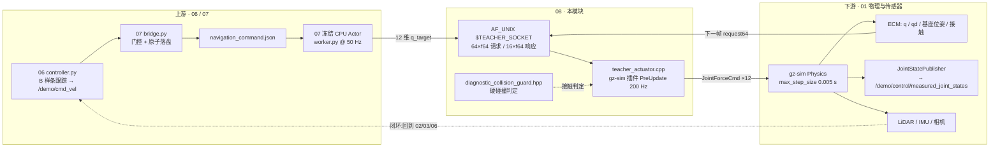
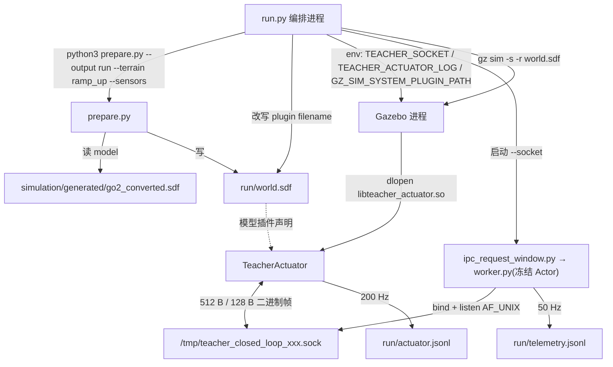
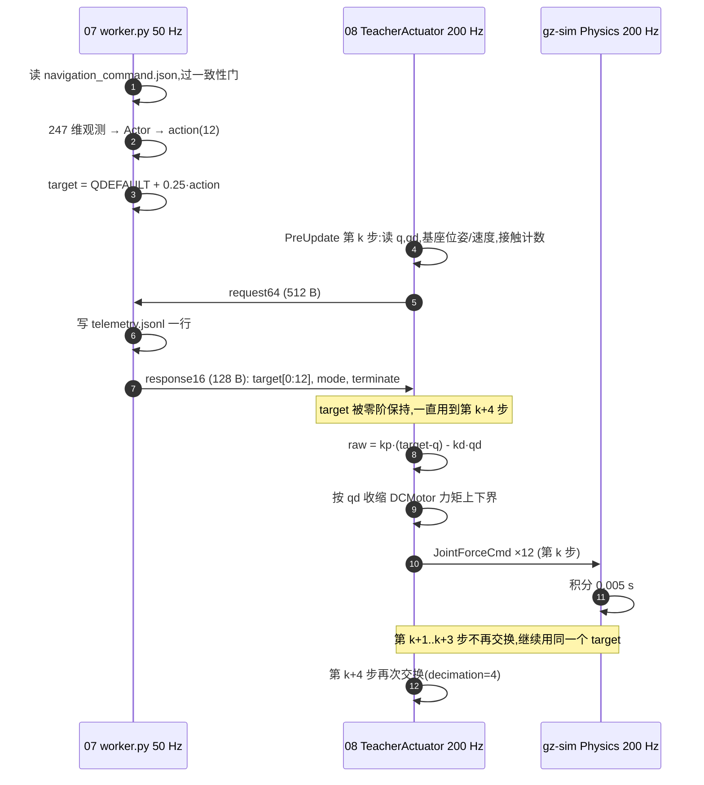
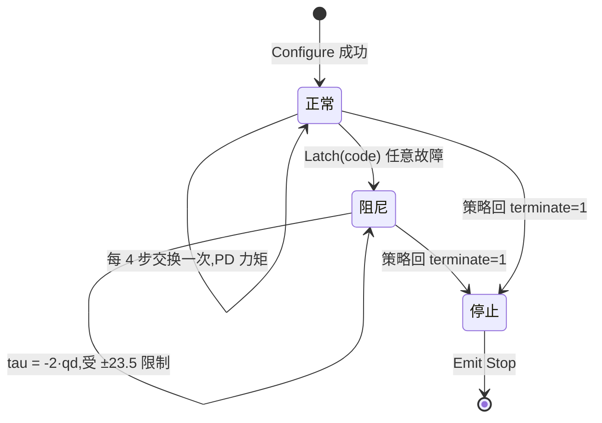

# 08 · 原生执行器、步态与运动学

> 所属: Fast-Livo2-SCAN-Gazebo-dog-sim-control @ 2331b93 · 模块 08/09
> 覆盖路径: `multifloor_demo/teacher_mode/simulation/native/current/`、`multifloor_demo/teacher_mode/simulation/prepare.py`、`multifloor_demo/teacher_mode/policy/contract.json`、`multifloor_demo/navigation/ros2_ws/src/plan_manage/src/`、`multifloor_demo/simulation/config/`、`go2_sim_control/src/unitree_go2_ros2/unitree_go2_sim/config/`、`multifloor_demo/simulation/generated/`、`multifloor_demo/teacher_mode/tests/terrain_targets/`

## 1. 一句话职责

**把 50 Hz 策略输出的 12 维关节目标角,在一个 gz-sim 原生插件里用 200 Hz 关节 PD + 速度相关力矩包络变成 12 个真实关节力矩写进 Gazebo 物理**——本模块是整个数据流唯一的"力矩出口",也是物理反馈重新进入闭环的"入口"。

边界非常硬:插件是**唯一**的关节力矩写入者,不用 base wrench、不做位姿伺服、启动后不再重置位置/速度([teacher_actuator.cpp:2-3](../../multifloor_demo/teacher_mode/simulation/native/current/teacher_actuator.cpp#L2-L3))。

---

## 2. 在总体数据流中的位置

上游是模块 06(速度指令)与模块 07(策略推理),下游是模块 01(Gazebo 物理),而物理结果又反向成为模块 01/02/03/06 的输入。**这是全仓库唯一一条回到上游的边**。



三条必须记住的事实:

1. 插件名叫 `teacher_sim::TeacherActuator`,文件名 `libteacher_actuator.so`,在生成的 `<run>/world.sdf` 里以 `<plugin filename=... name='teacher_sim::TeacherActuator'>` 声明([prepare.py:71-73](../../multifloor_demo/teacher_mode/simulation/prepare.py#L71-L73)),运行前被 [run.py:174-176](../../multifloor_demo/teacher_mode/navigation/engineering_v34_r44_active_p95_capture_candidate/run.py#L174-L176) 改写成冻结的私有路径。
2. 50→200 Hz 的机制是**硬编码的 decimation=4 + 零阶保持**,不是插值([teacher_actuator.cpp:91](../../multifloor_demo/teacher_mode/simulation/native/current/teacher_actuator.cpp#L91)、[:229](../../multifloor_demo/teacher_mode/simulation/native/current/teacher_actuator.cpp#L229))。
3. 输出的是**力矩**(effort),不是位置/速度指令;位置目标只活在插件内部的 PD 里。

---

## 3. 内部子模块划分

| 子模块 | 关键文件 | 职责 | 关键符号 |
|---|---|---|---|
| 原生执行器插件 | [teacher_actuator.cpp](../../multifloor_demo/teacher_mode/simulation/native/current/teacher_actuator.cpp) (427 行) | Configure 建模型绑定、PreUpdate 读状态→PD→写力矩→写证据 | `TeacherActuator`、`Configure`、`PreUpdate`、`Exchange`、`Latch`、`CheckOwnership` |
| 诊断碰撞门 | [diagnostic_collision_guard.hpp](../../multifloor_demo/teacher_mode/simulation/native/current/diagnostic_collision_guard.hpp) (17 行) | 判定一条接触是否属于"不可接受的硬碰撞" | `DiagnosticCollisionIsHard` |
| 插件构建 | [CMakeLists.txt](../../multifloor_demo/teacher_mode/simulation/native/current/CMakeLists.txt) | 编成 `libteacher_actuator.so`,依赖 gz-sim8 | `add_library(teacher_actuator SHARED)`、`install(... DESTINATION lib)` |
| 资产生成(本模块入口) | [prepare.py](../../multifloor_demo/teacher_mode/simulation/prepare.py) (184 行) | 由 `go2_converted.sdf` 生成 `<run>/world.sdf`:剥插件、注入原生执行器、定 200 Hz、定关节限位 | `main()`、`mapping`、`lower`、`upper`、`qdefault` |
| 只读测量旁路 | [prepare.py:74-78](../../multifloor_demo/teacher_mode/simulation/prepare.py#L74-L78) / `:157-160` | 加 `JointStatePublisher` 与 ros_gz_bridge 条目 | `/demo/teacher/physical_joint_states` |
| ROS 侧运动学回归 | [go2_kinematic_sim.cpp](../../multifloor_demo/navigation/ros2_ws/src/plan_manage/src/go2_kinematic_sim.cpp) | `cmd_vel` 一阶积分成 `body_pose`(无物理) | `Go2KinematicSim` |
| ROS 侧轨迹回放 | [open_loop_controller.cpp](../../multifloor_demo/navigation/ros2_ws/src/plan_manage/src/open_loop_controller.cpp) | B 样条直接当位姿真值发布 | `OpenLoopController` |
| ROS 侧轨迹跟踪 | [closed_loop_controller.cpp](../../multifloor_demo/navigation/ros2_ws/src/plan_manage/src/closed_loop_controller.cpp) | B 样条 + P 反馈 → `cmd_vel` | `ClosedLoopController` |
| ROS 侧步态发生器 | [go2_gait_publisher.cpp](../../multifloor_demo/navigation/ros2_ws/src/plan_manage/src/go2_gait_publisher.cpp) | 正弦 trot 关节角(纯可视化) | `Go2GaitPublisher`、`fillLeg` |
| 配置 | [ros_control.yaml](../../multifloor_demo/simulation/config/ros_control.yaml)、[gait.yaml](../../multifloor_demo/simulation/config/gait.yaml)、[joints.yaml](../../go2_sim_control/src/unitree_go2_ros2/unitree_go2_sim/config/joints/joints.yaml)、[links.yaml](../../go2_sim_control/src/unitree_go2_ros2/unitree_go2_sim/config/links/links.yaml) | 见 §6.4;原生链路里全部**未生效** | — |
| 冻结契约(跨模块) | [contract.json](../../multifloor_demo/teacher_mode/policy/contract.json) | 定义 12 关节顺序、DCMotor 公式、request64 布局 | `gazebo_joint_names`、`actuator`、`request64` |

---

## 4. 数据流与接口

### 4.1 一次运行的进程与文件



### 4.2 接口表

| 方向 | 话题 / 文件 | 类型 | 生产者 | 消费者 |
|---|---|---|---|---|
| 06→07 | `/demo/cmd_vel` | `geometry_msgs/Twist` | 模块 06 的高层控制器(见 06 文档) | [bridge.py:27](../../multifloor_demo/teacher_mode/navigation/engineering_v34_r44_active_p95_capture_candidate/bridge.py#L27) `COMMAND_TOPIC` |
| 07→07 | `<run>/navigation_command.json` | JSON(vx,vy,wz + 双时钟因果戳) | `bridge.py:3` 声明的"原子落盘"、路径在 `bridge.py:532` | [worker.py:142](../../multifloor_demo/teacher_mode/navigation/engineering_v34_r44_active_p95_capture_candidate/worker.py#L142) 读 |
| **07→08** | **`$TEACHER_SOCKET`(AF_UNIX) 请求帧** | **64×little-endian float64 = 512 B,无包头** | [`worker.py:222`](../../multifloor_demo/teacher_mode/navigation/engineering_v34_r44_active_p95_capture_candidate/policy_candidate/worker.py#L222) `recv_exact(conn,64*8)` 的对应发送端 | `teacher_actuator.cpp:380-388` `Exchange` |
| **08→07** | **同一 socket 响应帧** | **16×float64 = 128 B** | `teacher_actuator.cpp:383-385` | `policy_candidate/worker.py:274` 组装、`:295` `sendall` |
| 09→08 | `TEACHER_SOCKET` / `TEACHER_ACTUATOR_LOG` / `GZ_SIM_SYSTEM_PLUGIN_PATH` | 环境变量 | [run.py:551-553](../../multifloor_demo/teacher_mode/navigation/engineering_v34_r44_active_p95_capture_candidate/run.py#L551-L553) | `teacher_actuator.cpp:104-112` |
| 09→08 | `<run>/world.sdf` 的 `<plugin name='teacher_sim::TeacherActuator'>` | SDF | `prepare.py:71-73`,文件名被 `run.py:176` 改写 | `gz sim`(run.py:606) |
| 09→08 | 冻结 `libteacher_actuator.so` + sha256 | 二进制 | `run.py:172-176` | 插件加载器;`run.py:500-530` 用 `/proc/<pid>/maps` 反证"确实加载了这个文件" |
| 01→08 | `components::ContactSensorData`、`JointPosition/Velocity`、`Link` 位姿与速度 | gz-sim ECM 组件 | `gz-sim-physics-system` + `gz-sim-contact-system`([three_floors.sdf:1](../../multifloor_demo/simulation/generated/three_floors.sdf#L1)) | `teacher_actuator.cpp:183-211` |
| **08→01** | **`components::JointForceCmd`(12 个关节)** | gz-sim ECM 组件 | `teacher_actuator.cpp:241` `SetForce` | gz-sim Physics(下一步积分) |
| 08→07/09 | `<run>/actuator.jsonl` | JSONL,**200 Hz**(每物理步一行) | `teacher_actuator.cpp:243-307` | `run.py:514-521`(校验契约行)、封存审计 |
| 07→05/09 | `<run>/telemetry.jsonl` | JSONL,**50 Hz**(每次交换一行) | `policy_candidate/worker.py:292` | [mission46_runtime_evidence.py:95-100](../../multifloor_demo/teacher_mode/navigation/engineering_v34_r44_active_p95_capture_candidate/mission46_runtime_evidence.py#L95-L100) `native_projection` |
| 08→06/07 | Gazebo `Stop` 事件 | gz-sim event | `teacher_actuator.cpp:310` | gz-sim 运行循环 → 进程退出 |
| 01→07(只读) | `/demo/teacher/physical_joint_states`(gz `Model`)→ `/demo/control/measured_joint_states`(ROS `JointState`) | 桥接话题 | `prepare.py:76-78` + `run.py:589` | 本快照内唯一已知消费者是**可选** `--sensor-feedback`(`worker.py:162`、`:201-207`),其脚本未在本快照中找到 |
| 05→07 | `<run>/terrain_target_manifest.json` | JSON | [pid_scope.py:138](../../multifloor_demo/teacher_mode/navigation/engineering_v34_r44_active_p95_capture_candidate/pid_scope.py#L138) 从 profile 复制 | [worker.py:252](../../multifloor_demo/teacher_mode/navigation/engineering_v34_r44_active_p95_capture_candidate/worker.py#L252) 传给 Actor(privileged 地形) |

### 4.3 闭环是怎么合上的

`SetForce` 写的是**下一步积分要用的力矩**;而 `PreUpdate` 读到的 `q/qd/位姿/接触`是**上一步积分的结果**。策略侧在元数据里把这一相位关系写死为 `physics_state_phase: Gazebo PreUpdate reads previous Physics result; effective state time = world_sim_time - 0.005s`(`policy_candidate/worker.py:190`),telemetry 也因此令 `state_physics_world_time = world_sim_time - 0.005`(`policy_candidate/worker.py:276`)。这就是"08 既是终点又是起点"的精确含义:**同一帧里,力矩出、状态入,状态永远比力矩晚一个 5 ms 步。**

### 4.4 插件声明清单:输入资产 vs 运行资产

C++ 侧用 `GZ_ADD_PLUGIN(teacher_sim::TeacherActuator, gz::sim::System, ISystemConfigure, ISystemPreUpdate)` + `GZ_ADD_PLUGIN_ALIAS(..., "teacher_sim::TeacherActuator")` 注册([teacher_actuator.cpp:424-427](../../multifloor_demo/teacher_mode/simulation/native/current/teacher_actuator.cpp#L424-L427)),SDF 里的 `name` 就是靠这个别名解析的。

| 声明位置 | `filename` | `name` | 在运行 `world.sdf` 里的命运 |
|---|---|---|---|
| [go2_converted.sdf:1257](../../multifloor_demo/simulation/generated/go2_converted.sdf#L1257) | `gz-sim-pose-publisher-system` | `gz::sim::systems::PosePublisher` | **删除**([prepare.py:31](../../multifloor_demo/teacher_mode/simulation/prepare.py#L31)) |
| [go2_converted.sdf:1267](../../multifloor_demo/simulation/generated/go2_converted.sdf#L1267) | `gz_ros2_control-system` | `gz_ros2_control::GazeboSimROS2ControlPlugin`(参数文件指向 `ros_control.yaml`) | **删除**(同上,这是 250 Hz 控制器链路被掐断的地方) |
| [go2_converted.sdf:1271](../../multifloor_demo/simulation/generated/go2_converted.sdf#L1271) | `gz-sim-odometry-publisher-system` | `gz::sim::systems::OdometryPublisher`(`/demo/ground_truth`) | **删除**(同上,导航侧不再有 GT 里程计话题) |
| [go2_measured.urdf:1109-1125](../../multifloor_demo/simulation/generated/go2_measured.urdf#L1109-L1125) | `gz-sim-joint-state-publisher-system` | `gz::sim::systems::JointStatePublisher`(12 个 `joint_name`,话题 `/demo/physical_joint_states`) | URDF 侧的等价声明;运行时由 [prepare.py:76-78](../../multifloor_demo/teacher_mode/simulation/prepare.py#L76-L78) 以新话题名 `/demo/teacher/physical_joint_states` 重新注入 SDF |
| **`<run>/world.sdf`**(生成自 [prepare.py:71-73](../../multifloor_demo/teacher_mode/simulation/prepare.py#L71-L73)) | **`libteacher_actuator.so`**(`run.py:176` 改写为冻结私有路径) | **`teacher_sim::TeacherActuator`**;参数只显式写 `kp=25`、`kd=.5`、`effort_limit=23.5`、`velocity_limit=30`,其余走 C++ 默认 | **唯一力矩写入者**;`run.py:188-189` 断言"恰好一个 TeacherActuator 且没有任何 ros2_control/champ 插件" |
| 世界级([three_floors.sdf:1](../../multifloor_demo/simulation/generated/three_floors.sdf#L1) → `world.sdf`) | `gz-sim-physics-system`、`gz-sim-user-commands-system`、`gz-sim-scene-broadcaster-system`、`gz-sim-sensors-system`、`gz-sim-imu-system`、**`gz-sim-contact-system`** | 各 `gz::sim::systems::*` | **保留**(`contact-system` 就是填 `ContactSensorData` 的那个系统);不带 `--sensors` 时只删 `Sensors`/`Imu` 两个([prepare.py:89-91](../../multifloor_demo/teacher_mode/simulation/prepare.py#L89-L91)) |

> 注意 `go2_measured.urdf` 与 `go2_converted.sdf` 里的 `gz_ros2_control` + `JointTrajectoryController` + PID 220.98 是**另一条从未在本轮接通的控制链**;它的 `ros_control.yaml` 参数是 250 Hz,与原生链路的 200 Hz PD 没有任何共享代码。


---

## 5. 关键流程与时序

### 5.1 50 Hz 命令 → 200 Hz 关节



逐步说明(**全部有据可查**):

1. **读策略命令**:插件在 `Configure` 时从环境变量取 socket 路径([:104-110](../../multifloor_demo/teacher_mode/simulation/native/current/teacher_actuator.cpp#L104-L110)),首次交换时惰性 `connect`([:344-359](../../multifloor_demo/teacher_mode/simulation/native/current/teacher_actuator.cpp#L344-L359))。socket 由编排进程生成:`/tmp/teacher_closed_loop_<12 hex>.sock`([run.py:550](../../multifloor_demo/teacher_mode/navigation/engineering_v34_r44_active_p95_capture_candidate/run.py#L550))。**不是 JSON 文件、不是 Gazebo 话题、不是共享内存。**
2. **打包状态**:request[0]=仿真时刻,[1:4]=base_link 原点世界位置,[4:8]=四元数 wxyz,[8:11]=**base COM 点**的机体系线速度,[11:14]=机体系角速度,[14:26]=q,[26:38]=qd,[38:50]=上一帧实际力矩,[50:55]=5 组接触计数,[55]=步序号,[56]=fault([:213-228](../../multifloor_demo/teacher_mode/simulation/native/current/teacher_actuator.cpp#L213-L228))。字段语义与 [contract.json:388-401](../../multifloor_demo/teacher_mode/policy/contract.json#L388-L401) 的 `request64` 逐项一致。
3. **频率切分**:`if (stateValid && (iteration-2) % decimation == 0) Exchange(request);`([:229](../../multifloor_demo/teacher_mode/simulation/native/current/teacher_actuator.cpp#L229))。`decimation` 默认 4([:91](../../multifloor_demo/teacher_mode/simulation/native/current/teacher_actuator.cpp#L91)),`prepare.py:73` **没有**写这个键,所以 50 Hz 是 C++ 默认值,并被 [run.py:190](../../multifloor_demo/teacher_mode/navigation/engineering_v34_r44_active_p95_capture_candidate/run.py#L190) 断言 `physics_step_s==.005 and decimation==4`。
4. **保持而非插值**:响应只在前 12 项被拷进 `target`([:397](../../multifloor_demo/teacher_mode/simulation/native/current/teacher_actuator.cpp#L397));下三次 `PreUpdate` 沿用旧 `target`。平滑来自 PD 动力学与力矩包络,不来自任何插值器。上游另有一处**速度指令**斜坡(`policy_candidate/worker.py:243`),作用在 3 维速度命令上,与本层的关节目标无关。
5. **算力矩**:`raw[i] = kp*(target[i]-q[i]) - kd*qd[i]`,fault 或终止时退化为 `-faultDamping*qd[i]`([:232](../../multifloor_demo/teacher_mode/simulation/native/current/teacher_actuator.cpp#L232))。
6. **速度相关包络**(DCMotor 模型):`upper = min(23.5*(1-qd/30), 23.5)`、`lower = max(23.5*(-1-qd/30), -23.5)`([:235-236](../../multifloor_demo/teacher_mode/simulation/native/current/teacher_actuator.cpp#L235-L236))。若上下界交叉(等价于 |qd| 超出契约里 `clip(qd,-60,60)` 的适用范围)则 latch 故障码 6,并退回阻尼力矩。
7. **写物理**:`joints[i].SetForce(ecm, {lastTorque[i]})`([:241](../../multifloor_demo/teacher_mode/simulation/native/current/teacher_actuator.cpp#L241))。同时 `Configure` 里已经装好 `SetEffortLimits(±23.5)`、`SetVelocityLimits(±30)`([:124-125](../../multifloor_demo/teacher_mode/simulation/native/current/teacher_actuator.cpp#L124-L125))。
8. **首帧特例**:`iteration++ == 0` 的那一步只写 0 力矩并返回,让"一次性位置重置"和新增的测量组件先被物理看到([:179-182](../../multifloor_demo/teacher_mode/simulation/native/current/teacher_actuator.cpp#L179-L182))。
9. **姿态重置只发生一次**:`joints[i].ResetPosition(ecm, {target[i]})` 在 `Configure` 内([:122-123](../../multifloor_demo/teacher_mode/simulation/native/current/teacher_actuator.cpp#L122-L123)),契约行自报 `joint_position_reset_count:12, body_pose_resets:0`([:157](../../multifloor_demo/teacher_mode/simulation/native/current/teacher_actuator.cpp#L157))。

### 5.2 故障与阻尼状态机



`Latch` 只认第一次([:336-342](../../multifloor_demo/teacher_mode/simulation/native/current/teacher_actuator.cpp#L336-L342)),并同时做两件事:改控制律、写 `"kind":"fault"` 行 + `gzerr`。故障码一览:

| code | 触发条件(源码位置) |
|---|---|
| 1 | socket 创建/连接失败([:348](../../multifloor_demo/teacher_mode/simulation/native/current/teacher_actuator.cpp#L348)、[:355](../../multifloor_demo/teacher_mode/simulation/native/current/teacher_actuator.cpp#L355)) |
| 3 | 收发超时/半帧/对端断开([:386](../../multifloor_demo/teacher_mode/simulation/native/current/teacher_actuator.cpp#L386)) |
| 4 | 响应非有限或越界([:394](../../multifloor_demo/teacher_mode/simulation/native/current/teacher_actuator.cpp#L394)) |
| 5 | 策略要求 fault damping 但未 terminate([:396](../../multifloor_demo/teacher_mode/simulation/native/current/teacher_actuator.cpp#L396)) |
| 6 | 状态缺失/非有限、接触组件缺失、或速度超出 DCMotor 包络([:199](../../multifloor_demo/teacher_mode/simulation/native/current/teacher_actuator.cpp#L199)、[:204](../../multifloor_demo/teacher_mode/simulation/native/current/teacher_actuator.cpp#L204)、[:238](../../multifloor_demo/teacher_mode/simulation/native/current/teacher_actuator.cpp#L238)) |
| 7 | `dt != 0.005` 或时钟回退([:174-175](../../multifloor_demo/teacher_mode/simulation/native/current/teacher_actuator.cpp#L174-L175)) |
| 8 | 同一模型上有多个关节执行器插件([:169](../../multifloor_demo/teacher_mode/simulation/native/current/teacher_actuator.cpp#L169)) |
| 9 | 证据日志写失败([:309](../../multifloor_demo/teacher_mode/simulation/native/current/teacher_actuator.cpp#L309)) |
| 10 | 诊断碰撞门判定硬碰撞([:208](../../multifloor_demo/teacher_mode/simulation/native/current/teacher_actuator.cpp#L208)) |

fault 会经 `request[56]` 上报给策略;策略侧一旦看到非零就置 `fault`(`policy_candidate/worker.py:255`),并在 `t >= 2` 后回 `terminate=1`(`:273-274`),插件随即 `Emit<Stop>`([:310-311](../../multifloor_demo/teacher_mode/simulation/native/current/teacher_actuator.cpp#L310-L311))。**故障码 7 从未触发就是"步长 0.005 s 无断档"的机器可验证形式**([C44_LOG_EXCERPT.log:25](../C44_LOG_EXCERPT.log#L25) 的 `step_gaps:0, native_faults:0`)。

---

## 6. 关键数据结构与配置

### 6.1 12 个关节(三处命名必须对齐)

插件的关节名数组是**写死的**([:402-404](../../multifloor_demo/teacher_mode/simulation/native/current/teacher_actuator.cpp#L402-L404)),顺序即 socket 帧和训练契约的索引顺序:

| idx | 插件 / SDF / `joints.yaml` / `links.yaml` / `ros_control.yaml` | [contract.json:33-46](../../multifloor_demo/teacher_mode/policy/contract.json#L33-L46) 训练名 | 硬限位 lower..upper (rad) | 默认 target (rad) |
|---|---|---|---|---|
| 0 | `rf_hip_joint` | `FR_hip_joint` | -1.0472 .. 1.0472 | -0.1 |
| 1 | `rf_upper_leg_joint` | `FR_thigh_joint` | -1.5708 .. 3.4907 | 0.8 |
| 2 | `rf_lower_leg_joint` | `FR_calf_joint` | -2.7227 .. -0.83776 | -1.5 |
| 3 | `lf_hip_joint` | `FL_hip_joint` | -1.0472 .. 1.0472 | 0.1 |
| 4 | `lf_upper_leg_joint` | `FL_thigh_joint` | -1.5708 .. 3.4907 | 0.8 |
| 5 | `lf_lower_leg_joint` | `FL_calf_joint` | -2.7227 .. -0.83776 | -1.5 |
| 6 | `rh_hip_joint` | `RR_hip_joint` | -1.0472 .. 1.0472 | -0.1 |
| 7 | `rh_upper_leg_joint` | `RR_thigh_joint` | -0.5236 .. 4.5379 | 1.0 |
| 8 | `rh_lower_leg_joint` | `RR_calf_joint` | -2.7227 .. -0.83776 | -1.5 |
| 9 | `lh_hip_joint` | `RL_hip_joint` | -1.0472 .. 1.0472 | 0.1 |
| 10 | `lh_upper_leg_joint` | `RL_thigh_joint` | -0.5236 .. 4.5379 | 1.0 |
| 11 | `lh_lower_leg_joint` | `RL_calf_joint` | -2.7227 .. -0.83776 | -1.5 |

- 硬限位来自 [prepare.py:34-35](../../multifloor_demo/teacher_mode/simulation/prepare.py#L34-L35) 并写进 SDF 的 `axis/limit`;插件在 `Configure` 里从 `joint.Axis()` 读回同一组值([:119-121](../../multifloor_demo/teacher_mode/simulation/native/current/teacher_actuator.cpp#L119-L121)),只用于记录 `target_outside_hard_limits`,**不做目标裁剪**。
- 默认 target 在四处重复出现且数值一致:[teacher_actuator.cpp:412](../../multifloor_demo/teacher_mode/simulation/native/current/teacher_actuator.cpp#L412)、`prepare.py:32`、`policy_candidate/worker.py:13`(`QDEFAULT`)、[contract.json:61-74](../../multifloor_demo/teacher_mode/policy/contract.json#L61-L74)。
- **唯一不一致的地方**:[go2_gait_publisher.cpp:34-38](../../multifloor_demo/navigation/ros2_ws/src/plan_manage/src/go2_gait_publisher.cpp#L34-L38) 用 `FL_hip_joint/FL_thigh_joint/FL_calf_joint` 这套 Unitree-IsaacLab 风格名字,顺序也是 FL,FR,RL,RR。它既不对应 `unitree_go2_description` 的 xacro 命名(`leg.xacro:9/70/110` 用 `${name}_upper_leg_joint`),也不对应 Gazebo 模型——这是判断"步态节点不在实际链路里"的第一条硬证据。

### 6.2 频控

| 项 | 值 | 证据 |
|---|---|---|
| 物理步长 | 0.005 s(200 Hz) | [prepare.py:81](../../multifloor_demo/teacher_mode/simulation/prepare.py#L81)、[contract.json:29-31](../../multifloor_demo/teacher_mode/policy/contract.json#L29-L31) |
| decimation | 4(策略 50 Hz) | `teacher_actuator.cpp:91`、`run.py:190` |
| 交换周期 | 每 4 个物理步 | `teacher_actuator.cpp:229` |
| 步长契约校验 | `abs(dt-0.005) <= 1e-9` 且时钟严格递增 | `teacher_actuator.cpp:174-175` |
| socket 帧超时 | 200 ms(同时是策略侧 `native_watchdog_ms`) | `teacher_actuator.cpp:349-351`、`:363`、`ENG/worker.py:260` |
| 证据日志 flush | 每 200 步(1 s)或故障/终止时 | `teacher_actuator.cpp:308` |
| 契约行精度 | `std::setprecision(17)` | `teacher_actuator.cpp:113` |

### 6.3 控制增益与力矩包络(实际生效的那一套)

| 参数 | 默认值 | SDF 是否显式写入 | 含义 |
|---|---|---|---|
| `kp` | 25.0 | 是([prepare.py:73](../../multifloor_demo/teacher_mode/simulation/prepare.py#L73)) | 关节位置刚度 |
| `kd` | 0.5 | 是 | 关节阻尼 |
| `effort_limit` | 23.5 | 是 | 力矩硬上限(同时写 SDF `axis/limit/effort`) |
| `saturation_effort` | 23.5 | 否 | 速度相关包络基准 |
| `velocity_limit` | 30.0 | 是(部分) | 包络斜率与限速 |
| `fault_damping` | 2.0 | 否 | 故障时 `tau=-2·qd` |
| `expected_dt` | 0.005 | 否 | 步长契约 |
| `target_abs_bound` | 10.0 | 否 | 只用于**校验** `initial_q` 与响应,不裁剪 |
| `decimation` | 4 | 否 | 50/200 Hz 耦合 |

公式与包络与 [contract.json:95-105](../../multifloor_demo/teacher_mode/policy/contract.json#L95-L105) 的 DCMotor 描述一致,该处还明确警告:`23.7 / 45.43` 这类通用 Go2 限值**不适用于本轮**。

### 6.4 配置文件逐项说明(以及为什么原生链路里不生效)

| 文件 | 内容 | 在原生链路中的状态 |
|---|---|---|
| [multifloor_demo/simulation/config/ros_control.yaml](../../multifloor_demo/simulation/config/ros_control.yaml) | `gz_ros_control.hold_joints: true`、`position_proportional_gain: 100`;`controller_manager.update_rate: 250`;`joint_states_controller`(`joint_state_broadcaster/JointStateBroadcaster`);`joint_group_effort_controller`(`joint_trajectory_controller/JointTrajectoryController`),12 关节、`command_interfaces: effort`、`state_publish_rate: 100`、**PID 增益统一 `p: 220.982919, i: 0.2, d: 1.0, i_clamp: 2.5`**([:68-79](../../multifloor_demo/simulation/config/ros_control.yaml#L68-L79)) | **未生效**:它只被 `gz_ros2_control` 插件([go2_converted.sdf:1268](../../multifloor_demo/simulation/generated/go2_converted.sdf#L1268)、[go2_measured.urdf:295](../../multifloor_demo/simulation/generated/go2_measured.urdf#L295))与 demo 资产生成器 [multifloor_demo/simulation/prepare.py:40](../../multifloor_demo/simulation/prepare.py#L40) 的 xacro 参数引用,而 teacher 版 [prepare.py:31](../../multifloor_demo/teacher_mode/simulation/prepare.py#L31) 删掉了模型上**所有**插件,`prepare.py:170` 把 `ros2_control`/`JointTrajectoryController` 列入 `disabled` |
| [multifloor_demo/simulation/config/gait.yaml](../../multifloor_demo/simulation/config/gait.yaml) | `gait`:`knee_orientation ">>"`、`pantograph_leg false`、`odom_scaler 0.9`、速度上限 0.3/0.25/0.5、`swing_height 0.07`、`stance_depth 0.005`、`stance_duration 0.35`、`nominal_height 0.30` | **未生效**:没有 CHAMP/quadruped_controller 进程 |
| [unitree_go2_sim/config/gait/gait.yaml](../../go2_sim_control/src/unitree_go2_ros2/unitree_go2_sim/config/gait/gait.yaml) | 同上,仅 `swing_height 0.02`、`nominal_height 0.225` 不同 | 同上;两份的差异见 §9 |
| [joints.yaml](../../go2_sim_control/src/unitree_go2_ros2/unitree_go2_sim/config/joints/joints.yaml) | `joints_map`:`left_front/right_front/left_hind/right_hind` 各 4 条(`*_hip/_upper_leg/_lower_leg/_foot_joint`) | 命名与插件一致(含 4 条 `*_foot_joint` 固定关节,插件不控) |
| [links.yaml](../../go2_sim_control/src/unitree_go2_ros2/unitree_go2_sim/config/links/links.yaml) | `links_map`:`base: base_link` + 4 组 `*_hip/_upper_leg/_lower_leg/_foot_link` | 命名与 [teacher_actuator.cpp:127-128](../../multifloor_demo/teacher_mode/simulation/native/current/teacher_actuator.cpp#L127-L128) 用的 5 个接触连杆一致 |
| [unitree_go2_sim/config/ros_control/ros_control.yaml](../../go2_sim_control/src/unitree_go2_ros2/unitree_go2_sim/config/ros_control/ros_control.yaml) | 上游原始版本:`hold_joints: false`、`position_proportional_gain: 0.0`、PID `p: 100.0`;无 `enforce_command_limits` | 未生效;`multifloor_demo` 那份是它的"低刚度/保持姿态"改造版 |
| [prepare.py:36-46](../../multifloor_demo/teacher_mode/simulation/prepare.py#L36-L46) | 把 12 关节的 `damping/friction/spring_stiffness` 全部置 0 | **生效**:保证"关节力矩=唯一力矩来源",避免 SDF 摩擦项偷偷改变动力学 |

### 6.5 ROS 侧四节点的参数

[controllers.yaml](../../multifloor_demo/navigation/ros2_ws/src/plan_manage/config/controllers.yaml) 给出四个节点的默认参数:`closed_loop_controller`(`time_forward 0.8`、`heading_error_threshold 0.8`、`kp_pos 0.8`、`kp_yaw 1.5`、`max_vx/vy/vyaw 0.75/0.35/1.0`、`finish_dist 0.15`)、`open_loop_controller`(`publish_rate 100`、`hold_final_position true`)、`go2_kinematic_sim`(`sim_rate 100`、`cmd_timeout 0.3`、`publish_tf true`)、`go2_gait_publisher`(`rate 60`、`gait_frequency 2.2`、`hip/thigh/calf_swing 0.08/0.32/0.42`)。

### 6.6 地形目标文件(`terrain_targets/*.json`)与它们的消费者

四个文件都是"给 privileged 高度扫描选碰撞几何"的白名单,`scope` 里统一声明"不做基于真值的自动分层"、"不改变物理与安全几何":

| 文件 | `id` | `include_models` | 角色 |
|---|---|---|---|
| [all_static.json](../../multifloor_demo/teacher_mode/tests/terrain_targets/all_static.json) | `all_static_historical_baseline` | 42 项:`floor_1/2/3`、`ramp_12/23`、`landmark_0..5`、`panel_0..27`、`wall_*` | **历史全静态基线**,用于同代码 A/B;本快照内**未找到消费者** |
| [lower12.json](../../multifloor_demo/teacher_mode/tests/terrain_targets/lower12.json) | `lower12` | `floor_1`、`ramp_12`、`floor_2` | 本轮**初始层**:profile 指定([engineering_nav46.json:109](../../multifloor_demo/teacher_mode/navigation/engineering_v34_r44_active_p95_capture_candidate/profiles/engineering_nav46.json#L109)) |
| [upper23.json](../../multifloor_demo/teacher_mode/tests/terrain_targets/upper23.json) | `upper23` | `floor_2`、`ramp_23`、`floor_3` | **交替层**:三个双向切换点用 |
| [walkable.json](../../multifloor_demo/teacher_mode/tests/terrain_targets/walkable.json) | `walkable` | `floor_1/2/3`、`ramp_12/23`(无墙、无面板) | 只含可行走面;与 §8 碰撞门白名单**逐项相同** |

消费链:`profile:109` → [pid_scope.py:138](../../multifloor_demo/teacher_mode/navigation/engineering_v34_r44_active_p95_capture_candidate/pid_scope.py#L138) 复制成 `<run>/terrain_target_manifest.json`(`:143-144` 再把 `upper23` 复制成 `alternate_terrain_target_manifest.json`)→ [worker.py:252](../../multifloor_demo/teacher_mode/navigation/engineering_v34_r44_active_p95_capture_candidate/worker.py#L252) 作为 `--terrain-target-manifest` 传给 Actor → `policy_candidate/worker.py:174-176` 读 `include_models` 供高度扫描 → [mission46_terrain.py:11-22](../../multifloor_demo/teacher_mode/navigation/engineering_v34_r44_active_p95_capture_candidate/mission46_terrain.py#L11-L22) 定义 `LAYERS/TRANSITIONS` 双向切换 → [terrain_provider.py:51-52/67-68](../../multifloor_demo/teacher_mode/navigation/engineering_v34_r44_active_p95_capture_candidate/terrain_provider.py#L51-L52) 校验运行目录里的两份清单与评审配置一致。切换点本身由模块 05 决定([mission46.py:39-41](../../multifloor_demo/teacher_mode/navigation/engineering_v34_r44_active_p95_capture_candidate/mission46.py#L39-L41)、[mission46_guard.py:6-8](../../multifloor_demo/teacher_mode/navigation/engineering_v34_r44_active_p95_capture_candidate/mission46_guard.py#L6-L8))。**它对 08 的影响只有一个**:白名单外的几何若被踩到,碰撞门会判故障码 10。

---

## 7. 代码结构讲解

```
multifloor_demo/teacher_mode/simulation/
├── prepare.py                        # 唯一入口:go2_converted.sdf → run/world.sdf
└── native/current/
    ├── teacher_actuator.cpp          # 插件本体(427 行)
    ├── diagnostic_collision_guard.hpp# 硬碰撞判定(17 行)
    └── CMakeLists.txt                # gz-sim8 插件构建
multifloor_demo/simulation/
├── prepare.py                        # 更早的 demo 资产生成器(three_floors.sdf / go2.urdf / go2_measured.urdf)
├── config/{ros_control,gait}.yaml
└── generated/{go2_converted.sdf,go2_measured.urdf,three_floors.sdf}
multifloor_demo/navigation/ros2_ws/src/plan_manage/
├── src/{go2_gait_publisher,go2_kinematic_sim,open_loop_controller,closed_loop_controller}.cpp
├── launch/{run,simulator,rviz}.launch.py
└── config/controllers.yaml
```

**teacher_actuator.cpp** — `ISystemConfigure` + `ISystemPreUpdate` 两个生命周期,没有 `PostUpdate`([:65-66](../../multifloor_demo/teacher_mode/simulation/native/current/teacher_actuator.cpp#L65-L66))。

- `Configure`(`:70-159`):绑定 `base_link` 并开启速度检查;从 `Inertial` 组件读**实际** COM 偏移与质量([:79-82](../../multifloor_demo/teacher_mode/simulation/native/current/teacher_actuator.cpp#L79-L82));解析 9 个 PD/契约参数并做有限性检查;解析 `initial_q`;强制要求 `TEACHER_SOCKET` 与 `TEACHER_ACTUATOR_LOG` 两个环境变量;逐个关节开启位置/速度检查、读硬限位、**一次性** `ResetPosition`、装限速限力矩;为 5 个连杆枚举碰撞体并创建 `ContactSensorData` 组件;最后写一行 `actuator_contract` 自描述(自报 `base_mass_kg`、`kp/kd/...`、`joint_order`、`body_pose_resets:0`)。
- `PreUpdate`(`:161-311`):暂停即返回;首帧做插件所有权自检(`CheckOwnership`,`:166-173`);校验步长契约;跳过一次空转帧;读 12 关节 q/qd + base 位姿/原点速度/COM 速度/角速度;统计 5 组接触并跑碰撞门;打包 64 维请求;按 decimation 交换;算 PD 与包络;写 12 个力矩;写一行 `physics_step` 证据(含 `pd_raw`、`tau_lower/upper`、`tau`、接触明细与世界系接触点/法向/深度/原始 wrench);必要时 flush、必要时 `Emit<Stop>`。
- `Exchange`(`:380-400`):512 B 出、128 B 入,校验所有响应有限、`|target[i]| <= 10`、`mode/terminate ∈ {0,1}`;写一行 `policy_exchange`(含 wall 时长,供 200 ms 预算审计)。

**diagnostic_collision_guard.hpp** — 见 §8 的边界讨论;它是**保护**,不是纯记录。

**prepare.py(teacher_mode 版)** — `--terrain` 只影响出生点/台阶夹具,核心动作是:删掉模型上所有插件([:31](../../multifloor_demo/teacher_mode/simulation/prepare.py#L31))→ 覆盖 12 关节的 effort/velocity/限位/dynamics([:36-46](../../multifloor_demo/teacher_mode/simulation/prepare.py#L36-L46))→ 把摩擦统一成 `.7` 并注明"这是受控变更"([:59-62](../../multifloor_demo/teacher_mode/simulation/prepare.py#L59-L62))→ 注入执行器插件([:71-73](../../multifloor_demo/teacher_mode/simulation/prepare.py#L71-L73))→ `--sensors` 时追加 `JointStatePublisher`([:74-78](../../multifloor_demo/teacher_mode/simulation/prepare.py#L74-L78))→ 把世界物理步长设成 `.005`([:81](../../multifloor_demo/teacher_mode/simulation/prepare.py#L81))→ 输出 `world.sdf`、`sensor_contract.json`、`sensor_bridge.yaml`、`frames.urdf`、`asset_manifest.json`。

**四个 ROS 侧 C++ 文件** — 全部属于 `scan_planner` 包的"确定性回归/可视化"分支,不是本轮的力矩通路:它们产出/消费 `body_pose`、`cmd_vel`、`joint_states`,`go2_kinematic_sim` 甚至不接 Gazebo,只做 `x += vx·dt` 的一阶积分([:95-112](../../multifloor_demo/navigation/ros2_ws/src/plan_manage/src/go2_kinematic_sim.cpp#L95-L112))。

---

## 8. 与其他模块的边界

| 模块 | 边界在哪 | 关键证据 |
|---|---|---|
| 01 仿真与本体 | 我只消费 ECM 组件、只写 `JointForceCmd`;URDF/SDF、传感器、世界插件都属 01。模型名 `go2`,`base_link` 质量 8.336 kg 是 SDF 实测值([go2_converted.sdf:7](../../multifloor_demo/simulation/generated/go2_converted.sdf#L7)) | `teacher_actuator.cpp:76-82`、`:127-142`、`:241` |
| 06 高层控制 | 06 只到 `/demo/cmd_vel`;它永远不知道关节存在 | [bridge.py:27](../../multifloor_demo/teacher_mode/navigation/engineering_v34_r44_active_p95_capture_candidate/bridge.py#L27) |
| 07 Teacher/IPC | 分界线就是那 512/128 字节二进制帧。**不使用 JSON、不使用 ROS 话题**;帧布局由 `policy/contract.json` 冻结 | `teacher_actuator.cpp:380-400`、`policy_candidate/worker.py:222/274` |
| 09 编排 | 09 生成 `world.sdf`、注入环境变量、改写插件路径、用 `/proc/<pid>/maps` 反证加载 | [run.py:162-176](../../multifloor_demo/teacher_mode/navigation/engineering_v34_r44_active_p95_capture_candidate/run.py#L162-L176)、`:500-530`、`:606` |
| 05 任务 | 只通过 privileged 地形层与停止语义间接影响我:地形白名单在 `terrain_targets/*.json` | 见 §9 |

**`DiagnosticCollisionIsHard` 到底做了什么**([diagnostic_collision_guard.hpp:4-16](../../multifloor_demo/teacher_mode/simulation/native/current/diagnostic_collision_guard.hpp#L4-L16)):输入是 `(接触组号, collision1 名, collision2 名)`。

- 组号 > 4、或名字为空 → 判为硬碰撞;组号 0(`base_link`)无条件判硬——**机身着地/撞墙一律是硬碰撞**。
- 其余四组是四条小腿,但插件在建组时只收名字里含 `foot` 的碰撞体([:134](../../multifloor_demo/teacher_mode/simulation/native/current/teacher_actuator.cpp#L134))。
- 判定用 `::` 前缀取模型名:两侧都是机器人(`go2`/`teacher_go2`)→ 硬;**否则另一侧必须属于 `floor_1/floor_2/floor_3/ramp_12/ramp_23` 白名单**,不在白名单里(如 `panel_*`、`landmark_*`、`wall_*`、`moving_obstacle`、`teacher_low_step`)→ 硬。

触发后**不是只记录**:`Latch(10, ...)`([:207-209](../../multifloor_demo/teacher_mode/simulation/native/current/teacher_actuator.cpp#L207-L209))把控制律切到纯阻尼 `tau = -2·qd`,写 `fault` 行与 `gzerr`,并把 `fault=10` 通过 `request[56]` 上报;策略侧据此置 fault、2 s 后终止,插件 `Emit<Stop>`。也就是说**一次不可接受接触会在约 2 s 内结束整轮运行**。这套门是 `run.py:522-524` 明确要求存在的冻结契约(`actual_ContactSensorData_200Hz_v1`)。

注意这道门的白名单与 [walkable.json:4-10](../../multifloor_demo/teacher_mode/tests/terrain_targets/walkable.json#L4-L10) 的 `include_models` **完全相同**——它是为"平台 + 10% 缓坡"路线定制的;若切换到 `--terrain step*` 加出的 `teacher_low_step`([prepare.py:102-107](../../multifloor_demo/teacher_mode/simulation/prepare.py#L102-L107)),踩上去就是故障码 10。

**"传感器"旁路**:插件本身**不发布任何话题**。`/demo/teacher/physical_joint_states` 来自 `gz::sim::systems::JointStatePublisher`([prepare.py:76-78](../../multifloor_demo/teacher_mode/simulation/prepare.py#L76-L78)),由 `run.py:589` 的 `ros_gz_bridge` 转到 `/demo/control/measured_joint_states`([prepare.py:159](../../multifloor_demo/teacher_mode/simulation/prepare.py#L159));`sensor_contract.json` 里标注它 `actuation: False`、`rate_hz: 200`([:111-112](../../multifloor_demo/teacher_mode/simulation/prepare.py#L111-L112))。本轮编排传了 `--sensors`([run.py:163](../../multifloor_demo/teacher_mode/navigation/engineering_v34_r44_active_p95_capture_candidate/run.py#L163)),所以这条桥是活的;但唯一已知消费者是可选 `--sensor-feedback` 分支(`policy_candidate/worker.py:162`、`:201-207`),而 ENG 包装器给 worker 的 `sys.argv` 里**没有**这个开关([worker.py:251-252](../../multifloor_demo/teacher_mode/navigation/engineering_v34_r44_active_p95_capture_candidate/worker.py#L251-L252)),其 `sources/scripts/sensor_feedback.py` 也未在本快照中找到。结论:**这条测量通路在本轮是"已接线但未被策略消费"的证据旁路。**

---

## 9. 已知限制与失败点

1. **"50 Hz telemetry" 的发布者不是原生插件,而是策略进程**。插件只写自己的 200 Hz 证据日志 `actuator.jsonl`(每物理步一行,`teacher_actuator.cpp:243-307`);`telemetry.jsonl` 由冻结 CPU Actor 在**每次 socket 交换**后写一行(`policy_candidate/worker.py:217` 打开、`:292` `stream.write`),行内容为 `sim_time / world_sim_time / state_physics_world_time / position / quaternion_wxyz / rpy / body_lin_vel / body_ang_vel / q / qd / applied_torque / q_target / action / policy_target / contacts / fault / inference_ms / body_clearance / command / command_expired` 等([policy_candidate/worker.py:275-291](../../multifloor_demo/teacher_mode/navigation/engineering_v34_r44_active_p95_capture_candidate/policy_candidate/worker.py#L275-L291)),每 10 行再落一次 `state.json`(`:293`)。它**没有对应的 ROS 话题**,纯文件。`docs/C44_EXPERIMENT.md` 的"50 Hz telemetry 8,173 条"就指这个文件;它与"32,692 个 200 Hz 步"的算术关系正是 `decimation=4`:`8173 × 4 = 32692`([C44_EXPERIMENT.md:33](../C44_EXPERIMENT.md#L33)、[C44_LOG_EXCERPT.log:25/28](../C44_LOG_EXCERPT.log#L25))。`telemetry.jsonl` 末条 163.440 s、物理末刻 163.465 s,差 0.025 s(5 步),说明零命令之后物理还积分了几步才停。
2. **`applied_torque` 不是测量值**。它是插件裁剪后交给物理的 `JointForceCmd` 原样回传([:225](../../multifloor_demo/teacher_mode/simulation/native/current/teacher_actuator.cpp#L225)、契约行 `torque_source` [:146](../../multifloor_demo/teacher_mode/simulation/native/current/teacher_actuator.cpp#L146)),不是硬件力矩测量,也不是未裁剪的 PD 输出([contract.json:257](../../multifloor_demo/teacher_mode/policy/contract.json#L257))。
3. **强耦合的 50/200 Hz 契约**。`decimation` 与 `expected_dt` 只在 C++ 默认值里([:89-91](../../multifloor_demo/teacher_mode/simulation/native/current/teacher_actuator.cpp#L89-L91)),`prepare.py` 不写这两个键。改 `max_step_size` 会立刻触发故障码 7 并整轮阻尼。`decimation=4` 只在 `policy/contract.json:30` 与编排断言 `run.py:190` 里被"记住"。
4. **接触数据依赖两个外部条件**:世界必须挂着 `gz-sim-contact-system`([three_floors.sdf:1](../../multifloor_demo/simulation/generated/three_floors.sdf#L1)),且接触传感器 `update_rate` 必须 ≥ 200 Hz——`prepare.py:57-58` 把原来 50 Hz 的接触传感器统一改成 200 Hz([go2_converted.sdf:201](../../multifloor_demo/simulation/generated/go2_converted.sdf#L201));插件是**每步**读 `ContactSensorData` 的,漏改就会读到重复/过期接触。
5. **DCMotor 包络与训练契约在 |qd| > 60 rad/s 处分岔**。契约写的是 `qd_limited = clip(qd,-60,60)`([contract.json:102](../../multifloor_demo/teacher_mode/policy/contract.json#L102)),插件没做这层裁剪,于是 |qd| > 60 时上下界交叉 → 故障码 6 + 阻尼([:237-239](../../multifloor_demo/teacher_mode/simulation/native/current/teacher_actuator.cpp#L237-L239))。正常运行不会碰到,但这是"部署实现 ≠ 训练公式"的一处真实差异。
6. **训练/部署的基座惯量不一致(已被显式记录,未被消除)**。训练名义 `base_mass 7.279 kg`、COM `[0.020153064, 0, -0.0051089553]`([contract.json:251-256](../../multifloor_demo/teacher_mode/policy/contract.json#L251-L256));Gazebo 实测 `base_link` 质量 8.336 kg、COM `[0.05523092, -0.001869, 0.0060953]`([go2_converted.sdf:6-7](../../multifloor_demo/simulation/generated/go2_converted.sdf#L6-L7))。插件读**实际值**并写进契约行,`run.py:191-193` 只校验"控制器参数与资产一致",不校验"资产与训练一致"。
7. **`--sensors` 之外的一切关节测量都不存在**。插件不发话题、不写 joint state;若把 `JointStatePublisher` 视为"执行器反馈",它其实是模块 01 的旁路。
8. **编译产物与证据不在本快照里**。`simulation/build/`、`external/omitted-history/libteacher_actuator.so`、策略权重都未提供;本文件对"插件确实被加载"的论断依据是编排代码的 `/proc/<pid>/maps` 校验(`run.py:500-530`)而非可执行文件本身。
9. **ROS 侧四节点是旁路,不是控制流**。`grep` 全仓库:这四个可执行文件只在 [plan_manage/CMakeLists.txt:40-52](../../multifloor_demo/navigation/ros2_ws/src/plan_manage/CMakeLists.txt#L40-L52)、[launch/run.launch.py:105-171](../../multifloor_demo/navigation/ros2_ws/src/plan_manage/launch/run.launch.py#L105-L171)、`config/controllers.yaml` 里出现;ENG 的 [stack.launch.py](../../multifloor_demo/teacher_mode/navigation/engineering_v34_r44_active_p95_capture_candidate/stack.launch.py) 只起 `scan_epoch_supervisor.py / known_scene_runtime.py / sensor_gate.py / controller.py / bridge.py / mission46_runtime.py` 与两个 `ros_gz_bridge`([:29-44](../../multifloor_demo/teacher_mode/navigation/engineering_v34_r44_active_p95_capture_candidate/stack.launch.py#L29-L44)),**没有任何 plan_manage 节点**。它们服务于 `run.launch.py → simulator.launch.py` 的"mockamap + pcl_render_node + odom_visualization"确定性回归场景([simulator.launch.py:1](../../multifloor_demo/navigation/ros2_ws/src/plan_manage/launch/simulator.launch.py#L1)、`:58-124`),且该路径在本快照内连依赖都缺:`run.launch.py:19` 需要 `go2_description` 包,而快照里只有 `unitree_go2_description`。同理 `ros_control.yaml`/`gait.yaml`/`joints.yaml`/`links.yaml` 在原生链路中全部不生效(§6.4)。
10. **收尾顺序会制造一条吓人的日志**。Gazebo 先停/先关 socket 时,策略侧 `recv_exact` 抛 `EOFError: Gazebo actuator disconnected`([policy_candidate/worker.py:146](../../multifloor_demo/teacher_mode/navigation/engineering_v34_r44_active_p95_capture_candidate/policy_candidate/worker.py#L146)),被记进 `worker_fault`;它**不是** native fault(插件侧 `native_faults: 0`),也不影响归档完整性([C44_EXPERIMENT.md:35](../C44_EXPERIMENT.md#L35))。读 `C44_LOG_EXCERPT.log:28` 时不要把两者混为一谈。

---

## 10. 建议阅读路线

1. [teacher_actuator.cpp](../../multifloor_demo/teacher_mode/simulation/native/current/teacher_actuator.cpp) —— 先读 `Configure`(`:70-159`)建立"模型/关节/接触/参数"的绑定,再读 `PreUpdate`(`:161-311`)看每步顺序,最后读 `Exchange`(`:380-400`)确认协议。
2. [contract.json](../../multifloor_demo/teacher_mode/policy/contract.json) 的 `timing` / `joint_names` / `gazebo_joint_names` / `actuator` / `request64` 五节 —— 这是本层唯一"冻结的数学",插件是它的实现。
3. [prepare.py](../../multifloor_demo/teacher_mode/simulation/prepare.py) —— 看 `world.sdf` 是怎么把 demo 资产改造成"单力矩写入者 + 200 Hz"的。
4. [diagnostic_collision_guard.hpp](../../multifloor_demo/teacher_mode/simulation/native/current/diagnostic_collision_guard.hpp)(17 行,全文只读一遍)+ [terrain_targets/walkable.json](../../multifloor_demo/teacher_mode/tests/terrain_targets/walkable.json) —— 保护门与地形白名单的对偶关系。
5. [policy_candidate/worker.py:215-295](../../multifloor_demo/teacher_mode/navigation/engineering_v34_r44_active_p95_capture_candidate/policy_candidate/worker.py#L215-L295) —— 从 socket 服务端视角看同一帧,顺带理解 telemetry 行是怎么来的。
6. [run.py:160-200](../../multifloor_demo/teacher_mode/navigation/engineering_v34_r44_active_p95_capture_candidate/run.py#L160-L200) 与 `:544-610` —— 编排如何把环境变量、插件路径、world.sdf、bridge、Gazebo 串起来。
7. 最后读 [plan_manage/launch/run.launch.py](../../multifloor_demo/navigation/ros2_ws/src/plan_manage/launch/run.launch.py) 与四个 C++ 节点 —— 明确它们**不在**本轮链路,避免把回归场景当成实际控制流。
