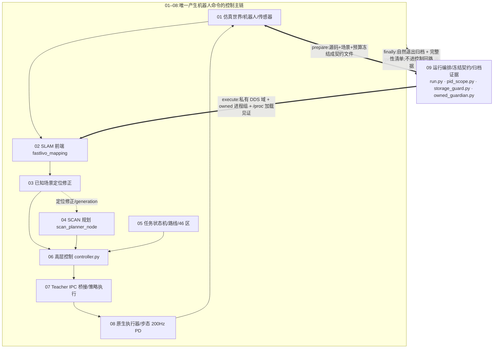
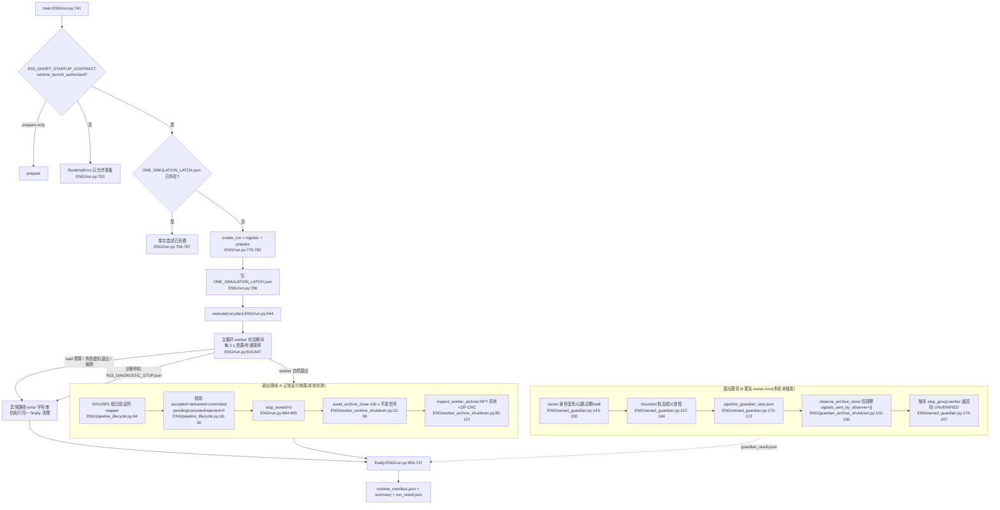

# 09 · 运行编排、冻结契约与归档证据

> 所属: Fast-Livo2-SCAN-Gazebo-dog-sim-control @ 2331b93 · 模块 09/09
> 覆盖路径: `ENG/` = `multifloor_demo/teacher_mode/navigation/engineering_v34_r44_active_p95_capture_candidate/`;`EV/` = `multifloor_demo/teacher_mode/navigation/evidence_runtime_v32/`;另含 `multifloor_demo/mission/{artifacts,runtime_evidence,processes}.py`、`multifloor_demo/navigation/event_archive.py`。
> 本文行号均为仓库根相对路径;`ENG/xxx.py:NN` 即 `multifloor_demo/teacher_mode/navigation/engineering_v34_r44_active_p95_capture_candidate/xxx.py` 第 NN 行。

## 1. 一句话职责

[run.py](../../multifloor_demo/teacher_mode/navigation/engineering_v34_r44_active_p95_capture_candidate/run.py) 是整轮仿真的**唯一 owner**:在 ROS/Gazebo 启动之前把 profile、被执行的源码、场景资产、策略选择与存储预算冻结成"每轮一份"的契约([prepare](../../multifloor_demo/teacher_mode/navigation/engineering_v34_r44_active_p95_capture_candidate/run.py#L138));在私有 DDS 域中用**可验证所有权的进程组**拉起 5(+1)个 owned 角色与 14 个 launch 子进程([execute](../../multifloor_demo/teacher_mode/navigation/engineering_v34_r44_active_p95_capture_candidate/run.py#L544));退出时按"先停物理、再让 worker 自然收尾、最后才升级信号"的顺序产出归档与收据。它**不发布也不订阅任何 ROS 话题**——`run.py` 全文不 import `rclpy`,仅有 3 处外部 ROS 命令:`ros_environment()` 的 `bash -c source …`(`ENG/run.py:324-325`)、`ros2 launch stack.launch.py`(`ENG/run.py:595`)和 `ros2 node list --no-daemon`(`ENG/run.py:493`)。

## 2. 在总体数据流中的位置(横切层)



关键事实(代码层面依据):

- 主链上任一节点的**命令**都由 01–08 自己产生;09 只在链的两端各出现一次(启动前冻结、退出后收据)。
- `plan['limitations'] = 'Plan is launch provenance only, never a route/SLAM/Sim2Sim pass'`(`ENG/run.py:282`);`runtime_status` 最高只能到 `completed_requires_independent_navigation_evaluation`(`ENG/run.py:719`),`summary_closed_loop_navigation.json` 的 `navigation/multifloor/Sim2Sim/real_robot` 四层恒为 `unverified`(`ENG/run.py:732-736`)。
- 09 对主链的影响只有两种:**放行**或**抛错终止本轮**(fail-closed),不存在"改一个增益/阈值"的通道。

## 3. 内部子模块划分

| 子模块 | 关键文件 | 职责 | 关键符号 |
|---|---|---|---|
| run 级编排 | [run.py](../../multifloor_demo/teacher_mode/navigation/engineering_v34_r44_active_p95_capture_candidate/run.py)、[pipeline_lifecycle.py](../../multifloor_demo/teacher_mode/navigation/engineering_v34_r44_active_p95_capture_candidate/pipeline_lifecycle.py)、[gc_startup_partition.py](../../multifloor_demo/teacher_mode/navigation/engineering_v34_r44_active_p95_capture_candidate/gc_startup_partition.py) | 两阶段 run、正常停止请求、CLI 启动 GC 分区 | `prepare` `execute` `launch_child_receipt` `request_normal_stop` `StartupPartition` |
| 冻结契约与作用域 | [pid_scope.py](../../multifloor_demo/teacher_mode/navigation/engineering_v34_r44_active_p95_capture_candidate/pid_scope.py)、[scoped_profile.py](../../multifloor_demo/teacher_mode/navigation/engineering_v34_r44_active_p95_capture_candidate/scoped_profile.py)、[slam_workspace.py](../../multifloor_demo/teacher_mode/navigation/engineering_v34_r44_active_p95_capture_candidate/slam_workspace.py)、[scan_workspace.py](../../multifloor_demo/teacher_mode/navigation/engineering_v34_r44_active_p95_capture_candidate/scan_workspace.py)、[corridor_preflight.py](../../multifloor_demo/teacher_mode/navigation/engineering_v34_r44_active_p95_capture_candidate/corridor_preflight.py)、[sampling.py](../../multifloor_demo/teacher_mode/navigation/engineering_v34_r44_active_p95_capture_candidate/sampling.py) | 授权 + 源码/构建/binary 哈希绑定 + 场景唯一性 | `verify_scope` `prepare` `scan_contract` `verify_preflight` `override_sensors` |
| 进程所有权与生命周期 | [owned_guardian.py](../../multifloor_demo/teacher_mode/navigation/engineering_v34_r44_active_p95_capture_candidate/owned_guardian.py)、[run.py](../../multifloor_demo/teacher_mode/navigation/engineering_v34_r44_active_p95_capture_candidate/run.py) | 独立看门狗、角色许可(permit)、`/proc` 身份核验、只杀自有进程组 | `Guardian` `bootstrap` `validated_members` `stop_owned` |
| 归档与存储 | [compact_archives.py](../../multifloor_demo/teacher_mode/navigation/engineering_v34_r44_active_p95_capture_candidate/compact_archives.py)、[storage_guard.py](../../multifloor_demo/teacher_mode/navigation/engineering_v34_r44_active_p95_capture_candidate/storage_guard.py)、[storage_recovery.py](../../multifloor_demo/teacher_mode/navigation/engineering_v34_r44_active_p95_capture_candidate/storage_recovery.py)、[run_storage.py](../../multifloor_demo/teacher_mode/navigation/engineering_v34_r44_active_p95_capture_candidate/run_storage.py)、[worker_archive_shutdown.py](../../multifloor_demo/teacher_mode/navigation/engineering_v34_r44_active_p95_capture_candidate/worker_archive_shutdown.py)、[guardian_archive_shutdown.py](../../multifloor_demo/teacher_mode/navigation/engineering_v34_r44_active_p95_capture_candidate/guardian_archive_shutdown.py) | 运行目录契约、80 GB 会话预算、字典式压缩历史、worker 归档完整性 | `Codec` `Watchdog` `StorageStop` `await_archive_close` `inspect_worker_archive` |
| 旁路证据 | [publication_ledger.py](../../multifloor_demo/teacher_mode/navigation/engineering_v34_r44_active_p95_capture_candidate/publication_ledger.py)、[startup_trace.py](../../multifloor_demo/teacher_mode/navigation/engineering_v34_r44_active_p95_capture_candidate/startup_trace.py)、[EV/](../../multifloor_demo/teacher_mode/navigation/evidence_runtime_v32)、[geometry_archive.py](../../multifloor_demo/teacher_mode/navigation/engineering_v34_r44_active_p95_capture_candidate/geometry_archive.py)、[status_acceptance_receipt.py](../../multifloor_demo/teacher_mode/navigation/engineering_v34_r44_active_p95_capture_candidate/status_acceptance_receipt.py) | 只读观测 + 有界写入;不参与控制决策 | `PublicationLedger` `CallbackTrace` `InitializationTrace` `verify_geometry_archive` `StatusAcceptanceReceipt` |
| mission 侧归档副本 | [artifacts.py](../../multifloor_demo/mission/artifacts.py)、[runtime_evidence.py](../../multifloor_demo/mission/runtime_evidence.py)、[processes.py](../../multifloor_demo/mission/processes.py)、[event_archive.py](../../multifloor_demo/navigation/event_archive.py)、[mission46_runtime_evidence.py](../../multifloor_demo/teacher_mode/navigation/engineering_v34_r44_active_p95_capture_candidate/mission46_runtime_evidence.py) | 另一套(go2_sim_control 风格)源码快照/停前证据/事件归档;teacher_mode 侧的 `FileTail`+`seal` 原语 | `snapshot_sources` `capture_before_stop` `EventArchive` `FileTail` `seal` |

## 4. 数据流与接口

### 4.1 契约文件的冻结与消费

```mermaid
flowchart LR
  subgraph PREP["prepare(run,args) — 不启动 ROS/Gazebo"]
    PR1["profile + validate_profile<br/>ENG/run.py:139"] --> PR2["world.sdf 生成/改写<br/>ENG/run.py:166-177"]
    PR2 --> PR3["sensor_sampling_contract.json<br/>ENG/sampling.py:58-68"]
    PR3 --> PR4["pid_scope.prepare<br/>ENG/pid_scope.py:106"]
    PR4 --> PR5["run/sources/** 源码快照<br/>ENG/pid_scope.py:180-190"]
    PR5 --> PR6["navigation_scope.json<br/>ENG/pid_scope.py:191-206"]
    PR6 --> PR7["runtime_plan.json<br/>ENG/run.py:317"]
  end
  PR6 --> EX1["execute 再验 scope<br/>ENG/run.py:580"]
  PR7 --> EX1
  EX1 --> EX2["start(role) × 5(+1)<br/>ENG/run.py:564-600"]
  EX2 --> EX3["/proc 加载见证 ×3<br/>ENG/run.py:603-608"]
  EX3 --> EX4["循环采样 + 停止判定<br/>ENG/run.py:616-647"]
  EX4 --> FIN["finally:归档收据<br/>ENG/run.py:659-737"]
  FIN --> R1["runtime_manifest.json / summary / run_result.json"]
```



### 4.2 run 目录文件总表

写入者/读取者列中省略的 `ENG/` 前缀同文首定义;`P` = policy worker(`run/sources/policy/worker.py`,即 [policy_candidate/worker.py](../../multifloor_demo/teacher_mode/navigation/engineering_v34_r44_active_p95_capture_candidate/policy_candidate/worker.py) 的快照)。

| 文件 | 写入者(文件:行号) | 读取者 | 用途 |
|---|---|---|---|
| `runner_request.json` | `ENG/run.py:779` | 审计 | 入口 argv/runner sha/无越权信号声明 |
| `cpu_interpreter_inspection.json` | `ENG/run.py:160` | 审计 | CPU 解释器与 torch/numpy 位置探针 |
| `input_profile.json` | `ENG/run.py:161` | `ENG/compact_archives.py:45-46` | 压缩历史头部的 source identity |
| `world.sdf` / `world_before_sensor_override.sdf` | `ENG/run.py:166,177` / `ENG/sampling.py:37` | gz sim、`ENG/pid_scope.py:98` | 冻结场景;采样改写前后对照 |
| `sensor_contract.json` / `sensor_sampling_contract.json` | `ENG/sampling.py:57,68` | `ENG/pid_scope.py:109-117` | 传感器外参/率;仅 4 个叶子可变 |
| `asset_manifest.json` | `ENG/run.py:181-186` | `ENG/pid_scope.py:95-98` | 资产回执 + native guard 哈希 |
| `cloud_transport_manifest.json` / `.xml` | `tests/cloud_transport_probe_20261004/prepare_transport.py`(经 `ENG/run.py:194`) | `ENG/run.py:545-547` | SHM 传输环境 |
| `known_scene_reference.json` | `ENG/run.py:197` | `ENG/known_scene_runtime.py:113` | 已知场景参考几何 |
| `v34_scan_overrides.yaml` | `ENG/run.py:199` | `ENG/stack.launch.py:32` | SCAN 参数覆盖 |
| `known_scene_event_capture_contract.json` | `ENG/run.py:210`、`ENG/pid_scope.py:162-165` | `ENG/event_aware_source_capture.py:41,460` | 事件采样契约(16 MiB 上限) |
| `navigation_scope.json` | `ENG/pid_scope.py:206` | `ENG/stack.launch.py:22`、`P:20-24`、`ENG/run.py:580` | **运行授权** |
| `navigation_source_snapshots.json` / `source_manifest.json` | `ENG/pid_scope.py:189` | `ENG/pid_scope.py:85-91`、`ENG/run.py:581` | 快照↔原件映射与哈希 |
| `run/sources/**` | `ENG/pid_scope.py:180-187` | `P:41-43`(Actor)、`ENG/geometry_archive.py:36-44` | 被执行源码的逐字节副本 |
| `selected_policy_binding.json` | `ENG/pid_scope.py:168` | `ENG/run.py:295`、`ENG/policy_selection.py:59-75` | 策略选择绑定 |
| `selected_policy_loaded.json` | `ENG/policy_selection.py:98` | 审计 | 实际 import 到的策略路径/哈希 |
| `navigation_slam_contract.json` | `ENG/pid_scope.py:173-178` | `ENG/slam.launch.py:21,33-36` | SLAM 配置/源绑定 |
| `navigation_profile.json` / `navigation_fastlivo.yaml` / `navigation_camera.yaml` / `navigation_scenario.json` | `ENG/pid_scope.py:133-137` | `ENG/slam.launch.py:27`、fastlivo_mapping | SLAM 实际参数与场景 |
| `terrain_target_manifest.json` | `ENG/pid_scope.py:138` | `P`(`--terrain-target-manifest`,`ENG/worker.py:252`) | 地形层清单 |
| `mission46_runtime_interfaces.json` | `ENG/pid_scope.py:153` | 审计 | 5 个 mission 实现模块哈希 |
| `run_storage_contract.json` | `ENG/run_storage.py:37` | `ENG/run_storage.py:44-54` | 运行目录所有权/别名 |
| `runtime_plan.json` | `ENG/run.py:317` | `ENG/slam.launch.py:42-45`、`ENG/owned_guardian.py:115` | **启动溯源总值** |
| `effective_environment.json` | `ENG/run.py:559` | 审计 | 关键环境变量投影 |
| `navigation_stack_effective_environment.json` | `ENG/run.py:593` | `ENG/run.py:390-399`、`ENG/pipeline_lifecycle.py:55-59` | launch 子进程真实环境 |
| `resources_before.json` / `resources_after.json` | `ENG/run.py:561` / `ENG/run.py:731` | 审计 | 内存/负载/GPU 快照 |
| `owned_resources.jsonl` | `ENG/run.py:563,643` | 审计 | 2 s 周期资源采样 |
| `storage_observations.jsonl` / `storage_stop.json` | `ENG/storage_guard.py:160-164` / `:174` | `ENG/run.py:727-729` | 每 1 s 预算观测;超预算回执 |
| `<role>.log`(worker/bridge/capture/navigation_stack/gazebo/guardian) | `ENG/run.py:565`、`ENG/owned_guardian.py:223` | `ENG/run.py:534,697` | 角色输出;launch 子进程收据来源 |
| `owned_processes_started.json` | `ENG/run.py:614` | 审计 | 每个角色的 `/proc` 身份 |
| `guardian_owner.json` / `runner_heartbeat.json` / `guardian_heartbeat.json` / `guardian_ready.json` | `ENG/owned_guardian.py:219,222,125,121` | `ENG/owned_guardian.py:97-111` | 双向心跳 + 许可门 |
| `owned_roles/<role>.identity.json` / `<role>.permit.json` | `ENG/owned_guardian.py:253` / `:133` | `ENG/owned_guardian.py:49-69` | 角色所有权登记与准入 |
| `guardian_release.json` / `guardian_result.json` / `guardian_recovery_intent.json` | `ENG/owned_guardian.py:264` / `:139,204` / `:165` | `ENG/run.py:695` | 看门狗释放/紧急恢复记录 |
| `worker_ready` | `P:216` | `ENG/run.py:585` | Actor IPC 就绪栅栏 |
| `telemetry.jsonl` | `P:217` | `ENG/run.py:612`、`ENG/mission46_runtime.py:101` | 50 Hz 原生遥测 |
| `actuator.jsonl` | native 插件(`TEACHER_ACTUATOR_LOG`,`ENG/run.py:552`) | `ENG/run.py:514`、`ENG/guardian_archive_shutdown.py:72` | 200 Hz 物理步与故障 |
| `worker_result.json` / `observations_actions.npz` | `P:306` / `P:305` | `ENG/run.py:654`、`ENG/worker_archive_shutdown.py:91-153` | 样本数与归档数组 |
| `slam_loaded_binary.json` / `scan_loaded_binary.json` / `R33_native_loaded_guard.json` | `ENG/run.py:404` / `:435` / `:528` | `ENG/pipeline_lifecycle.py:39`、`ENG/owned_guardian.py:168` | **已验证加载**收据 |
| `known_scene_runtime_witness.json` + `producer_*_proc_maps_*.txt` | `ENG/known_scene_witness.py:71-73` / `:36-38` | `ENG/known_scene_adapter.py:67`、`ENG/known_scene_route_registration.py:34-36` | 生产者见证 |
| `R33_DIAGNOSTIC_STOP.json` | `ENG/run.py:635` | `ENG/guardian_archive_shutdown.py:124,133` | 诊断停机记录(会取消归档等待) |
| `fastlivo_debug/pipeline_v19_summary.json`、`fastlivo_diagnostics/` | SLAM 前端(`FASTLIVO_*` env,`ENG/run.py:228-239`) | `ENG/pipeline_lifecycle.py:39` | pipeline 排空证据 |
| `navigation_command.json`(+`.lock`) | `ENG/bridge.py:309,353` | `P:142`、`ENG/known_scene_runtime.py:163` | 命令传输(单写者锁) |
| `navigation_status.json` / `navigation_status.jsonl` | `ENG/teacher_wrapper.py:67` / `:65` | `P:195`、`ENG/first_goal_stop.py:238` | 导航状态 |
| `navigation_command_history.jsonl` | `ENG/runtime_io.py:81-86` | `ENG/compact_archives.py:15` | 命令历史(可压缩) |
| `mission46_status.json` / `mission46_control.json` / `mission46_terrain_ack.json` | `ENG/mission46_runtime.py:357,340` / `ENG/mission46_terrain.py:128` | `P:197`、`ENG/mission46_guard.py:14,28` | 任务状态与地形 ACK |
| `navigation_request.json` | `ENG/mission46_runtime.py:281` 或 `ENG/request.py:252` | `ENG/first_goal_stop.py:239` | 请求定义 |
| `scan_epoch_ready.json` / `scan_epoch_history.jsonl` | `ENG/scan_epoch_supervisor.py:105` / `:41` | `ENG/known_scene_runtime.py:261` | SCAN epoch 就绪 |
| `cascade_command_source.json` | `ENG/controller.py:864-865` | 审计/profile `controller_source_file` | 发布命令的因果溯源 |
| `closed_loop_executor_ack.json` / `.jsonl` | `ENG/worker.py:133` / `:33` | `ENG/controller.py:631` | Actor 确认收据 |
| `closed_loop_execution_commands.jsonl` | `ENG/worker.py:32,105` | 审计 | 实际执行命令历史 |
| `navigation_command_publications.jsonl` | `ENG/publication_ledger.py:64` | 审计 | 真实发布时刻/前后状态 |
| `navigation_pid_history.jsonl` / `navigation_guard_history.jsonl` / `navigation_region_passes.jsonl` / `navigation_feedback_history.jsonl` | `ENG/controller.py:866,827,516,197` | `ENG/first_goal_stop.py:78-85` | 通过区收据与反馈历史 |
| `path_admission_candidates/*.json` | `ENG/controller.py:353` | `ENG/startup_trace.py:171` | 关联事务归档 |
| `known_scene_{matches,bundles,correction_decisions,transaction_releases}.jsonl` | `ENG/known_scene_runtime.py:126-129` | 审计 | 定位修正证据 |
| `known_scene_status.json` / `known_scene_initialization_frame.json` / `known_scene_exit.json` / `known_scene_witness_validation.json` | `ENG/known_scene_runtime.py:319,281,325,153` | `ENG/known_scene_route_registration.py:128,134` | 已知场景运行时状态 |
| `R33_INITIALIZATION_JOBS.jsonl` / `R33_INITIALIZATION_RESULT.json` | `ENG/startup_trace.py:107-114,162` | `ENG/first_goal_stop.py:226` | 初始化元组快照(诊断) |
| `R33_{mission,canonical}_callback_decisions.jsonl` | `ENG/startup_trace.py:28,44` | 审计 | 回调决策有界追踪(各 128 KiB) |
| `bounded_worker_evidence/*.bin` + `RESULT.json` | `EV/bounded_binary.py:26`、`EV/worker_logging.py:116` | 离线审计 | 命令/高度源有界二进制 |
| `ipc_evidence_result.json` / `ipc_frame_timing.jsonl` | `ENG/worker.py:269` / `:31` | 审计 | IPC 证据与帧内计时 |
| `map_metadata.json` | `multifloor_demo/slam/map_archive.py:189` | `ENG/mission46_runtime_evidence.py:262`、`ENG/slam.launch.py:23` | 本轮 RGB 地图;存在即禁止复用 |
| `navigation_events/*.npz` + `.json` | `multifloor_demo/navigation/event_archive.py:73-86` | 离线审计 | 保护事件云(JSON 为提交标记) |
| `pipeline_normal_stop.json` | `ENG/pipeline_lifecycle.py:82` | `ENG/run.py:709` | 正常排空收据 |
| `worker_archive_close.json` / `worker_archive_integrity.json` | `ENG/run.py:691,692` | `ENG/run.py:704` | **自然退出/归档完整性**收据 |
| `runtime_manifest.json` / `summary_closed_loop_navigation.json` / `run_result.json` / `prepare_failure.json` | `ENG/run.py:730` / `:732` / `:806` / `:787` | 审计 | 总清单与结果 |
| `*.compact.jsonl` | `ENG/compact_archives.py:177-180,188` | `ENG/compact_archives.py:148-158` | 三路历史的无损字典压缩 |
| `ONE_SIMULATION_LATCH.json`(run 外,`source_stage/`) | `ENG/run.py:796` | `ENG/run.py:756-757` | 单次仿真闩锁 |

### 4.3 接口表(与 01–08 的交接点)

| 方向 | 话题/文件 | 类型 | 生产者 | 消费者 |
|---|---|---|---|---|
| 09 → 01 | `world.sdf`、`asset_manifest.json`、`sensor_contract.json`、`gz sim -s -r` 启动 | 文件/进程 | `ENG/run.py:166-186`、`ENG/run.py:606` | 仿真世界与机器人 |
| 09 → 01 | `GZ_PARTITION`、`GZ_SIM_SYSTEM_PLUGIN_PATH` | 环境 | `ENG/run.py:551-552` | gz sim/插件加载 |
| 01 → 09 | `/proc/<gz sim pid>/maps`;`actuator.jsonl` | 内核/文件 | gz sim 进程;native 插件 | `ENG/run.py:498-530`、`ENG/guardian_archive_shutdown.py:70-99` |
| 09 → 02 | `FASTLIVO_*` 环境、`navigation_fastlivo.yaml`、`navigation_camera.yaml`、`navigation_slam_contract.json` | 环境/文件 | `ENG/run.py:228-239`、`ENG/pid_scope.py:173-178` | `ENG/slam.launch.py:29-45`、fastlivo_mapping |
| 02 → 09 | `fastlivo_debug/pipeline_v19_summary.json`、SIGUSR1 排空 | 文件/信号 | SLAM 前端 | `ENG/pipeline_lifecycle.py:39,64-77` |
| 09 → 02 | `slam_loaded_binary.json`(二进制见证) | 文件 | `ENG/run.py:404` | `ENG/owned_guardian.py:168-172` |
| 09 → 03 | `known_scene_reference.json`、`known_scene_runtime_witness.json`、事件采样契约 | 文件 | `ENG/run.py:197`、`ENG/known_scene_witness.py:73` | `ENG/known_scene_runtime.py:113,150` |
| 03 → 09 | `known_scene_status.json`、`scan_epoch_ready.json` | 文件 | `ENG/known_scene_runtime.py:319`、`ENG/scan_epoch_supervisor.py:105` | 审计链(只读) |
| 09 → 04 | `v34_scan_overrides.yaml`、`scan_binary_contract`(path+sha) | 文件/清单 | `ENG/run.py:199,272-273` | `ENG/scan_epoch_supervisor.py:31-33`、`ENG/run.py:412-439` |
| 04 → 09 | `scan_loaded_binary.json`、`scan_epoch_ready.json` | 文件 | `ENG/run.py:435`、supervisor | 审计 |
| 09 → 05 | `mission46_runtime.py`/`request.py` 进程、`terrain_target_manifest.json`、`runtime_plan.json` | 进程/文件 | `ENG/run.py:595`(经 `ENG/stack.launch.py:39`) | 任务状态机 |
| 05 → 09 | `navigation_request.json`、`mission46_status.json` | 文件 | `ENG/mission46_runtime.py:281,357` | `ENG/first_goal_stop.py:239-245` |
| 09 → 06 | `controller.py` 进程 + `DEMO_RUN_DIR` | 进程/环境 | `ENG/stack.launch.py:36` | 高层控制 |
| 06 → 09 | `navigation_command_publications.jsonl`、`cascade_command_source.json` | 文件 | `ENG/publication_ledger.py:64`、`ENG/controller.py:864` | 审计 |
| 09 → 07 | `TEACHER_SOCKET`、`run/sources/policy/worker.py`、`selected_policy_binding.json` | 环境/文件 | `ENG/run.py:550-552`、`ENG/pid_scope.py:168,180-190` | `P:41-45` |
| 07 → 09 | `worker_ready`、`telemetry.jsonl`、`worker_result.json`、`observations_actions.npz` | 文件 | `P:216,217,306,305` | `ENG/run.py:585,612,654`、`ENG/worker_archive_shutdown.py:102-153` |
| 09 → 08 | native guard 路径/哈希、`TEACHER_ACTUATOR_LOG` | 文件/环境 | `ENG/run.py:172-176,552` | Gazebo 插件 |
| 08 → 09 | `actuator_contract` 行(接触守卫标记) | 文件 | native 插件 | `ENG/run.py:514-524` |

## 5. 关键流程与时序



### 5.1 两个阶段各做什么

**`prepare(run,args)`(`ENG/run.py:138-318`,不启动 ROS/Gazebo)**:①profile 校验 `validate_profile`(`ENG/run.py:102-130`:controller_kind 必须 teacher、禁止 GT、300 ms 新鲜度、clock-hold 契约、detail 窗口 `[1600,1601]`、duration∈[30,1500]、命令包络 ≤`[1,.4,1]`、`feedback_expected_hz==camera_hz`);②`verify_slam_workspace()`(143)与 `scan_contract()`(146-148)选定冻结工作区;③依赖存在性与**权重哈希**(150-152)、CPU 解释器探针(154-160);④生成并改写场景资产(162-195),包括"只允许 4 个传感器叶子变化"的结构等价性证明(`ENG/sampling.py:32-49`);⑤冻结事件采样契约(200-210);⑥`pid_scope.prepare` 生成授权并把源码快照进 `run/sources/`(211-212);⑦交叉校验 scope 与 runner 的进程契约(220-223)、算好 binary 契约与诊断环境(224-239);⑧写 `runtime_plan.json`(317)并在 309-316 强制"相对基线 profile 只允许 80 GB 预算差"。

**`execute(run,plan)`(`ENG/run.py:544-738`)**:①构造 ROS 环境并剥离只属于 navigation_stack 的诊断键(545-549),写 `effective_environment.json`(559);②启动存储看门狗与 guardian(574-576),`resource_guard`、`require_private_domain`(577-578);③再次 `verify_scope` 并复核 `source_manifest.json`/`world.sdf` 哈希(579-582);④按角色启动 worker→bridge→capture→navigation_stack→(可选 shadow_sampler)(583-600);⑤在物理推进前完成 SLAM/SCAN 二进制见证(603-605),启动 gazebo 后再做 native 插件见证,并记录生产者见证与进程身份(606-614);⑥主循环:角色存活、`first_goal_runtime_decision` 停机判定、相机 30 s 门、每 2 s 资源+存储采样、wall 预算(616-647);⑦finally 按 §5.4 顺序归档,产出 `runtime_manifest.json`/`summary_closed_loop_navigation.json`(659-737)。

### 5.2 冻结源码快照的范围与用途(核实)

**源码快照的范围与用途(核实)**:`pid_scope.prepare` 在 180-190 行对每个"run 之外"的引用文件做逐字节复制:`teacher_mode/` 内的文件按相对路径镜像到 `run/sources/<相对路径>`(经 `policy_selection.archive_relative` 特别处理:被选中的策略源写 `sources/policy/worker.py`,基线写 `sources/baseline_policy/worker.py`),其余一律扁平化为 `sources/external/<sha256 前 16 位>_<原文件名>`;同时产出 `navigation_source_snapshots.json`(原件→快照映射)与 `source_manifest.json`(快照相对路径→哈希 ∪ run 外原件绝对路径→哈希,`ENG/pid_scope.py:186-189`)。范围覆盖 ENG 全部 `*.py`、`profiles/*.json`、诊断 schema 与 preflight 契约、`EV/*.py|json`、SLAM 的 `src/build/install` 构件、SCAN 二进制、`teacher_mode/{policy,simulation,scripts,test_results}`、`multifloor_demo/{navigation,slam,camera_mode}` 的若干模块(`ENG/pid_scope.py:23-58,169-179`)。**用途有三**:①`worker.py:41-43` 用 `importlib` 从 `run/sources/policy/worker.py` 加载 Actor(因此"实际执行的策略"就是快照里那一份);②`verify_scope` 要求每份快照都位于 `run/sources/` 之下且哈希与 scope 一致(`ENG/pid_scope.py:85-89`);③`geometry_archive` 要求 5 个几何源存在**规范镜像路径**的副本(`ENG/geometry_archive.py:36-44`)。注意它并非全仓快照:未入选清单的文件不会进 `sources/`,SLAM 源码还额外按后缀白名单过滤(`ENG/pid_scope.py:27-28`)。

### 5.3 `EXPECTED_CHILDREN=11`、5 个角色与 14 个 launch 子进程

两者是**嵌套的两层**,不是同一组进程:

- **5 个 owned 角色**(`REQUIRED_ROLES`,`ENG/run.py:52`)由 runner 自己经 guardian 启动:`worker`、`bridge`、`capture`、`navigation_stack`、`gazebo`(+ 可选 `shadow_sampler`,596-600)。判定在 `ENG/run.py:698-699`(`roles_complete` + 全部 returncode==0 + 无残留组成员)。
- **`navigation_stack` 这一个角色**就是 `ros2 launch stack.launch.py` 的进程组,它内部再拉起 launch 子进程。`launch_child_receipt`(`ENG/run.py:533-541`)从 `navigation_stack.log` 解析 launch 自己的三类文本(`process started with pid`、`process has finished cleanly [pid N]`、`process has died [pid N, exit code …`)并输出 `all_expected_children_clean`(唯一 PID 数==期望、无重复启动、无死亡、全部干净退出)。
- 期望值由两处**独立计算并交叉校验**:`ENG/run.py:221` 与 `ENG/pid_scope.py:195-196`,`ENG/run.py:222-223` 不一致即 `RuntimeError('New scope and runner process contracts disagree')`。
- 本 profile(`mission46_required=true`,`engineering_recording.raw_source_capture=false`,`profiles/engineering_nav46.json:277,3657`)的期望值为 **14** = `stack.launch.py` 的 8 个(`scan_epoch_supervisor.py`、`known_scene_runtime.py`、`sensor_gate.py`、`controller.py`、`bridge.py`、`mission46_runtime.py`,`ENG/stack.launch.py:29-39`;再加 `ros_gz_bridge parameter_bridge` 与 `mission46_obstacle_runtime.py`,`ENG/stack.launch.py:41-44`)+ `slam.launch.py` 的 6 个(`sensor_relay.py`、`self_echo_filter.py`、`parameter_blackboard`、`fastlivo_mapping`、`odom_adapter.py`、`map_archive.py`,`ENG/slam.launch.py:47-65`)。
- `EXPECTED_CHILDREN=11` 是模块级常量(`ENG/run.py:53`),只作为非 mission46 分支的基项(`EXPECTED_CHILDREN+1` = 12)与 `launch_child_receipt` 的**默认参数**出现;执行路径始终显式传入 `plan['expected_launch_children']`(`ENG/run.py:697`),因此 11 本身不参与本轮判据。**注意**:按当前 `slam.launch.py`(6 个进程)与非 46 栈(6 个进程)计算应为 12,与常量 11 已不再自洽;这是一个易误读的历史遗留常量,本快照中无法确定 11 对应的历史布局。
- `scan_epoch_supervisor.py` 另行以 `subprocess.Popen` 持有 `scan_planner_node`(`ENG/scan_epoch_supervisor.py:56`);它不是 launch 子进程,不计入 14,但属于 `navigation_stack` 的进程组,因此可被 `/proc` 见证(`ENG/run.py:412-439`)。

### 5.4 归档顺序、"不发终止信号"与 CRC

正常路径顺序(`finally`,`ENG/run.py:659-693`):(1)`request_normal_stop` 只对**已验证过的 mapper PID** 发一次 `SIGUSR1`(`ENG/pipeline_lifecycle.py:64`),等待其身份一致的退出并校验 `pipeline_v19_summary.json` 的 9 项条件(`ENG/pipeline_lifecycle.py:18-30`)——本轮即 accepted/delivered/committed 均为 91,418、`pending/inflight/ready/bytes/canceled/rejected_capacity/closed_rejections` 全 0;(2)按 `shadow_sampler→navigation_stack(parent_first)→capture→bridge→gazebo` 顺序 `stop_owned`(`ENG/run.py:664-665`);(3)`await_archive_close` 最多 30 s 观察 worker 自然 EOF(`ENG/worker_archive_shutdown.py:16,49-67`);(4)`stop_owned(worker)`,此时组内已空,首轮循环即 `break`,故 `sent_signals` 为空(`ENG/run.py:451-452`);(5)`inspect_worker_archive` 校验归档。

"不发终止信号"的代码体现:`await_archive_close` 文档与实现中**从不调用 kill**(`ENG/worker_archive_shutdown.py:1,28`),收据字段 `sent_signals=[]` 初始化后不再追加(`:32`);紧急路径的观察者用独立字段 `signals_sent_by_observer=[]`(`ENG/guardian_archive_shutdown.py:114`);worker 的最终清理仍走 `stop_owned`,只是组已空。对照 `docs/C44_LOG_EXCERPT.log:27`(`waited_wall_s≈0.244`、`sent_signals:[]`、`natural_worker_exit:true`、`worker_returncode:0`)正是 `go2_worker_archive_close/v1` 的字段投影;`docs/C44_EXPERIMENT.md:35` 的记录与此一致。

CRC 位置:`inspect_worker_archive`(`ENG/worker_archive_shutdown.py:80-157`)要求 `observations_actions.npz` 成员恰为 `actions.npy`/`observations.npy`,按 `samples×width×8+4108` 上界校验、解析 NPY magic/版本/头部(≤4096 B、`ast.literal_eval`,不执行代码),要求 `shape==(samples,width)`、`fortran_order is False`、dtype 匹配 `[<>=|]f[48]`,并对每个成员**读到 EOF** 后再标记 `crc_verified=True` 并记录 `entry.CRC`(`:141-153`)——读到 EOF 时 `zipfile` 会自行校验 CRC32,不匹配即抛错并被 `:155` 捕获为 `verified=False`。样本数上界 `MAX_SAMPLES=75_001` 来自冻结的 1500 s×50 Hz(`:17`)。

两条退出路径的分工:`worker_archive_shutdown.py` 属于**父 runner**(它是 worker 的父进程,能拿到真实返回码与 `poll()`);`guardian_archive_shutdown.py` 属于**独立看门狗**(`reason` 只接受 `parent_identity_lost`/`parent_heartbeat_stale`,`:21,121`),它明确声明 `worker_returncode='UNVERIFIED'`(`:115`),并要求 pipeline 已排空、无 `R33_DIAGNOSTIC_STOP.json`、原生限值精确等于 1500 s/9090 s/10 GB/80 GB、存储预留未触顶、原生尾部 `physics_step` 无故障(`:48-99,123-193`)。本轮**未触发**该路径(`docs/C44_EXPERIMENT.md:35`)。

### 5.5 "已验证加载"三件套与生产者见证

三个 `verify_loaded_*` 回答的都是同一个问题:**动态加载器实际选中的是不是 prepare 时冻结的那一份**——"scope 里有哈希"本身不构成证明(见 `ENG/run.py:346-351` 的 docstring)。手段统一为 `/proc` + sha256,不使用任何进程环境读取(`process_environment_directly_read=False`,`ENG/run.py:397`)。

| 见证 | 目标 | 手段(文件:行号) | 失败后果 |
|---|---|---|---|
| `verify_loaded_slam` | `fastlivo_mapping` + `libfast_livo2_core.so` | `group_members(pgid)` 枚举自有组(`ENG/run.py:336-342`,依据 `/proc/<pid>/stat` 的 pgid/state/start_ticks)→ `readlink /proc/<pid>/exe` 唯一候选 → `/proc/<pid>/maps` 中 core 路径唯一 → 路径必须等于冻结路径且非 `(deleted)` → `sha(/proc/<pid>/exe)` 与 core 文件 sha 必须等于 prepare 哈希(370-388)→ 复核 `DEMO_RUN_DIR` 与 4 个 `FASTLIVO_*` 模式键(389-399)→ 复检身份未变(400-402)| 写 `slam_loaded_binary.json`(含 error)后**抛出**,无任何回退 |
| `verify_loaded_scan` | `scan_planner_node` | 同一套 `/proc/exe` + sha + 身份复检(412-439) | 写 `scan_loaded_binary.json` 后抛出 |
| `verify_loaded_native` | `libteacher_actuator.so` | 遍历 gazebo owned 组的 `/proc/<pid>/maps`,要求映射路径集合恰等于冻结路径且文件 sha 匹配(498-512)→ 再从 `actuator.jsonl` 前 8 行找 `kind=='actuator_contract'`,要求 `diagnostic_native_collision_guard=='actual_ContactSensorData_200Hz_v1'`(513-524)| 15 s 超时或校验失败即抛出;成功写 `R33_native_loaded_guard.json` |

`known_scene_witness.record`(`ENG/known_scene_witness.py:15-74`)是互补的**生产者见证**:它从 gazebo/bridge 组的 `/proc/<pid>/maps` 里认出 `libgz-sensors8-gpu_lidar.so`、`libgz-rendering8.so`、`libgz-sim8-sensors-system.so`、`ros_gz_bridge`,并把原始 maps 字节落盘为 `producer_*_proc_maps_*.txt` + sha(`:30-41`),再绑定 4 个 post-LIO 源与 `navigation_scenario.json` 的 sha(`:46-60`),并引用 `slam_loaded_binary.json` 作为 SLAM 侧见证(`:61`)。区别在于:`verify_loaded_*` 证明"**我启动的东西**是冻结的那份",生产者见证证明"**数据是谁产出的**";两者都只写收据、都可抛错终止本轮,都不改变任何命令。消费者 `known_scene_adapter.py:67` 与 `known_scene_route_registration.py:34-36` 会校验其 schema、`run_id` 与文件 sha,因此该见证不是可选装饰。


## 6. 关键数据结构与配置

- **运行目录**:`create_run` 生成 `runs/<UTC 时间戳>_closed_loop_cascade_clock_hold_<label>_<uuid4>`(`ENG/run.py:777`),默认落在 `teacher_mode/runs/`,也支持外部固定根 `external/omitted-history/go2_teacher_pipeline_v19_20261006_runs`(必须 0700、拥有者一致、非符号链接,`ENG/run_storage.py:5,10-19`);同时刷新 `runs/latest_…` 别名(`ENG/run.py:789-790`)。
- **两个核心契约 JSON**:`navigation_scope.json`(schema `teacher_closed_loop_navigation_scope/v1`,含 `references` 全量哈希、`runtime.required_owned_roles` 与 `expected_launch_children`、`prospective_gates`,`ENG/pid_scope.py:191-205`)与 `runtime_plan.json`(schema `teacher_closed_loop_runtime_plan/v1`,含 actor device/线程、50/200 Hz、native 插件哈希、SLAM 5 个契约、扫描工作区、诊断环境,`ENG/run.py:240-282`)。
- **存储预算**:权威值是 `storage_guard.HARD_BYTES=80_000_000_000`(十进制 80 GB)与 `SOFT_BYTES=HARD-512 MiB=79_463_129_088`(`ENG/storage_guard.py:17-18`),并要求 profile 的 `raw_storage_budget` 恰为 `max_run_bytes=80 GB`、最小可用 100 GiB(`ENG/storage_guard.py:113-117`),同时 `ENG/run.py:309-316` 强制"相对基线 profile 只允许这一处 80 GB 差异"。profile 里另有 `engineering_recording.whole_session_budget_bytes: 50000000000`(50 GB,`profiles/engineering_nav46.json:3678`)——**本快照中没有任何代码读取该字段**,它只是元数据,不要当成运行时预算。
- **压缩历史**:`compact_archives.Codec` 对三路历史做无字段丢失的字典化(`v33_dictionary_jsonl/v1`),帧内以 `original_record_sha256` 链式哈希 + footer 校验(`ENG/compact_archives.py:54-145`);`COMPACT_ARCHIVE_V33_SPEC.json:49` 明确"选中的历史没有已知的在线消费者"。
- **外部依赖占位**:见 §9。

## 7. 代码结构讲解

```
ENG/
├── run.py                  # 两阶段入口:prepare/execute/main;所有权、加载见证、清单
├── owned_guardian.py       # 独立看门狗 + 角色 bootstrap/permit + validated_members
├── pipeline_lifecycle.py   # 向已验证 mapper 发 SIGUSR1 并校验 pipeline 排空
├── pid_scope.py            # 运行授权 scope + run/sources 源码冻结 + 证明源清单
├── scoped_profile.py       # 早期"有限实验"授权路径(schema teacher_navigation_scope/v1)
├── slam_workspace.py       # 独立 FASTLIVO 工作区契约(src/build/ELF 哈希、编译源必须来自本工作区)
├── scan_workspace.py       # 只允许两个冻结 SCAN 工作区之一
├── corridor_preflight.py   # V34 源审查门 + V32 溯源 + R37 三处声明式改动审计
├── sampling.py             # 仅 4 个传感器叶子可变,且可逆性证明
├── status_acceptance_receipt.py  # 把已核验的静态收据投影成 run 内可恢复引用
├── startup_trace.py        # 有界回调/初始化追踪;包装原验证器而不改变其结果
├── gc_startup_partition.py # owned CLI 的 GC 启动分区(仅预热 torch,永不 thaw)
├── storage_guard.py        # 80 GB 会话预算 + 看门狗(永不删除文件)
├── storage_recovery.py     # 追加式 fsync 恢复账本,历史扣费不退还
├── run_storage.py          # 运行目录与外部根的所有权契约
├── compact_archives.py     # 三路历史的字典压缩与严格解码
├── worker_archive_shutdown.py    # 父 runner 侧:自然退出观察 + NPY/ZIP 完整性
├── guardian_archive_shutdown.py  # 看门狗侧:owner-loss 时的只观察收尾(返回码 UNVERIFIED)
├── publication_ledger.py   # 发布前/后快照(只读)
├── geometry_archive.py     # 5 个几何源 + 规范副本 + 双 manifest 键校验
├── mission46_runtime_evidence.py # FileTail/seal/native_projection 等证据原语
└── policy_candidate/worker.py    # 被冻结进 run/sources/policy/worker.py 的 Actor 源(含 load_actor)
EV/  (evidence_runtime_v32)
├── __init__.py             # "Recording-only … No actuator or navigation publisher"
├── bounded_binary.py       # 按字节有界 + 显式丢失计数 + 逐记录 SHA256
├── worker_logging.py       # 只投影 JSON 形态与时间窗,不碰命令/守卫/截止时间
├── raw_capture.py          # 独立 ROS 采集节点(无发布者),窗口化 CDR 原样保存
└── SCHEMA.json             # 上述契约的声明式版本
```

[mission46_runtime_evidence.py](../../multifloor_demo/teacher_mode/navigation/engineering_v34_r44_active_p95_capture_candidate/mission46_runtime_evidence.py) 提供三件本模块反复复用的原语:`FileTail`(精确行偏移 + 行 SHA256,截断/替换即报错,`:59-82`)、`seal`(存在即拒绝改写的不可变小证据,`:44-51`)、`native_projection`/`native_ns`/`native_safe`(原生遥测的只读投影与物理安全判据,`:95-139`)。[mission 侧三个文件](../../multifloor_demo/mission/artifacts.py)构成**另一套**归档实现:`snapshot_sources` 打包 `source_snapshot.tar.gz` + `source_manifest.json`(`multifloor_demo/mission/artifacts.py:9-24`),`capture_before_stop` 在停机前抓 `/proc/<pid>/{exe,maps,environ}` 成 `prestop_runtime_paths.json`(`multifloor_demo/mission/runtime_evidence.py:17-41`),`verify_after_stop` 在退出后核对同一 PID、库映射、源码与 36 个步态源哈希(`:44-82`);`multifloor_demo/mission/processes.py` 只对"自己启动的独立 session"发信号(`group_running`/`wait_group`/`finish_owned_process`,`:9-50`)。

## 8. 与其他模块的边界

- **01 仿真**:本模块负责生成/冻结 `world.sdf` 与资产回执,并**只**改 `pose` 与唯一的 native 插件 `filename`(结构等价性检查在 `ENG/run.py:167-177`);物理步长 0.005 s、decimation 4 被硬校验(190)。
- **02 SLAM**:本模块提供配置与哈希绑定,并见证"实际加载的 mapping/core";pipeline 的正常排空由 `pipeline_lifecycle` 请求但判定权在前端写出的 summary。
- **03/04**:本模块提供参考几何、epoch 契约与 binary 路径/哈希;`scan_epoch_supervisor` 是 SCAN 的唯一写者,本模块不参与其重规划。
- **05/06**:prospective gates 只是"允许测试"的门槛(`ENG/pid_scope.py:197-205`,`meaning` 字段),不是通过判据;09 从不写入 `navigation_status.json`。
- **07/08**:Actor 源码经 `run/sources/policy/worker.py` 被 `importlib` 加载(`ENG/worker.py:41-43`,`policy_selection.record_actual_loaded` 反向校验实际 import 路径),native 插件经 `R33_native_loaded_guard.json` 见证。

### 8.1 旁路 vs 控制流(核实结论)

逐个核实的结果:**这四个模块都不参与控制决策,只"记录"或"验证"**;它们唯一能影响运行的方式是 fail-closed 抛错,而不是改变命令或阈值。

| 模块 | 是否影响控制决策 | 代码依据 |
|---|---|---|
| `publication_ledger.py` | 否。它在 `publish_command` 前后各插一个快照点,`Twist` 消息在此之前就已由原逻辑定值 | 首行自述 "Read-only evidence surrounding actual command publication; no control inputs"(`ENG/publication_ledger.py:1`);挂钩点为 `ENG/controller.py:834-835`(入口快照)、`:868`(发布开始)、`:872`(发布完成);命令构造在 `:837-845`,与 ledger 无数据依赖;`completed()` 只在 `cmd_pub.publish` 返回后追加一行 JSONL(`ENG/publication_ledger.py:49-64`) |
| `startup_trace.py` | 否。它是"包装器":把真实元组快照下来后**原样**交给原验证器,自己不做准入判定 | 首行 "Bounded real-input diagnostics. Never grants initialization or navigation."(`ENG/startup_trace.py:1`);`InitializationTrace.verify` 调 `mission46_runtime_evidence.verify_initialization` 并原样返回/原样抛出异常(`:150-155`),收据自述 `admission_by_diagnostic=False`、`original_tuple_reconstructed_or_changed=False`(`:138,148`);`CallbackTrace` 只是每角色 128 KiB 上限的环形记录(`:24-44`) |
| `EV/*`(evidence_runtime_v32) | 否。写入是旁挂的、有界的、显式报告丢失的 | `EV/__init__.py:1` "Recording-only, bounded evidence helpers. No actuator or navigation publisher.";`worker_logging.py` 仅投影 JSON 形态与时间窗(`EV/worker_logging.py:33-78`),并在 `close()` 里逐条声明 `actor_or_navigation_algorithm_changed=False`、`command_validation_response_ack_guards_and_deadlines_unchanged=True`(`:108-115`);`raw_capture.py` 是独立节点,契约里 `publications=[]`(`EV/raw_capture.py:56`) |
| `geometry_archive.py` | 否。它是纯校验函数,只返回或抛出 | 第 3 行 "This verifies source evidence only. It does not authorize navigation success.";`verify_geometry_archive` 只做 5 个几何源的哈希/副本/manifest 键比对(`ENG/geometry_archive.py:22-47`),不写文件;调用者只有 `ENG/pid_scope.py:90-92` |

需要如实标注的唯一"能影响运行"的通道:`publication_ledger` / 其它证据都通过 `runtime_io.EvidenceWriter` 入队,队满或 I/O 失败时 `enqueue` 抛 `RuntimeError`(`multifloor_demo/teacher_mode/navigation/runtime_io.py:19-24`),`close()` 也会把错误抛出(`:45-49`)。也就是说证据链是 **fail-closed 的旁观者**:失败会让本节点/本轮停止并判 `failed`,但不会生成、修改或放行任何一条速度命令。


## 9. 已知限制与失败点

1. **权重是外部依赖**:`CHECKPOINT=Path('external/weights/teacher.pt')`、`MODEL_SHA=''`(`ENG/run.py:50-51`)。加载点在策略侧:`policy_candidate/worker.py:11,12`(`CHECKPOINT`/`SHA=''`)与 `load_actor()`(`:21-31`)——`torch.set_num_threads(1)` → 校验 SHA → `torch.load(weights_only=True)` → `Sequential(247→512→256→128→12)` → `load_state_dict(strict=True)` → 有限性检查。权重本身不在快照内(`docs/C44_EXPERIMENT.md:41`);且由于 `SHA`/`MODEL_SHA` 被清空为 `''`,`ENG/run.py:152` 的 `sha(CHECKPOINT)!=MODEL_SHA` 对任何真实文件都成立——**即使补上权重文件也会直接抛错**,这是快照化的取舍而非 bug。
2. **本快照内第一次运行会直接失败的前置校验**(按执行顺序):①`ENG/run.py:752` 读 `ENG/R33_SHORT_STARTUP_CONTRACT.json` → `FileNotFoundError`(该文件不在快照中,`--prepare-only` 也会失败);②`ENG/run.py:765` `external/omitted-history/STORAGE_SESSION.json` 不存在 → `R33 must preserve the existing shared storage baseline`;③`validate_profile` → `corridor_preflight.verify_preflight` 需要 `ENG/R33_STARTUP_PREFLIGHT.json`、`ENG/R33_STARTUP_SOURCE_REVIEW.json`(`ENG/corridor_preflight.py:98-99`),且要求 `navigation/map_surface_v32/**`、`navigation/engineering_v33/**`、`engineering_v34_r36_full_route_acceptance/**`(快照均无);④`verify_slam_workspace()` 需要 `ENG/R33_SLAM_WORKSPACE_CONTRACT.json` 与 `multifloor_demo/slam/FULL_FASTLIVO_BUILD_RECEIPT.json`,以及 `slam/ros2_ws/{build,install}/**`(快照只有 `src/**`);⑤`scan_contract()` 需要 `ENG/SCAN_BASELINE_WORKSPACE_CONTRACT.json` 且 `navigation/ros2_ws/install/**` 必须存在(快照只有 `src/**`);⑥`ENG/run.py:150-152` 依赖存在性(`external/actor-python/bin/python3`、`/opt/ros/jazzy`、SLAM/SCAN overlay、`parameter_bridge`、`external/weights/teacher.pt`)与权重哈希;⑦`pid_scope.prepare` 还要求 `multifloor_demo/teacher_mode/policy/worker.py`、`multifloor_demo/teacher_mode/runs/acceptance.json`、`multifloor_demo/teacher_mode/simulation/build/libteacher_actuator.so`、`ENG/policy_candidate/worker.py`(唯一存在的策略源)并通过 `policy_selection` 的 `BASELINE_SHA/CANDIDATE_SHA=''` 校验(`ENG/policy_selection.py:32-33`);⑧`storage_recovery` 需要 `ENG/STORAGE_REBOOT_RECOVERY_CONTRACT.json`(`ENG/storage_recovery.py:89-91`);⑨`runtime_plan` 里引用的多个契约 JSON(`PIPELINE_V19_CONTRACT.json`、`COMBINED_COMPUTE_CONTRACT.json`、`LOGGING_ACCELERATION_CONTRACT.json`、`LOCKFREE_RESIDUAL_CONTRACT.json`、`BOUNDARY_TIMING_CONTRACT.json`、`PROSPECTIVE_CLOCK_HOLD_CRITERIA.json`、`PUBLICATION_LEDGER_CONTRACT.json`、`diagnostic_baseline.json` 等,`ENG/run.py:255-259`、`ENG/pid_scope.py:32-35`)在快照中不存在。**结论:"不能一键复现"是设计使然**——快照只发布源码与少量契约,所有固化 sha 字面量被清空。
3. **平台绑定**:`/proc/**`、`fcntl.flock`、`os.killpg`、`os.statvfs`、`nvidia-smi`、`/opt/ros/jazzy`、POSIX 权限位(0700)遍及本模块;当前工作区是 Windows 检出,**只能阅读源码,不能在此运行**。
4. **紧急 owner-loss 路径**本轮未触发(`docs/C44_EXPERIMENT.md:35`),`guardian_archive_shutdown.py` 的判定逻辑(含 `worker_returncode='UNVERIFIED'`)只有静态审计,没有实测证据;它在 `ENG/owned_guardian.py:179-182` 的调用还包在 `try/except` 中,失败会转写 `guardian_worker_archive_close_error.json` 而不改变恢复流程。
5. **证据层是 fail-closed 的旁路**:证据写入失败会终止本节点并判 `failed`,但不会改变命令、阈值或通过判据(完整核实见 §8.1 与 `multifloor_demo/teacher_mode/navigation/runtime_io.py:19-24`)。
6. **顺序敏感性**:`R33_DIAGNOSTIC_STOP.json` 只要存在就取消看门狗侧的归档等待(`ENG/guardian_archive_shutdown.py:124,133,183`);`slam.launch.py:23` 一旦发现 `map_metadata.json` 就拒绝启动(禁止复用旧地图)。
7. **常量不一致**:`EXPECTED_CHILDREN=11` 与当前栈的 12 个子进程布局不符(§5.3);运行时被显式传参覆盖,但作为默认值仍有误导风险。

## 10. 建议阅读路线

1. `ENG/run.py:1-60`(范围/常量)→ `main`(`:741-807`)建立"prepare-only vs 实跑"的整体印象。
2. `ENG/run.py:138-318` 的 `prepare` 与 `ENG/pid_scope.py:106-206`(`prepare`/`verify_scope`)对照阅读:这是"冻结"的核心。
3. `ENG/run.py:321-541`(`identity`/`group_members`/三个 `verify_loaded_*`/`stop_owned`/`launch_child_receipt`)是"证明实际跑的是哪份东西"的全部手段。
4. `ENG/run.py:544-738` 的 `execute` 与 `finally`,配合 `ENG/pipeline_lifecycle.py`、`ENG/worker_archive_shutdown.py` 看两条退出路径。
5. 存储与旁路:`ENG/storage_guard.py` → `ENG/storage_recovery.py` → `EV/bounded_binary.py` → `ENG/publication_ledger.py` / `ENG/startup_trace.py`。
6. 快照边界:`docs/C44_EXPERIMENT.md` 与 `docs/C44_LOG_EXCERPT.log:26-28`。
