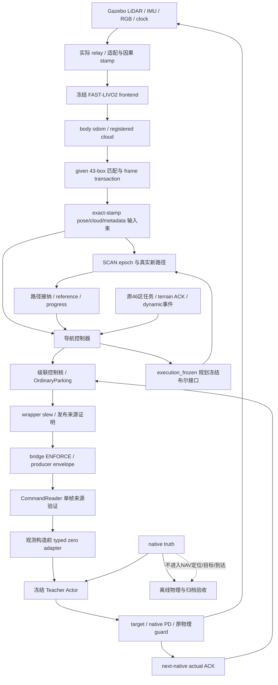
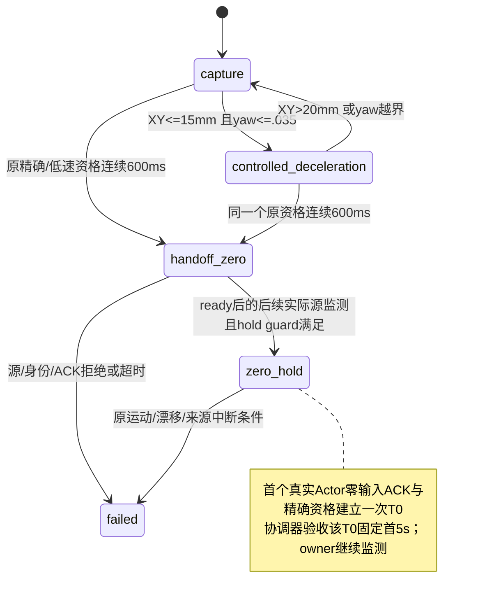

# R83 模块、数据流与停车所有权

此文绑定 `engineering_v63_r83_parking_hysteresis_candidate` 及实际 R83 完整运行；历史 R44 文档继续作为历史说明，不作为当前运行结构。

## 导航与执行数据流

Actor 使用特权 native 观测；导航位姿、路线、目标、到达及零命令资格使用实际 SLAM/IMU 和因果 ACK。给定地图辅助不能被描述成纯传感器全局定位。

## 模块责任

| 边界 | 主要模块 | 权限/语义 |
|---|---|---|
| 原任务定义及验收 | `mission46*`, `continuous_route.py`, 原 mission/goal_regions | 原40+6顺序、阶段、动态、terrain、RGB及固定窗口谓词 |
| 定位 frame 事务 | `known_scene_*`, `point_provenance.py` | 实际同 stamp 输入、generation/源身份、一致 frame；不从GT推导航 |
| 路径 | `path_admission.py`, `pending_path_commit.py`, `global_route_reference.py` | 有源身份的接纳/进度/heading，不通过静态回放替代真实运行 |
| heading/settle | `transition_gate.py`, `navigation_stop_window.py` | 公共连续300ms `stopped()`保留；新统计门仅 eligible settle；本轮0次使用 |
| 控制数学 | `cascade_core.py`, `spatial_reference.py` | 原反馈、积分/滤波、实际reset和保护；源龄与数学更新边界保留 |
| 末端所有权 | `ordinary_parking.py` | capture / controlled_deceleration / handoff_zero / zero_hold / failed；只决定状态，不自建T0 |
| 执行来源 | `controller.py`, `teacher_wrapper.py`, `bridge.py` | guarded after-slew 命令与同身份source；15类bridge reason code；默认ENFORCE |
| Actor输入 | `executor_command.py`, `parking_zero_contract.py`, `worker.py` | 每帧先撤销旧授权，消费当前producer；request必须已是严格零，typed zero仅确保当前速度命令观测槽为零，不清previous_action/策略action |
| 物理执行 | selected policy worker/observation, `teacher_actuator.cpp` | 冻结Actor/target/native PD与独立latch，不被上层zero替代 |
| 取证与生命周期 | `evidence_runtime_v32`, `ipc_evidence.py`, `compact_archives.py`, `pipeline_lifecycle.py`, shutdown/guardian | 有界记录、CRC/SHA、先排空后信号、唯一owner |
| 身份与资源 | owner `run.py`, prepare/freeze, storage guard | exact依赖/冻结输入、一次运行身份、独占进程组、130GB现存/10GB本轮预算 |

## 末端停车时序

进入/退出减速阈值与捕获资格分离。15/20mm 滞回不替代原25mm/.035rad/<.03m/s/<.06rad/s连续600ms条件，也不要求先进入减速才计时。

本次实际资格来源为 888.625–889.255s，630ms；producer 66010输入时刻889.310s，next-native ACK889.330s，首次资格时刻T0=889.370s。任务协调器晚到889.590s才看见该事件，仍使用原不可变T0；固定验收结束894.370s，不重置为观察时刻。旧到达882.540s的首5s另存且FAIL。

`CommandReader` 的授权是单帧对象：`read/reject`先revoke，`before_observation`在finally再revoke。`stop_requested`仍含零命令含义，但不能据字段名直接推断永久锁存。末端 `zero_hold` 持续监测是有意所有权状态。`execution_frozen`仍是独立规划接口，后续拆分要保持它与控制状态的时序，而不能只改一个hold分支。

## 重构与交付边界

当前实际源码、880项冻结输入及原运行证据继续封存。新分支交付成功源代码、profile、实际依赖源、报告及此文；不携带大日志、模型权重、build/install、socket、真实机器授权或运行latch。公开副本的路径脱敏/出处映射单列，不能继承本机运行授权；使用者需要依赖环境与新prepare/admission。

下一次结构改进先统一RunContext及验收身份，再以显式端口分拆WorkerHooks/Recording。只读审计可并行；代码、准备、仿真和正式验收由唯一集成人串行。固定输入的命令、状态、reset、generation和实际zero/ACK时序逐值一致是重构门槛，完整46及双停车口径是后续仿真门槛。
