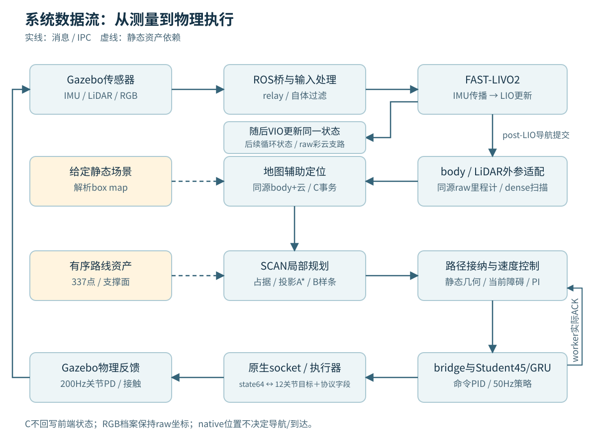
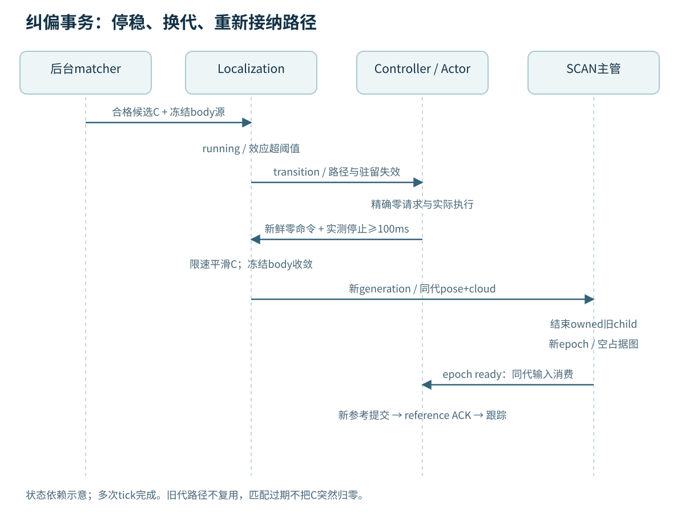

# 源码结构、数据流与阅读路线

当前树已从平铺脚本改为职责模块。公式和上游算法解释见[技术报告](technical_report.zh-CN.md)，完整因果链见[模块数据流](模块数据流.md)，构建与环境见[移植说明](移植构建运行.md)。本页描述源码现状；验证结论以[本轮状态](验证状态.md)为准。

```text
.
├── start.py
├── Dockerfile / build_support/build.py
├── src/
│   ├── bringup/          # main、总launch、prepare、总配置
│   ├── common/           # 配置/路径、活状态、通信、时间
│   ├── localization/     # frontend C++、sensors、匹配/C事务、mapping
│   ├── planning/         # SCAN C++、supervisor、reference、admission
│   ├── control/          # node、tracking、safety、parking、mission、policy
│   ├── simulation/       # 子launch、世界生成、actuator C++
│   └── sdk/              # 五个ROS SDK/消息包
├── assets/               # 原Go2/三层世界、mesh、解析几何与路线
├── models/               # 必要Student JIT与来源通知
├── third_party/fastdds/  # 双端SHM heartbeat生产补丁和fixtures
├── experiments/          # 候选与诊断实现，不作为正常依赖
├── tools/validation/     # 独立组件/动态停走/停车验收
├── tests/                # 安全与停车负例
├── docs/                 # 中文文档
├── build/                # 可重建工作目录，交付源码不包含
├── install/              # 本树新构建产物；无原机器.local查找
└── runs/                 # 本次生成的配置/状态/日志
```

## 入口与边界

`start.py`只转交`bringup.main.main()`。总配置列出每模块settings，加载时拒绝顶层重复键。main生成一个run与统一环境，唯一总launch包含四个子launch；模块内部Python是算法/状态实现，不能用几份launch替代。

仿真Actor先完成真实模型加载和socket listen，ready屏障才启动Gazebo；DDS环境在所有ROS进程初始化前构造。SCAN只由supervisor启动，坐标generation变化时由其结束/重建child。ROS与Actor解释器分开选择。

## 模块连接与纠偏时序

下图先看运行数据如何流动，再看坐标纠偏为何必须停稳、换代并重新接纳路径。数据箭头与静态依赖分开标记，局部滤波状态与导航C变换的所有权也分开。





## 从哪里读到哪里

1. `src/bringup/main.py`、`prepare.py`、`launch/demo.launch.py`：谁拥有进程、如何生成配置，为什么需要真实ready屏障。
2. `src/localization/sensors`和`frontend/fast_livo2_core/src/LIVMapper.cpp`：传感器同步→IMU传播→LIO→导航发布→VIO的顺序。
3. `src/localization/odom_adapter.py`、`known_scene_matcher.py`、`localization_runtime.py`：物理参考点、解析box匹配、C变换与受控纠偏。
4. `src/planning/scan_epoch_supervisor.py`、`scan/plan_manage`、`scan/plan_env`：参考/代次输入怎样进入原生占据图、搜索和B样条。
5. `src/planning/admission`和`reference`：异步静态证明、同源结果和控制owner上的提交，不能把证书当完整导航许可。
6. `src/control/controller.py`、`tracking/cascade_core.py`、`safety`：实际跟踪数学、双走廊guard、IMU/源龄保护及两层slew。
7. `src/control/policy/worker.py`、`student.py`、`native/worker.py`：实际命令读取、obs45/GRU、显式frame finalization与next-request ACK。
8. `src/control/parking`：terminal reference、捕获、零输入资格、固定T0/5秒规则；再读`tools/validation`独立验证。

## 本轮做了哪些职责拆分

- R系列当前实现迁入语义模块，默认诊断实现退出导入链；R97固定FIFO选择与观察类分离。
- 正常clock service不再依赖R99/R107探针_binding，也不按历史rclpy文件hash拒绝启动；保留实际API/AST及回调组语义核验。
- Actor帧处理不再寄生于`json.dumps`：frame finalization显式建立pending ACK；下一native请求到达才提交。计时socket包装和历史日志不再是正常依赖。
- 旧Teacher权重加载、脚本命令表、接受旧实验文件、故障注入和HeaderPID实现归档；正常原生循环只消费显式Student/观测/命令/ACK回调。
- 活状态原子写、动态guard事件身份、真实clear窗口、当前来源包和ACK仍在正常链，未因名字带evidence而删掉。

正式Python文件已没有R编号命名；SCAN上游C++内仍保留两份关闭的诊断/protocol头文件名，不作为版本选择。内部消息schema中的历史编号保留兼容意义，不是文件版本选择或旧run准入；源码整理没有调整原滤波、PID、安全、停车阈值。模块README与实现映射用于阅读，不作为运行批准清单。
