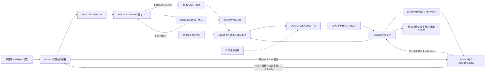

# 模块数据流：从传感器到停车

系统把“估计在哪里”“决定走哪里”“速度如何执行”和“是否真的停住”分给不同owner。总入口只编排生命周期；它不代替算法模块。一次运行的所有生产者共享配置生成的ROS域、Gazebo partition、原生socket与run目录。

实线为消息或执行数据，虚线为静态约束输入。LIO和VIO耦合同一状态；post-LIO导航输出不等本轮VIO完成。全局匹配更新导航变换，不回写前端状态。Actor原生姿态/关节/COM反馈和导航SLAM位姿的用途必须分清；机器人真值位置不负责导航到达。

## 1. 每条边传什么

| 生产者 | 内容、坐标/单位 | 消费者与触发 |
| --- | --- | --- |
| Gazebo/ros_gz_bridge | IMU200Hz、LiDAR30Hz、RGB30Hz是配置名义值；消息带仿真源戳 | relay、过滤器和FAST-LIVO2；按实际消息到达同步，不将配置率称实测率 |
| FAST-LIVO2 | IMU传播状态、扫描去畸变、LIO/VIO更新；raw camera_init | post-LIO里程计/完整扫描进入外参适配和同源连接；post-VIO彩云独立存档 |
| odom adapter | 机体原点/LiDAR位姿，米、四元数，含COM/安装参考差异 | localization运行器按同源键合并 |
| 场景匹配 | 静态box表面约束下匹配与质量指标，组成C变换、generation | 纠偏事务与停车/停止状态交互；导航坐标更新后SCAN换代 |
| localization运行器 | `/demo/slam/body_odom`、`/cloud_registered_full`及`/demo/navigation/localization_bundle` | controller和SCAN监督器；必须同源、同generation、fresh |
| Mission/全局参考 | 单目标、337点有序路线的当前后缀、epoch与参考提交 | SCAN局部搜索与控制准入，不是全部扫描都叫“点云地图” |
| SCAN | 局部占据/膨胀图、搜索种子、优化后的B样条及planner epoch | admission绑定控制点/knots/参考代次，异步静态证书完成后由控制owner提交 |
| 导航controller | 机体系vx/vy(m/s)、yaw rate(rad/s)及真实pose/IMU/guard来源 | bridge在50Hz墙钟调度上检查实际源戳dt和新鲜度；不是将墙钟周期当传感器dt |
| bridge | 当前命令文件与来源包、ordinary-zero事件 | Actor每个20ms策略帧读取，过期/因果不合格走原零命令保护 |
| Student | 命令修正PID→45维观测→GRU256→12动作，0.25缩放加默认关节角 | 原生200Hz物理PD/每4步一次50Hz策略socket；响应16个float64 |
| 下一native请求 | 证明上一响应确已完成，带更晚原生clock | `receive`提交上帧pending ACK；不能send前提前确认 |
| 终端parking owner | 几何资格、实际obs command精确零、因果ACK与固定T0 | 10Hz/51格因果pose及5秒状态覆盖；XY≤5cm、yaw≤0.1rad，高频速度仅诊断 |

这些频率是当前配置/时序合同，不能作为新包性能测量。新构建实测结果单列[验证状态](验证状态.md)。

## 2. 地图不是同一种对象

- `assets/world/*.sdf`、Go2 URDF/mesh描述物理碰撞和外观；prepare按当前配置生成本run世界。
- `assets/geometry`是已知场景解析box、坐标变换、路线及静态支撑配置；匹配器/几何证书使用它们。
- FAST-LIVO2在raw里程计系维护多层voxel平面/视觉点patch，不做全局闭环因子图优化。
- 同源导航点云是按C变换得到的实时观测；SCAN消费它更新局部占据/膨胀体素图。动态点不能与静态全局box资产混为一谈。
- SCAN的B样条和337点有序参考是轨迹/路线结构，不是地图点云。原生高度raycast只服务Actor/物理安全，不成为导航真值地图。

## 3. 进程、线程与有界队列

总main拥有一个ROS总launch；四个模块子launch各定义内部进程。simulation拥有Actor、sensor bridge、Gazebo与一次ready屏障；planning只拥有supervisor，原生SCAN child由该supervisor管理换代。定位与控制节点可以先启动等待传感器，不可等定位ready才启动Gazebo形成循环。

控制器的prepared-feedback邮箱与因果IMU缓冲保留原有边界；几何准入使用2MiB FIFO和single-flight独立解释器worker，由原控制group提交ready结果。时钟服务每次至多取一个原clock回调；executor保留原positive-yield与空重试协作行为。没有把线程并行写成估计器完全独立。

原`R99/R107`诊断_binding读取已从正常clock service解除，R97业务容量选择与观察类已分离。诊断源在`experiments/`，正常端口不导入实验实现；源码hash只在下载/构建和完整性记录出现，不成为历史启动批准。

## 4. 运动与停止的因果链

新路径必须通过同源/代次/连续几何和新鲜度检查才能交给速度控制。障碍与倾斜保护可以在原回调立即输出零命令；clear窗口必须来自实际新观测。目标捕获依SLAM/IMU和固定终端引用；Student继续闭环站立，零速度命令不等于零动作。

停车T0由第一次实际零输入ACK与几何资格固定，不能失败后滑动重试窗口。独立测试工具只移动moving_obstacle并观察真实运动/停车；正常入口不会读取旧PASS。退出时总main先向自己拥有的launch进程发送一次SIGINT，由launch转交组件；必要时才升级到该owned进程组，各组件退出码独立记录。
